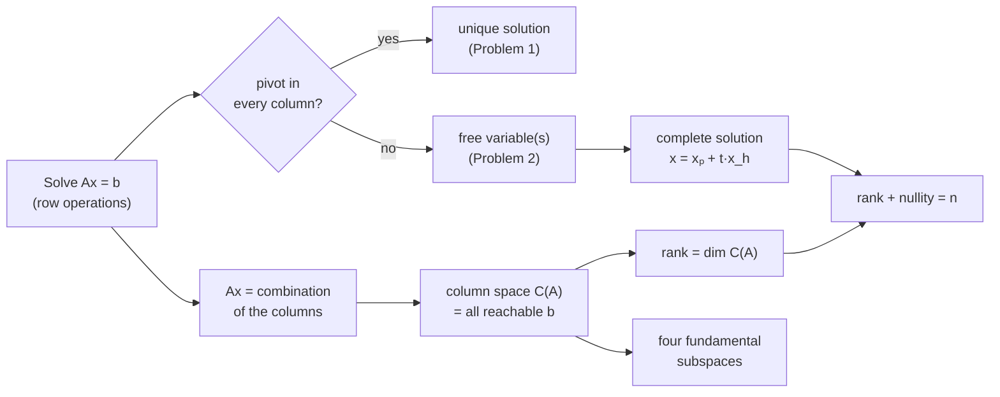
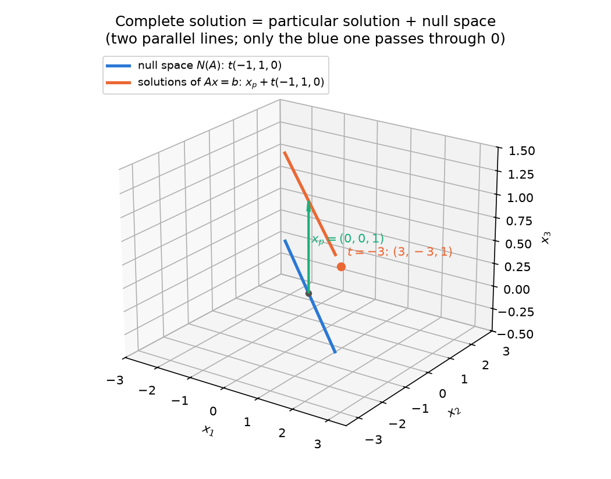
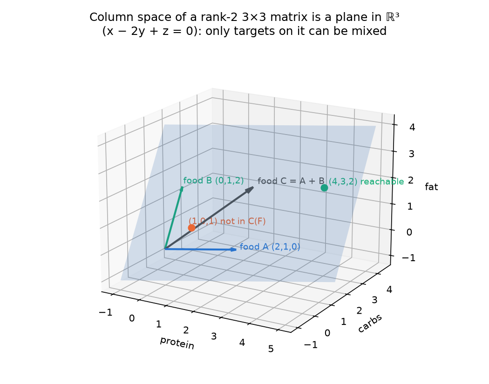

# 06 · Problem-Solving Session: Free Variables, Column Space & Rank

> **Course:** Applied Mathematics for Data Science & AI · Dr. Arulalan Rajan
>
> **Lectures:** 5 October 2026 (problem-solving class, 8:00–9:30 pm) and the first half of 7 October 2026
>
> **Sources:** handwritten notes pp. 56–69 (`Lecture notes till 10th October.pdf`)
>
> **Notebook:** [`code/06_column_space_deep_dive.ipynb`](code/06_column_space_deep_dive.ipynb), Parts A–J: every row operation, solution, rank, span membership test, case study and practice answer of this note, in exact (sympy) arithmetic. Figures: [`code/figures_06.py`](code/figures_06.py)
>
> **Builds on:** [Note 04](04-Span-Independence-Basis-Dimension.md) (span, independence, basis) and [Note 05](05-Null-Space-and-Nullity.md) (null space, rank–nullity proof, complete solution, four subspaces). This note **does not repeat** those proofs; it links to them and concentrates on the problems solved in class, the column-space proof, and exam practice.
>
> **Next:** the second half of 7 Oct (linear transformations) is in [Note 07](07-Linear-Transformations.md); 10 Oct (dot product, projections) in [Note 08](08-Dot-Product-Projections-Least-Squares.md).

---

## 📌 Table of Contents

1. [Big Picture](#1-big-picture)
2. [Problem 1: A 3×3 System with a Unique Solution](#2-problem-1-a-33-system-with-a-unique-solution-)
3. [Problem 2: Two Equations, Three Unknowns, a Free Variable](#3-problem-2-two-equations-three-unknowns-a-free-variable-)
4. [The Complete Solution: Particular + Homogeneous](#4-the-complete-solution-particular--homogeneous-)
5. [Pivots, Free Variables and the Rank–Nullity Count](#5-pivots-free-variables-and-the-ranknullity-count-)
6. [Ax = b Is a Linear Combination of the Columns](#6-ax--b-is-a-linear-combination-of-the-columns-)
7. [The Column Space Is a Vector Space (Proof)](#7-the-column-space-is-a-vector-space-proof-)
8. [Rank = dim C(A) = Number of Independent Columns](#8-rank--dim-ca--number-of-independent-columns-)
9. [Linear Independence (7 Oct recap)](#9-linear-independence-7-oct-recap-)
10. [Span = the Smallest Vector Space Containing the Vectors](#10-span--the-smallest-vector-space-containing-the-vectors-)
11. [The Four Fundamental Subspaces (as introduced)](#11-the-four-fundamental-subspaces-as-introduced-)
12. [Reading Assignment & Textbooks](#12-reading-assignment--textbooks-)
13. [More Worked Exam Problems](#13-more-worked-exam-problems-)
14. [Real-World Case Studies](#14--real-world-case-studies)
15. [Code Walkthrough](#15--code-walkthrough)
16. [Professor Emphasised](#16--professor-emphasised)
17. [Common Confusions](#17--common-confusions)
18. [Practice Problems](#18--practice-problems)
19. [Cheat Sheet](#19--cheat-sheet)
20. [Go Deeper](#20--go-deeper-curated-links)

---

## 1. Big Picture

The problem-solving class took **one matrix and changed the question around it** until every idea of the last three weeks appeared:



Two questions drive everything:

| Question | Answered by | Where |
|---|---|---|
| **Is there a solution?** (existence) | Is $`b`$ in the column space $`C(A)`$? | §6–§8 |
| **How many solutions?** (uniqueness) | Is the null space $`N(A)`$ just $`\{\mathbf{0}\}`$? | §3–§5 and Note 05 |

The **rank** sits in the middle: it is the number of pivots, the dimension of the column space, and (through rank–nullity) it fixes the dimension of the null space.

---

## 2. Problem 1: A 3×3 System with a Unique Solution 🟢

**Board (pp. 56–57).** Solve for $`x_1, x_2, x_3`$:

```math
\begin{aligned}
x_1 + x_2 + x_3 &= 1\\
x_1 + x_2 - x_3 &= -1\\
x_1 - x_2 + x_3 &= -1
\end{aligned}
\qquad\Longleftrightarrow\qquad
\begin{bmatrix}1&1&1\\1&1&-1\\1&-1&1\end{bmatrix}
\begin{bmatrix}x_1\\x_2\\x_3\end{bmatrix}
=\begin{bmatrix}1\\-1\\-1\end{bmatrix}
```

**Step 1: write the augmented matrix** $`[A \mid b]`$ (the coefficients and the right-hand side side by side; every row operation acts on both).

```math
[A\mid b]=\left[\begin{array}{ccc|c}1&1&1&1\\1&1&-1&-1\\1&-1&1&-1\end{array}\right]
```

**Step 2: clear column 1 below the pivot.**

```math
R_2 \leftarrow R_2 - R_1:\ \left[\begin{array}{ccc|c}1&1&1&1\\0&0&-2&-2\\1&-1&1&-1\end{array}\right]
\qquad
R_3 \leftarrow R_3 - R_1:\ \left[\begin{array}{ccc|c}1&1&1&1\\0&0&-2&-2\\0&-2&0&-2\end{array}\right]
```

**Step 3: a zero has appeared in the pivot position (row 2, column 2).** Swap rows so the next pivot is non-zero:

```math
R_2 \leftrightarrow R_3:\ \left[\begin{array}{ccc|c}1&1&1&1\\0&-2&0&-2\\0&0&-2&-2\end{array}\right]
```

This is **row echelon form**: three pivots ($`1, -2, -2`$), one per column.

**Step 4: back-substitute** from the bottom row up:

| Row | Equation | Result |
|---|---|---|
| 3 | $`-2x_3 = -2`$ | $`x_3 = 1`$ |
| 2 | $`-2x_2 = -2`$ | $`x_2 = 1`$ |
| 1 | $`x_1 + 1 + 1 = 1`$ | $`x_1 = -1`$ |

```math
\boxed{x = (-1,\ 1,\ 1)}
```

**Check** (always do this in an exam; it takes ten seconds): $`-1+1+1 = 1`$ ✓, $`-1+1-1 = -1`$ ✓, $`-1-1+1 = -1`$ ✓.

**Why unique?** Every column has a pivot, so there is **no free variable**: rank 3 = number of unknowns. Equivalently $`\det A = -4 \neq 0`$ (notebook Part A).

### The homogeneous version (p. 58)

*"Solve the same with RHS = 0."* The row operations are identical (the right-hand column stays 0 throughout), so back-substitution gives $`x_3 = x_2 = x_1 = 0`$:

```math
Ax = \mathbf{0} \ \Rightarrow\ x = (0, 0, 0)\qquad N(A) = \{\mathbf{0}\},\ \ \text{nullity } 0.
```

> 💡 **Exam shortcut.** Once you know $`Ax = b`$ has a **unique** solution for one $`b`$, you know $`N(A) = \{\mathbf{0}\}`$ (Note 05 §10: solutions $`= x_p + N(A)`$, so a single solution means the null space has a single vector). No second elimination is needed.

---

## 3. Problem 2: Two Equations, Three Unknowns, a Free Variable 🟢

**Board (pp. 58–59), Ex 2.** Solve

```math
\begin{aligned}
x_1 + x_2 + x_3 &= 1\\
x_1 + x_2 - x_3 &= -1
\end{aligned}
\qquad
[A\mid b]=\left[\begin{array}{ccc|c}1&1&1&1\\1&1&-1&-1\end{array}\right]
\xrightarrow{R_2 \leftarrow R_2 - R_1}
\left[\begin{array}{ccc|c}1&1&1&1\\0&0&-2&-2\end{array}\right]
```

Read the rows back as equations:

- Row 2: $`-2x_3 = -2 \Rightarrow x_3 = 1`$.
- Row 1: $`x_1 + x_2 + 1 = 1 \Rightarrow x_1 + x_2 = 0 \Rightarrow x_1 = -x_2`$.

Two equations cannot pin down three unknowns: **one unknown is left free**.

### Pivots and free variables (definitions from the board)

> **Pivot:** the first non-zero entry of a non-zero row in the echelon form. Its column is a **pivot column**, and its variable a **pivot (basic) variable**.
>
> **Free variable:** *"The variable associated with the column in REF/RREF of A which has no pivot is called a free variable."* (p. 58)

Here the pivots are in columns 1 and 3, so **column 2 has no pivot** and $`x_2`$ is free: *"$`x_2`$ can take any real value. So we parameterise $`x_2`$ as $`x_2 = t,\ t\in\mathbb{R}`$"* (p. 59).

```math
\begin{bmatrix}x_1\\x_2\\x_3\end{bmatrix}=\begin{bmatrix}-t\\t\\1\end{bmatrix}
= t\begin{bmatrix}-1\\1\\0\end{bmatrix}+\begin{bmatrix}0\\0\\1\end{bmatrix},\qquad t\in\mathbb{R}.
```

Infinitely many solutions, all on one **line** in $`\mathbb{R}^3`$.

### Could $`x_1`$ be the free variable instead?

Yes, the equation $`x_1 + x_2 = 0`$ is symmetric. Setting $`x_1 = s`$ gives $`(s, -s, 1)`$, and $`s = -t`$ turns it into $`(-t, t, 1)`$: **the same set of solutions, described with a different parameter** (notebook Part B). The convention "free = non-pivot column" exists so that everyone writes the same description; any choice is correct as long as the final set is the same.

> ⚠️ What is **not** allowed: making $`x_3`$ free. Row 2 forces $`x_3 = 1`$; it is a pivot variable.

---

## 4. The Complete Solution: Particular + Homogeneous 🟢→🟡

### The homogeneous version first (p. 59)

*"In the above example, take RHS = (0, 0)."* The same row operation gives $`x_3 = 0`$ and $`x_1 = -x_2`$:

```math
Ax = \mathbf{0}:\quad x = \begin{bmatrix}-t\\t\\0\end{bmatrix}=t\begin{bmatrix}-1\\1\\0\end{bmatrix}
\qquad\Rightarrow\qquad N(A)=\operatorname{span}\{(-1,1,0)\}.
```

### Put the two side by side (p. 60)

```math
\underbrace{\begin{bmatrix}x_1\\x_2\\x_3\end{bmatrix}}_{\text{all solutions of }Ax=b}
=\underbrace{\begin{bmatrix}0\\0\\1\end{bmatrix}}_{x_p:\ \text{one particular solution}}
+\;t\underbrace{\begin{bmatrix}-1\\1\\0\end{bmatrix}}_{x_h:\ \text{solves }Ax=0}
```

- $`x_p = (0,0,1)`$ is **one** solution of $`Ax = b`$ (the one with $`t = 0`$). Check: $`A x_p = (1, -1)`$ ✓.
- $`x_h = (-1,1,0)`$ spans the **null space**: $`A x_h = (0,0)`$ ✓.
- Adding any multiple of $`x_h`$ to $`x_p`$ changes nothing on the right: $`A(x_p + t x_h) = b + t\cdot\mathbf{0} = b`$.

**Professor's check with $`t = -3`$:**

```math
x=\begin{bmatrix}0\\0\\1\end{bmatrix}-3\begin{bmatrix}-1\\1\\0\end{bmatrix}=\begin{bmatrix}3\\-3\\1\end{bmatrix},
\qquad
\begin{bmatrix}1&1&1\\1&1&-1\end{bmatrix}\begin{bmatrix}3\\-3\\1\end{bmatrix}=\begin{bmatrix}1\\-1\end{bmatrix}\ ✓
```



*The solution set (orange) is the null-space line (blue) **shifted** by $`x_p`$. It does not pass through the origin, so it is not a subspace; the null space is.*

### 🔗 The differential-equations analogy (professor, p. 60)

*"Similar to particular integral + complementary function in differential equations."*

| Linear ODE $`y'' + y = 1`$ | Linear system $`Ax = b`$ |
|---|---|
| Complementary function: solves $`y'' + y = 0`$ → $`c_1\cos x + c_2\sin x`$ | Homogeneous solution: solves $`Ax = 0`$ → $`t\,x_h`$ |
| Particular integral: any one solution → $`y_p = 1`$ | Particular solution: any one solution → $`x_p`$ |
| General solution $`= y_p + \text{CF}`$ | Complete solution $`= x_p + N(A)`$ |

It is the **same theorem**, because both $`y \mapsto y'' + y`$ and $`x \mapsto Ax`$ are **linear** (Note 07). Linearity is exactly what makes "one solution + everything that maps to zero" describe all solutions. The full proof is in [Note 05 §10](05-Null-Space-and-Nullity.md#10-the-complete-solution-of-ax--b-).

### Three outcomes, one recipe

| After elimination you see… | Meaning | Solutions |
|---|---|---|
| a row $`[0\ 0\ \cdots\ 0 \mid c]`$ with $`c \neq 0`$ | $`0 = c`$, a contradiction; $`b \notin C(A)`$ | **none** |
| a pivot in every column (and no contradiction) | no free variables | **exactly one** |
| some column without a pivot (and no contradiction) | free variables | **infinitely many**: $`x_p + N(A)`$ |

There is never "exactly two" solutions: if $`x`$ and $`y`$ both solve $`Ax = b`$, so does every point on the line through them.

---

## 5. Pivots, Free Variables and the Rank–Nullity Count 🟢

**Board (p. 61):**

```math
A=\begin{bmatrix}1&1&1\\1&1&-1\end{bmatrix}\ \xrightarrow{\text{REF}}\ \begin{bmatrix}\boxed{1}&1&1\\0&0&\boxed{-2}\end{bmatrix}
```

> **Rank** = number of pivots in the RREF of $`A`$ = number of pivot variables = number of pivot columns $`= 2`$.

*Note:* the board shows the REF but says RREF. The **count** is the same in both (row operations that finish the RREF don't create or destroy pivots); the RREF itself is $`\begin{bmatrix}1&1&0\\0&0&1\end{bmatrix}`$ (notebook Part C).

Every column either has a pivot or does not, so

```math
\underbrace{\#\text{pivot variables}}_{\text{rank}}+\underbrace{\#\text{free variables}}_{\text{nullity}}=\#\text{columns of }A
\qquad\Longrightarrow\qquad
\boxed{\ \operatorname{rank}(A)+\operatorname{nullity}(A)=n\ }
```

This is the **Rank–Nullity Theorem** (boxed on the board). For the board matrix: $`2 + 1 = 3`$ ✓. The counting argument above is the intuition; the full proof (why the free-variable vectors really are a basis of $`N(A)`$) is in [Note 05 §7](05-Null-Space-and-Nullity.md#7-ranknullity-theorem-and-its-proof-).

### Quick table: what rank tells you about Ax = b (A is m × n, rank r)

| Case | Example shape | Free variables | Every $`b`$ reachable? | Solutions when one exists |
|---|---|---|---|---|
| $`r = m = n`$ | square, invertible (Problem 1) | 0 | yes | exactly 1 |
| $`r = m < n`$ | wide, full row rank (Problem 2) | $`n - m`$ | yes | infinitely many |
| $`r = n < m`$ | tall, full column rank | 0 | no | exactly 1 |
| $`r < m,\ r < n`$ | rank-deficient | $`n - r`$ | no | infinitely many |

> 💡 *Every $`b`$ reachable* ⇔ $`C(A) = \mathbb{R}^m`$ ⇔ $`r = m`$ (a pivot in every **row**). *Unique* ⇔ $`N(A) = \{\mathbf 0\}`$ ⇔ $`r = n`$ (a pivot in every **column**). Rows control existence, columns control uniqueness.

---

## 6. Ax = b Is a Linear Combination of the Columns 🟢

**Board (p. 62):**

```math
\begin{bmatrix}1&1&1\\1&1&-1\end{bmatrix}\begin{bmatrix}x_1\\x_2\\x_3\end{bmatrix}=\begin{bmatrix}b_1\\b_2\end{bmatrix}
\quad\Longleftrightarrow\quad
x_1\begin{bmatrix}1\\1\end{bmatrix}+x_2\begin{bmatrix}1\\1\end{bmatrix}+x_3\begin{bmatrix}1\\-1\end{bmatrix}=\begin{bmatrix}b_1\\b_2\end{bmatrix}
```

The unknowns are the **weights** of a linear combination of the columns. So

> **$`Ax = b`$ has a solution ⇔ $`b`$ is a linear combination of the columns of $`A`$.**

**The redundancy shows up immediately.** Columns 1 and 2 are equal, so they merge (p. 62):

```math
\underbrace{(x_1 + x_2)}_{c_1}\begin{bmatrix}1\\1\end{bmatrix}+x_3\begin{bmatrix}1\\-1\end{bmatrix}=\begin{bmatrix}b_1\\b_2\end{bmatrix}
```

Only the **sum** $`c_1 = x_1 + x_2`$ matters for $`b`$; how it is split between $`x_1`$ and $`x_2`$ is invisible. That invisible split is exactly the null-space direction $`(-1, 1, 0)`$ of §4: add 1 to $`x_2`$, subtract 1 from $`x_1`$, and $`b`$ doesn't change.

**Board question:** *"Set of all possible linear combinations of the columns of $`A`$: is this set a vector space?"* §7 answers yes.

---

## 7. The Column Space Is a Vector Space (Proof) 🟡

**Set-up (p. 63).** Let $`A`$ be a real $`m\times n`$ matrix. *"Every column of A is an m-component vector, and there are n such columns."* Write the columns as $`\vec A_1, \dots, \vec A_n \in \mathbb{R}^m`$ and define

```math
R_A=\{\,x_1\vec A_1+x_2\vec A_2+\cdots+x_n\vec A_n\ :\ x_1,\dots,x_n\in\mathbb{R}\,\}=\{\,A\vec x : \vec x\in\mathbb{R}^n\,\}\ \subseteq\ \mathbb{R}^m .
```

Where the vectors live (the board's side note):

| Object | Lives in | Subspace |
|---|---|---|
| $`\vec x`$ (input) | $`\mathbb{R}^n`$ | Null space $`N(A)`$ is a subspace of $`\mathbb{R}^n`$ |
| $`\vec b = A\vec x`$ (output) | $`\mathbb{R}^m`$ | $`R_A`$ is a subspace of $`\mathbb{R}^m`$ (proved now) |

**Theorem.** $`R_A`$ is a vector space (a subspace of $`\mathbb{R}^m`$).

**Proof (pp. 64–65), using the subspace test from Note 03.**

1. **Closed under vector addition.** Take $`\vec u, \vec v \in R_A`$:
   ```math
   \vec u = x_1\vec A_1+\cdots+x_n\vec A_n,\qquad \vec v = y_1\vec A_1+\cdots+y_n\vec A_n
   ```
   ```math
   \vec u+\vec v=(x_1+y_1)\vec A_1+\cdots+(x_n+y_n)\vec A_n = z_1\vec A_1+\cdots+z_n\vec A_n
   ```
   with $`z_i = x_i + y_i\in\mathbb{R}`$. Again a combination of the columns, so $`\vec u+\vec v\in R_A`$.
2. **Closed under scalar multiplication.** For $`k\in\mathbb{R}`$:
   ```math
   k\vec u = k(x_1\vec A_1+\cdots+x_n\vec A_n)=(kx_1)\vec A_1+\cdots+(kx_n)\vec A_n=\alpha_1\vec A_1+\cdots+\alpha_n\vec A_n
   ```
   with $`\alpha_i = kx_i`$. So $`k\vec u\in R_A`$.
3. **Contains the zero vector.** Take all weights 0: $`0\vec A_1+\cdots+0\vec A_n=\vec 0\in\mathbb{R}^m`$.

Therefore $`R_A`$ is a vector space. ∎

**Matrix-form version (same proof in one line):** $`A\vec x + A\vec y = A(\vec x+\vec y)`$, $`k(A\vec x) = A(k\vec x)`$, $`\vec 0 = A\vec 0`$. Every step uses only the **linearity** of matrix multiplication (notebook Part D checks it numerically on a random 4×3 matrix).

### Names for the same set

> $`R_A`$ = **column space** $`C(A)`$ = **range of A** = *"the set of all $`\vec b\in\mathbb{R}^m`$ which can be expressed as $`A\vec x`$"* = *"the set of all destinations we reach by taking linear combinations of the columns of A."* (p. 65)

**Range vs codomain (the board's margin note).** For a function $`y = f(x)`$, the inputs form the **domain** and the outputs actually produced form the **range**. Example on the board: $`f(x) = x^3`$ with $`x`$ ranging over the non-negative integers produces $`\{0, 1, 8, 27, \dots\}`$, not every number. The same holds for matrices: $`A`$ maps into $`\mathbb{R}^m`$ (the **codomain**), but only the vectors in $`C(A)`$ are actually hit. When $`C(A)\neq\mathbb{R}^m`$, some $`b`$ are unreachable and $`Ax = b`$ has no solution.

> 💡 **Existence test.** $`Ax = b`$ is solvable ⇔ $`b\in C(A)`$ ⇔ $`\operatorname{rank}[A\mid b]=\operatorname{rank}A`$ (appending $`b`$ adds no new direction).

---

## 8. Rank = dim C(A) = Number of Independent Columns 🟢

**Board (p. 65), boxed:** *"The dimension of the column space of A is called the rank."* And: *"Rank of A = number of linearly independent columns of A."*

```math
\operatorname{rank}(A)=\dim C(A)=\#\text{pivots}=\#\text{independent columns}.
```

**Board example (p. 66).** For $`A=\begin{bmatrix}1&1&1\\1&1&-1\end{bmatrix}`$:

```math
C(A)=\left\{\alpha_1\begin{bmatrix}1\\1\end{bmatrix}+\alpha_2\begin{bmatrix}1\\-1\end{bmatrix}\right\}=\mathbb{R}^2,
\qquad \operatorname{rank}A=\dim C(A)=\dim\mathbb{R}^2=2.
```

Why $`\mathbb{R}^2`$: the two columns $`(1,1)`$ and $`(1,-1)`$ are independent ($`\det\begin{bmatrix}1&1\\1&-1\end{bmatrix} = -2\neq0`$), and two independent vectors in $`\mathbb{R}^2`$ span it (Note 04 §3–§4). The duplicate column adds nothing.

### Which columns form a basis of C(A)?

The **pivot columns of the original A** (columns 1 and 3 here). The full argument, and the warning not to use the columns of the RREF itself, are in [Note 04 §9](04-Span-Independence-Basis-Dimension.md#9-building-a-basis-prune-and-extend-).

### Worked example 8.1: a 3×3 matrix of rank 2 🟡

```math
A=\begin{bmatrix}1&2&3\\4&5&6\\7&8&9\end{bmatrix}\ \xrightarrow{\text{RREF}}\ \begin{bmatrix}1&0&-1\\0&1&2\\0&0&0\end{bmatrix}
```

- Pivots in columns 1, 2 → rank 2 → $`C(A)`$ is a **plane** in $`\mathbb{R}^3`$, basis $`\{(1,4,7),(2,5,8)\}`$.
- RREF column 3 reads $`(-1, 2)`$: $`\text{col}_3 = -\text{col}_1 + 2\,\text{col}_2`$. Check: $`-(1,4,7)+2(2,5,8)=(3,6,9)`$ ✓.
- Nullity $`= 3 - 2 = 1`$, $`N(A)=\operatorname{span}\{(1,-2,1)\}`$: that vector is the recipe $`\text{col}_1 - 2\,\text{col}_2 + \text{col}_3 = \mathbf 0`$.
- Row rank = column rank = 2 (notebook Part E). This equality holds for **every** matrix (Note 05 §11).

---

## 9. Linear Independence (7 Oct recap) 🟢

**Board (p. 67, 7 Oct):**

> A set of vectors $`v_1, v_2, \dots, v_k\in\mathbb{R}^n`$ is **linearly independent** if the only way to generate the zero vector $`\mathbf 0^{n\times1}`$ as a linear combination of $`v_1,\dots,v_k`$ is by making all the scalars zero:
>
> ```math
> c_1\vec v_1+c_2\vec v_2+\cdots+c_k\vec v_k=\vec 0\ \Rightarrow\ c_1=c_2=\cdots=c_k=0.
> ```

**Link to this session.** Put the vectors as the columns of a matrix $`V`$. Then $`c_1\vec v_1+\cdots+c_k\vec v_k = V\vec c`$, and

```math
\text{columns independent}\iff V\vec c=\vec 0 \text{ only for } \vec c=\vec 0\iff N(V)=\{\vec 0\}\iff\operatorname{rank}V=k.
```

So "independent?" is the homogeneous problem of §2 in disguise: **row-reduce and look for a pivot in every column.** Equivalent forms, the determinant test and worked examples are in [Note 04 §6](04-Span-Independence-Basis-Dimension.md#6-linear-independence-).

---

## 10. Span = the Smallest Vector Space Containing the Vectors 🟢→🟡

**Board question (p. 67):** *"What is the smallest vector space that contains $`\{v_1, \dots, v_k\}`$?"*

**Board answer (pp. 68–69):** *"The smallest VS that contains these $`v_1, \dots, v_k`$ vectors is the set of all possible linear combinations of $`v_1, \dots, v_k`$."* That set is called the **span**:

```math
\operatorname{span}\{v_1,\dots,v_k\}=\{c_1v_1+\cdots+c_kv_k:\ c_i\in\mathbb{R}\}.
```

> **Span:** the smallest vector space that contains a given set of vectors $`v_1, \dots, v_k`$.

### Why "smallest"? (proof) 🟡

Two facts:

1. **The span is a vector space** that contains each $`v_i`$ (take $`c_i = 1`$, the others 0). The proof is §7's proof word for word, since the span of the columns of $`A`$ is $`C(A)`$ (also [Note 04 §5](04-Span-Independence-Basis-Dimension.md#5-span-is-always-a-subspace-)).
2. **Any** vector space $`W`$ containing $`v_1,\dots,v_k`$ must contain every linear combination of them: $`W`$ is closed under scalar multiplication (so each $`c_iv_i\in W`$) and under addition (so their sum is in $`W`$). Hence $`\operatorname{span}\{v_1,\dots,v_k\}\subseteq W`$.

So the span is inside every vector space that contains the vectors, and is itself one of them: it is the **smallest**. ∎

So **the column space is the span of the columns**: $`C(A)=\operatorname{span}\{\vec A_1,\dots,\vec A_n\}`$.

### Board examples (p. 68)

| Vectors | Span | Geometry |
|---|---|---|
| $`\vec u=(1,2)`$ | $`\{c(1,2):c\in\mathbb{R}\}`$ | the line $`y = 2x`$ through the origin in $`\mathbb{R}^2`$ |
| $`\vec u=(1,0,0),\ \vec v=(0,1,0)`$ | $`\{c_1(1,0,0)+c_2(0,1,0)\}=\{(c_1,c_2,0)\}`$ | the $`x_1x_2`$-plane inside $`\mathbb{R}^3`$ |

The board notes that $`S=\{(1,2)\}`$ is a linearly independent set: a single **non-zero** vector is always independent.

### Finishing the board's ℝ⁴ example (p. 67) 🟡

The board posed $`v_1=(1,0,0,0)`$, $`v_2=(0,1,0,0)`$, $`v_3=(0,1,1,1)`$ and drew a brace under them; the answer was not written. Here it is:

```math
c_1v_1+c_2v_2+c_3v_3=(c_1,\ c_2+c_3,\ c_3,\ c_3).
```

- The vectors are independent (rank 3, notebook Part F), so the span is a **3-dimensional subspace of $`\mathbb{R}^4`$**.
- Every vector in it has **third component = fourth component**. Conversely any $`(a, b, c, c)`$ is reached with $`c_1 = a,\ c_3 = c,\ c_2 = b - c`$. So
```math
\operatorname{span}\{v_1,v_2,v_3\}=\{(x_1,x_2,x_3,x_4)\in\mathbb{R}^4:\ x_3=x_4\}.
```
- Membership test: $`(5,7,2,2)`$ is in it; $`(0,0,1,0)`$ is not.

---

## 11. The Four Fundamental Subspaces (as introduced) 🟡

**Board (p. 69).** For $`A\in\mathbb{R}^{m\times n}`$ there are four subspaces, **two from $`A`$ and two from $`A^\top`$**:

| From | Subspace | Lives in | For the board matrix $`\begin{bmatrix}1&1&1\\1&1&-1\end{bmatrix}`$ |
|---|---|---|---|
| $`A`$ | Null space $`N(A)`$ | $`\mathbb{R}^n`$ | $`\operatorname{span}\{(-1,1,0)\}`$, dim 1 |
| $`A`$ | Column space $`C(A)`$ | $`\mathbb{R}^m`$ | $`\mathbb{R}^2`$, dim 2 |
| $`A^\top`$ | Null space $`N(A^\top)`$ (left null space) | $`\mathbb{R}^m`$ | $`\{\mathbf 0\}`$, dim 0 |
| $`A^\top`$ | Column space $`C(A^\top)`$ = **row space of A** | $`\mathbb{R}^n`$ | $`\operatorname{span}\{(1,1,1),(1,1,-1)\}`$, dim 2 |

Dimension check: $`\dim C(A^\top)+\dim N(A) = 2 + 1 = 3 = n`$ and $`\dim C(A)+\dim N(A^\top) = 2 + 0 = 2 = m`$. Both rows of $`A`$ are perpendicular to the null-space vector $`(-1,1,0)`$ (dot products 0, notebook Part G), which previews the orthogonality picture of Note 08.

The full treatment (dimensions, orthogonality, the existence test via $`N(A^\top)`$, Strang's picture) is in [Note 05 §11](05-Null-Space-and-Nullity.md#11-the-four-fundamental-subspaces-). This was also part 3 of the reading assignment.

---

## 12. Reading Assignment & Textbooks 🟢

**Assigned on 5/7 Oct (p. 66):**

1. Linear combination, linear independence, vector space, basis → Notes [03](03-Vector-Spaces-and-Subspaces.md), [04](04-Span-Independence-Basis-Dimension.md)
2. Span → [Note 04](04-Span-Independence-Basis-Dimension.md) and §10 above
3. The four fundamental subspaces of $`A_{m\times n}`$ → [Note 05 §11](05-Null-Space-and-Nullity.md#11-the-four-fundamental-subspaces-) and §11 above

**Books named in class:**

| Book | Author | Best for |
|---|---|---|
| *Introduction to Linear Algebra*, 5th ed. | Gilbert Strang | the four subspaces, column picture, intuition (Ch. 1–3) |
| *Linear Algebra and Its Applications* | David C. Lay | careful definitions, many worked examples (Ch. 1, 2, 4) |
| *Linear Algebra: Pure & Applied* | Edgar G. Goodaire | proofs and applications side by side |

---

## 13. More Worked Exam Problems 🟡

### Worked example 13.1: a parameter that decides everything

For which $`k`$ does the system have **no**, **one**, or **infinitely many** solutions?

```math
\begin{aligned}x+y+z&=1\\x+2y+3z&=2\\x+3y+kz&=3\end{aligned}
```

Eliminate ($`R_2 - R_1`$, $`R_3 - R_1`$, then $`R_3 - 2R_2`$):

```math
\left[\begin{array}{ccc|c}1&1&1&1\\0&1&2&1\\0&0&k-5&0\end{array}\right]
```

- **$`k\neq5`$:** three pivots → unique: $`z = 0`$, $`y = 1`$, $`x = 0`$, i.e. $`(0, 1, 0)`$.
- **$`k = 5`$:** last row is $`0 = 0`$; $`z`$ is free → $`(x,y,z)=(0,1,0)+t(1,-2,1)`$, infinitely many.
- **Never "no solution"** for this right-hand side: $`b = (1,2,3)`$ **is** column 2 of $`A`$, so it always lies in $`C(A)`$ (reached by $`x = (0,1,0)`$) whatever $`k`$ is.

**Change the right-hand side to $`(1, 2, 4)`$:** the last row becomes $`[0\ 0\ k-5 \mid 1]`$.

- $`k = 5`$: $`0 = 1`$ → **no solution** ($`b\notin C(A)`$ because the column space has shrunk to a plane).
- $`k\neq5`$: $`z = \frac{1}{k-5}`$, $`y = 1 - 2z`$, $`x = z`$. E.g. $`k = 7`$ gives $`(\tfrac12, 0, \tfrac12)`$; $`k = 6`$ gives $`(1, -1, 1)`$.

> **Pattern:** a parameter that kills a pivot drops the rank. Then the answer depends on $`b`$: on the shrunken column space → infinitely many; off it → none.

### Worked example 13.2: the condition on b 🟡

For $`A=\begin{bmatrix}1&1&1\\1&1&-1\\2&2&0\end{bmatrix}`$ (row 3 = row 1 + row 2), find all $`b`$ for which $`Ax = b`$ is solvable.

Carry $`b`$ symbolically through elimination:

```math
\left[\begin{array}{ccc|c}1&1&1&b_1\\1&1&-1&b_2\\2&2&0&b_3\end{array}\right]
\longrightarrow
\left[\begin{array}{ccc|c}1&1&1&b_1\\0&0&-2&b_2-b_1\\0&0&0&b_3-b_1-b_2\end{array}\right]
```

Solvable ⇔ $`b_3 - b_1 - b_2 = 0`$, i.e. $`C(A)`$ is the **plane $`b_3 = b_1 + b_2`$** in $`\mathbb{R}^3`$. The coefficients $`(-1,-1,1)`$ form a basis of the left null space $`N(A^\top)`$ (notebook Part H): a solvable $`b`$ must be perpendicular to it. Example: $`b=(1,2,3)`$ works and gives $`x=(\tfrac32 - t,\ t,\ -\tfrac12)`$; $`b = (1,2,4)`$ doesn't.

---

## 14. 🏭 Real-World Case Studies

### 14.1 Diet planning: which nutrient targets can be mixed?

Each food is a **column** of nutrients per unit (protein, carbs, fat):

```math
F=\begin{bmatrix}2&0&2\\1&1&2\\0&2&2\end{bmatrix}\qquad(\text{food A, food B, food C})
```

Buying amounts $`x`$ gives nutrients $`Fx`$: a linear combination of the columns. The **reachable targets are exactly $`C(F)`$**.

- Food C = food A + food B, so rank $`F = 2`$: the reachable targets form the **plane $`x - 2y + z = 0`$** (normal vector from $`N(F^\top)`$, notebook Part I).
- Target $`(4,3,2)`$: $`4 - 6 + 2 = 0`$ ✓ reachable, e.g. 2 units of A + 1 unit of B.
- Target $`(1,0,1)`$: $`1 - 0 + 1 = 2 \ne 0`$ ✗ unreachable, **no matter how much food you buy**. Adding food C cannot help: it adds no new direction.
- Food C makes the solution **non-unique** (null space $`\neq\{0\}`$): the same nutrients can come from different shopping baskets, so a planner can then optimise cost.



*(Real diet problems also require $`x\ge0`$; the reachable set is then a cone inside the column space. That is linear programming, a later topic.)*

### 14.2 Regression: predictions live in C(X)

A linear model predicts $`\hat y = Xw`$, so every possible prediction vector lies in $`C(X)`$. With features *intercept*, *x* and *x + 1* on four data points:

```math
X=\begin{bmatrix}1&1&2\\1&2&3\\1&3&4\\1&4&5\end{bmatrix},\qquad \operatorname{rank}X=2\ (\text{col}_3=\text{col}_1+\text{col}_2).
```

- $`y=(3,5,7,9)`$ lies in $`C(X)`$ → an exact fit exists (in fact infinitely many weight vectors, because of the redundant feature).
- $`y=(1,0,0,0)`$ is **not** in $`C(X)`$ → no exact fit. Least squares returns the closest point of $`C(X)`$, $`\hat y=(0.7,0.4,0.1,-0.2)`$, with residual norm 0.5477. Finding that closest point is a **projection** onto the column space: the topic of [Note 08](08-Dot-Product-Projections-Least-Squares.md).

### 14.3 Displays and colour

A display with red $`(1,0,0)`$ and green $`(0,1,0)`$ primaries only has a 2-dimensional column space: it can show no colour with a blue component, e.g. $`(0.2,0.4,0.9)`$ is out of reach. Three independent primaries give rank 3, so every direction in $`\mathbb{R}^3`$ is reachable in principle (the physical gamut is the non-negative part).

---

## 15. 💻 Code Walkthrough

All numbers come from [`code/06_column_space_deep_dive.ipynb`](code/06_column_space_deep_dive.ipynb) (executed); figures from [`code/figures_06.py`](code/figures_06.py).

| Part | What it does | Key output |
|---|---|---|
| A | Problem 1 row operations step by step; solution; homogeneous case | $`x=(-1,1,1)`$, $`\det A = -4`$, $`N(A)=\{0\}`$ |
| B | Problem 2: complete solution, $`t = -3`$ check, $`x_1`$ as the free variable | $`x=(0,0,1)+t(-1,1,0)`$; $`t=-3\to(3,-3,1)`$ |
| C | REF vs RREF, rank–nullity, the p. 55 matrix | RREF $`[[1,1,0],[0,0,1]]`$, $`2+1=3`$ |
| D | $`Ax`$ as a column combination; membership; closure checks | all `True` |
| E | Rank = dim C(A); the 3×3 rank-2 example | $`\text{col}_3=2\text{col}_2-\text{col}_1`$ |
| F | Span examples incl. the ℝ⁴ board example | span = $`\{x_3 = x_4\}`$ |
| G | Four subspaces of the board matrix | dims 1, 2, 0, 2 |
| H | Parameter $`k`$; symbolic consistency condition | $`k=5`$ is critical; $`b_3=b_1+b_2`$ |
| I | Case studies | plane $`x-2y+z=0`$; residual 0.5477 |
| J | Practice problem checks | |

```python
import sympy as sp

A = sp.Matrix([[1, 1, 1], [1, 1, -1]]); b = sp.Matrix([1, -1])
print(A.rref())                      # (Matrix([[1, 1, 0], [0, 0, 1]]), (0, 2))  -> pivots in columns 1 and 3
print(A.gauss_jordan_solve(b))       # (-tau0, tau0, 1): the complete solution
print(A.rank() == A.row_join(b).rank())   # True: b is in C(A), so Ax = b is solvable
```

---

## 16. 🎓 Professor Emphasised

1. **Use the augmented matrix** $`[A\mid b]`$ and row operations; swap rows when a pivot position becomes 0.
2. A column **without a pivot** in REF/RREF gives a **free variable**; parametrise it as $`t\in\mathbb{R}`$.
3. **Complete solution = particular + $`t\times`$ homogeneous**, like *particular integral + complementary function* for differential equations.
4. **Rank = number of pivots** (pivot variables, pivot columns). **Rank + nullity = number of columns** (boxed: *Rank–Nullity Theorem*).
5. $`Ax = b`$ is a **linear combination of the columns** of $`A`$.
6. The set of all such combinations, $`R_A`$, is a **vector space**: the **column space** or **range** of $`A`$, a subspace of $`\mathbb{R}^m`$. The null space is a subspace of $`\mathbb{R}^n`$.
7. *"The dimension of the column space is called the rank"* = number of linearly independent columns.
8. **Span** = all linear combinations = the **smallest vector space** containing the vectors.
9. **Four fundamental subspaces:** two for $`A`$ ($`N(A)\subseteq\mathbb{R}^n`$, $`C(A)\subseteq\mathbb{R}^m`$), two for $`A^\top`$ ($`N(A^\top)\subseteq\mathbb{R}^m`$, $`C(A^\top)`$ = row space $`\subseteq\mathbb{R}^n`$).
10. **Reading assignment:** LC, LI, VS, basis; span; four fundamental subspaces (Strang 5th ed., Lay, Goodaire).

---

## 17. ⚠️ Common Confusions

| Confusion | Clarification |
|---|---|
| "Two equations, three unknowns → no solution" | Usually **infinitely many**; "no solution" needs a contradiction row $`0 = c\neq0`$ |
| The free variable must be $`x_3`$ (the last one) | It is the variable of a **non-pivot column**; here $`x_2`$. Other choices describe the same set |
| The solution set of $`Ax = b`$ is a subspace | Only for $`b = 0`$. Otherwise it is $`x_p + N(A)`$, a shifted copy (§4 figure) |
| $`x_p`$ is "the" particular solution | Any single solution works; different $`x_p`$ give the same set |
| Rank counts non-zero **entries** | Rank counts **pivots** (= independent columns = independent rows) |
| REF and RREF can have different ranks | Same pivot positions, same count; RREF just normalises them to 1 and clears above |
| Column space lives in $`\mathbb{R}^n`$ | $`C(A)\subseteq\mathbb{R}^m`$ (columns have $`m`$ entries); $`N(A)\subseteq\mathbb{R}^n`$ |
| Rank–nullity uses the number of rows | It uses $`n`$, the number of **columns** (unknowns) |
| Range = codomain | Range (column space) is what is **actually reached**; it can be smaller than $`\mathbb{R}^m`$ |
| More columns ⇒ bigger column space | Only **independent** columns add dimension (food C in §14.1 adds nothing) |
| Span of $`k`$ vectors has dimension $`k`$ | Dimension = number of **independent** vectors among them ≤ $`k`$ |
| Basis of $`C(A)`$ = pivot columns of the RREF | Use pivot columns of the **original** $`A`$ (row operations change $`C(A)`$) |
| "Smallest vector space" means fewest vectors | It means **contained in every other** vector space that holds the given vectors |

---

## 18. 📝 Practice Problems

Difficulty: 🟢 basic · 🟡 exam-standard · 🔴 challenging / beyond syllabus. Every answer is checked in notebook Part J (or the part named).

<details>
<summary><b>P1.</b> 🟢 Solve x + y + z = 6, x − y + z = 2, x + y − z = 0 with row operations.</summary>

```math
\left[\begin{array}{ccc|c}1&1&1&6\\1&-1&1&2\\1&1&-1&0\end{array}\right]
\xrightarrow{R_2-R_1,\ R_3-R_1}
\left[\begin{array}{ccc|c}1&1&1&6\\0&-2&0&-4\\0&0&-2&-6\end{array}\right]
```

$`z = 3`$, $`y = 2`$, $`x = 6 - 2 - 3 = 1`$. **$`(1, 2, 3)`$**, unique (three pivots). Check: $`1+2+3=6`$, $`1-2+3=2`$, $`1+2-3=0`$ ✓.

</details>

<details>
<summary><b>P2.</b> 🟢 Solve the same system with right-hand side 0. What is the null space?</summary>

Same pivots, so only $`x = 0`$. $`N(A)=\{\mathbf 0\}`$, nullity 0, rank 3. (RREF = $`I_3`$.)

</details>

<details>
<summary><b>P3.</b> 🟢 Find the complete solution of x₁ + 2x₂ − x₃ = 3, 2x₁ + 4x₂ + x₃ = 9.</summary>

$`R_2 - 2R_1`$: $`3x_3 = 3\Rightarrow x_3 = 1`$. Row 1: $`x_1 = 3 + 1 - 2x_2 = 4 - 2x_2`$. Column 2 has no pivot, so $`x_2 = t`$:

```math
x=\begin{bmatrix}4\\0\\1\end{bmatrix}+t\begin{bmatrix}-2\\1\\0\end{bmatrix}
```

$`x_p = (4,0,1)`$, $`N(A)=\operatorname{span}\{(-2,1,0)\}`$.

</details>

<details>
<summary><b>P4.</b> 🟢 For the RREF with rows (1, 3, 0, 2) and (0, 0, 1, −1), name the pivot and free variables, the rank, the nullity and a null-space basis.</summary>

Pivots in columns 1, 3 ($`x_1, x_3`$); free $`x_2, x_4`$. Rank 2, nullity 2. Special solutions: $`x_2 = 1, x_4 = 0`$ → $`(-3,1,0,0)`$; $`x_2 = 0, x_4 = 1`$ → $`(-2,0,1,1)`$.

</details>

<details>
<summary><b>P5.</b> 🟢 A is 5 × 8 with rank 5. Nullity? Is Ax = b solvable for every b ∈ ℝ⁵?</summary>

Nullity $`= 8 - 5 = 3`$. Rank = $`m`$ = 5, so $`C(A)=\mathbb{R}^5`$: **yes**, always solvable, with infinitely many solutions (3 free variables).

</details>

<details>
<summary><b>P6.</b> 🟡 A is 6 × 4 with rank 4. How many solutions can Ax = b have?</summary>

Nullity $`= 4 - 4 = 0`$, so **at most one**. $`C(A)`$ is a 4-dimensional subspace of $`\mathbb{R}^6`$, so for most $`b`$ there is **none**. Possible counts: 0 or 1.

</details>

<details>
<summary><b>P7.</b> 🟢 Describe C(A) for A with rows (1, 2), (2, 4). Is (3, 6) in it? (5, 1)?</summary>

Both columns are multiples of $`(1,2)`$: $`C(A)`$ is the line $`b_2 = 2b_1`$. $`(3,6)`$: yes (e.g. $`x = (3,0)`$; complete solution $`(3-2t,\ t)`$). $`(5,1)`$: no, $`1\neq10`$.

</details>

<details>
<summary><b>P8.</b> 🟡 For A with rows (1, 1, 1), (1, 1, −1), (2, 2, 0), solve Ax = (1, 2, 3) and Ax = (1, 2, 4).</summary>

Condition (Worked example 13.2): $`b_3 = b_1 + b_2`$.

- $`(1,2,3)`$: $`3 = 1 + 2`$ ✓. $`-2x_3 = 1 \Rightarrow x_3 = -\tfrac12`$; $`x_1 + x_2 = \tfrac32`$ → $`x=(\tfrac32 - t,\ t,\ -\tfrac12)`$.
- $`(1,2,4)`$: $`4\neq3`$ → **no solution**.

</details>

<details>
<summary><b>P9.</b> 🟡 Prove, in matrix notation, that C(A) is closed under addition and scalar multiplication.</summary>

If $`u = Ax`$, $`v = Ay`$ then $`u + v = A(x + y)\in C(A)`$ and $`ku = A(kx)\in C(A)`$; also $`\mathbf 0 = A\mathbf 0\in C(A)`$. Only the distributive law and $`A(kx) = k(Ax)`$ are used.

</details>

<details>
<summary><b>P10.</b> 🟡 Is {Ax : every entry of x is ≥ 0} a subspace?</summary>

**No** in general. Take $`A = I_2`$: the set is the first quadrant. $`(1,0)`$ is in it, but $`-1\cdot(1,0)`$ is not: not closed under scalar multiplication. (It is a **cone**; see the diet note in §14.1.)

</details>

<details>
<summary><b>P11.</b> 🟡 Is {x : Ax = b} a subspace when b ≠ 0? Prove your answer.</summary>

No: $`A\mathbf 0 = \mathbf 0\neq b`$, so $`\mathbf 0`$ is not in the set. Also, if $`Ax = Ay = b`$ then $`A(x + y) = 2b\neq b`$.

</details>

<details>
<summary><b>P12.</b> 🟢 Are (1, 2, 3), (2, 4, 6), (0, 1, 1) independent? What do they span?</summary>

No: $`(2,4,6) = 2(1,2,3)`$. As columns, the RREF has pivots in columns 1 and 3 → rank 2; null space $`\operatorname{span}\{(-2,1,0)\}`$ is the dependency $`-2v_1 + v_2 = 0`$. They span a **plane** in $`\mathbb{R}^3`$ (basis $`\{(1,2,3),(0,1,1)\}`$).

</details>

<details>
<summary><b>P13.</b> 🟡 Find the equation of span{(1, 0, 1), (0, 1, 1)} in ℝ³. Are (2, 3, 5) and (1, 1, 1) in it?</summary>

$`c_1(1,0,1) + c_2(0,1,1) = (c_1, c_2, c_1 + c_2)`$, so the span is the plane **$`x_3 = x_1 + x_2`$**. $`(2,3,5)`$: $`5 = 2 + 3`$ ✓. $`(1,1,1)`$: $`1\neq2`$ ✗.

</details>

<details>
<summary><b>P14.</b> 🟢 What is the smallest vector space containing (1, 2) and (2, 4)? Containing (1, 2) and (3, 1)?</summary>

First: the line $`\operatorname{span}\{(1,2)\}`$ (rank 1). Second: all of $`\mathbb{R}^2`$ (rank 2; $`\det = 1 - 6 = -5\neq0`$).

</details>

<details>
<summary><b>P15.</b> 🟡 For A with rows (1,2,3), (4,5,6), (7,8,9): rank, basis of C(A), nullity, null space.</summary>

RREF rows $`(1,0,-1), (0,1,2), (0,0,0)`$ → rank 2; basis of $`C(A)`$: $`\{(1,4,7),(2,5,8)\}`$; nullity 1; $`N(A)=\operatorname{span}\{(1,-2,1)\}`$ (Worked example 8.1).

</details>

<details>
<summary><b>P16.</b> 🟡 Same A as P15. Solve Ax = (6, 15, 24). Is Ax = (1, 1, 2) solvable?</summary>

$`(6,15,24) = 3\times\text{col}_2`$, so $`x_p = (0,3,0)`$ and $`x = (0,3,0)+t(1,-2,1)`$.

For $`(1,1,2)`$: the left null space is $`\operatorname{span}\{(1,-2,1)\}`$, so solvable ⇔ $`b_1 - 2b_2 + b_3 = 0`$. Here $`1 - 2 + 2 = 1\neq0`$: **no solution**.

</details>

<details>
<summary><b>P17.</b> 🟡 Worked example 13.1 with k = 5: give two different solutions and verify one.</summary>

$`x = (t, 1 - 2t, t)`$: $`t = 0`$ gives $`(0,1,0)`$, $`t = 1`$ gives $`(1,-1,1)`$. Check $`(1,-1,1)`$: $`1-1+1=1`$, $`1-2+3=2`$, $`1-3+5=3`$ ✓.

</details>

<details>
<summary><b>P18.</b> 🟡 Worked example 13.1 with RHS (1, 2, 4): solve for k = 6, and explain k = 5.</summary>

$`k = 6`$: $`z = 1/(6-5) = 1`$, $`y = 1 - 2 = -1`$, $`x = 1`$ → $`(1,-1,1)`$. $`k = 5`$: last row $`0 = 1`$, no solution: $`C(A)`$ has collapsed to a plane that doesn't contain $`(1,2,4)`$.

</details>

<details>
<summary><b>P19.</b> 🟡 Solve y'' + y = 1 and label the particular integral and the complementary function. What is the "nullity" of the operator?</summary>

$`y = 1 + c_1\cos x + c_2\sin x`$ (sympy `dsolve`). Particular integral $`y_p = 1`$; complementary function $`c_1\cos x + c_2\sin x`$ solves $`y'' + y = 0`$. The homogeneous solution space has dimension **2**, the analogue of nullity 2.

</details>

<details>
<summary><b>P20.</b> 🟢 True or false: if Ax = b has two different solutions, it has infinitely many.</summary>

**True.** If $`Ax = Ay = b`$ with $`x\neq y`$, then $`z = x - y\neq0`$ is in $`N(A)`$, and $`x + tz`$ is a solution for every real $`t`$.

</details>

<details>
<summary><b>P21.</b> 🟡 Build a 3 × 3 matrix whose column space is the plane x + y + z = 0.</summary>

Pick two independent vectors on the plane, e.g. $`(1,-1,0)`$ and $`(0,1,-1)`$, and a third that is their sum, $`(1,0,-1)`$:

```math
A=\begin{bmatrix}1&0&1\\-1&1&0\\0&-1&-1\end{bmatrix},\quad \operatorname{rank}A = 2,
```

and every column sums to 0, so each column lies on the plane.

</details>

<details>
<summary><b>P22.</b> 🔴 Prove: if W is a subspace containing v₁, …, v_k, then span{v₁, …, v_k} ⊆ W.</summary>

Take $`w = c_1v_1+\cdots+c_kv_k`$. Each $`c_iv_i\in W`$ (closure under scalar multiplication); adding them one at a time stays in $`W`$ (closure under addition, by induction on $`k`$). So $`w\in W`$. ∎ (This is the "smallest" half of §10.)

</details>

<details>
<summary><b>P23.</b> 🔴 Prove rank(AB) ≤ rank(A).</summary>

Every column of $`AB`$ is $`A\times(\text{a column of }B)`$, so it lies in $`C(A)`$. Hence $`C(AB)\subseteq C(A)`$ and $`\dim C(AB)\le\dim C(A)`$. Example: $`A = \begin{bmatrix}1&2\\3&6\end{bmatrix}`$ (rank 1) times anything has rank ≤ 1.

</details>

<details>
<summary><b>P24.</b> 🔴 Show by example that row operations change the column space but not the null space.</summary>

$`A = \begin{bmatrix}1\\0\end{bmatrix}`$, swap rows → $`EA = \begin{bmatrix}0\\1\end{bmatrix}`$. $`C(A)`$ is the $`x`$-axis, $`C(EA)`$ is the $`y`$-axis: different. $`N(A) = N(EA) = \{0\}`$. In general $`N(EA) = N(A)`$ for invertible $`E`$ (Note 05 §7, step 1). That's why the basis of $`C(A)`$ must use the **original** pivot columns.

</details>

<details>
<summary><b>P25.</b> 🟡 For the regression matrix X in §14.2, what is rank X? Can y = (1, 0, 0, 0) be fitted exactly?</summary>

Rank 2 (column 3 = column 1 + column 2). $`(1,0,0,0)`$ is not in $`C(X)`$ (every vector in $`C(X)`$ has equally spaced entries $`a + bi`$; $`1, 0, 0, 0`$ is not), so no exact fit; least squares gives $`(0.7,0.4,0.1,-0.2)`$.

</details>

<details>
<summary><b>P26.</b> 🟢 How many pivots does the REF with rows (2, 1, 0), (0, 0, 3), (0, 0, 0) have? Which variable is free?</summary>

Two pivots (the 2 and the 3) → rank 2. Column 2 has no pivot → $`x_2`$ free; null space $`\operatorname{span}\{(-\tfrac12, 1, 0)\}`$ (or $`(-1,2,0)`$).

</details>

<details>
<summary><b>P27.</b> 🔴 Fill in "none / exactly one / infinitely many" possibilities for A (m × n, rank r) in each case: r = m = n; r = n < m; r = m < n; r < m and r < n.</summary>

| Case | Possible numbers of solutions |
|---|---|
| $`r=m=n`$ | exactly one, for every $`b`$ |
| $`r=n<m`$ | 0 or 1 |
| $`r=m<n`$ | ∞, for every $`b`$ |
| $`r<m,\ r<n`$ | 0 or ∞ |

(§5 table.)

</details>

<details>
<summary><b>P28.</b> 🟡 For the p. 55 matrix A with rows (1, 1, 2), (1, 0, 3): find C(A), N(A), rank and nullity, and check rank–nullity.</summary>

RREF rows $`(1,0,3),(0,1,-1)`$: pivots in columns 1, 2 → rank 2, so $`C(A)=\mathbb{R}^2`$. $`x_3 = t`$ free: $`N(A)=\operatorname{span}\{(-3,1,1)\}`$ (as on the board), nullity 1. $`2 + 1 = 3`$ ✓.

</details>

---

## 19. 🧾 Cheat Sheet

- **Recipe:** $`[A\mid b]`$ → row-reduce → read pivots → back-substitute; parametrise free variables with $`t, s,\dots`$.
- **Free variable:** variable of a column with **no pivot** in REF/RREF.
- **Outcomes:** contradiction row → none; pivot in every column → one; otherwise → $`x_p + N(A)`$ (∞).
- **Complete solution:** $`x = x_p + t\,x_h`$ (particular + homogeneous), like PI + CF for linear ODEs.
- **Rank** = #pivots = dim C(A) = #independent columns = #independent rows.
- **Rank–nullity:** rank + nullity = $`n`$ (columns).
- $`Ax = x_1\vec A_1+\cdots+x_n\vec A_n`$: solvable ⇔ $`b\in C(A)`$ ⇔ $`\operatorname{rank}[A\mid b]=\operatorname{rank}A`$.
- **Column space / range** $`C(A)=\{Ax\}\subseteq\mathbb{R}^m`$ is a subspace (closure + contains 0). **Null space** $`N(A)\subseteq\mathbb{R}^n`$.
- Existence ⇔ pivot in every **row** ($`r = m`$) for all $`b`$; uniqueness ⇔ pivot in every **column** ($`r = n`$).
- **Independent** ⇔ $`c_1v_1+\cdots+c_kv_k=0`$ forces all $`c_i = 0`$ ⇔ $`N(V)=\{0\}`$.
- **Span** = all linear combinations = **smallest** subspace containing the vectors; $`C(A)`$ = span of the columns.
- **Four subspaces:** $`N(A)\subseteq\mathbb{R}^n`$, $`C(A)\subseteq\mathbb{R}^m`$, $`N(A^\top)\subseteq\mathbb{R}^m`$, $`C(A^\top)`$ = row space $`\subseteq\mathbb{R}^n`$.
- Basis of $`C(A)`$: pivot columns of the **original** $`A`$.

---

## 20. 📚 Go Deeper: Curated Links

| Topic | Why | Link |
|---|---|---|
| Column space, null space visually | Span of columns as "where A can land" | [3Blue1Brown — Inverse matrices, column space and null space](https://www.youtube.com/watch?v=uQhTuRlWMxw) |
| Solving Ax = b completely | Strang: particular + special solutions | [MIT 18.06 — L8: Solving Ax = b: row reduced form R](https://www.youtube.com/watch?v=9Q1q7s1jTzU) |
| Column space and null space | Strang's lecture on exactly §6–§7 | [MIT 18.06 — L6: Column Space and Nullspace](https://www.youtube.com/watch?v=8o5Cmfpeo6g) |
| Free variables, special solutions | Pivot / free columns | [MIT 18.06 — L7: Solving Ax = 0](https://www.youtube.com/watch?v=VqP2tREMvt0) |
| The four subspaces | Reading assignment item 3 | [MIT 18.06 — L10: The Four Fundamental Subspaces](https://www.youtube.com/watch?v=nHlE7EgJFds) |
| Span and independence | Geometric intuition | [3Blue1Brown — Linear combinations, span, and basis vectors](https://www.youtube.com/watch?v=k7RM-ot2NWY) |
| Textbook (Strang) | Ch. 2–3, the course's main reference | [Introduction to Linear Algebra, 5th ed.](https://math.mit.edu/~gs/linearalgebra/ila5/indexila5.html) |
| Textbook (Lay) | §1.2–1.7, 2.8–2.9, 4.2 | [Lay, Lay & McDonald — Linear Algebra and Its Applications](https://www.pearson.com/en-us/subject-catalog/p/linear-algebra-and-its-applications/P200000006235) |
| Instructor's NPTEL course | Same instructor's lectures | [NPTEL — Linear Algebra Through Geometry](https://nptel.ac.in/courses/106108482) |
| sympy linear systems | `rref`, `gauss_jordan_solve`, `columnspace` | [SymPy — Matrices](https://docs.sympy.org/latest/modules/matrices/matrices.html) |
| ML-oriented text | §2.3 solving systems, §2.7 image and kernel | [Mathematics for Machine Learning (free)](https://mml-book.github.io/) |

---
⬅️ [05 · Null Space & Nullity](05-Null-Space-and-Nullity.md) · [Index](README.md) · ➡️ [07 · Linear Transformations](07-Linear-Transformations.md)
