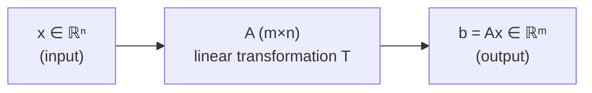
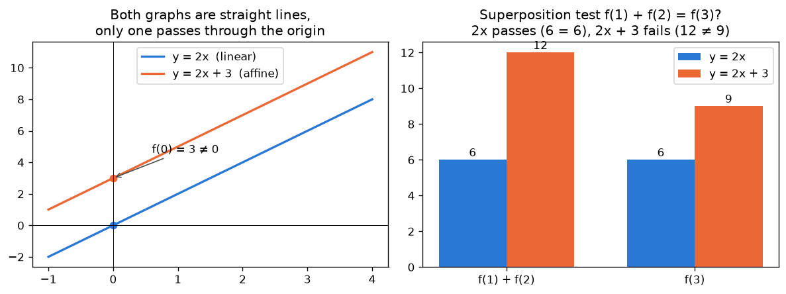
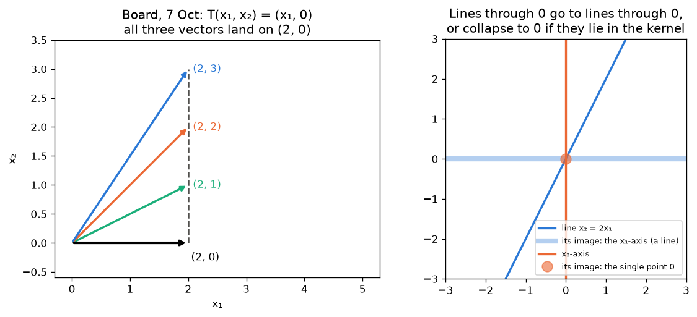
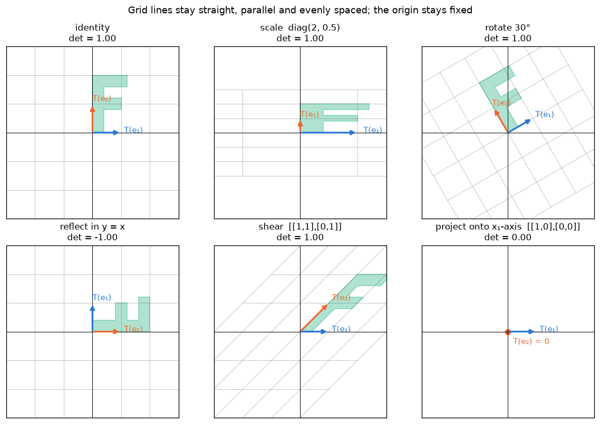
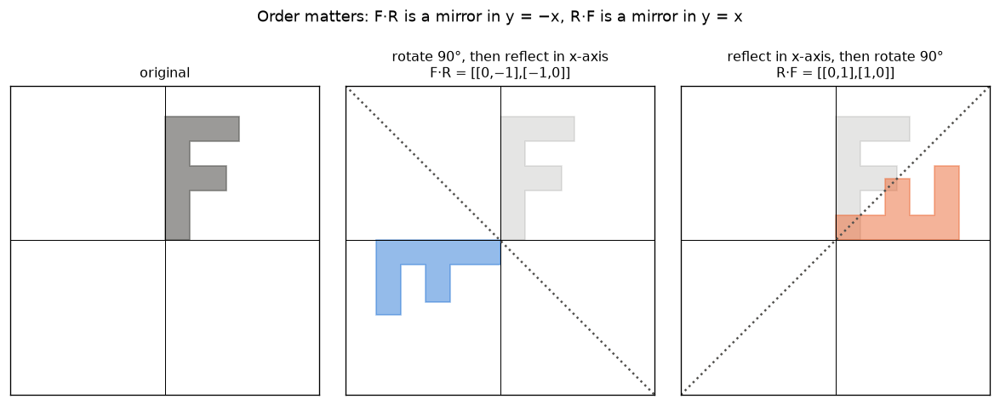

# 07 · Linear Transformations

> **Course:** Applied Mathematics for Data Science & AI · Dr. Arulalan Rajan
>
> **Lectures:** 7 October 2026 (definition, superposition & homogeneity, lines and planes) and the opening of 10 October 2026 (recall, "identify the matrix of T")
>
> **Sources:** handwritten notes pp. 70–75 (`Lecture notes till 10th October.pdf`). No transcript was available for these classes, so "the professor said" below means "written on the board".
>
> **Notebooks:** [`code/07_linear_transformations_deep_dive.ipynb`](code/07_linear_transformations_deep_dive.ipynb), Parts A–K (class example, linearity tests, lines/planes, matrix of a map, 2×2 gallery, composition, kernel & image, homogeneous coordinates, neural layers, maps on polynomials and matrices, practice checks). Figures: [`code/figures_07.py`](code/figures_07.py)
>
> **Level:** 🟢 Basic → 🟡 Intermediate → 🔴 Advanced. Sections 8–14 go beyond the board; they are the standard theory and applications behind it.

---

## 📌 Table of Contents

1. [Big Picture](#1-big-picture)
2. [A Matrix Is a Machine: ℝⁿ → ℝᵐ](#2-a-matrix-is-a-machine-ℝⁿ--ℝᵐ-)
3. [Definition of a Linear Transformation](#3-definition-of-a-linear-transformation-)
4. [Worked Example: Checking Linearity with the Class Matrix](#4-worked-example-checking-linearity-with-the-class-matrix-)
5. [Testing Whether a Map Is Linear](#5-testing-whether-a-map-is-linear-)
6. [What Linear Maps Do to Lines and Planes](#6-what-linear-maps-do-to-lines-and-planes-)
7. [Finding the Matrix of a Transformation](#7-finding-the-matrix-of-a-transformation-)
8. [A Gallery of 2×2 Transformations](#8-a-gallery-of-22-transformations-)
9. [Composition = Matrix Multiplication](#9-composition--matrix-multiplication-)
10. [Kernel & Image, One-to-One & Onto](#10-kernel--image-one-to-one--onto-)
11. [Affine Maps & Homogeneous Coordinates](#11-affine-maps--homogeneous-coordinates-)
12. [Neural-Network Layers](#12-neural-network-layers-)
13. [Linear Maps Beyond ℝⁿ](#13-linear-maps-beyond-ℝⁿ-)
14. [Real-World Case Studies](#14--real-world-case-studies)
15. [Code Walkthrough](#15--code-walkthrough)
16. [Professor Emphasised](#16--professor-emphasised)
17. [Common Confusions](#17-️-common-confusions)
18. [Practice Problems](#18--practice-problems)
19. [Cheat Sheet](#19--cheat-sheet)
20. [Go Deeper](#20--go-deeper-curated-links)

---

## 1. Big Picture

Up to now a matrix has been a **table of numbers** (Note 01), something to **row-reduce** (Note 02), and a list of columns whose combinations form a **column space** (Notes 04–06). This lecture adds the most important viewpoint of all:

> **A matrix is a function.** $`A \in \mathbb{R}^{m\times n}`$ takes an input vector $`x \in \mathbb{R}^n`$ and produces an output vector $`b = Ax \in \mathbb{R}^m`$.

Functions of this kind are special: they respect **addition** and **scaling**. They are called **linear transformations**, and they are exactly the functions that matrices can represent (§7).



Why this viewpoint matters in DS & AI:

| Where | What the linear map does |
|---|---|
| Linear regression | $`\hat y = X\beta`$: a linear map from weights to predictions |
| Neural networks | each layer computes $`Wx + b`$, a linear map plus a shift, then a non-linearity (§12) |
| PCA / projections | project data onto a few directions (Note 08) |
| Computer graphics & image augmentation | rotate, scale, shear, reflect images (§8, §14) |
| Embeddings | a learned matrix maps one-hot words to dense vectors |

The two words written on the board, **superposition** and **homogeneity**, are the whole story: if you know what $`T`$ does to a few vectors, linearity tells you what it does to **every** combination of them.

---

## 2. A Matrix Is a Machine: ℝⁿ → ℝᵐ 🟢

The board example (p.70):

```math
\underbrace{\begin{bmatrix}3&2\\1&5\\-1&1\end{bmatrix}}_{A\ (3\times2)}
\underbrace{\begin{bmatrix}x_1\\x_2\end{bmatrix}}_{\vec x\ \in\ \mathbb{R}^2}
=
\begin{bmatrix}3x_1+2x_2\\x_1+5x_2\\-x_1+x_2\end{bmatrix}\ \in\ \mathbb{R}^3
```

drawn as a box: two numbers go in, three numbers come out.

```
   [x1]          ┌─────────┐          [ 3x1 + 2x2 ]
   [x2]  ─────▶  │    A    │  ─────▶  [  x1 + 5x2 ]
                 └─────────┘          [ -x1 +  x2 ]
  x ∈ ℝ²                               b ∈ ℝ³
```

> **Linear transformation** $`T : \mathbb{R}^n \to \mathbb{R}^m`$: maps an $`\vec x \in \mathbb{R}^n`$ to a $`\vec b \in \mathbb{R}^m`$. With a matrix, $`T(\vec x) = A\vec x = \vec b`$.

**Reading the sizes.** $`A`$ is $`m\times n`$: the number of **columns** $`n`$ is the input dimension, the number of **rows** $`m`$ is the output dimension. A $`3\times2`$ matrix is a map $`\mathbb{R}^2 \to \mathbb{R}^3`$ (it *raises* the dimension); the second board example (p.71) is $`2\times3`$, a map $`\mathbb{R}^3 \to \mathbb{R}^2`$:

```math
\begin{bmatrix}1&1&1\\1&0&2\end{bmatrix}\begin{bmatrix}x_1\\x_2\\x_3\end{bmatrix}
=\begin{bmatrix}x_1+x_2+x_3\\x_1+2x_3\end{bmatrix}
= x_1\begin{bmatrix}1\\1\end{bmatrix}+x_2\begin{bmatrix}1\\0\end{bmatrix}+x_3\begin{bmatrix}1\\2\end{bmatrix}
```

The last form, the **column picture** from Note 04, says: *the output is always a combination of the columns*. So every output of $`T`$ lies in the column space $`C(A)`$ (Note 06); this is the **image** or **range** of $`T`$ (§10).

---

## 3. Definition of a Linear Transformation 🟢

> **Definition (board, p.71).** A transformation $`T : \mathbb{R}^n \to \mathbb{R}^m`$ is called **linear** if
>
> 1. $`T(\vec 0_{\mathbb{R}^n}) = \vec 0_{\mathbb{R}^m}`$,
> 2. **Superposition:** $`T(\vec u + \vec v) = T(\vec u) + T(\vec v)`$ for all $`\vec u, \vec v \in \mathbb{R}^n`$,
> 3. **Homogeneity:** $`T(c\,\vec u) = c\,T(\vec u)`$ for all $`\vec u \in \mathbb{R}^n`$ and $`c \in \mathbb{R}`$.

Conditions 2 and 3 combine into a single test (board, p.72):

```math
\boxed{\,T(\alpha\vec u + \beta\vec v) = \alpha\,T(\vec u) + \beta\,T(\vec v)\qquad \forall\,\alpha,\beta\in\mathbb{R},\ \vec u,\vec v\in\mathbb{R}^n\,}
```

In words: **transforming a combination = combining the transforms**. You may scale-and-add before or after $`T`$; the answer is the same.

### Why every matrix map is linear (proof) 🟢

For $`T(x) = Ax`$, the rules of matrix arithmetic give

```math
A(\alpha u + \beta v) = A(\alpha u) + A(\beta v) = \alpha (Au) + \beta (Av).
```

The first step is distributivity of matrix multiplication over addition, the second is that scalars move through a matrix product. ∎ (The converse, *every* linear map is a matrix map, is §7.)

### Condition (i) is automatic 🟡

Condition (i) is not wrong, but it is implied by homogeneity: put $`c = 0`$ in (iii), $`T(\vec 0) = T(0\cdot\vec u) = 0\cdot T(\vec u) = \vec 0`$. Its real value is as a **quick rejection test**: if $`T(\vec 0) \ne \vec 0`$, the map is not linear and you can stop (§5).

> 🔗 **Same idea as a subspace.** A subspace is closed under addition and scalar multiplication (Note 03). A linear map *preserves* addition and scalar multiplication. That's why linear maps send subspaces to subspaces (§6) and why their kernel and image are subspaces (§10).

**Names from physics and engineering.** "Superposition" is the principle that the response to two inputs together is the sum of the responses (waves, circuits, springs). "Homogeneity" means doubling the input doubles the output. A system with both properties is called a **linear system**; signal processing (filters, convolution) is built on it.

---

## 4. Worked Example: Checking Linearity with the Class Matrix 🟢

Board, p.72. $`A = \begin{bmatrix}3&2\\1&5\\-1&1\end{bmatrix}`$, $`\vec u = (1, 2)`$, $`\vec v = (3, 4)`$.

**Step 1: transform each vector.**

```math
A\vec u = \begin{bmatrix}3+4\\1+10\\-1+2\end{bmatrix} = \begin{bmatrix}7\\11\\1\end{bmatrix},\qquad
A\vec v = \begin{bmatrix}9+8\\3+20\\-3+4\end{bmatrix} = \begin{bmatrix}17\\23\\1\end{bmatrix}
```

**Step 2: superposition.** $`\vec u + \vec v = (4, 6)`$ and

```math
A(\vec u + \vec v) = \begin{bmatrix}12+12\\4+30\\-4+6\end{bmatrix} = \begin{bmatrix}24\\34\\2\end{bmatrix} = \begin{bmatrix}7\\11\\1\end{bmatrix} + \begin{bmatrix}17\\23\\1\end{bmatrix} = A\vec u + A\vec v\ \checkmark
```

**Step 3: a general combination**, $`\alpha = 2`$, $`\beta = 3`$ (the yellow working on the board):

```math
2(A\vec u) + 3(A\vec v) = \begin{bmatrix}14\\22\\2\end{bmatrix} + \begin{bmatrix}51\\69\\3\end{bmatrix} = \begin{bmatrix}65\\91\\5\end{bmatrix}
```

Directly: $`2\vec u + 3\vec v = (11, 16)`$, and $`A(11,16) = (33+32,\ 11+80,\ -11+16) = (65, 91, 5)`$ ✓. So

```math
A(2\vec u + 3\vec v) = 2(A\vec u) + 3(A\vec v).
```

> ⚠️ **On the board** the second vector is labelled $`\vec u = (3,4)`$; it should read $`\vec v`$. The labels "$`2\vec u`$" and "$`3\vec v`$" in the margin refer to the yellow multiples computed afterwards; the purple products are $`A\vec u`$ and $`A\vec v`$ themselves. All the numbers are correct.

**What the example shows.** Once $`A\vec u`$ and $`A\vec v`$ are known, the image of *any* combination $`\alpha\vec u + \beta\vec v`$ costs only scalar arithmetic: $`\alpha(7,11,1) + \beta(17,23,1)`$. Since $`\vec u`$ and $`\vec v`$ are independent, they form a basis of $`\mathbb{R}^2`$ (Note 04), so these two outputs determine $`T`$ completely (§7).

---

## 5. Testing Whether a Map Is Linear 🟡

A practical checklist, cheapest test first:

1. **Zero test.** Compute $`T(\vec 0)`$. Not zero ⇒ **not linear**. (Zero ⇒ no conclusion yet.)
2. **Look at the formula.** Each output component must be a sum of **constant × input variable** terms. Any constant term, product of variables ($`x_1x_2`$), power ($`x_1^2`$), absolute value, $`\sin`$, $`\max`$ … ⇒ almost certainly not linear.
3. **Prove or disprove** $`T(\alpha u + \beta v) = \alpha T(u) + \beta T(v)`$. To disprove, one concrete counterexample is enough.

| Map | $`T(\vec 0)`$ | Linear? | Reason / counterexample |
|---|---|:-:|---|
| $`T(x) = (2x_1 - x_2,\ x_1 + 3x_2)`$ | $`(0,0)`$ | ✅ | it is $`Ax`$ with $`A = \begin{bmatrix}2&-1\\1&3\end{bmatrix}`$ |
| $`T(x) = (x_2,\ x_1,\ x_1 - x_2)`$ | $`(0,0,0)`$ | ✅ | a $`3\times2`$ matrix |
| $`T(x) = (x_1 + 1,\ x_2)`$ | $`(1,0)`$ | ❌ | fails the zero test |
| $`T(x) = (x_1^2,\ x_2)`$ | $`(0,0)`$ | ❌ | $`T(2e_1) = (4,0) \ne 2T(e_1) = (2,0)`$ |
| $`T(x) = (x_1x_2,\ 0)`$ | $`(0,0)`$ | ❌ | $`T(2\cdot(1,1)) = (4,0) \ne 2\cdot(1,0)`$ |
| $`T(x) = (\lvert x_1\rvert,\ x_2)`$ | $`(0,0)`$ | ❌ | $`T(-e_1) = (1,0) \ne -T(e_1) = (-1,0)`$ |

The last three pass the zero test and still fail: **$`T(\vec 0) = \vec 0`$ is necessary, not sufficient**. (Notebook Part B checks all six on 200 random combinations.)

### y = mx is linear; y = mx + c is not (board, p.73) 🟢

The board contrasts $`y = mx`$ with $`y = mx + c,\ c \ne 0`$. Both graphs are straight lines, but only the first is a **linear transformation**. With $`m = 2`$, $`c = 3`$:

| Test | $`f(x) = 2x`$ | $`f(x) = 2x + 3`$ |
|---|---|---|
| $`f(0)`$ | 0 ✓ | 3 ✗ |
| $`f(1) + f(2)`$ vs $`f(3)`$ | 2 + 4 = 6 = 6 ✓ | 5 + 7 = 12 ≠ 9 ✗ |
| $`2f(1)`$ vs $`f(2)`$ | 4 = 4 ✓ | 10 ≠ 7 ✗ |



> 🎯 **"Linear" in linear algebra ≠ "straight-line graph" in school algebra.** A map like $`mx + c`$ is called **affine**: linear plus a constant shift. §11 shows how affine maps are handled with one extra coordinate, which is how graphics engines and neural networks deal with the "$`+c`$".

---

## 6. What Linear Maps Do to Lines and Planes 🟢

Board, p.73: a linear transformation $`T : \mathbb{R}^n \to \mathbb{R}^m`$ maps

- (a) $`\vec 0 \in \mathbb{R}^n`$ to $`\vec 0 \in \mathbb{R}^m`$,
- (b) any **line** through the origin in $`\mathbb{R}^n`$ to a line through the origin in $`\mathbb{R}^m`$,
- (c) any **plane** through the origin in $`\mathbb{R}^n`$ to a plane through the origin in $`\mathbb{R}^m`$.

**Why (b) holds.** A line through the origin is $`\{t\vec d : t \in \mathbb{R}\}`$ for a direction $`\vec d \ne \vec 0`$. By homogeneity, $`T(t\vec d) = t\,T(\vec d)`$, so the image is $`\{t\,T(\vec d)\}`$: the line through the origin with direction $`T(\vec d)`$.

**Why (c) holds.** A plane through the origin is $`\{s\vec a + t\vec b\}`$ with $`\vec a, \vec b`$ independent. By linearity its image is $`\{s\,T(\vec a) + t\,T(\vec b)\}`$ = span$`\{T\vec a, T\vec b\}`$.

### ⚠️ The fine print: lines and planes can collapse 🟡

Both proofs quietly assume $`T(\vec d) \ne \vec 0`$, and that $`T\vec a, T\vec b`$ stay independent. If not, the image is **smaller**:

| Input | Image | When |
|---|---|---|
| line span$`\{\vec d\}`$ | a line | $`T\vec d \ne \vec 0`$ |
| | the single point $`\vec 0`$ | $`\vec d \in \ker T`$ |
| plane span$`\{\vec a,\vec b\}`$ | a plane | $`T\vec a, T\vec b`$ independent |
| | a line, or the point $`\vec 0`$ | they become dependent |

So the precise statement is: *a linear map sends a line (plane) through the origin to a line (plane) through the origin, **or to something of lower dimension**.* What it **never** does is bend it, or move it off the origin. The image of a subspace is always a subspace (§10).

### The board picture: (2, y) → (2, 0)

The sketch on p.73 shows the vectors $`(2,1), (2,2), (2,3)`$ all being sent to $`(2,0)`$: the map $`T(x_1, x_2) = (x_1, 0)`$, the **projection onto the $`x_1`$-axis**. Also written: $`(x, y, z) \to (x, y, 0)`$, the projection of $`\mathbb{R}^3`$ onto the $`xy`$-plane.



- The line $`x_2 = 2x_1`$ (direction $`(1,2)`$) maps to $`t(1,0)`$: the whole $`x_1`$-axis, a line ✓.
- The $`x_2`$-axis (direction $`(0,1)`$) maps to $`t(0,0) = \vec 0`$: a **single point**. This is the collapse case, because $`(0,1)`$ is in the kernel.
- In $`\mathbb{R}^3`$, $`P = \text{diag}(1,1,0)`$ sends the plane span$`\{(1,0,1),(0,1,1)\}`$ to the $`xy`$-plane (rank 2, still a plane), but the $`xz`$-plane span$`\{(0,0,1),(1,0,0)\}`$ only to the $`x`$-axis (rank 1, a line). (Notebook Part C.)

**Many-to-one.** Three different inputs gave the same output $`(2,0)`$. A projection loses information (the $`x_2`$ coordinate), so it cannot be undone: it has no inverse. Note 08 develops projections fully: the matrices $`\begin{bmatrix}1&0\\0&0\end{bmatrix}`$ and $`\begin{bmatrix}0&0\\0&1\end{bmatrix}`$, why $`P^2 = P`$, and projection onto any vector.

---

## 7. Finding the Matrix of a Transformation 🟢

### The board question (10 Oct, pp.74–75)

> **Q:** $`T : \mathbb{R}^2 \to \mathbb{R}^2`$, $`T\!\left(\begin{bmatrix}x_1\\x_2\end{bmatrix}\right) = \begin{bmatrix}x_1\\0\end{bmatrix}`$. Identify the matrix corresponding to $`T`$.

Write each output component as an explicit combination of **all** the inputs, then read off the coefficients:

```math
T\!\left(\begin{bmatrix}x_1\\x_2\end{bmatrix}\right) = \begin{bmatrix}1\cdot x_1 + 0\cdot x_2\\ 0\cdot x_1 + 0\cdot x_2\end{bmatrix}
\quad\Longrightarrow\quad A = \begin{bmatrix}1&0\\0&0\end{bmatrix}
```

Likewise $`T(x_1, x_2) = (0, x_2)`$ has matrix $`\begin{bmatrix}0&0\\0&1\end{bmatrix}`$. (On the board this is written "$`(0, x_2) = \begin{bmatrix}0&0\\0&1\end{bmatrix}`$"; read the "=" as "has matrix", since a vector cannot equal a matrix.)

### The general recipe: columns = images of the basis vectors 🟡

> **Theorem.** If $`T : \mathbb{R}^n \to \mathbb{R}^m`$ is linear, then $`T(\vec x) = A\vec x`$ for the $`m\times n`$ matrix
>
> ```math
> A = \Big[\ T(\vec e_1)\ \ \Big|\ \ T(\vec e_2)\ \ \Big|\ \cdots\ \Big|\ \ T(\vec e_n)\ \Big],
> ```
>
> where $`\vec e_j`$ is the $`j`$-th standard basis vector. This $`A`$ is called the **standard matrix** of $`T`$, and it is unique.

**Proof.** Any $`\vec x = x_1\vec e_1 + \dots + x_n\vec e_n`$. By linearity,

```math
T(\vec x) = x_1T(\vec e_1) + \dots + x_nT(\vec e_n) = \Big[T(\vec e_1)\ \cdots\ T(\vec e_n)\Big]\begin{bmatrix}x_1\\\vdots\\x_n\end{bmatrix} = A\vec x.
```

The middle step is the column picture of a matrix–vector product. Uniqueness: if $`A\vec x = B\vec x`$ for all $`\vec x`$, take $`\vec x = \vec e_j`$ to get column $`j`$ of $`A`$ = column $`j`$ of $`B`$. ∎

> 🎯 **Linear maps ℝⁿ → ℝᵐ and m×n matrices are the same thing.** Every matrix gives a linear map (§3), and every linear map is a matrix (this theorem). "Know what $`T`$ does to the basis, and you know $`T`$ everywhere."

### Worked example 7.1: a map ℝ² → ℝ³ 🟢

$`T(x_1, x_2) = (x_1 + 2x_2,\ 3x_1,\ x_2 - x_1)`$.

- $`T(\vec e_1) = T(1, 0) = (1, 3, -1)`$ → column 1
- $`T(\vec e_2) = T(0, 1) = (2, 0, 1)`$ → column 2

```math
A = \begin{bmatrix}1&2\\3&0\\-1&1\end{bmatrix},\qquad \text{check: } A\begin{bmatrix}2\\5\end{bmatrix} = \begin{bmatrix}12\\6\\3\end{bmatrix} = T(2, 5)\ \checkmark
```

### Worked example 7.2: images of a non-standard basis 🟡

Given $`T(1,1) = (3,1)`$ and $`T(1,-1) = (1,-1)`$, find $`A`$. Write the standard basis in terms of the given vectors: $`\vec e_1 = \tfrac12[(1,1) + (1,-1)]`$, $`\vec e_2 = \tfrac12[(1,1) - (1,-1)]`$. By linearity,

```math
T(\vec e_1) = \tfrac12[(3,1) + (1,-1)] = (2, 0),\qquad T(\vec e_2) = \tfrac12[(3,1) - (1,-1)] = (1, 1)
\ \Rightarrow\ A = \begin{bmatrix}2&1\\0&1\end{bmatrix}.
```

Matrix shortcut: if $`V`$ has the input vectors as columns and $`W`$ their images, then $`AV = W`$, so $`A = WV^{-1}`$ (valid when the input vectors form a basis).

---

## 8. A Gallery of 2×2 Transformations 🟡

Every $`2\times2`$ matrix is a linear map of the plane. The figure shows what six of them do to the grid and to the letter **F** (chosen because it is not symmetric, so flips are visible). The blue and orange arrows are $`T(\vec e_1)`$ and $`T(\vec e_2)`$, the **columns** of the matrix.



| Map | Matrix | $`T(3,1)`$ | det | What it does |
|---|---|---|:-:|---|
| Scaling | $`\begin{bmatrix}2&0\\0&0.5\end{bmatrix}`$ | $`(6,\ 0.5)`$ | 1 | stretch $`x_1`$ by 2, squash $`x_2`$ by ½ |
| Rotation by 90° | $`\begin{bmatrix}0&-1\\1&0\end{bmatrix}`$ | $`(-1,\ 3)`$ | 1 | turn anticlockwise |
| Rotation by θ | $`\begin{bmatrix}\cos\theta&-\sin\theta\\\sin\theta&\cos\theta\end{bmatrix}`$ | θ = 30°: $`(2.0981,\ 2.366)`$ | 1 | keeps lengths and angles |
| Reflection in $`x_1`$-axis | $`\begin{bmatrix}1&0\\0&-1\end{bmatrix}`$ | $`(3,\ -1)`$ | −1 | mirror; flips orientation |
| Reflection in $`y = x`$ | $`\begin{bmatrix}0&1\\1&0\end{bmatrix}`$ | $`(1,\ 3)`$ | −1 | swaps the coordinates |
| Shear | $`\begin{bmatrix}1&1\\0&1\end{bmatrix}`$ | $`(4,\ 1)`$ | 1 | slides rows sideways; areas unchanged |
| Projection onto $`x_1`$-axis | $`\begin{bmatrix}1&0\\0&0\end{bmatrix}`$ | $`(3,\ 0)`$ | 0 | flattens the plane to a line |

**Reading the picture.** In every panel the grid lines stay **straight, parallel and evenly spaced**, and the origin stays put. That is what "linear" looks like. A curved grid or a moved origin would mean a non-linear (or affine) map.

**The determinant is the area factor** (Note 01): the unit square becomes a parallelogram of area $`\lvert\det A\rvert`$, and a negative sign means the orientation is flipped (the F is mirrored). The projection has det 0: the plane is squashed onto a line of zero area, so information is lost and the map is not invertible. For $`A = \begin{bmatrix}2&1\\1&3\end{bmatrix}`$ the unit square becomes a parallelogram of area 5.

> 🔗 Rotations and reflections were treated in Note 01 §9 as **orthogonal matrices** ($`Q^\top Q = I`$): they preserve lengths ($`\lVert(3,1)\rVert = \sqrt{10} = 3.1623`$ before and after the 30° rotation) and are trivially invertible ($`Q^{-1} = Q^\top`$).

---

## 9. Composition = Matrix Multiplication 🟡

Doing $`T_1`$ first and then $`T_2`$ is the composition $`T_2 \circ T_1`$, $`x \mapsto T_2(T_1(x))`$. If $`T_1(x) = Bx`$ and $`T_2(y) = Ay`$, then

```math
T_2(T_1(x)) = A(Bx) = (AB)x.
```

> **Matrix multiplication is defined the way it is precisely so that the product matrix represents "do B, then A".** That is also why the inner sizes must match: $`B`$ outputs vectors in $`\mathbb{R}^k`$ and $`A`$ must accept them, so $`A`$ is $`m\times k`$ and $`B`$ is $`k\times n`$.

**Read right to left.** In $`AB\vec x`$, $`B`$ acts **first**.

### Worked example 9.1: order matters

$`R`$ = rotation by 90°, $`F`$ = reflection in the $`x_1`$-axis.

```math
\underbrace{FR}_{\text{rotate, then reflect}} = \begin{bmatrix}1&0\\0&-1\end{bmatrix}\begin{bmatrix}0&-1\\1&0\end{bmatrix} = \begin{bmatrix}0&-1\\-1&0\end{bmatrix},
\qquad
\underbrace{RF}_{\text{reflect, then rotate}} = \begin{bmatrix}0&1\\1&0\end{bmatrix}
```

$`FR`$ is the mirror in the line $`y = -x`$; $`RF`$ is the mirror in $`y = x`$. On $`\vec x = (2,1)`$: $`F(R\vec x) = (-1,-2)`$ but $`R(F\vec x) = (1, 2)`$. **Matrix multiplication is not commutative** because doing things in a different order gives different results.



Two more facts the notebook confirms (Part F):

- Rotating by 30° three times = rotating by 90°: $`R_{30°}^3 = R_{90°}`$ (angles add, Note 01).
- Projecting twice = projecting once: $`P^2 = P`$ (the defining property of a projection, Note 08).

---

## 10. Kernel & Image, One-to-One & Onto 🟡

Every linear map comes with two subspaces, which are the null space and column space of its matrix under new names:

| Name for maps | Name for matrices | Definition | Lives in | Dimension |
|---|---|---|---|---|
| **kernel** $`\ker T`$ | null space $`N(A)`$ (Note 05) | $`\{x : T(x) = 0\}`$ | input space $`\mathbb{R}^n`$ | nullity $`n - r`$ |
| **image / range** $`\text{im}\,T`$ | column space $`C(A)`$ ([Note 06](06-Problem-Solving-Column-Space-and-Rank.md)) | $`\{T(x) : x \in \mathbb{R}^n\}`$ | output space $`\mathbb{R}^m`$ | rank $`r`$ |

Rank–nullity (Note 05) now reads: **dim(input) = dim(what is lost) + dim(what survives)**, $`n = \dim\ker T + \dim\text{im}\,T`$.

| Property | Meaning | Test | Possible only if |
|---|---|---|---|
| **One-to-one** (injective) | different inputs → different outputs | $`\ker T = \{\vec 0\}`$, i.e. rank $`= n`$ | $`n \le m`$ |
| **Onto** (surjective) | every $`\vec b \in \mathbb{R}^m`$ is reached | $`\text{im}\,T = \mathbb{R}^m`$, i.e. rank $`= m`$ | $`n \ge m`$ |
| **Invertible** (bijective) | both | rank $`= n = m`$, $`\det A \ne 0`$ | square |

**Why one-to-one ⇔ trivial kernel.** If $`T(x) = T(y)`$, then $`T(x - y) = 0`$, so $`x - y \in \ker T`$. With only $`\vec 0`$ in the kernel, $`x = y`$.

### Worked example 10.1: the three board maps 🟡

| Map | Size | Rank | Kernel | One-to-one | Onto |
|---|---|:-:|---|:-:|:-:|
| $`A = \begin{bmatrix}3&2\\1&5\\-1&1\end{bmatrix}`$ | ℝ² → ℝ³ | 2 | $`\{\vec 0\}`$ | ✅ | ❌ |
| $`B = \begin{bmatrix}1&1&1\\1&0&2\end{bmatrix}`$ | ℝ³ → ℝ² | 2 | span$`\{(-2,1,1)\}`$ | ❌ | ✅ |
| $`P = \begin{bmatrix}1&0\\0&0\end{bmatrix}`$ | ℝ² → ℝ² | 1 | span$`\{(0,1)\}`$ ($`x_2`$-axis) | ❌ | ❌ |

- **A:** the image is a **plane** through the origin in ℝ³ (spanned by the two columns), so most $`\vec b \in \mathbb{R}^3`$ are not reachable. The plane's normal is the cross product of the columns, $`(3,1,-1)\times(2,5,1) = (6,-5,13)`$, so $`\vec b`$ is in the image iff $`6b_1 - 5b_2 + 13b_3 = 0`$. $`(7,11,1)`$ passes ($`42 - 55 + 13 = 0`$; it is $`A\vec u`$), $`(1,1,1)`$ fails ($`= 14`$).
- **B:** from $`x_1 + x_2 + x_3 = 0`$ and $`x_1 + 2x_3 = 0`$: $`x_1 = -2x_3`$, $`x_2 = x_3`$, so the kernel is the line through $`(-2, 1, 1)`$. Check: $`-2 + 1 + 1 = 0`$, $`-2 + 2 = 0`$ ✓.
- **P:** the kernel is the $`x_2`$-axis, exactly the line that collapsed to a point in §6.

> 🎯 **Dimension counting.** A map ℝ³ → ℝ² can never be one-to-one (it must lose at least one dimension); a map ℝ² → ℝ³ can never be onto (two directions can't fill three).

---

## 11. Affine Maps & Homogeneous Coordinates 🔴

An **affine map** is a linear map followed by a shift: $`F(\vec x) = A\vec x + \vec c`$. It is not linear when $`\vec c \ne 0`$ ($`F(\vec 0) = \vec c`$), yet it is everywhere in practice: $`y = mx + c`$, translations in graphics, and every neural-network layer $`W\vec x + \vec b`$.

**The trick: add one coordinate equal to 1.** Then the shift becomes part of a bigger matrix:

```math
\begin{bmatrix}A\vec x + \vec c\\1\end{bmatrix} = \begin{bmatrix}A&\vec c\\\vec 0^\top&1\end{bmatrix}\begin{bmatrix}\vec x\\1\end{bmatrix}
```

The affine map in $`\mathbb{R}^n`$ has become a **linear** map in $`\mathbb{R}^{n+1}`$, restricted to vectors whose last entry is 1. These are **homogeneous coordinates**.

| Example | Matrix | Result |
|---|---|---|
| $`f(x) = 2x + 3`$ at $`x = 5`$ | $`\begin{bmatrix}2&3\\0&1\end{bmatrix}\begin{bmatrix}5\\1\end{bmatrix}`$ | $`(13, 1)`$ → 13 ✓ |
| translate $`(1,1)`$ by $`(2,-1)`$ | $`\begin{bmatrix}1&0&2\\0&1&-1\\0&0&1\end{bmatrix}\begin{bmatrix}1\\1\\1\end{bmatrix}`$ | $`(3, 0, 1)`$ → $`(3, 0)`$ |
| rotate 90°, then translate, on $`(1,1)`$ | $`T_{\text{tr}}R`$ | $`(1, 0)`$ |
| translate, then rotate 90°, on $`(1,1)`$ | $`RT_{\text{tr}}`$ | $`(0, 3)`$ |

Order still matters (last two rows). This is why every 3-D game engine and the OpenGL/WebGL pipeline use $`4\times4`$ matrices for 3-D points: rotation, scaling and translation can all be chained by matrix multiplication.

**The same trick in regression.** Adding a column of 1s to the data matrix $`X`$ lets the intercept $`\beta_0`$ ride along with the other weights, so $`\hat y = \beta_0 + \beta_1x_1 + \dots`$ becomes $`\hat y = X\beta`$, a purely linear map in $`\beta`$. This is the column of ones in the normal equations (Note 08).

---

## 12. Neural-Network Layers 🔴

A fully connected layer computes $`\vec h = \sigma(W\vec x + \vec b)`$: an **affine map** followed by a **non-linear activation** $`\sigma`$ (ReLU, sigmoid, …).

**Why the non-linearity is essential.** Without it, two layers collapse into one:

```math
W_2(W_1\vec x) = (W_2W_1)\vec x,
```

a single matrix. Stacking 100 linear layers would still give one linear map, and a linear map can only draw **flat** decision boundaries.

**Numbers (notebook Part I).** $`W_1 = \begin{bmatrix}1&2\\0&1\\1&-1\end{bmatrix}`$ (ℝ² → ℝ³), $`W_2 = \begin{bmatrix}1&1&2\end{bmatrix}`$ (ℝ³ → ℝ), $`\vec x = (1, 2)`$.

| Network | Computation | Output |
|---|---|:-:|
| Two linear layers | $`W_2(W_1\vec x) = W_2(5, 2, -1)`$ | 5 |
| Collapsed | $`(W_2W_1)\vec x = [3\ \ 1](1,2)`$ | 5 |
| With ReLU in between | $`W_2\,\text{ReLU}(5, 2, -1) = W_2(5, 2, 0)`$ | 7 |

ReLU is not linear: $`\text{ReLU}(-1\cdot 1) = 0`$ but $`-1\cdot\text{ReLU}(1) = -1`$ (homogeneity fails for negative scalars). That single kink, repeated across thousands of neurons, is what lets networks bend their decision boundaries. Gen AI Note 02 develops this.

> 🔗 Between activations, *everything* a network does is linear algebra: each layer is a linear map whose image (column space) is at most rank-$`\min(m, n)`$, attention multiplies by learned matrices $`W_Q, W_K, W_V`$, and embeddings are columns of a matrix.

---

## 13. Linear Maps Beyond ℝⁿ 🔴

The definition only uses addition and scalar multiplication, so it works in any vector space (Note 03), not just ℝⁿ.

| Map | Space | Linear? | Why |
|---|---|:-:|---|
| Differentiation $`D(p) = p'`$ | polynomials of degree ≤ 2, $`P_2`$ | ✅ | $`(\alpha p + \beta q)' = \alpha p' + \beta q'`$ |
| Integration $`\int_0^1 p(x)\,dx`$ | $`P_2 \to \mathbb{R}`$ | ✅ | integrals are additive and homogeneous |
| Transpose $`M \mapsto M^\top`$ | 2×2 matrices | ✅ | $`(\alpha M + \beta N)^\top = \alpha M^\top + \beta N^\top`$ |
| Trace | 2×2 matrices → ℝ | ✅ | sum of diagonal entries |
| Determinant | 2×2 matrices → ℝ | ❌ | $`\det(2M) = 4\det M`$; for $`M = \begin{bmatrix}1&2\\3&4\end{bmatrix}`$: $`-8 \ne 2\cdot(-2) = -4`$ |

**Differentiation as a matrix.** In the basis $`\{1, x, x^2\}`$, a polynomial $`a + bx + cx^2`$ is the vector $`(a, b, c)`$. Since $`D(1) = 0`$, $`D(x) = 1`$, $`D(x^2) = 2x`$, the columns are $`(0,0,0)`$, $`(1,0,0)`$, $`(0,2,0)`$:

```math
D = \begin{bmatrix}0&1&0\\0&0&2\\0&0&0\end{bmatrix},\qquad D\begin{bmatrix}3\\2\\5\end{bmatrix} = \begin{bmatrix}2\\10\\0\end{bmatrix}\ \Leftrightarrow\ \frac{d}{dx}(3 + 2x + 5x^2) = 2 + 10x.
```

Its kernel is the constants (rank 2, nullity 1): differentiation forgets the constant term, which is why integration needs a "$`+C`$". This is the same "particular + homogeneous" structure as the complete solution of $`A\vec x = \vec b`$ that the board compared with differential equations on 5 Oct (Note 06).

---

## 14. 🏭 Real-World Case Studies

### 14.1 Image augmentation and computer graphics

Data augmentation for image models (rotate by ±15°, flip horizontally, zoom, shear) applies exactly the §8 matrices to **pixel coordinates**. A horizontal flip of a $`W`$-pixel-wide image maps column $`j`$ to $`W - 1 - j`$: an affine map, done with a $`3\times3`$ homogeneous matrix (§11). Libraries such as OpenCV (`cv2.warpAffine`, a $`2\times3`$ matrix) and torchvision (`RandomAffine`) take the matrix as input. Graphics cards apply $`4\times4`$ matrices to millions of vertices per frame; that is what GPUs were originally built to do, and why they turned out to be good at neural networks.

### 14.2 Dimensionality reduction is a linear map down

PCA keeps $`k`$ directions out of $`n`$ features: the map $`\vec x \mapsto W^\top\vec x`$ with $`W \in \mathbb{R}^{n\times k}`$ is a linear map ℝⁿ → ℝᵏ. It cannot be one-to-one when $`k < n`$ (§10): the discarded directions form its kernel. The best $`W`$ is chosen so the kernel contains only "unimportant" directions (low variance). Note 08 shows the projection behind this.

### 14.3 Colour transformations

A pixel's colour is a vector $`(R, G, B)`$. Converting to grayscale is the linear map ℝ³ → ℝ with matrix $`[0.299\ \ 0.587\ \ 0.114]`$ (DS Lab Note 01 uses the same weights); converting RGB to YUV for video compression is a $`3\times3`$ invertible matrix. Because these maps are linear, they can be applied to a whole image at once as one matrix product (`pixels @ M.T`).

### 14.4 Linear time-invariant systems

Audio equalisers, sensor smoothing and the convolution layers of CNNs are linear maps on signals: filtering $`(\alpha s_1 + \beta s_2)`$ gives $`\alpha\,(\text{filtered } s_1) + \beta\,(\text{filtered } s_2)`$. This "superposition" is the board's word: you can analyse a complex sound by splitting it into pure tones (the Fourier basis), filtering each, and adding back.

---

## 15. 💻 Code Walkthrough

All numbers in this note come from [`code/07_linear_transformations_deep_dive.ipynb`](code/07_linear_transformations_deep_dive.ipynb) (executed); figures from [`code/figures_07.py`](code/figures_07.py).

| Part | What it does | Key output |
|---|---|---|
| A | Class matrix on $`\vec u, \vec v`$ and combinations; symbolic $`A\vec x`$ | $`A(2\vec u + 3\vec v) = (65, 91, 5)`$ |
| B | Random-combination linearity test on six maps; $`2x`$ vs $`2x + 3`$ | 2 linear, 4 not; $`12 \ne 9`$ |
| C | Board projection, lines and planes that survive or collapse | $`(2, y) \to (2, 0)`$; $`x_2`$-axis → 0 |
| D | `matrix_of(f, n)`: columns = $`T(e_j)`$ | $`\begin{bmatrix}1&2\\3&0\\-1&1\end{bmatrix}`$ |
| E | Seven 2×2 maps, their dets and images of (3, 1) | rotations det 1, reflections −1, projection 0 |
| F | $`FR`$ vs $`RF`$; $`R_{30°}^3 = R_{90°}`$; $`P^2 = P`$ | mirrors in $`y = -x`$ and $`y = x`$ |
| G | Rank, kernel, one-to-one/onto via sympy; image-plane normal | normal $`(6, -5, 13)`$ |
| H | Homogeneous coordinates for $`2x + 3`$ and translations | $`(3, 0)`$ |
| I | Linear layers collapse; ReLU breaks linearity | 5 vs 7 |
| J | Differentiation matrix; det is not linear | $`2 + 10x`$; $`-8 \ne -4`$ |
| K | Practice-problem checks | |

```python
import numpy as np

def matrix_of(f, n):
    """Standard matrix of a linear map f: R^n -> R^m (columns = f(e_j))."""
    return np.column_stack([f(np.eye(n)[j]) for j in range(n)])

T = lambda x: np.array([x[0], 0.0])          # board, 10 Oct
print(matrix_of(T, 2))                       # [[1. 0.] [0. 0.]]
```

---

## 16. 🎓 Professor Emphasised

From the board (7 and 10 Oct):

1. A matrix is a **box**: $`\vec x \in \mathbb{R}^n`$ goes in, $`\vec b \in \mathbb{R}^m`$ comes out, $`A\vec x = \vec b`$. An $`m\times n`$ matrix is a map $`\mathbb{R}^n \to \mathbb{R}^m`$.
2. **Linear** = $`T(\vec 0) = \vec 0`$ + **superposition** $`T(\vec u + \vec v) = T\vec u + T\vec v`$ + **homogeneity** $`T(c\vec u) = cT(\vec u)`$; together, $`T(\alpha\vec u + \beta\vec v) = \alpha T\vec u + \beta T\vec v`$.
3. Verify numerically with a concrete matrix: $`A(\vec u + \vec v) = A\vec u + A\vec v`$ and $`A(2\vec u + 3\vec v) = 2A\vec u + 3A\vec v`$.
4. A linear map sends **0 to 0**, lines through the origin to lines through the origin, and planes through the origin to planes through the origin.
5. $`y = mx`$ is linear; **$`y = mx + c`$ with $`c \ne 0`$ is not**.
6. Projections such as $`(2, y) \to (2, 0)`$ and $`(x, y, z) \to (x, y, 0)`$ are linear maps.
7. To identify the matrix of $`T`$, write each output as $`1x_1 + 0x_2`$ style combinations and read off the coefficients.
8. Reading assignment (7 Oct): linear combinations, linear independence, vector spaces, basis, span, and the four fundamental subspaces; Strang (*Linear Algebra*, 5th ed.), Lay (*Linear Algebra and Its Applications*), Goodaire (*Linear Algebra: Pure & Applied*).

---

## 17. ⚠️ Common Confusions

| Confusion | Clarification |
|---|---|
| "Linear" means the graph is a straight line | Linear means $`T(\alpha u + \beta v) = \alpha Tu + \beta Tv`$. $`y = 2x + 3`$ has a straight graph but is **affine**, not linear |
| $`T(\vec 0) = \vec 0`$ proves linearity | Necessary, not sufficient: $`(x_1^2, x_2)`$ and $`(\lvert x_1\rvert, x_2)`$ pass it and are not linear |
| An $`m\times n`$ matrix maps $`\mathbb{R}^m \to \mathbb{R}^n`$ | It maps $`\mathbb{R}^n \to \mathbb{R}^m`$: input size = number of **columns** |
| A line always maps to a line | Or to the point $`\vec 0`$, if its direction is in the kernel (§6) |
| In $`AB\vec x`$, $`A`$ acts first | $`B`$ acts first; read right to left |
| $`AB = BA`$ for transformations | Generally false: rotate-then-reflect ≠ reflect-then-rotate (§9) |
| The matrix of $`T`$ depends on the formula's appearance | It is unique: column $`j`$ is always $`T(\vec e_j)`$ |
| Kernel lives in the output space | Kernel ⊂ input space ℝⁿ; image ⊂ output space ℝᵐ |
| A wide matrix could be one-to-one | Never: ℝⁿ → ℝᵐ with $`n > m`$ has nullity ≥ $`n - m`$ |
| Neural networks are "just matrix multiplications" | Matrix multiplications **plus** non-linear activations; without them, the whole network is one matrix |
| det is linear because it is computed from entries | $`\det(cM) = c^n\det M`$, not $`c\det M`$ |

---

## 18. 📝 Practice Problems

Difficulty: 🟢 basic · 🟡 exam-standard · 🔴 challenging / beyond syllabus. All numerical answers are checked in notebook Part K.

<details>
<summary><b>P1.</b> 🟢 Is T(x₁, x₂) = (x₁ + x₂, 3x₁) linear? If so, find its matrix.</summary>

Every component is a combination of $`x_1, x_2`$ with constant coefficients, so yes. $`T(\vec e_1) = (1, 3)`$, $`T(\vec e_2) = (1, 0)`$:

```math
A = \begin{bmatrix}1&1\\3&0\end{bmatrix}
```

</details>

<details>
<summary><b>P2.</b> 🟢 Is T(x₁, x₂) = (x₁ + 1, x₂) linear?</summary>

No. $`T(0, 0) = (1, 0) \ne (0, 0)`$: it fails the zero test. It is a translation, an affine map.

</details>

<details>
<summary><b>P3.</b> 🟢 Is f(x) = x² (from ℝ to ℝ) linear?</summary>

No. $`f(0) = 0`$ passes, but homogeneity fails: $`f(2\cdot1) = 4 \ne 2f(1) = 2`$.

</details>

<details>
<summary><b>P4.</b> 🟢 A is a 4×7 matrix. T(x) = Ax maps ℝ? → ℝ?</summary>

$`\mathbb{R}^7 \to \mathbb{R}^4`$. Inputs need 7 components (one per column); outputs have 4 (one per row).

</details>

<details>
<summary><b>P5.</b> 🟢 With the class matrix A (rows (3, 2), (1, 5), (−1, 1)), compute T(5, −1).</summary>

$`(15 - 2,\ 5 - 5,\ -5 - 1) = (13, 0, -6)`$.

</details>

<details>
<summary><b>P6.</b> 🟢 T is linear with T(u) = (1, 2) and T(v) = (0, −1). Find T(3u − 2v).</summary>

$`3T(u) - 2T(v) = (3, 6) - (0, -2) = (3, 8)`$. No formula for $`T`$ is needed.

</details>

<details>
<summary><b>P7.</b> 🟡 T: ℝ² → ℝ² is linear with T(e₁) = (2, 1) and T(e₂) = (−1, 3). Find its matrix and T(4, 5).</summary>

```math
A = \begin{bmatrix}2&-1\\1&3\end{bmatrix},\qquad A\begin{bmatrix}4\\5\end{bmatrix} = \begin{bmatrix}8 - 5\\4 + 15\end{bmatrix} = \begin{bmatrix}3\\19\end{bmatrix}
```

</details>

<details>
<summary><b>P8.</b> 🟡 T(1, 1) = (3, 1) and T(1, −1) = (1, −1). Find the matrix of T.</summary>

$`\vec e_1 = \tfrac12[(1,1) + (1,-1)]`$, so $`T(\vec e_1) = \tfrac12[(3,1) + (1,-1)] = (2, 0)`$. $`\vec e_2 = \tfrac12[(1,1) - (1,-1)]`$, so $`T(\vec e_2) = (1, 1)`$.

```math
A = \begin{bmatrix}2&1\\0&1\end{bmatrix}
```

Check: $`A(1,1) = (3,1)`$ ✓, $`A(1,-1) = (1,-1)`$ ✓ (§7.2).

</details>

<details>
<summary><b>P9.</b> 🟢 Write the matrix of (x, y, z) → (x, y, 0) as a map ℝ³ → ℝ³, and of (x, y, z) → (x, y) as a map ℝ³ → ℝ².</summary>

```math
\begin{bmatrix}1&0&0\\0&1&0\\0&0&0\end{bmatrix}\ (3\times3),\qquad \begin{bmatrix}1&0&0\\0&1&0\end{bmatrix}\ (2\times3)
```

Both drop $`z`$; the first keeps the result in ℝ³ (a projection), the second lands in ℝ². On $`(4, -1, 7)`$: $`(4, -1, 0)`$ and $`(4, -1)`$.

</details>

<details>
<summary><b>P10.</b> 🟢 Matrices of the reflection in the x₁-axis and in the line y = x.</summary>

$`\begin{bmatrix}1&0\\0&-1\end{bmatrix}`$ (negate $`x_2`$) and $`\begin{bmatrix}0&1\\1&0\end{bmatrix}`$ (swap coordinates). Both have det −1.

</details>

<details>
<summary><b>P11.</b> 🟡 Find the matrix of the anticlockwise rotation by 90° and the image of (3, 1).</summary>

$`\vec e_1 = (1, 0) \to (0, 1)`$ and $`\vec e_2 = (0, 1) \to (-1, 0)`$:

```math
R = \begin{bmatrix}0&-1\\1&0\end{bmatrix},\qquad R\begin{bmatrix}3\\1\end{bmatrix} = \begin{bmatrix}-1\\3\end{bmatrix}
```

</details>

<details>
<summary><b>P12.</b> 🟡 Rotate (1, 0) by 30°.</summary>

$`(\cos30°, \sin30°) = (0.866, 0.5)`$: the first column of the rotation matrix.

</details>

<details>
<summary><b>P13.</b> 🟡 Apply the shear with rows (1, 2), (0, 1) to the unit square. What is the new area?</summary>

Vertices $`(0,0), (1,0), (1,1), (0,1) \to (0,0), (1,0), (3,1), (2,1)`$: a parallelogram. Area $`= \lvert\det\rvert = \lvert1\cdot1 - 2\cdot0\rvert = 1`$: shears preserve area.

</details>

<details>
<summary><b>P14.</b> 🟡 Find the single matrix for "rotate by 90°, then reflect in the x₁-axis", and for the reverse order. Describe each.</summary>

$`FR = \begin{bmatrix}0&-1\\-1&0\end{bmatrix}`$ (mirror in $`y = -x`$); $`RF = \begin{bmatrix}0&1\\1&0\end{bmatrix}`$ (mirror in $`y = x`$). Different, so order matters (§9).

</details>

<details>
<summary><b>P15.</b> 🟢 Is the map y = 3x + 2 linear? What kind of map is it?</summary>

Not linear: $`f(0) = 2 \ne 0`$ (also $`f(1) + f(1) = 10 \ne f(2) = 8`$). It is **affine**: the linear map $`3x`$ followed by a shift of 2.

</details>

<details>
<summary><b>P16.</b> 🟡 Where does the shear with rows (1, 1), (0, 1) send the line x₂ = 2x₁?</summary>

The direction $`(1, 2)`$ maps to $`(1 + 2, 2) = (3, 2)`$, so the image is the line through the origin with direction $`(3, 2)`$, i.e. $`x_2 = \tfrac23x_1`$.

</details>

<details>
<summary><b>P17.</b> 🟡 The board says a linear map sends every line through the origin to a line through the origin. Give a counterexample and correct the statement.</summary>

$`P = \begin{bmatrix}1&0\\0&0\end{bmatrix}`$ sends the $`x_2`$-axis $`\{t(0,1)\}`$ to $`\{t(0,0)\} = \{\vec 0\}`$, a single point. Correct version: a line through the origin maps to a line through the origin **or to the origin itself** (when its direction is in the kernel). For an invertible map the board statement holds exactly.

</details>

<details>
<summary><b>P18.</b> 🟡 Find the kernel and image of the class map with matrix rows (1, 1, 1), (1, 0, 2). Is it one-to-one? Onto?</summary>

Kernel: $`x_1 = -2x_3`$, $`x_2 = x_3`$ → span$`\{(-2, 1, 1)\}`$, nullity 1. Rank $`3 - 1 = 2 = m`$, so the image is all of ℝ². **Onto, not one-to-one.**

</details>

<details>
<summary><b>P19.</b> 🟡 For the class matrix A (rows (3, 2), (1, 5), (−1, 1)): describe the image. Is b = (1, 1, 1) in it? Is (7, 11, 1)?</summary>

Rank 2, so the image is the plane spanned by the columns $`(3,1,-1)`$ and $`(2,5,1)`$, with normal $`(3,1,-1)\times(2,5,1) = (6, -5, 13)`$. A vector is in the image iff its dot product with the normal is 0. $`(1,1,1)`$: $`6 - 5 + 13 = 14 \ne 0`$, **no**. $`(7, 11, 1)`$: $`42 - 55 + 13 = 0`$, **yes** (it is $`A(1, 2)`$).

</details>

<details>
<summary><b>P20.</b> 🟡 Can a linear map ℝ³ → ℝ² be one-to-one? Can a linear map ℝ² → ℝ³ be onto?</summary>

No and no. ℝ³ → ℝ²: rank ≤ 2, so nullity ≥ 1, so the kernel is non-trivial. ℝ² → ℝ³: rank ≤ 2 < 3, so the image is at most a plane.

</details>

<details>
<summary><b>P21.</b> 🔴 Write the translation by (2, −1) in ℝ² as a 3×3 matrix and apply it to (1, 1).</summary>

```math
\begin{bmatrix}1&0&2\\0&1&-1\\0&0&1\end{bmatrix}\begin{bmatrix}1\\1\\1\end{bmatrix} = \begin{bmatrix}3\\0\\1\end{bmatrix}\ \Rightarrow\ (3, 0)
```

</details>

<details>
<summary><b>P22.</b> 🔴 W₁ has rows (1, 2), (0, 1), (1, −1); W₂ = [1 1 2]; x = (1, 2). Compute W₂W₁, the output of the two-layer linear network, and the output with ReLU between the layers.</summary>

$`W_2W_1 = [1 + 0 + 2,\ 2 + 1 - 2] = [3\ \ 1]`$. Linear network: $`[3\ \ 1](1, 2) = 5`$. With ReLU: $`W_1\vec x = (5, 2, -1) \to (5, 2, 0) \to 5 + 2 + 0 = 7`$. The activation zeroed the negative unit, so the network is no longer a single matrix.

</details>

<details>
<summary><b>P23.</b> 🟡 Prove that T(x) = Ax satisfies superposition and homogeneity.</summary>

Row $`i`$ of $`A(\vec u + \vec v)`$ is $`\sum_j a_{ij}(u_j + v_j) = \sum_j a_{ij}u_j + \sum_j a_{ij}v_j`$ = row $`i`$ of $`A\vec u + A\vec v`$. Row $`i`$ of $`A(c\vec u)`$ is $`\sum_j a_{ij}cu_j = c\sum_j a_{ij}u_j`$ = row $`i`$ of $`cA\vec u`$. ∎

</details>

<details>
<summary><b>P24.</b> 🟡 Show that condition (i) of the board's definition follows from (iii).</summary>

Take $`c = 0`$ in homogeneity: $`T(\vec 0) = T(0\cdot\vec u) = 0\cdot T(\vec u) = \vec 0`$. So a map satisfying (ii) and (iii) automatically satisfies (i); (i) is kept because it's the fastest way to reject non-linear maps.

</details>

<details>
<summary><b>P25.</b> 🔴 Find the matrix of d/dx on polynomials of degree ≤ 2 (basis 1, x, x²) and use it on 3 + 2x + 5x².</summary>

Columns = derivatives of $`1, x, x^2`$ = $`0, 1, 2x`$ → $`(0,0,0), (1,0,0), (0,2,0)`$.

```math
D = \begin{bmatrix}0&1&0\\0&0&2\\0&0&0\end{bmatrix},\quad D(3, 2, 5) = (2, 10, 0) \Leftrightarrow 2 + 10x
```

Kernel = constants, rank 2 (§13).

</details>

<details>
<summary><b>P26.</b> 🔴 Which maps on 2×2 matrices are linear: transpose, trace, determinant?</summary>

Transpose ✅ and trace ✅ (both respect sums and scalar multiples). Determinant ❌: $`\det(2M) = 4\det M`$; for $`M = \begin{bmatrix}1&2\\3&4\end{bmatrix}`$, $`\det(2M) = -8 \ne 2\det M = -4`$.

</details>

<details>
<summary><b>P27.</b> 🟢 Verify A(2u + 3v) = 2Au + 3Av for the class matrix with u = (1, 2), v = (3, 4).</summary>

$`2\vec u + 3\vec v = (11, 16)`$; $`A(11,16) = (65, 91, 5)`$. $`2A\vec u + 3A\vec v = 2(7,11,1) + 3(17,23,1) = (14,22,2) + (51,69,3) = (65, 91, 5)`$ ✓ (§4).

</details>

<details>
<summary><b>P28.</b> 🟡 What is the area of the image of the unit square under the matrix with rows (2, 1), (1, 3)?</summary>

$`\lvert\det\rvert = \lvert 2\cdot3 - 1\cdot1\rvert = 5`$.

</details>

---

## 19. 🧾 Cheat Sheet

- $`A_{m\times n}`$ defines $`T : \mathbb{R}^n \to \mathbb{R}^m`$, $`T(\vec x) = A\vec x`$ (input size = columns, output size = rows).
- **Linear** ⇔ $`T(\alpha\vec u + \beta\vec v) = \alpha T(\vec u) + \beta T(\vec v)`$ (superposition + homogeneity). Then $`T(\vec 0) = \vec 0`$ automatically.
- Quick rejection: $`T(\vec 0) \ne \vec 0`$, constant terms, products/powers of variables, |·|, max, sin …
- $`y = mx`$ linear; $`y = mx + c`$ ($`c \ne 0`$) **affine**.
- **Standard matrix:** column $`j`$ = $`T(\vec e_j)`$. Linear maps ℝⁿ → ℝᵐ ⇔ $`m\times n`$ matrices.
- Given images of another basis $`V`$ (columns) → $`W`$: $`A = WV^{-1}`$.
- Lines/planes through 0 → lines/planes through 0, **or lower-dimensional** (kernel directions collapse to 0).
- 2×2 gallery: scale $`\text{diag}(a,b)`$; rotate $`\begin{bmatrix}\cos&-\sin\\\sin&\cos\end{bmatrix}`$; reflect (det −1); shear $`\begin{bmatrix}1&k\\0&1\end{bmatrix}`$; project (det 0). $`\lvert\det\rvert`$ = area factor.
- **Composition** "B then A" = $`AB`$ (read right to left); not commutative.
- **Kernel** = $`N(A)`$ ⊂ ℝⁿ; **image** = $`C(A)`$ ⊂ ℝᵐ; $`n = \dim\ker + \dim\text{im}`$.
- One-to-one ⇔ $`\ker = \{0\}`$ ⇔ rank $`n`$; onto ⇔ rank $`m`$; invertible ⇔ square with $`\det \ne 0`$.
- Affine $`A\vec x + \vec c`$ = linear in **homogeneous coordinates** $`\begin{bmatrix}A&\vec c\\0&1\end{bmatrix}\begin{bmatrix}\vec x\\1\end{bmatrix}`$.
- Linear layers collapse ($`W_2W_1`$); non-linear activations are what make deep networks deep.

---

## 20. 📚 Go Deeper: Curated Links

| Topic | Why | Link |
|---|---|---|
| Linear maps visually | Grid lines stay parallel, columns = where basis vectors land | [3Blue1Brown — Linear transformations and matrices](https://www.youtube.com/watch?v=kYB8IZa5AuE) |
| Composition | Why matrix multiplication is "do one, then the other" | [3Blue1Brown — Matrix multiplication as composition](https://www.youtube.com/watch?v=XkY2DOUCWMU) |
| Non-square matrices | Maps between different dimensions | [3Blue1Brown — Nonsquare matrices as transformations](https://www.youtube.com/watch?v=v8VSDg_WQlA) |
| Strang's lecture | Linear transformations and their matrices | [MIT 18.06 — L30: Linear Transformations and Their Matrices](https://www.youtube.com/watch?v=Ts3o2I8_Mxc) |
| Homogeneous coordinates | Translations as matrices in graphics | [Wikipedia — Transformation matrix (affine transformations)](https://en.wikipedia.org/wiki/Transformation_matrix#Affine_transformations) |
| Image warps in code | `warpAffine` with a 2×3 matrix | [OpenCV — Geometric transformations of images](https://docs.opencv.org/4.x/da/d6e/tutorial_py_geometric_transformations.html) |
| Augmentation | `RandomAffine`, flips, rotations | [torchvision — transforms](https://pytorch.org/vision/stable/transforms.html) |
| ML-oriented text | §2.7 linear mappings, kernel and image | [Mathematics for Machine Learning (free)](https://mml-book.github.io/) |
| Instructor's NPTEL course | Same instructor, geometric view | [NPTEL — Linear Algebra Through Geometry](https://nptel.ac.in/courses/106108482) |

---
⬅️ [06 · Problem-Solving Session, Column Space & Rank](06-Problem-Solving-Column-Space-and-Rank.md) · [Index](README.md) · ➡️ [08 · Dot Product, Projections & Least Squares](08-Dot-Product-Projections-Least-Squares.md)
