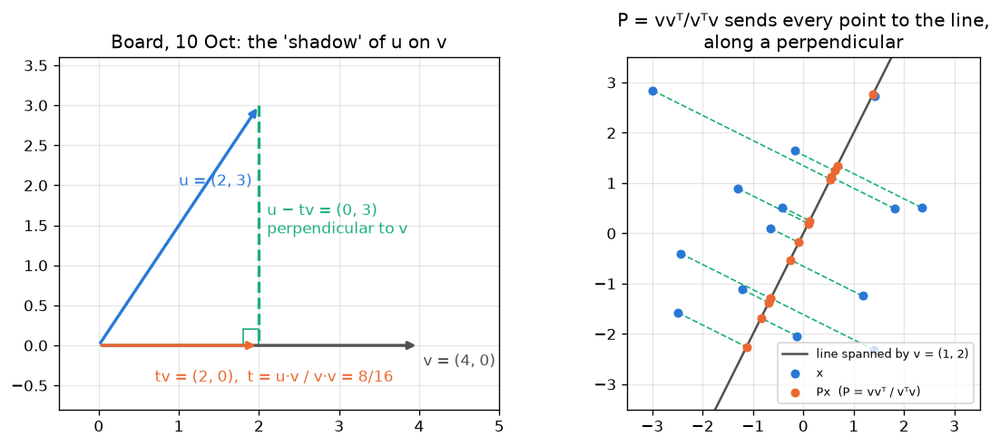
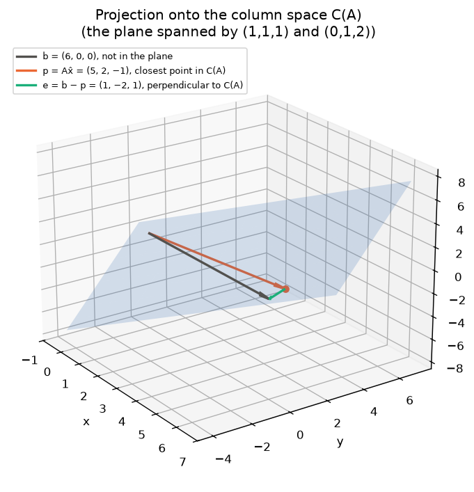
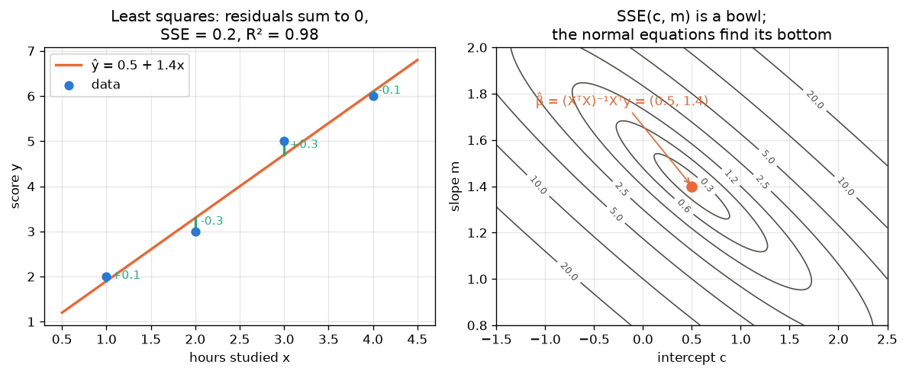

# 08 · Dot Product, Projections & Least Squares

> **Course:** Applied Mathematics for Data Science & AI · Dr. Arulalan Rajan
>
> **Lecture:** 10 October 2026
>
> **Sources:** handwritten notes pp. 74–81 (no transcript for this class)
>
> **Notebooks:** [`code/08_projections_deep_dive.ipynb`](code/08_projections_deep_dive.ipynb), Parts A–K (axis projections, dot-product properties, angles and cosine similarity, projection matrices, projection onto a subspace, least squares three ways, pseudo-inverse, Gram–Schmidt, case studies, practice checks). Figures: [`code/figures_08.py`](code/figures_08.py)
>
> **Next class:** eigenvalues and eigenvectors (announced at the end of the board, p.81).
>
> **Level:** 🟢 Basic → 🟡 Intermediate → 🔴 Advanced. Sections 7, 9, 10 and 11 go beyond what was written on the board; they are the standard theory that the last board lines ($`\beta = (X^\top X)^{-1}X^\top y`$, "pseudoinverse", "eigenvalues") point to.

---

## 📌 Table of Contents

1. [Big Picture](#1-big-picture)
2. [Matrices that Project onto the Axes](#2-matrices-that-project-onto-the-axes-)
3. [The Dot Product](#3-the-dot-product-)
4. [Length, Angle & Cauchy–Schwarz](#4-length-angle--cauchyschwarz-)
5. [Projection of a Vector onto a Vector](#5-projection-of-a-vector-onto-a-vector-)
6. [The Projection Matrix P = vvᵀ / vᵀv](#6-the-projection-matrix-p--vvᵀ--vᵀv-)
7. [Projection onto a Subspace](#7-projection-onto-a-subspace-)
8. [Least Squares: y = Xβ](#8-least-squares-y--xβ-)
9. [The Pseudo-inverse](#9-the-pseudo-inverse-)
10. [Bridge: Gram–Schmidt & Orthonormal Bases](#10-bridge-gramschmidt--orthonormal-bases-)
11. [Bridge: Eigenvalues of a Projection](#11-bridge-eigenvalues-of-a-projection-)
12. [Real-World Case Studies](#12--real-world-case-studies)
13. [Code Walkthrough](#13--code-walkthrough)
14. [Professor Emphasised](#14--professor-emphasised)
15. [Clarifications to the Board](#15--clarifications-to-the-board)
16. [Common Confusions](#16--common-confusions)
17. [Practice Problems](#17--practice-problems)
18. [Cheat Sheet](#18--cheat-sheet)
19. [Go Deeper](#19--go-deeper-curated-links)

---

## 1. Big Picture

The class started from a recall of **linear transformations** ([Note 07](07-Linear-Transformations.md)) and asked a very concrete question: *what is the matrix of the map that keeps $`x_1`$ and throws away $`x_2`$?* The answer, $`\begin{bmatrix}1&0\\0&0\end{bmatrix}`$, is a **projection**: it drops every vector straight down onto the $`x_1`$-axis, like the shadow of a stick at noon.

From there the lecture built one chain of ideas:


Why a data scientist cares:

| Idea from today | Where it shows up |
|---|---|
| Dot product | every neuron computes $`w\cdot x + b`$; attention scores in transformers are dot products |
| Cosine of the angle | similarity between documents, word embeddings, users in a recommender |
| Projection onto a vector | the mean of a dataset; the first step of PCA; "how much of $`u`$ points along $`v`$" |
| Projection onto a subspace | **linear regression**: the fitted values are the projection of $`y`$ onto the column space of $`X`$ |
| Pseudo-inverse | solving regressions even when features are redundant ([Note 05 §12](05-Null-Space-and-Nullity.md#12-why-redundancy-breaks-least-squares-)) |

---

## 2. Matrices that Project onto the Axes 🟢

**Board, p.74–75.** For $`T:\mathbb{R}^2\to\mathbb{R}^2`$,

```math
T\!\left(\begin{bmatrix}x_1\\x_2\end{bmatrix}\right) = \begin{bmatrix}x_1\\0\end{bmatrix} = \begin{bmatrix}1\cdot x_1 + 0\cdot x_2\\ 0\cdot x_1 + 0\cdot x_2\end{bmatrix}
\quad\Rightarrow\quad A = \begin{bmatrix}1&0\\0&0\end{bmatrix}
```

Reading the coefficients row by row gives the matrix (the method of Note 07: column $`j`$ of $`A`$ is $`T(e_j)`$). Similarly $`T(x_1, x_2) = (0, x_2)`$ has matrix $`\begin{bmatrix}0&0\\0&1\end{bmatrix}`$.

| | $`P_{x_1} = \begin{bmatrix}1&0\\0&0\end{bmatrix}`$ | $`P_{x_2} = \begin{bmatrix}0&0\\0&1\end{bmatrix}`$ |
|---|---|---|
| Projects onto | the $`x_1`$-axis | the $`x_2`$-axis |
| $`(2,3)\mapsto`$ | $`(2,0)`$ | $`(0,3)`$ |
| Symmetric $`P^\top = P`$ | ✓ | ✓ |
| Idempotent $`P^2 = P`$ | ✓ | ✓ |

**Why idempotent is the heart of "projection" (board p.76):**

```math
\begin{bmatrix}1&0\\0&0\end{bmatrix}\begin{bmatrix}2\\3\end{bmatrix} = \begin{bmatrix}2\\0\end{bmatrix},
\qquad
\begin{bmatrix}1&0\\0&0\end{bmatrix}\begin{bmatrix}2\\0\end{bmatrix} = \begin{bmatrix}2\\0\end{bmatrix}
\quad\Rightarrow\quad P(P\,x) = P\,x
```

Once a vector is on the axis, projecting it again does nothing. **A shadow of a shadow is the same shadow.** That is $`P^2 = P`$.

> **Board definition:** a matrix $`P`$ is called a projection matrix iff $`P^\top = P`$ (symmetric) and $`P^2 = P`$ (idempotent).
>
> 🔴 Precisely, these two conditions define an **orthogonal** projection (the shadow falls along a perpendicular). $`P^2 = P`$ alone gives a general, possibly **oblique**, projection; see §15 and P11.

Two more facts visible already here (notebook Part A): $`P_{x_1} + P_{x_2} = I`$ (the two shadows rebuild the vector) and $`P_{x_1}P_{x_2} = 0`$ (the axes are perpendicular, so the shadow on one axis has no shadow on the other).

---

## 3. The Dot Product 🟢

**Board, p.77:** *"To answer [the general projection question], we need to understand the idea of dot product of 2 vectors."*

> **Definition.** For $`n`$-component vectors $`\vec u, \vec v`$, the dot product is the **scalar**
>
> ```math
> \vec u\cdot\vec v = \sum_{i=1}^{n} u_i v_i = u_1v_1 + u_2v_2 + \dots + u_nv_n.
> ```

Example: $`(1,2,3)\cdot(4,-5,6) = 4 - 10 + 18 = 12`$.

**Properties (board p.78)**, all checked in notebook Part B with $`u = (1,2,3)`$, $`v = (4,-5,6)`$, $`w = (2,0,-1)`$:

| # | Property | Check |
|---|---|---|
| (i) | $`\vec u\cdot\vec v = v^\top u = u^\top v = \vec v\cdot\vec u`$ (commutative) | 12 = 12 |
| (ii) | $`(\vec u + \vec v)\cdot\vec w = \vec u\cdot\vec w + \vec v\cdot\vec w`$ (distributive) | 1 = 1 |
| (iii) | $`(\alpha\vec u)\cdot\vec w = \vec u\cdot(\alpha\vec w) = \alpha(\vec u\cdot\vec w)`$ | $`-3 = -3`$ for $`\alpha = 3`$ |
| (iv) | $`\vec u\cdot\vec u = u^\top u = \lVert\vec u\rVert^2 \ge 0`$, and $`= 0`$ **iff** $`\vec u = \vec 0`$ | $`u\cdot u = 14`$, $`\lVert u\rVert = 3.7417`$ |
| (iv a) | $`\vec u\cdot\vec v = 0 \Rightarrow \vec u, \vec v`$ are **orthogonal** (perpendicular) | $`(1,2)\cdot(-2,1) = 0`$ |

**The matrix form $`u^\top v`$.** With column vectors, $`u^\top`$ is $`1\times n`$ and $`v`$ is $`n\times 1`$, so $`u^\top v`$ is $`1\times1`$: a single number. Flip the order and you get something completely different: $`v\,u^\top`$ is an $`n\times n`$ **matrix** (the outer product). §6 uses both.

```
uᵀ v   =  (1 × n)(n × 1)  =  1 × 1    a scalar   (inner product)
v uᵀ   =  (n × 1)(1 × n)  =  n × n    a matrix   (outer product)
```

**Why (iv) matters:** $`\lVert u\rVert^2 = u\cdot u`$ is just Pythagoras in $`n`$ dimensions: $`\lVert(3,4,12)\rVert = \sqrt{9+16+144} = 13`$. And "$`= 0`$ only for the zero vector" is what makes "length" a sensible notion; it is used in every proof below (and in [Note 05 §12](05-Null-Space-and-Nullity.md#12-why-redundancy-breaks-least-squares-): $`\lVert Xw\rVert^2 = 0 \Rightarrow Xw = 0`$).

---

## 4. Length, Angle & Cauchy–Schwarz 🟢→🟡

**Board, p.78 (v):** *"Angle between $`\vec u`$ and $`\vec v`$: $`\cos\theta = ?`$"*. The board set up the right triangle but stopped at $`t`$ (§5). Completing it:



In the right triangle with hypotenuse $`\vec u`$ and adjacent side $`t\vec v`$:

```math
\cos\theta = \frac{\text{adjacent}}{\text{hypotenuse}} = \frac{t\,\lVert\vec v\rVert}{\lVert\vec u\rVert} = \frac{\vec u\cdot\vec v}{\vec v\cdot\vec v}\cdot\frac{\lVert\vec v\rVert}{\lVert\vec u\rVert}
\quad\Rightarrow\quad
\boxed{\cos\theta = \frac{\vec u\cdot\vec v}{\lVert\vec u\rVert\,\lVert\vec v\rVert}}
```

(using $`\vec v\cdot\vec v = \lVert\vec v\rVert^2`$). Equivalently $`\vec u\cdot\vec v = \lVert\vec u\rVert\lVert\vec v\rVert\cos\theta`$: the dot product measures **how much two vectors point the same way**, scaled by their lengths.

| Sign of $`u\cdot v`$ | Angle | Meaning |
|---|---|---|
| $`> 0`$ | acute, $`< 90°`$ | point broadly the same way |
| $`= 0`$ | $`90°`$ | orthogonal: no component along each other |
| $`< 0`$ | obtuse, $`> 90°`$ | point broadly opposite ways |

### Worked example 4.1 🟢

**(a) Board vectors** $`u = (2,3)`$, $`v = (4,0)`$:

```math
\cos\theta = \frac{8}{\sqrt{13}\cdot 4} = \frac{2}{\sqrt{13}} \approx 0.5547,\qquad \theta \approx 56.31°
```

**(b) In 3-D** $`u = (1,2,2)`$, $`v = (2,1,2)`$: $`u\cdot v = 2 + 2 + 4 = 8`$, $`\lVert u\rVert = \lVert v\rVert = 3`$, so $`\cos\theta = 8/9`$ and $`\theta \approx 27.27°`$. "Angle" works in any dimension, even where we can't draw.

### Cauchy–Schwarz inequality 🟡

For $`\cos\theta`$ to be a genuine cosine it must lie in $`[-1, 1]`$. That is guaranteed by

```math
|\vec u\cdot\vec v| \;\le\; \lVert\vec u\rVert\,\lVert\vec v\rVert, \qquad\text{with equality iff } \vec u, \vec v \text{ are parallel.}
```

**Proof (one line, using property iv).** For $`v \ne 0`$ let $`t = \frac{u\cdot v}{v\cdot v}`$. Then

```math
0 \le \lVert u - tv\rVert^2 = u\cdot u - 2t\,(u\cdot v) + t^2\,(v\cdot v) = \lVert u\rVert^2 - \frac{(u\cdot v)^2}{\lVert v\rVert^2},
```

so $`(u\cdot v)^2 \le \lVert u\rVert^2\lVert v\rVert^2`$. Equality iff $`u - tv = 0`$, i.e. $`u`$ is a multiple of $`v`$. ∎ (Notice: this is exactly the board's $`t`$ again. The residual $`u - tv`$ having non-negative length *is* Cauchy–Schwarz.)

Notebook Part C: over 10,000 random pairs in $`\mathbb{R}^5`$ the largest $`|a\cdot b|/(\lVert a\rVert\lVert b\rVert)`$ was 0.9836, never above 1; for the parallel pair $`(1,2), (3,6)`$ both sides equal 15.

### Cosine similarity 🟡

In ML the cosine itself is the score:

```math
\text{cos\_sim}(u, v) = \frac{u\cdot v}{\lVert u\rVert\lVert v\rVert} \in [-1, 1]
```

It ignores **length** and compares only **direction**. A 10× longer document with the same word proportions has cosine 1 with the original (notebook Part C). Toy word-count vectors over the words (match, goal, election, vote):

| | sports1 (3,2,0,0) | sports2 (1,4,0,0) | politics (0,0,3,4) | mixed (1,1,1,1) |
|---|---|---|---|---|
| sports1 | 1 | 0.740 | **0** | 0.693 |
| sports2 | 0.740 | 1 | **0** | 0.606 |
| politics | 0 | 0 | 1 | 0.700 |

Sports and politics share no words, so their vectors are **orthogonal**: similarity exactly 0.

---

## 5. Projection of a Vector onto a Vector 🟢

**The question (board p.76):** *given a direction, what is the projection (shadow) of a vector along it?*

**The derivation (board p.78–79).** We want the multiple $`t\vec v`$ of $`\vec v`$ closest to $`\vec u`$. At the closest point the "error" $`\vec u - t\vec v`$ is **perpendicular** to $`\vec v`$ (the dashed line in the figure):

```math
(\vec u - t\vec v)\cdot\vec v = 0
\;\Rightarrow\; \vec u\cdot\vec v - t\,(\vec v\cdot\vec v) = 0
\;\Rightarrow\; t = \frac{\vec u\cdot\vec v}{\vec v\cdot\vec v}
```

> **Projection of $`\vec u`$ along $`\vec v`$** (the "shadow of $`\vec u`$ in the direction of $`\vec v`$"):
>
> ```math
> \text{proj}_{\vec v}\,\vec u = t\vec v = \frac{\vec u\cdot\vec v}{\vec v\cdot\vec v}\,\vec v
> ```

**Reading the formula.** $`\frac{u\cdot v}{\lVert v\rVert}`$ is the signed **length** of the shadow; dividing by $`\lVert v\rVert`$ once more turns "a length along $`v`$" into "a multiple of $`v`$". The answer depends only on the **direction** of $`v`$: replace $`v`$ by $`5v`$ and $`t`$ shrinks by 5 while $`v`$ grows by 5.

### Worked example 5.1: the board vectors 🟢

$`u = (2,3)`$, $`v = (4,0)`$: $`t = \frac{8}{16} = 0.5`$, shadow $`t v = (2, 0)`$, residual $`u - tv = (0, 3)`$, and $`(0,3)\cdot(4,0) = 0`$ ✓. Projecting onto the $`x_1`$-axis direction gives the same $`(2,0)`$ as $`P_{x_1}`$ in §2, as it must.

### Worked example 5.2: in 3-D 🟡

$`u = (1,2,2)`$, $`v = (2,1,2)`$:

```math
t = \frac{8}{9},\qquad t v = \left(\tfrac{16}{9}, \tfrac{8}{9}, \tfrac{16}{9}\right),\qquad u - tv = \left(-\tfrac{7}{9}, \tfrac{10}{9}, \tfrac{2}{9}\right)
```

Check perpendicularity: $`(-\tfrac{7}{9})(2) + (\tfrac{10}{9})(1) + (\tfrac{2}{9})(2) = \tfrac{-14 + 10 + 4}{9} = 0`$ ✓. And **Pythagoras**: $`\lVert u\rVert^2 = 9 = \lVert tv\rVert^2 + \lVert u - tv\rVert^2 = \tfrac{576}{81} + \tfrac{153}{81}`$ ✓. Every vector splits into a part **along** $`v`$ plus a part **perpendicular** to $`v`$.

---

## 6. The Projection Matrix P = vvᵀ / vᵀv 🟢→🟡

**Board, p.79:** *"What is the matrix that projects any vector in $`\mathbb{R}^n`$ onto the vector $`\vec v`$?"* Rewrite the shadow so that $`u`$ stands alone on the right:

```math
t\vec v = \frac{v^\top u}{v^\top v}\,v = v\,\frac{v^\top u}{v^\top v} = \left(\frac{v\,v^\top}{v^\top v}\right)u
```

The middle step is legal because $`\frac{v^\top u}{v^\top v}`$ is a **scalar**, and a scalar can sit on either side of $`v`$. Then $`v(v^\top u) = (vv^\top)u`$ by associativity.

> ```math
> P = \frac{v\,v^\top}{v^\top v}\quad (n\times n)\qquad\text{projects any vector in }\mathbb{R}^n\text{ onto the line through }\vec v.
> ```

**Sizes (board p.80):** $`v^\top v = \sum v_i^2`$ is a scalar (the denominator); $`v v^\top`$ is an $`n\times n`$ matrix.

**Check against §2:** $`v = (1,0)`$ gives $`P = \frac{1}{1}\begin{bmatrix}1&0\\0&0\end{bmatrix} = P_{x_1}`$ ✓.

### It is symmetric and idempotent (board p.80–81)

```math
P^\top = \frac{(vv^\top)^\top}{v^\top v} = \frac{(v^\top)^\top v^\top}{v^\top v} = \frac{vv^\top}{v^\top v} = P
```

```math
P^2 = \frac{vv^\top}{v^\top v}\cdot\frac{vv^\top}{v^\top v} = \frac{v\,(v^\top v)\,v^\top}{(v^\top v)(v^\top v)} = \frac{vv^\top}{v^\top v} = P
```

The key move in the second line: the inner $`v^\top v`$ is a **scalar**, so it cancels one factor of the denominator.

### Worked example 6.1 🟢

$`v = (1,2)`$, $`v^\top v = 5`$:

```math
P = \frac{1}{5}\begin{bmatrix}1&2\\2&4\end{bmatrix},\qquad P\begin{bmatrix}3\\1\end{bmatrix} = \begin{bmatrix}1\\2\end{bmatrix},\qquad P\begin{bmatrix}1\\2\end{bmatrix} = \begin{bmatrix}1\\2\end{bmatrix},\qquad P\begin{bmatrix}-2\\1\end{bmatrix} = \begin{bmatrix}0\\0\end{bmatrix}
```

Vectors **on** the line are unchanged; vectors **perpendicular** to it are sent to 0. For $`v = (2,1,2)`$: $`P = \frac19\begin{bmatrix}4&2&4\\2&1&2\\4&2&4\end{bmatrix}`$.

### More properties 🟡 (notebook Part E)

| Property | Why | Example |
|---|---|---|
| rank $`P = 1`$ | every column is a multiple of $`v`$ | both $`v = (1,2)`$ and $`(2,1,2)`$ |
| trace $`P = 1`$ | trace $`= \frac{\sum v_i^2}{v^\top v}`$; for any projection, trace = rank | $`\tfrac15 + \tfrac45 = 1`$ |
| $`P`$ unchanged if $`v \to cv`$ | $`c^2`$ cancels top and bottom | $`v = (5,10)`$ gives the same $`P`$ |
| $`I - P`$ is also a projection | onto everything **perpendicular** to $`v`$ | $`I - P = \frac15\begin{bmatrix}4&-2\\-2&1\end{bmatrix}`$ |
| $`\lVert Pu\rVert \le \lVert u\rVert`$ | Pythagoras: $`\lVert u\rVert^2 = \lVert Pu\rVert^2 + \lVert(I-P)u\rVert^2`$ | a shadow is never longer than the stick |

---

## 7. Projection onto a Subspace 🟡

**Board, p.81** wrote $`v\,(v^\top v)^{-1}v^\top`$: the same matrix, with the division written as an inverse. That form generalises immediately. Replace the single vector $`v`$ by a matrix $`A`$ whose **columns** span a subspace:

```math
\boxed{P = A\,(A^\top A)^{-1}A^\top}\qquad\text{projects onto } C(A),\ \text{the column space of } A.
```

**Derivation (same idea as §5).** We want the point $`p = A\hat x`$ in $`C(A)`$ closest to $`b`$. The error $`e = b - A\hat x`$ must be perpendicular to **every** column of $`A`$:

```math
A^\top(b - A\hat x) = 0 \;\Longrightarrow\; \underbrace{A^\top A\,\hat x = A^\top b}_{\text{normal equations}} \;\Longrightarrow\; \hat x = (A^\top A)^{-1}A^\top b,\quad p = A\hat x = A(A^\top A)^{-1}A^\top b.
```

With one column ($`A = v`$) this collapses to $`\frac{vv^\top}{v^\top v}`$. The inverse exists exactly when the columns of $`A`$ are independent, because $`N(A^\top A) = N(A)`$ ([Note 05 §12](05-Null-Space-and-Nullity.md#12-why-redundancy-breaks-least-squares-)).

**"Normal"** means perpendicular: the equations say the error is normal (⟂) to the subspace. In the language of the four fundamental subspaces ([Note 05 §11](05-Null-Space-and-Nullity.md#11-the-four-fundamental-subspaces-)): $`e \in N(A^\top)`$, the left null space, which is the orthogonal complement of $`C(A)`$. So $`b = p + e`$ splits $`b`$ into its $`C(A)`$ part and its $`N(A^\top)`$ part.

### Worked example 7.1: projecting onto a plane in ℝ³ 🟡



```math
A = \begin{bmatrix}1&0\\1&1\\1&2\end{bmatrix},\quad b = \begin{bmatrix}6\\0\\0\end{bmatrix}
```

**Step 1.** $`A^\top A = \begin{bmatrix}3&3\\3&5\end{bmatrix}`$ (det 6), $`A^\top b = \begin{bmatrix}6\\0\end{bmatrix}`$.

**Step 2.** $`\hat x = \frac16\begin{bmatrix}5&-3\\-3&3\end{bmatrix}\begin{bmatrix}6\\0\end{bmatrix} = \begin{bmatrix}5\\-3\end{bmatrix}`$.

**Step 3.** $`p = A\hat x = (5, 2, -1)`$, $`e = b - p = (1, -2, 1)`$.

**Step 4 (check).** $`A^\top e = (1 - 2 + 1,\ 0 - 2 + 2) = (0, 0)`$ ✓: the error is perpendicular to both columns.

**Step 5.** The projection matrix:

```math
P = A(A^\top A)^{-1}A^\top = \frac16\begin{bmatrix}5&2&-1\\2&2&2\\-1&2&5\end{bmatrix},\qquad P^\top = P,\quad P^2 = P,\quad \text{trace } P = 2 = \text{rank}
```

Its trace is 2 because it projects onto a **2-dimensional** subspace. This example is also a regression: fit a line $`y = c + mx`$ through $`(0,6), (1,0), (2,0)`$; the best line is $`y = 5 - 3x`$ (Strang's classic example).

---

## 8. Least Squares: y = Xβ 🟡

**Board, p.81:**

```math
y = X\beta,\qquad \beta = \begin{bmatrix}m\\c\end{bmatrix}\ \text{or}\ \begin{bmatrix}c\\m\end{bmatrix},\qquad \beta = (X^\top X)^{-1}X^\top y
```

A data set with more points than parameters has **no exact solution**: $`y`$ is not in $`C(X)`$. Least squares picks the $`\beta`$ that makes $`X\beta`$ **as close as possible** to $`y`$:

```math
\hat\beta = \arg\min_\beta \lVert y - X\beta\rVert^2
```

By §7, the closest point is the projection: $`X\hat\beta = Py`$, where $`P = X(X^\top X)^{-1}X^\top`$, and $`\hat\beta`$ solves the normal equations $`X^\top X\hat\beta = X^\top y`$. **Linear regression is a projection.** (Note 01 §10 met the normal equations from the calculus side: set the gradient of the squared error to zero; [link](01-Linear-Systems-Determinant-Inverse.md#10-least-squares-and-the-normal-equations-).)

**$`(m, c)`$ or $`(c, m)`$?** Either, as the board says; the order of $`\beta`$ follows the order of the **columns of $`X`$**. With $`X = [\mathbf 1\ \ x]`$ you get $`\beta = (c, m)`$; with $`X = [x\ \ \mathbf 1]`$ you get $`(m, c)`$. Same line (notebook Part G).

### Worked example 8.1: a regression by hand 🟡

Hours studied $`x = (1,2,3,4)`$, test score $`y = (2,3,5,6)`$. Model $`y \approx c + m x`$.

```math
X = \begin{bmatrix}1&1\\1&2\\1&3\\1&4\end{bmatrix},\qquad
X^\top X = \begin{bmatrix}4 & 10\\ 10 & 30\end{bmatrix},\qquad
X^\top y = \begin{bmatrix}16\\47\end{bmatrix}
```

(Entries: $`n = 4`$, $`\sum x = 10`$, $`\sum x^2 = 30`$, $`\sum y = 16`$, $`\sum xy = 2 + 6 + 15 + 24 = 47`$.)

$`\det(X^\top X) = 120 - 100 = 20`$, so

```math
\hat\beta = \frac{1}{20}\begin{bmatrix}30 & -10\\ -10 & 4\end{bmatrix}\begin{bmatrix}16\\47\end{bmatrix} = \frac{1}{20}\begin{bmatrix}10\\28\end{bmatrix} = \begin{bmatrix}0.5\\1.4\end{bmatrix}
\quad\Rightarrow\quad \hat y = 0.5 + 1.4x
```



| $`x`$ | $`y`$ | $`\hat y`$ | residual $`e = y - \hat y`$ |
|---|---|---|---|
| 1 | 2 | 1.9 | +0.1 |
| 2 | 3 | 3.3 | −0.3 |
| 3 | 5 | 4.7 | +0.3 |
| 4 | 6 | 6.1 | −0.1 |

**The projection checks** (notebook Part G):

- $`X^\top e = (0, 0)`$: residuals sum to 0 (column of ones) **and** are uncorrelated with $`x`$ ($`0.1 - 0.6 + 0.9 - 0.4 = 0`$). That's "error ⟂ column space".
- SSE $`= 0.01 + 0.09 + 0.09 + 0.01 = 0.2`$, SST $`= \sum(y - \bar y)^2 = 10`$, so $`R^2 = 1 - 0.2/10 = 0.98`$.
- **Five ways, one answer:** normal equations, explicit $`(X^\top X)^{-1}X^\top y`$, `np.linalg.lstsq`, `np.linalg.pinv(X) @ y` and scikit-learn's `LinearRegression` all give $`c = 0.5`$, $`m = 1.4`$.

### The hat matrix 🔴

```math
H = X(X^\top X)^{-1}X^\top,\qquad \hat y = Hy \quad(\text{"puts the hat on } y\text{"})
```

For the example, $`H`$ is $`4\times4`$, symmetric, idempotent, with trace 2 = number of parameters. Its diagonal entries, the **leverages** $`(0.7, 0.3, 0.3, 0.7)`$, show that the end points pull hardest on the line. Statistics uses leverage to flag influential observations.

---

## 9. The Pseudo-inverse 🔴

The board labelled $`(X^\top X)^{-1}`$ "pseudoinverse". More precisely, the matrix that turns $`y`$ into $`\hat\beta`$,

```math
X^{+} = (X^\top X)^{-1}X^\top \qquad (n\times m),
```

is the **(Moore–Penrose) pseudo-inverse** of $`X`$ when its columns are independent. It behaves like an inverse for a non-square matrix: $`X^+X = I_n`$ (a left inverse), while $`XX^+ = H`$ is the projection onto $`C(X)`$, not $`I_m`$.

**When columns are dependent**, $`X^\top X`$ is singular and the formula breaks, but the Moore–Penrose pseudo-inverse (computed from the SVD, `np.linalg.pinv`) still exists. Among all least-squares solutions it returns the one with the **smallest length**.

### Worked example 9.1 🔴 (notebook Part H)

```math
X = \begin{bmatrix}1&2\\1&2\\1&2\end{bmatrix},\quad y = \begin{bmatrix}1\\2\\3\end{bmatrix}:\qquad X^\top X = \begin{bmatrix}3&6\\6&12\end{bmatrix},\ \det = 0
```

`np.linalg.inv` raises `LinAlgError: Singular matrix`. Column 2 = 2 × column 1, so the model can only predict a constant: the best constant is the mean, 2. Any $`\beta`$ with $`\beta_1 + 2\beta_2 = 2`$ predicts $`(2,2,2)`$:

| $`\beta`$ | prediction | $`\lVert\beta\rVert`$ |
|---|---|---|
| $`(2, 0)`$ | (2, 2, 2) | 2.0 |
| $`(0, 1)`$ | (2, 2, 2) | 1.0 |
| $`(1.2, 0.4)`$ | (2, 2, 2) | 1.2649 |
| **`pinv`: $`(0.4, 0.8)`$** | (2, 2, 2) | **0.8944** (smallest) |

The min-norm solution $`(0.4, 0.8)`$ is parallel to $`(1, 2)`$, so it lies in the row space and has no component in the null space $`\text{span}\{(-2,1)\}`$. That's the same story as Note 05 §12 (redundant features ⇒ non-unique weights, same predictions).

---

## 10. Bridge: Gram–Schmidt & Orthonormal Bases 🔴

$`(A^\top A)^{-1}`$ is the annoying part of $`P = A(A^\top A)^{-1}A^\top`$. If the columns were **orthonormal** (perpendicular, length 1), then $`A^\top A = I`$ and $`P = AA^\top`$. **Gram–Schmidt** makes them so, using nothing but §5: subtract from each new vector its projection onto the earlier ones.

$`a_1 = (1,1,0)`$, $`a_2 = (1,0,1)`$:

```math
b_2 = a_2 - \frac{a_2\cdot a_1}{a_1\cdot a_1}a_1 = (1,0,1) - \tfrac12(1,1,0) = \left(\tfrac12, -\tfrac12, 1\right),\qquad b_2\cdot a_1 = 0\ ✓
```

Normalising gives $`q_1 = \tfrac{1}{\sqrt2}(1,1,0)`$, $`q_2 = \tfrac{1}{\sqrt6}(1,-1,2)`$ with $`Q^\top Q = I`$, and $`QQ^\top`$ equals $`A(A^\top A)^{-1}A^\top`$ exactly (notebook Part I). In practice regression solvers use this route (the QR decomposition) because it avoids forming $`X^\top X`$, which squares the condition number (Note 01 §11).

---

## 11. Bridge: Eigenvalues of a Projection 🔴

The board ended with *"eigenvalues & eigenvectors"*. Projections are the friendliest first example. An **eigenvector** $`x \ne 0`$ satisfies $`Px = \lambda x`$: $`P`$ only stretches it.

For $`P = \frac{vv^\top}{v^\top v}`$ we already found two kinds of vector in §6:

| Vector | $`Px`$ | Eigenvalue |
|---|---|---|
| $`x`$ on the line ($`x = v`$) | $`x`$ | $`\lambda = 1`$ |
| $`x \perp v`$ | $`\mathbf 0`$ | $`\lambda = 0`$ |

So a projection has **only eigenvalues 0 and 1**. This follows from idempotence alone: $`Px = \lambda x \Rightarrow P^2x = \lambda^2 x`$, and $`P^2 = P`$ gives $`\lambda^2 = \lambda`$. Notebook Part E: for $`v = (2,1,2)`$ the eigenvalues are $`\{1, 0, 0\}`$; for the plane in §7, $`\{1, 1, 0\}`$. The number of 1s is the dimension of the subspace = rank = trace.

---

## 12. 🏭 Real-World Case Studies

### 12.1 The mean is a projection

Project $`y = (2, 4, 9)`$ onto the all-ones vector $`\mathbf 1 = (1,1,1)`$:

```math
\frac{y\cdot\mathbf 1}{\mathbf 1\cdot\mathbf 1}\mathbf 1 = \frac{15}{3}(1,1,1) = (5,5,5)
```

The coefficient is the **mean**. Regression with only an intercept predicts the mean, and "centering" data ($`y - \bar y\mathbf 1`$) is the perpendicular part $`(I - P)y`$. The variance is then $`\lVert(I-P)y\rVert^2/n`$: statistics is geometry.

### 12.2 Search engines and embeddings: cosine similarity

Search engines (TF-IDF vectors), sentence-embedding models and vector databases rank results by $`\cos\theta`$ between the query vector and each document vector. Using the angle rather than raw dot products stops long documents from winning just by being long. Transformers compute $`q\cdot k/\sqrt{d}`$ between query and key vectors: attention is a scaled dot product.

**Recommenders.** Users as rating vectors for four films: A = (5,4,0,1), B = (4,5,1,0), C = (0,1,5,4). $`\cos(A,B) = 0.952`$, $`\cos(A,C) = 0.19`$: recommend B's favourites to A, not C's (notebook Part J).

### 12.3 Computer graphics: shadows and orthographic views

Rendering a 3-D object in a CAD "top view" applies $`P = \text{diag}(1,1,0)`$: the 3-D version of the board's $`P_{x_1}`$. Projecting onto a tilted plane with normal $`n`$ uses $`P = I - \frac{nn^\top}{n^\top n}`$; for the plane $`x + y - z = 0`$, $`P(1,1,0) = (\tfrac13, \tfrac13, \tfrac23)`$ (notebook Part J, and P21 below).

### 12.4 GPS and sensor fusion

A GPS receiver sees 6–12 satellites but has 4 unknowns (3 coordinates and its clock error). The over-determined, noisy system is solved by (weighted, linearised) least squares, i.e. a projection, many times per second.

---

## 13. 💻 Code Walkthrough

```python
import numpy as np

u, v = np.array([2., 3.]), np.array([4., 0.])
u @ v                                   # dot product: 8.0
np.linalg.norm(u)                        # length: 3.6056
np.degrees(np.arccos(u @ v / (np.linalg.norm(u) * np.linalg.norm(v))))   # 56.31

t = (u @ v) / (v @ v); t * v             # projection: [2. 0.]
P = np.outer(v, v) / (v @ v)             # projection matrix vvᵀ/vᵀv
np.allclose(P, P.T), np.allclose(P @ P, P)   # (True, True)

# least squares: four equivalent ways
X = np.column_stack([np.ones(4), [1, 2, 3, 4]]); y = np.array([2., 3, 5, 6])
np.linalg.solve(X.T @ X, X.T @ y)        # normal equations  -> [0.5 1.4]
np.linalg.lstsq(X, y, rcond=None)[0]     # QR/SVD based      -> [0.5 1.4]
np.linalg.pinv(X) @ y                    # pseudo-inverse    -> [0.5 1.4]
H = X @ np.linalg.inv(X.T @ X) @ X.T     # hat matrix, trace 2
```

**Rule of thumb:** for real problems use `lstsq` (or scikit-learn), not `inv(X.T @ X)`. Forming $`X^\top X`$ squares the condition number and breaks outright when features are redundant (§9).

---

## 14. 🎓 Professor Emphasised

1. The matrix of a linear map is found by **reading off the coefficients**: $`T(x_1,x_2) = (1x_1 + 0x_2,\ 0x_1 + 0x_2)`$ gives $`\begin{bmatrix}1&0\\0&0\end{bmatrix}`$.
2. A projection matrix is **symmetric** ($`P^\top = P`$) and **idempotent** ($`P^2 = P`$): projecting twice changes nothing.
3. The dot product is a **scalar**, $`\sum u_iv_i`$, and $`u\cdot v = u^\top v = v^\top u`$.
4. $`u\cdot u = \lVert u\rVert^2 \ge 0`$, zero only for $`\vec 0`$; $`u\cdot v = 0`$ means **orthogonal**.
5. The projection comes from **one perpendicularity condition**: $`(u - tv)\cdot v = 0`$.
6. "Shadow of $`u`$ in the direction of $`v`$" $`= \frac{u\cdot v}{v\cdot v}v`$ (boxed on the board).
7. $`v^\top v`$ is a **scalar** but $`vv^\top`$ is an **$`n\times n`$ matrix**; $`\frac{vv^\top}{v^\top v}`$ projects any vector in $`\mathbb{R}^n`$ onto $`v`$.
8. The same idea gives regression: $`y = X\beta`$, $`\beta = (X^\top X)^{-1}X^\top y`$ (the pseudo-inverse).
9. Next: **eigenvalues and eigenvectors**.

---

## 15. ✏️ Clarifications to the Board

| Page | Written | Correct reading |
|:-:|:--|:--|
| 75 | $`T(x_1,x_2) = (0, x_2) = \begin{bmatrix}0&0\\0&1\end{bmatrix}`$ | A vector can't equal a matrix: the **matrix of** $`T`$ is $`\begin{bmatrix}0&0\\0&1\end{bmatrix}`$ |
| 75–76 | $`P`$ is a projection matrix **iff** $`P^\top = P`$ and $`P^2 = P`$ | That defines an **orthogonal** projection. Any $`P`$ with $`P^2 = P`$ is a projection; e.g. $`\begin{bmatrix}1&1\\0&0\end{bmatrix}`$ projects onto the $`x_1`$-axis **along** the direction $`(1,-1)`$ (oblique) and is not symmetric (P11) |
| 76 | "Idompotent" | **Idempotent** (Latin *idem* "same" + *potent* "power": the same under powers) |
| 76 vs 79 | Projection of $`\vec v`$ along $`\vec u`$ $`= \frac{v\cdot u}{u\cdot u}\vec u`$; later, projection of $`\vec u`$ along $`\vec v = \frac{u\cdot v}{v\cdot v}\vec v`$ | Both correct; the roles swap. Rule: **divide by the direction vector dotted with itself, and multiply by the direction vector** |
| 78 | Angle: "$`\cos\theta = ?`$", derivation stops at $`t`$ | Completed in §4: $`\cos\theta = \frac{u\cdot v}{\lVert u\rVert\lVert v\rVert}`$ |
| 78 | (i) $`\vec u\cdot\vec v = v^\top u = u^\top v = \vec v\cdot\vec u`$ | ✓ Correct as written (column vectors). The angle derivation $`(u - tv)\cdot v = 0 \Rightarrow u\cdot v - t(v\cdot v) = 0`$ is also correct |
| 81 | Brace under $`(X^\top X)^{-1}`$ labelled "Pseudoinverse" | The pseudo-inverse is the whole $`(X^\top X)^{-1}X^\top`$ (and only when the columns of $`X`$ are independent; otherwise `pinv`, §9) |
| 81 | $`\beta = (m, c)`$ or $`(c, m)`$ | Determined by the column order of $`X`$: $`[\mathbf 1\ \ x] \Rightarrow (c, m)`$ |

---

## 16. ⚠️ Common Confusions

| Confusion | Clarification |
|---|---|
| The dot product is a vector | It's a **scalar**. $`u^\top v`$ is $`1\times1`$ |
| $`u^\top v`$ and $`uv^\top`$ are the same | $`u^\top v`$ is a number; $`uv^\top`$ is an $`n\times n`$ rank-1 matrix |
| Orthogonal means "not related" in a vague sense | It means exactly $`u\cdot v = 0`$ |
| $`\text{proj}_v u = \frac{u\cdot v}{\lVert v\rVert}`$ | That's the **length** (scalar projection). The vector projection is $`\frac{u\cdot v}{v\cdot v}v`$ |
| $`\text{proj}_v u = \text{proj}_u v`$ | No: shadow of $`u`$ on $`v`$ lies along $`v`$; shadow of $`v`$ on $`u`$ lies along $`u`$ |
| The projection matrix depends on the length of $`v`$ | No: $`\frac{(cv)(cv)^\top}{(cv)^\top(cv)} = \frac{vv^\top}{v^\top v}`$ |
| Every idempotent matrix is symmetric | No: $`\begin{bmatrix}1&1\\0&0\end{bmatrix}`$ (oblique projection) |
| A projection matrix is invertible | Only $`I`$ is. Others have eigenvalue 0: information is lost (you can't rebuild the stick from its shadow) |
| $`(X^\top X)^{-1}`$ always exists | Only when the columns of $`X`$ are independent (Note 05 §12); otherwise use `pinv` or `lstsq` |
| Least squares makes the residuals 0 | It makes them **perpendicular** to $`C(X)`$; they're 0 only if $`y \in C(X)`$ |
| Cosine similarity 0 means "opposite" | 0 means **unrelated** (orthogonal); opposite is −1 |

---

## 17. 📝 Practice Problems

Difficulty: 🟢 basic · 🟡 exam-standard · 🔴 challenging / beyond syllabus. Every number is checked in notebook Part K (and Parts A–J).

<details>
<summary><b>P1.</b> 🟢 Compute (2, −1, 3) · (1, 4, 2).</summary>

$`2 - 4 + 6 = 4`$.

</details>

<details>
<summary><b>P2.</b> 🟢 Find the length of (3, 4, 12).</summary>

$`\sqrt{9 + 16 + 144} = \sqrt{169} = 13`$.

</details>

<details>
<summary><b>P3.</b> 🟢 Are (1, 2, −1) and (3, −1, 1) orthogonal?</summary>

$`3 - 2 - 1 = 0`$. Yes.

</details>

<details>
<summary><b>P4.</b> 🟢 Find k so that (k, 2, 1) is orthogonal to (3, −1, 4).</summary>

$`3k - 2 + 4 = 0 \Rightarrow k = -\tfrac23`$.

</details>

<details>
<summary><b>P5.</b> 🟢 Angle between (1, 0) and (1, 1)?</summary>

$`\cos\theta = \frac{1}{1\cdot\sqrt2}`$, so $`\theta = 45°`$.

</details>

<details>
<summary><b>P6.</b> 🟢 Angle between (1, 2, 2) and (2, −2, 1)?</summary>

Dot product $`2 - 4 + 2 = 0`$, so $`\theta = 90°`$.

</details>

<details>
<summary><b>P7.</b> 🟢 Project (3, 4) onto (1, 0) and onto (0, 1). Which matrices do this?</summary>

$`(3, 0)`$ and $`(0, 4)`$; the board's $`P_{x_1}`$ and $`P_{x_2}`$. Their sum is the original vector.

</details>

<details>
<summary><b>P8.</b> 🟡 Project u = (4, 2) onto v = (1, 1). Verify the residual is perpendicular to v.</summary>

$`t = \frac{6}{2} = 3`$, projection $`(3,3)`$, residual $`(1,-1)`$, and $`(1,-1)\cdot(1,1) = 0`$ ✓.

</details>

<details>
<summary><b>P9.</b> 🟡 Find the matrix that projects onto v = (3, 4), and apply it to (5, 0).</summary>

$`v^\top v = 25`$:

```math
P = \frac{1}{25}\begin{bmatrix}9&12\\12&16\end{bmatrix},\qquad P\begin{bmatrix}5\\0\end{bmatrix} = \frac{15}{25}\begin{bmatrix}3\\4\end{bmatrix} = \begin{bmatrix}9/5\\12/5\end{bmatrix} = \begin{bmatrix}1.8\\2.4\end{bmatrix}
```

</details>

<details>
<summary><b>P10.</b> 🟡 Verify P² = P for the matrix in P9 and find its trace.</summary>

Top-left of $`P^2`$: $`\frac{81 + 144}{625} = \frac{225}{625} = \frac{9}{25}`$ ✓ (the other entries similarly). Trace $`= \frac{9 + 16}{25} = 1`$ = rank.

</details>

<details>
<summary><b>P11.</b> 🟡 Is M = [[1, 1], [0, 0]] a projection? An orthogonal projection?</summary>

$`M^2 = M`$ ✓, so it is a projection (onto the $`x_1`$-axis). But $`M^\top \ne M`$: it is **oblique**. E.g. $`M(0,1) = (1,0)`$: the point $`(0,1)`$ slides along the direction $`(1,-1)`$, not straight down. Under the board's definition (symmetric + idempotent) it would not count; that definition is for orthogonal projections.

</details>

<details>
<summary><b>P12.</b> 🟡 Is [[½, ½], [½, ½]] a projection matrix? Onto what?</summary>

Yes: it equals $`\frac{vv^\top}{v^\top v}`$ for $`v = (1,1)`$; symmetric and idempotent. It projects onto the line $`y = x`$.

</details>

<details>
<summary><b>P13.</b> 🟡 For v = (1, 2), find I − P and show it is a projection. Onto what?</summary>

```math
I - P = \frac15\begin{bmatrix}4&-2\\-2&1\end{bmatrix}
```

$`(I-P)^2 = I - 2P + P^2 = I - P`$ ✓ and symmetric. It projects onto the line spanned by $`(-2, 1)`$, the perpendicular direction.

</details>

<details>
<summary><b>P14.</b> 🟢 If v is replaced by 5v, how does P = vvᵀ/vᵀv change?</summary>

It doesn't: numerator and denominator both gain a factor 25. A projection depends on the **line**, not on which vector you pick on it (notebook Part E checks $`v = (5,10)`$).

</details>

<details>
<summary><b>P15.</b> 🟡 Verify Cauchy–Schwarz for u = (1, 2, 3), v = (4, 5, 6) and find the angle.</summary>

$`u\cdot v = 32`$; $`\lVert u\rVert\lVert v\rVert = \sqrt{14}\sqrt{77} \approx 32.8329`$; $`32 \le 32.83`$ ✓. $`\cos\theta \approx 0.9746`$, $`\theta \approx 12.93°`$: nearly parallel but not exactly.

</details>

<details>
<summary><b>P16.</b> 🟡 Cosine similarity of word-count vectors d₁ = (2, 1, 0, 1) and d₂ = (1, 1, 1, 0).</summary>

$`d_1\cdot d_2 = 3`$, $`\lVert d_1\rVert = \sqrt6`$, $`\lVert d_2\rVert = \sqrt3`$, so $`\cos = \frac{3}{\sqrt{18}} \approx 0.7071`$ (45°).

</details>

<details>
<summary><b>P17.</b> 🟡 Fit y = c + mx to (0, 1), (1, 3), (2, 4) by least squares. Check the residuals.</summary>

```math
X^\top X = \begin{bmatrix}3&3\\3&5\end{bmatrix},\quad X^\top y = \begin{bmatrix}8\\11\end{bmatrix},\quad \hat\beta = \frac16\begin{bmatrix}5&-3\\-3&3\end{bmatrix}\begin{bmatrix}8\\11\end{bmatrix} = \begin{bmatrix}7/6\\3/2\end{bmatrix}
```

Line $`y = \tfrac76 + 1.5x`$. Fitted $`(\tfrac76, \tfrac83, \tfrac{25}{6})`$, residuals $`(-\tfrac16, \tfrac13, -\tfrac16)`$: they sum to 0 and $`0\cdot(-\tfrac16) + 1\cdot\tfrac13 + 2\cdot(-\tfrac16) = 0`$, so $`X^\top e = 0`$ ✓.

</details>

<details>
<summary><b>P18.</b> 🟡 Fit a line through the origin, y = mx, to (1, 2), (2, 3), (3, 7). Why is this "projection onto a vector"?</summary>

$`X`$ has one column $`x = (1,2,3)`$, so $`\hat m = \frac{x\cdot y}{x\cdot x} = \frac{2 + 6 + 21}{14} = \frac{29}{14} \approx 2.0714`$. That is exactly the board's $`t = \frac{u\cdot v}{v\cdot v}`$ with $`u = y`$, $`v = x`$.

</details>

<details>
<summary><b>P19.</b> 🟡 Find the hat matrix for P17 and its trace.</summary>

$`X`$ is the same as $`A`$ in Worked example 7.1, so $`H = \frac16\begin{bmatrix}5&2&-1\\2&2&2\\-1&2&5\end{bmatrix}`$, trace 2 (two parameters). The hat matrix depends only on $`X`$, not on $`y`$.

</details>

<details>
<summary><b>P20.</b> 🔴 Find the matrix projecting onto the plane spanned by (1, 0, 1) and (0, 1, 1), and project (1, 1, 0).</summary>

$`A = \begin{bmatrix}1&0\\0&1\\1&1\end{bmatrix}`$, $`A^\top A = \begin{bmatrix}2&1\\1&2\end{bmatrix}`$, $`(A^\top A)^{-1} = \frac13\begin{bmatrix}2&-1\\-1&2\end{bmatrix}`$:

```math
P = \frac13\begin{bmatrix}2&-1&1\\-1&2&1\\1&1&2\end{bmatrix},\qquad P\begin{bmatrix}1\\1\\0\end{bmatrix} = \begin{bmatrix}1/3\\1/3\\2/3\end{bmatrix}
```

</details>

<details>
<summary><b>P21.</b> 🔴 Redo P20 using the plane's normal vector.</summary>

Both spanning vectors satisfy $`x + y - z = 0`$, so the normal is $`n = (1,1,-1)`$. Projecting onto the plane = removing the component along $`n`$: $`P = I - \frac{nn^\top}{n^\top n} = I - \frac13 nn^\top`$, which equals the matrix of P20 (notebook check). For $`b = (1,1,0)`$: $`n\cdot b = 2`$, so $`Pb = (1,1,0) - \tfrac23(1,1,-1) = (\tfrac13, \tfrac13, \tfrac23)`$ ✓.

</details>

<details>
<summary><b>P22.</b> 🔴 X has rows (1, 2), (1, 2), (1, 2) and y = (1, 2, 3). Why does (XᵀX)⁻¹ fail, and what does pinv return?</summary>

Column 2 = 2 × column 1, so $`X^\top X = \begin{bmatrix}3&6\\6&12\end{bmatrix}`$ is singular. Every $`\beta`$ with $`\beta_1 + 2\beta_2 = 2`$ predicts the mean (2, 2, 2). `pinv` returns the shortest one, $`(0.4, 0.8)`$, with length 0.8944 (§9).

</details>

<details>
<summary><b>P23.</b> 🔴 Apply one Gram–Schmidt step to a₁ = (1, 1, 1), a₂ = (1, 0, 2).</summary>

$`\frac{a_2\cdot a_1}{a_1\cdot a_1} = \frac33 = 1`$, so $`b_2 = (1,0,2) - (1,1,1) = (0,-1,1)`$; $`b_2\cdot a_1 = 0`$ ✓.

</details>

<details>
<summary><b>P24.</b> 🔴 Eigenvalues and eigenvectors of the projection onto v = (3, 4).</summary>

$`\lambda = 1`$ with eigenvector $`(3,4)`$ (on the line), $`\lambda = 0`$ with eigenvector $`(-4,3)`$ (perpendicular). sympy returns them scaled as $`(3/4, 1)`$ and $`(-4/3, 1)`$: same directions.

</details>

<details>
<summary><b>P25.</b> 🔴 Prove that ‖Pu‖ ≤ ‖u‖ for P = vvᵀ/vᵀv.</summary>

$`u = Pu + (u - Pu)`$, and $`(u - Pu)\cdot Pu = 0`$ (the residual is ⟂ $`v`$, and $`Pu`$ is a multiple of $`v`$). By Pythagoras, $`\lVert u\rVert^2 = \lVert Pu\rVert^2 + \lVert u - Pu\rVert^2 \ge \lVert Pu\rVert^2`$. ∎ Equality iff $`u`$ is on the line.

</details>

<details>
<summary><b>P26.</b> 🔴 Show that vvᵀ has rank 1 for any non-zero v, and that every rank-1 symmetric idempotent matrix has this form.</summary>

Column $`j`$ of $`vv^\top`$ is $`v_j v`$: all multiples of $`v`$, not all zero, so rank 1. Conversely, if $`P`$ is symmetric, idempotent and rank 1, its column space is a line spanned by some unit $`q`$; then $`P`$ fixes $`q`$, kills $`q^\perp`$ (symmetric + idempotent ⇒ $`C(P) \perp N(P)`$), and so $`P = qq^\top = \frac{vv^\top}{v^\top v}`$ for any $`v`$ on that line. ∎

</details>

<details>
<summary><b>P27.</b> 🟡 Project y = (2, 4, 9) onto (1, 1, 1). What statistic did you compute?</summary>

$`\frac{15}{3}(1,1,1) = (5,5,5)`$: the **mean** (§12.1). The residual $`(-3, -1, 4)`$ is the centred data and sums to 0.

</details>

---

## 18. 🧾 Cheat Sheet

- **Dot product:** $`u\cdot v = \sum u_iv_i = u^\top v`$, a scalar. Commutative, distributive, $`(\alpha u)\cdot w = \alpha(u\cdot w)`$.
- **Length:** $`\lVert u\rVert^2 = u\cdot u \ge 0`$, zero only for $`\vec 0`$.
- **Orthogonal:** $`u\cdot v = 0`$.
- **Angle:** $`\cos\theta = \frac{u\cdot v}{\lVert u\rVert\lVert v\rVert}`$; **Cauchy–Schwarz** $`|u\cdot v| \le \lVert u\rVert\lVert v\rVert`$.
- **Projection of u onto v:** $`t = \frac{u\cdot v}{v\cdot v}`$, shadow $`tv`$, residual $`u - tv \perp v`$.
- **Projection matrix onto v:** $`P = \frac{vv^\top}{v^\top v}`$ ($`n\times n`$, rank 1, trace 1).
- **Projection onto C(A):** $`P = A(A^\top A)^{-1}A^\top`$; normal equations $`A^\top A\hat x = A^\top b`$; error $`\in N(A^\top)`$.
- **Orthogonal projection** ⇔ $`P^\top = P`$ and $`P^2 = P`$. ($`P^2 = P`$ alone: oblique.) $`I - P`$ projects onto the orthogonal complement.
- **Eigenvalues of a projection:** only 0 and 1; number of 1s = rank = trace.
- **Least squares:** $`\hat\beta = (X^\top X)^{-1}X^\top y`$; $`\hat y = Hy`$ with hat matrix $`H = X(X^\top X)^{-1}X^\top`$; residuals ⟂ every column (sum to 0, uncorrelated with each feature).
- **Pseudo-inverse:** $`X^+ = (X^\top X)^{-1}X^\top`$ for independent columns; otherwise `np.linalg.pinv` gives the min-norm least-squares solution.
- **In code:** prefer `np.linalg.lstsq` / scikit-learn over `inv(X.T @ X)`.

---

## 19. 📚 Go Deeper: Curated Links

| Topic | Why | Link |
|---|---|---|
| Dot product, visually | Projection and duality in 13 minutes | [3Blue1Brown — Dot products and duality](https://www.youtube.com/watch?v=LyGKycYT2v0) |
| Projections | Strang derives $`vv^\top/v^\top v`$ and $`A(A^\top A)^{-1}A^\top`$ | [MIT 18.06 — L15: Projections onto Subspaces](https://www.youtube.com/watch?v=Y_Ac6KiQ1t0) |
| Least squares | Same $`(0,6),(1,0),(2,0)`$ example as §7 | [MIT 18.06 — L16: Projection Matrices and Least Squares](https://www.youtube.com/watch?v=osh80YCg_GM) |
| Gram–Schmidt | Orthonormal bases and QR | [MIT 18.06 — L17: Orthogonal Matrices and Gram–Schmidt](https://www.youtube.com/watch?v=0MtwqhIwdrI) |
| Pseudo-inverse | Definition and SVD construction | [Wikipedia — Moore–Penrose inverse](https://en.wikipedia.org/wiki/Moore%E2%80%93Penrose_inverse) |
| ML-oriented text | Ch. 3 (analytic geometry: inner products, angles, projections) | [Mathematics for Machine Learning (free)](https://mml-book.github.io/) |
| Cosine similarity in practice | How it is used for text and embeddings | [scikit-learn — `cosine_similarity`](https://scikit-learn.org/stable/modules/generated/sklearn.metrics.pairwise.cosine_similarity.html) |
| Least squares in code | Why `lstsq` beats the explicit inverse | [NumPy — `numpy.linalg.lstsq`](https://numpy.org/doc/stable/reference/generated/numpy.linalg.lstsq.html) |
| Applied linear algebra | Ch. 3 (norms, angles), Ch. 12–13 (least squares, data fitting) | [Boyd & Vandenberghe — VMLS (free)](https://web.stanford.edu/~boyd/vmls/) |
| Instructor's NPTEL course | Same instructor's lectures | [NPTEL — Linear Algebra Through Geometry](https://nptel.ac.in/courses/106108482) |

---
⬅️ [07 · Linear Transformations](07-Linear-Transformations.md) · [Index](README.md)
