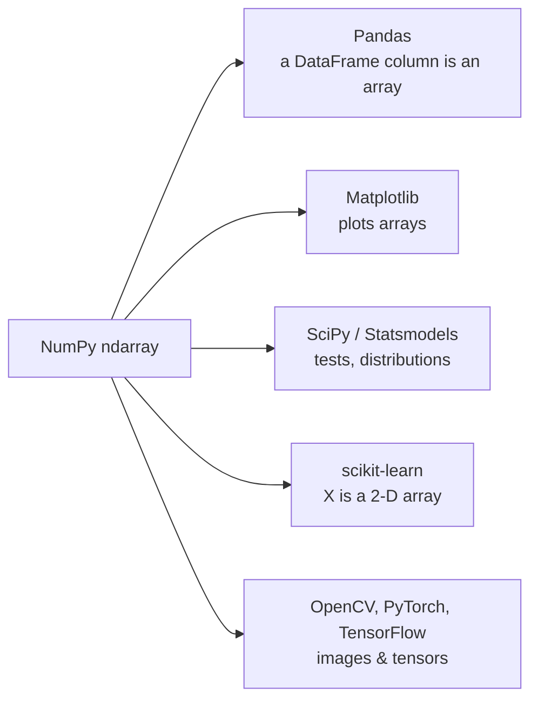
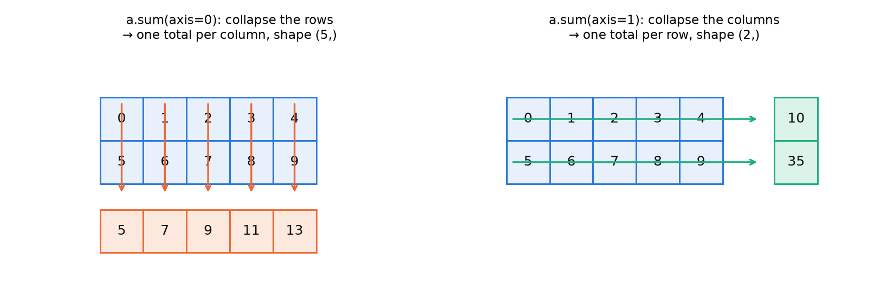
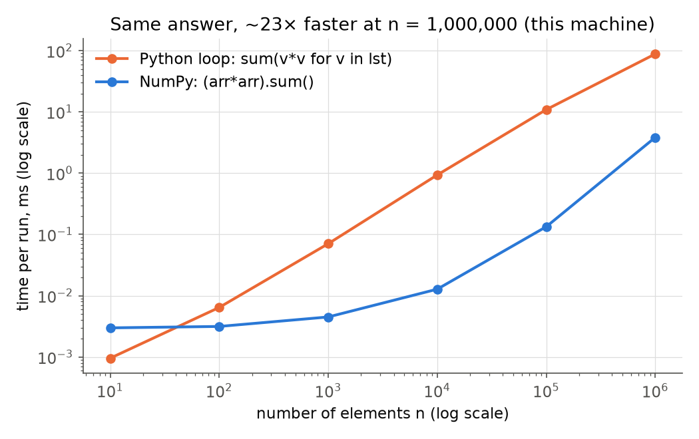
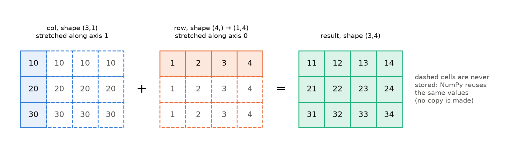

# 01 · NumPy Foundations

> **Course:** Data Analytics Laboratory · Dept. of Data Science & AI · IIIT Dharwad
>
> **Manual:** Experiment 3, *Working with Pandas DataFrames*, NumPy part (arrays, `ones`/`zeros`, `arange`, `concatenate`, `random`, `reshape`/`ravel`, transpose, slicing, axis sums, image indexing)
>
> **Notebooks:** [`code/lab1_numpy_class.ipynb`](code/lab1_numpy_class.ipynb) runs every manual snippet with an explanation · [`code/01_numpy_deep_dive.ipynb`](code/01_numpy_deep_dive.ipynb), Parts A–P, produces every number in this note. Figures: [`code/figures_01.py`](code/figures_01.py)
>
> **Practised in:** Assignment 1 (10 NumPy questions) and Assignment 2 (Q4–Q5)
>
> **Difficulty tags:** 🟢 core/manual · 🟡 needs practice · 🔴 beyond the manual

---

## 📌 Table of Contents

1. [Big Picture](#1-big-picture)
2. [The ndarray: ndim, shape, size, dtype](#2-the-ndarray-ndim-shape-size-dtype-)
3. [Creating Arrays](#3-creating-arrays-)
4. [Reshape, Ravel & Transpose](#4-reshape-ravel--transpose-)
5. [Indexing & Slicing](#5-indexing--slicing-)
6. [Axes & Aggregations](#6-axes--aggregations-)
7. [Joining & Splitting Arrays](#7-joining--splitting-arrays-)
8. [Boolean Masks, Fancy Indexing & np.where](#8-boolean-masks-fancy-indexing--npwhere-)
9. [Vectorization: Why NumPy Is Fast](#9-vectorization-why-numpy-is-fast-)
10. [Broadcasting](#10-broadcasting-)
11. [Views vs Copies](#11-views-vs-copies-)
12. [dtypes & Numerical Pitfalls](#12-dtypes--numerical-pitfalls-)
13. [Images as Arrays (the manual's `I` snippets)](#13-images-as-arrays-the-manuals-i-snippets-)
14. [Random Numbers & Reproducibility](#14-random-numbers--reproducibility-)
15. [Bridge: Linear Algebra in NumPy](#15-bridge-linear-algebra-in-numpy-)
16. [Real-World Case Studies](#16-real-world-case-studies-)
17. [Manual Errata](#17-%EF%B8%8F-manual-errata)
18. [Common Confusions](#18--common-confusions)
19. [Quiz-Style Questions](#19--quiz-style-questions)
20. [Practice Problems](#20--practice-problems)
21. [Cheat Sheet](#21--cheat-sheet)
22. [Go Deeper](#22--go-deeper)

---

## 1. Big Picture

> **NumPy** (*Numerical Python*) gives Python one new object, the **`ndarray`**: a grid of numbers that all have the **same type**, stored in **one continuous block of memory**. Everything else in NumPy is a fast operation on that grid.

Why a lab on data analytics starts here: **every** tool later in the course sits on top of NumPy.



**Python list vs NumPy array, in one table**

| | Python list | NumPy array |
|---|---|---|
| Element types | anything, mixed | one type (`dtype`) for all |
| Memory | array of pointers to separate objects | one contiguous block of raw numbers |
| `x * 2` | repeats the list: `[1, 2] * 2 → [1, 2, 1, 2]` | multiplies each element: `[2 4]` |
| Loops | written by you, run by the Python interpreter | run inside compiled C code |
| Speed on 1 million squares | ~100 ms | ~10 ms (roughly **5–25× faster**, depending on the run, §9) |
| Multi-dimensional | lists of lists, no real shape | true `shape`, axes, slicing in every dimension |

The mental model for the whole note: **an array = raw data + a small header** (`shape`, `dtype`, `strides`) that says how to read the data. Reshaping, transposing and slicing usually change only the header, which is why they are instant (§4, §11).

---

## 2. The ndarray: ndim, shape, size, dtype 🟢

The manual's first example:

```python
import numpy as np
a = np.array([[1, 2, 3], [4, 5, 6]], dtype=np.float32)
print(a.ndim, a.shape, a.dtype)      # 2 (2, 3) float32
```

| Attribute | Meaning | Value for `a` |
|---|---|---|
| `a.ndim` | number of dimensions (axes) | `2` |
| `a.shape` | size along each axis, as a tuple | `(2, 3)`: 2 rows, 3 columns |
| `a.size` | total number of elements = product of shape | `6` |
| `a.dtype` | type of every element | `float32` |
| `a.itemsize` | bytes per element | `4` |
| `a.nbytes` | total bytes = size × itemsize | `24` |

**Reading a shape.** Read it outside-in: `(2, 3)` = "2 things, each of which has 3 numbers". A 1-D array of 6 elements has shape `(6,)`; the comma makes it a one-element tuple. A single number has shape `()`.

```
shape (6,)            shape (2, 3)              shape (2, 3, 4)
[1 2 3 4 5 6]         [[1 2 3]                  2 blocks, each 3 rows × 4 columns
                       [4 5 6]]                 (e.g. 2 images of 3×4 pixels)
axis 0 →              axis 0 ↓ rows             axis 0 = block, axis 1 = row, axis 2 = column
                      axis 1 → columns
```

### Worked example 2.1: dtype and memory 🟢

Same numbers, different dtype:

| Code | dtype | nbytes |
|---|---|---|
| `np.array([[1,2,3],[4,5,6]], dtype=np.float32)` | `float32` | 24 |
| `np.array([[1,2,3],[4,5,6]])` | `int64` (default for whole numbers on 64-bit Linux) | 48 |

`float32` halves memory compared with the default `float64`. Deep-learning libraries use `float32` for exactly this reason; for statistics the default `float64` is safer (more precision).

---

## 3. Creating Arrays 🟢

| Function | What it builds | Example → result |
|---|---|---|
| `np.array(list)` | from a (nested) list | `np.array([1, 2, 3])` |
| `np.zeros(shape)` | all 0.0 | `np.zeros((2, 3))` |
| `np.ones(shape, dtype)` | all 1 | `np.ones((3, 5), dtype=np.float32)` (manual) |
| `np.full(shape, v)` | all `v` | `np.full((2, 3), 7)` |
| `np.eye(n)` | identity matrix | `np.eye(3)`: 1s on the diagonal |
| `np.arange(start, stop, step)` | evenly spaced, **stop excluded** | `np.arange(3, 15)` → 3 … 14 |
| `np.linspace(start, stop, num)` | `num` points, **stop included** | `np.linspace(0, 1, 5)` → `[0. 0.25 0.5 0.75 1.]` |
| `np.random.random(shape)` | uniform random in [0, 1) | `np.random.random((10, 3))` (manual, see §14) |

> **Shape goes in a tuple.** `np.zeros((3, 5))`, not `np.zeros(3, 5)`; in the second form 5 is taken as the dtype argument and raises an error.

### The `stop` rule (Assignment 1, Q1–Q2) 🟢

`arange` behaves like Python's `range`: start included, stop **excluded**.

| Want | Write | Result |
|---|---|---|
| 10 to 29 inclusive | `np.arange(10, 30)` | 20 numbers |
| even numbers 2 to 20 | `np.arange(2, 21, 2)` | `[ 2  4  6  8 10 12 14 16 18 20]` |
| 1 to 12 | `np.arange(1, 13)` | 12 numbers |

### Worked example 3.1: why `arange` with a float step is risky 🟡

```python
len(np.arange(0, 1, 0.1))      # 10  (as expected)
np.arange(1, 1.3, 0.1)         # [1.  1.1 1.2 1.3]  ← 4 values, 1.3 "should" be excluded!
```

0.1 cannot be stored exactly in binary (§12), so `1 + 3×0.1` comes out as 1.2999999…, which is *less* than 1.3 and gets included. **Rule:** for float ranges use `np.linspace(start, stop, num)`, where you choose the **count** and there is no rounding surprise.

---

## 4. Reshape, Ravel & Transpose 🟢

**Reshape** = same numbers, new arrangement. The only rule: **the product of the new shape must equal `size`.**

```python
a = np.array([1, 2, 3, 4, 5, 6])
a.reshape(3, 2)      # [[1 2] [3 4] [5 6]]
a.reshape(2, -1)     # -1 = "work it out": 6 / 2 = 3 → [[1 2 3] [4 5 6]]
a.reshape(2, 3).ravel()   # back to 1-D: [1 2 3 4 5 6]
np.arange(12).reshape(5, -1)   # ValueError: cannot reshape array of size 12 into shape (5,newaxis)
```

**Filling order.** NumPy fills **row by row** (called *C order* or *row-major*): the last index changes fastest. With `order="F"` (Fortran, column-major) it fills column by column:

```
a.reshape(3, 2)            a.reshape(3, 2, order="F")
[[1 2]                     [[1 4]
 [3 4]                      [2 5]
 [5 6]]                     [3 6]]
```

### Worked example 4.1: where is element `t[1, 2, 3]`? 🟡

`t = np.arange(24).reshape(2, 3, 4)`. In row-major order, one step along axis 0 skips a whole 3×4 block (12 elements), one step along axis 1 skips a row (4 elements):

$$\text{position} = 1 \times 12 + 2 \times 4 + 3 = 23 \quad\Rightarrow\quad t[1,2,3] = 23 \checkmark$$

NumPy stores these step sizes in bytes as **strides**: `t.strides = (96, 32, 8)` = (12, 4, 1) elements × 8 bytes. Reshape and transpose just compute new strides, so they don't copy data.

**Transpose** swaps rows and columns: `m = np.arange(10).reshape(5, 2)`; `m.T` and `m.transpose((1, 0))` both have shape `(2, 5)`. For 3-D arrays `transpose` takes the new order of the axes, e.g. an image stored as (channels, height, width) = (3, 32, 48) becomes (height, width, channels) = (32, 48, 3) with `.transpose(1, 2, 0)`.

---

## 5. Indexing & Slicing 🟢

**Slice syntax: `start:stop:step`.** Start included, stop excluded, step defaults to 1; negative indices count from the end (`-1` = last).

The manual's list examples, with their real results (`a = list(range(10))`):

| Expression | Indices taken | Result |
|---|---|---|
| `a[:3]` | 0, 1, 2 | `[0, 1, 2]` |
| `a[-3:]` | 7, 8, 9 | `[7, 8, 9]` |
| `a[3:8:2]` | 3, 5, 7 | `[3, 5, 7]` |
| `a[4:1:-1]` | 4, 3, 2 (walks backwards, stops before 1) | `[4, 3, 2]` |
| `a[::-1]` | everything, reversed | `[9, 8, …, 0]` |

**In 2-D, one slice per axis, separated by a comma: `arr[rows, cols]`.**

### Worked example 5.1: the Assignment 1/2 array 🟢

```python
arr = np.array([[10, 20, 30, 40],
                [50, 60, 70, 80],
                [90, 100, 110, 120]])
```

```
          col 0  col 1  col 2  col 3
row 0  [   10     20     30     40  ]     arr[:2, 2:]  → rows 0–1, cols 2–3 → [[30 40] [70 80]]
row 1  [   50     60    (70)    80  ]     arr[1, 2]    → 70
row 2  [   90    100    110    120  ]     arr[:, -1]   → [ 40  80 120]  (last column)
```

| Expression | Result | Reading |
|---|---|---|
| `arr[1, 2]` | `70` | row 1, column 2 |
| `arr[1]` or `arr[1, :]` | `[50 60 70 80]` | the second row |
| `arr[:, -1]` | `[ 40  80 120]` | every row, last column |
| `arr[:2, 2:]` | `[[30 40] [70 80]]` | top-right 2×2 block |
| `arr[::-1]` | rows in reverse order | flip upside down |
| `arr[:, ::2]` | columns 0 and 2 | every second column |
| `arr[-1, ::-1]` | `[120 110 100  90]` | last row, reversed |

**Integer vs slice changes the shape.** `arr[1]` has shape `(4,)` (the row axis disappears), but `arr[1:2]` has shape `(1, 4)` (still 2-D, one row). This matters when a function expects a 2-D input (e.g. scikit-learn's `predict`).

---

## 6. Axes & Aggregations 🟢

Aggregations (`sum`, `mean`, `min`, `max`, `std`, `argmax`, …) reduce many numbers to fewer. The `axis` argument says **which axis disappears**.



> **Memory trick:** `axis=0` collapses **down** the rows → one result **per column**. `axis=1` collapses **across** the columns → one result **per row**.

For `a2 = np.arange(10).reshape(2, 5)` = `[[0 1 2 3 4] [5 6 7 8 9]]`:

| Call | Result | Shape |
|---|---|---|
| `a2.sum()` | `45` | `()` |
| `a2.sum(axis=0)` | `[ 5  7  9 11 13]` | `(5,)` |
| `a2.sum(axis=1)` | `[10 35]` | `(2,)` |
| `a2.sum(axis=1, keepdims=True)` | `[[10] [35]]` | `(2, 1)` |

On a **1-D** array only `axis=0` exists: `np.arange(10).sum(axis=1)` raises `AxisError: axis 1 is out of bounds for array of dimension 1`. (The manual's comments on these lines are mixed up; see §17.)

### Worked example 6.1: a class result sheet 🟢

4 students (rows) × 3 subjects (columns):

```python
marks = np.array([[78, 85, 62],
                  [90, 72, 88],
                  [55, 60, 70],
                  [82, 95, 91]])
```

| Question | Code | Answer |
|---|---|---|
| Grand total | `marks.sum()` | 928 |
| Total per student | `marks.sum(axis=1)` | `[225 250 185 268]` |
| Average per subject | `marks.mean(axis=0)` | `[76.25 78.   77.75]` |
| Highest mark per subject | `marks.max(axis=0)` | `[90 95 91]` |
| Who is the topper? | `marks.sum(axis=1).argmax()` | student 3 (268) |
| Each student's best subject | `marks.argmax(axis=1)` | `[1 0 2 1]` |
| Spread per subject (population, ddof=0) | `marks.std(axis=0)` | `[13.01 13.21 12.13]` |
| Spread per subject (sample, ddof=1) | `marks.std(axis=0, ddof=1)` | `[15.02 15.25 14.01]` |

**Why `keepdims` is useful:** to express each mark as a percentage of that student's total, divide the (4, 3) array by the (4,) totals. Shapes (4, 3) and (4,) don't line up (§10), but `tot = marks.sum(axis=1, keepdims=True)` has shape (4, 1), which broadcasts across the columns: `100 * marks / tot` → first row `[34.7 37.8 27.6]`.

**`ddof`.** `np.std` divides by $n$ by default (population SD). Pandas' `.std()` divides by $n-1$ (sample SD). Same data, different answers; pass `ddof=1` in NumPy when you want to match Pandas or a statistics textbook.

---

## 7. Joining & Splitting Arrays 🟢

| Function | Joins along | `x=[1,2,3]`, `y=[4,5,6]` → |
|---|---|---|
| `np.concatenate([a, b], axis=0)` | an **existing** axis (default 0) | `[1 2 3 4 5 6]` |
| `np.vstack([x, y])` | rows (vertical) | `[[1 2 3] [4 5 6]]`, shape (2, 3) |
| `np.hstack([x, y])` | columns (horizontal) | `[1 2 3 4 5 6]` |
| `np.stack([x, y], axis=0)` | a **new** axis | shape (2, 3) |
| `np.stack([x, y], axis=1)` | a new last axis | shape (3, 2) |
| `np.column_stack([x, y])` | 1-D arrays become columns | `[[1 4] [2 5] [3 6]]` |

The manual's example: two (3, 5) arrays (ones and zeros) → `concatenate` gives **(6, 5)** with `axis=0` and **(3, 10)** with `axis=1`.

**The rule:** all dimensions must match **except** the one you join along. Joining a (2, 3) and a (4, 3) array works on axis 0 (→ (6, 3)) but fails on axis 1:
`ValueError: all the input array dimensions except for the concatenation axis must match exactly…`

**Splitting** is the reverse: `np.split(np.arange(9), 3)` → three arrays `[0 1 2]`, `[3 4 5]`, `[6 7 8]`; `np.split(np.arange(9), [2, 5])` cuts *before* index 2 and 5 → `[0 1]`, `[2 3 4]`, `[5 6 7 8]`.

---

## 8. Boolean Masks, Fancy Indexing & np.where 🟢

A comparison on an array gives an array of `True`/`False`, a **mask**. Putting a mask inside `[ ]` keeps only the `True` positions. This is the single most-used idea in data cleaning, and Pandas filtering (Note 02) works exactly the same way.

### Worked example 8.1: the Assignment 1 scores 🟢

```python
scores = np.array([45, 82, 67, 33, 91, 58, 74, 29, 88])
mask = scores >= 60
# [False  True  True False  True False  True False  True]
```

| Task | Code | Result |
|---|---|---|
| passing scores | `scores[mask]` | `[82 67 91 74 88]` |
| how many passed | `mask.sum()` (True counts as 1) | `5` |
| fraction passed | `mask.mean()` | `0.556` |
| *where* are they | `np.where(mask)[0]` | `[1 2 4 6 8]` |
| label every score | `np.where(mask, "Pass", "Fail")` | `['Fail' 'Pass' 'Pass' 'Fail' …]` |
| between 60 and 80 | `scores[(scores >= 60) & (scores < 80)]` | `[67 74]` |
| fail **or** ≥ 90 | `scores[(scores < 60) \| (scores >= 90)]` | `[45 33 91 58 29]` |
| grade bands | `np.select([scores>=85, scores>=70, scores>=60], ["A","B","C"], default="F")` | `['F' 'B' 'C' 'F' 'A' 'F' 'B' 'F' 'A']` |
| pick by position (fancy indexing) | `scores[[0, 4, -1]]` | `[45 91 88]` |
| top 3 | `scores[np.argsort(scores)[::-1][:3]]` | `[91 88 82]` |

**Three rules for combining conditions:**
1. Use `&` (and), `|` (or), `~` (not), **not** Python's `and`/`or`/`not`.
2. **Bracket every condition.** `&` binds tighter than `>=`, so `scores >= 60 & scores < 80` is read as `scores >= (60 & scores) < 80` and fails with *"The truth value of an array with more than one element is ambiguous"*.
3. `np.select` checks conditions **in order** and takes the first match, so put the strictest condition first.

---

## 9. Vectorization: Why NumPy Is Fast 🟡

**Vectorization** = writing an operation on the whole array (`arr * arr`) instead of a Python loop over elements. The loop still happens, but inside compiled C code that runs over raw numbers in contiguous memory, with no per-element type checks.



Sum of squares of 1,000,000 numbers on this laptop (Part H of the notebook):

| Method | Typical time |
|---|---|
| `sum(v * v for v in lst)` | ~100–115 ms |
| `(arr * arr).sum()` | ~8–16 ms |
| Ratio | **~6–25× faster** across runs, same answer |

Timings change from run to run and machine to machine, so the notebook prints its own numbers each time. The point is the order of magnitude, and the gap grows for heavier operations (e.g. `np.sqrt`, matrix products).

**Universal functions (ufuncs)** apply element by element: `np.sqrt([1, 4, 9, 16])` → `[1. 2. 3. 4.]`, `np.exp([0, 1])` → `[1. 2.7183]`, `np.log(np.e)` → `1.0`. Operators `+ - * / ** % //` and comparisons are ufuncs too.

> **Rule of thumb for this lab:** if you're writing `for i in range(len(arr))`, there is almost always a one-line NumPy (or Pandas) expression that does the same thing faster and more readably.

---

## 10. Broadcasting 🟡

**Broadcasting** lets NumPy combine arrays of **different shapes** without copying data. `arr + 5` already uses it: the single number 5 is "stretched" to the shape of `arr`.



**The rule.** Line up the shapes from the **right**. Each pair of dimensions must be **equal**, or **one of them must be 1** (or missing). A 1 is stretched to match.

| Shapes | Aligned from the right | Result |
|---|---|---|
| (3, 4) and () | scalar | (3, 4) |
| (3, 4) and (4,) | 4 = 4 | (3, 4): the row is added to every row |
| (3, 4) and (3, 1) | 4 vs 1 → ok; 3 = 3 | (3, 4): the column is added to every column |
| (3, 1) and (1, 4) | both stretch | (3, 4): an "outer" combination |
| (3, 4) and (3,) | 4 vs 3 ✗ | **error** |
| (2, 1, 3) and (4, 1) | 3 vs 1, 1 vs 4, 2 vs – | (2, 4, 3) |
| (8, 1, 6, 1) and (7, 1, 5) | | (8, 7, 6, 5) |

Example: `np.array([[10], [20], [30]]) + np.array([1, 2, 3, 4])` gives a (3, 4) table `[[11 12 13 14] [21 22 23 24] [31 32 33 34]]`.

The (3, 4) + (3,) case is the classic trap: a per-**row** quantity of shape (3,) must first become (3, 1) with `v[:, None]` or `v.reshape(-1, 1)` (or come from `keepdims=True`).

### Worked example 10.1: standardising features (z-scores) 🟡

Heights (cm) and weights (kg) of 4 people, shape (4, 2):

```python
X = np.array([[170, 65], [160, 58], [180, 80], [175, 72]], dtype=float)
mu = X.mean(axis=0)      # [171.25  68.75]   shape (2,)
sd = X.std(axis=0)       # [7.3951 8.1662]   shape (2,)
Z = (X - mu) / sd        # (4, 2) - (2,) → broadcast down the rows
```

$$z = \frac{x - \mu}{\sigma} \qquad Z = \begin{bmatrix} -0.169 & -0.459 \\ -1.521 & -1.316 \\ 1.183 & 1.378 \\ 0.507 & 0.398 \end{bmatrix}$$

Each column of `Z` now has mean 0 and standard deviation 1. This is exactly what scikit-learn's `StandardScaler` does in Experiment 4 (feature engineering).

---

## 11. Views vs Copies 🟡

Because an array is "data + header" (§1), many operations return a **view**: a new header pointing at the **same data**. Changing the view changes the original.

| Operation | Returns | Editing it changes the original? |
|---|---|---|
| basic slice `a[1:4]`, `a[:, 0]` | view | **yes** |
| `reshape`, `.T`, `ravel` (usually) | view | **yes** |
| boolean mask `a[a > 2]` | copy | no |
| fancy index `a[[0, 2]]` | copy | no |
| `.copy()` | copy | no |
| Python list slice `lst[1:3]` | copy | no |

From the notebook (`a = np.arange(6)` each time):

```python
v = a[1:4]; v[0] = 100          # a → [  0 100   2   3   4   5]   (view!)
b = a.reshape(2, 3); b[0, 0] = 99   # a → [99  1  2  3  4  5]    (view!)
c = a[a > 2]; c[0] = -1          # a unchanged                   (copy)
d = a[1:4].copy(); d[0] = 100    # a unchanged                   (copy)
```

`np.shares_memory(a, v)` tells you which case you are in. **Habit:** when you take a slice and plan to modify it, write `.copy()`. Pandas has the same issue (the *SettingWithCopyWarning*, Note 02).

---

## 12. dtypes & Numerical Pitfalls 🟡

**One array, one type.** If you mix types, NumPy picks the most general one ("upcasting"):

| Input | dtype |
|---|---|
| `[1, 2, 3]` | `int64` |
| `[1, 2.5]` | `float64` |
| `[1, 2.5, True]` | `float64` (True → 1.0) |
| `[1, "2"]` | `<U21` (everything becomes a string; arithmetic no longer works) |

**Pitfalls worth knowing:**

| Pitfall | Example | What happens |
|---|---|---|
| `astype(int)` truncates toward 0 | `[1.7, -3.9, 2.5].astype(int)` | `[ 1 -3  2]`; use `np.round(...)` first → `[ 2 -4  2]` |
| Integer overflow wraps around | `uint8` 200 + 100 | `44` (= 300 mod 256) |
| | `int8` 127 + 1 | `-128` |
| Floats are not exact | `0.1 + 0.2 == 0.3` | `False`; use `np.isclose` → `True` |
| Division by zero | `[1., 0., -1.] / 0` | `[ inf  nan -inf]` (a warning, not an error) |
| NaN is not equal to itself | `np.nan == np.nan` | `False`; test with `np.isnan` |
| NaN poisons aggregates | `np.mean([1, np.nan, 3])` | `nan`; `np.nanmean` → `2.0` |

The overflow row matters for images, which are stored as `uint8` (0–255): adding brightness directly wraps bright pixels round to dark. Convert to `int` first and `np.clip` back to 0–255 (§13).

The NaN rows matter for Note 02: Pandas uses NaN for missing values, but unlike NumPy its `mean()` **skips** NaN by default.

---

## 13. Images as Arrays (the manual's `I` snippets) 🔴

The manual's last NumPy lines (`I[1:-1, 1:-1]`, `I[:, :, ::-1]`) assume `I` is an **image**. A colour image is a 3-D array of shape **(height, width, channels)**, `uint8`, values 0–255.

### Worked example 13.1: a 2×2 pixel image 🟡

```python
I = np.array([[[255, 0, 0], [0, 255, 0]],          # red,  green
              [[0, 0, 255], [255, 255, 255]]],     # blue, white
             dtype=np.uint8)                        # shape (2, 2, 3)
```

| Operation | Code | Result |
|---|---|---|
| Swap RGB ↔ BGR (OpenCV order) | `I[:, :, ::-1]` | pixel (0,0) becomes `[0 0 255]` |
| Grayscale (luminance weights) | `I @ [0.299, 0.587, 0.114]` | `[[76.245 149.685] [29.07 255.]]` |
| Mirror left-right | `I[:, ::-1]` | row 0 becomes green, red |
| Drop a 1-pixel border | `I[1:-1, 1:-1]` | a (6, 6, 3) image → (4, 4, 3) |
| Brighten safely | `np.clip(I.astype(int) + 100, 0, 255)` | red pixel → `[255 100 100]` |

Green gets the largest grayscale weight because the human eye is most sensitive to it. Every one of these is a slice, mask or broadcast from §5–§12; no loops over pixels.

---

## 14. Random Numbers & Reproducibility 🟡

The manual uses the old interface `np.random.random((10, 3))`, which gives different numbers each run. The modern, recommended way is a **Generator** with a **seed**:

```python
rng = np.random.default_rng(42)
rng.random(3)                 # [0.774  0.4389 0.8586]  (same every run with seed 42)
rng.integers(1, 7, size=5)    # dice rolls; upper bound excluded
```

Two generators with the same seed produce identical numbers, so your notebook's results can be reproduced by anyone. Always seed when results are reported (train/test splits, simulations).

**Uses in this course:** shuffling and splitting data (`idx = rng.permutation(10)` → first 8 for training, last 2 for testing), simulation, and initialising model weights.

Fun check, **Monte Carlo π**: throw 100,000 random points in the unit square; the fraction inside the quarter circle ≈ π/4. With seed 0: `4 * inside.mean()` = **3.14812**.

---

## 15. Bridge: Linear Algebra in NumPy 🔴

This connects to Applied Math for AI & DS (linear systems, determinants, inverses).

| Operation | Code | For `A = [[2,1],[1,3]]` |
|---|---|---|
| Matrix product | `A @ A` | `[[ 5  5] [ 5 10]]` |
| Element-wise product (**not** matrix product) | `A * A` | `[[4 1] [1 9]]` |
| Determinant | `np.linalg.det(A)` | `5.0` |
| Solve `A x = b`, `b = [5, 10]` | `np.linalg.solve(A, b)` | `[1. 3.]` |
| Inverse | `np.linalg.inv(A)` | `[[ 0.6 -0.2] [-0.2  0.4]]` |
| Length of a vector | `np.linalg.norm([3, 4])` | `5.0` |

Prefer `solve(A, b)` over `inv(A) @ b`: it is faster and more accurate.

---

## 16. Real-World Case Studies 🔴

### 16.1 Weighted final marks

Weights 30% / 30% / 40% for the three subjects of Worked example 6.1. A (4, 3) matrix times a (3,) vector gives one number per student:

```python
final = marks @ np.array([0.3, 0.3, 0.4])   # [73.7 83.8 62.5 89.5]
np.argsort(-final)                           # rank order: [3 1 0 2]
```

### 16.2 Cleaning sensor readings

A temperature sensor logs `-999.0` when it fails, a spike of `85.0` from interference, and one `nan`:

```python
r = np.array([21.5, 22.1, -999.0, 23.0, 85.0, 22.7, np.nan, 21.9])
bad = ~np.isfinite(r) | (r < -50) | (r > 60)    # positions [2 4 6]
clean = np.where(bad, np.nan, r)
np.nanmean(clean)    # 22.24     ← sensible
np.nanmean(r)        # -114.686  ← one sentinel value ruins the average
```

This is the same logic as Assignment 3's invalid attendance value (105): **turn impossible values into missing values first, then summarise**.

---

## 17. ⚠️ Manual Errata

The manual's Experiment 3 NumPy code has some typos. Corrected versions:

| Manual | Problem | Correct |
|---|---|---|
| `np.arrange(3,5)` | no such function | `np.arange(3, 5)` |
| `a = a.T a = a.transpose((1,0))` | two statements on one line | put each on its own line |
| `a[4:1:-1]` followed by `# sum all entries a.sum(axis=0)` | comments and code have been merged | `a.sum()` sums all entries |
| `Axes a.sum()` / `# sum over rows` | labels swapped | `a.sum(axis=0)` collapses rows → one total **per column**; `a.sum(axis=1)` → one total **per row** (§6) |
| sum examples run on `a = list(range(10))` | a list has no `.sum`, and a 1-D array has no `axis=1` | use a 2-D array, e.g. `np.arange(10).reshape(2, 5)` |
| `I[1:-1,1:-1]` with no `I` defined | `I` is never created | it's an image array of shape (H, W, C), see §13 |
| `# swap channel order I[I` | line cut off | `I = I[:, :, ::-1]` swaps RGB ↔ BGR; the cut-off line was probably a mask such as `I[I > 128] = 255` |
| `np.random.random((10,3))` | works, but legacy API, not reproducible | `rng = np.random.default_rng(seed); rng.random((10, 3))` |

---

## 18. 🤔 Common Confusions

| Confusion | Clarification |
|---|---|
| `shape (6,)` vs `(6, 1)` vs `(1, 6)` | a flat array, a column, a row. They broadcast differently (§10). |
| `size` vs `len()` | `size` = all elements; `len(arr)` = length of axis 0 only. For a (3, 4) array: 12 vs 3. |
| `axis=0` means "rows"? | It means the row axis **disappears**: you get one value per **column**. |
| `arange` vs `linspace` | `arange` fixes the **step** (stop excluded); `linspace` fixes the **count** (stop included). |
| `a * b` vs `a @ b` | element-wise vs matrix product. |
| `reshape` vs `resize` | `reshape` returns a new view and needs the same size; `resize` changes the array in place and can pad/truncate. |
| `ravel` vs `flatten` | both give 1-D; `ravel` returns a view when it can, `flatten` always copies. |
| `and` vs `&` | use `&`, `\|`, `~` with arrays, and bracket each condition. |
| `np.std` vs Pandas `.std()` | ddof=0 vs ddof=1 by default (§6). |
| Slice of a list vs slice of an array | list slice = copy; array slice = view (§11). |

---

## 19. 📝 Quiz-Style Questions

1. What are `ndim`, `shape` and `size` of `np.zeros((2, 3, 4))`? → 3, (2, 3, 4), 24.
2. Which call creates the integers 10 to 29 inclusive? → `np.arange(10, 30)`.
3. `np.arange(12).reshape(3, -1).shape`? → (3, 4).
4. For `m` of shape (5, 2), what is `m.sum(axis=0).shape`? → (2,).
5. Write the expression for the last column of a 2-D array `arr`. → `arr[:, -1]`.
6. What does `np.arange(1, 11)[::-1]` give? → `[10 9 8 … 1]`.
7. Can a (3, 4) array be added to a (4,) array? a (3,) array? → yes; no (needs (3, 1)).
8. Why does `scores[scores >= 60 & scores < 80]` fail? → `&` is evaluated before `>=`; bracket each condition.
9. After `b = a[2:5]; b[:] = 0`, is `a` changed? → yes, a slice is a view.
10. `np.array([1, 2.5, True]).dtype`? → `float64`.
11. Which is the identity matrix function? → `np.eye(n)` (or `np.identity(n)`).
12. How do you make random numbers reproducible? → `rng = np.random.default_rng(seed)`.

---

## 20. 🏋️ Practice Problems

Solutions are verified in Part P of the [deep-dive notebook](code/01_numpy_deep_dive.ipynb).

**P1** 🟢 For `z = np.zeros((3, 4, 2))` give `ndim`, `shape`, `size` and `nbytes`.
> 3, (3, 4, 2), 24, 192 (24 × 8 bytes, float64).

**P2** 🟢 Create 5, 12, 19, … up to below 50. How many values?
> `np.arange(5, 50, 7)` → `[ 5 12 19 26 33 40 47]`, 7 values.

**P3** 🟢 Compare `np.linspace(0, 2, 5)` and `np.arange(0, 2, 0.5)`.
> `[0. 0.5 1. 1.5 2.]` vs `[0. 0.5 1. 1.5]`: linspace includes the stop, arange doesn't.

**P4** 🟢 What shape does `np.arange(12).reshape(3, -1)` have?
> (3, 4).

**P5** 🟢 For `a = np.arange(10)`: `a[2:8:3]`, `a[::-2]`, `a[-4:-1]`?
> `[2 5]`, `[9 7 5 3 1]`, `[6 7 8]`.

**P6** 🟡 For `m = np.arange(1, 17).reshape(4, 4)`, extract the main diagonal, the central 2×2 block, and the four corners.
> `np.diag(m)` → `[ 1  6 11 16]`; `m[1:3, 1:3]` → `[[6 7] [10 11]]`; `m[[0, 0, -1, -1], [0, -1, 0, -1]]` → `[ 1  4 13 16]`.

**P7** 🟢 For `B = [[2, 7, 1], [8, 3, 9]]`: column sums, row sums, column maxima, position of each row's maximum.
> `[10 10 10]`, `[10 20]`, `[8 7 9]`, `[1 2]`.

**P8** 🟡 Min-max scale each column of `X = [[1, 200], [3, 400], [5, 300]]` to [0, 1].
> `(X - X.min(axis=0)) / (X.max(axis=0) - X.min(axis=0))` → `[[0. 0.] [0.5 1.] [1. 0.5]]`.

**P9** 🟢 For `d = [15, 22, 8, 45, 31, 19, 50, 12]` (Assignment 1, Q8): min, max, mean, population SD, sample SD, index of max.
> 8, 50, 25.25, 14.42, 15.4157, 6.

**P10** 🟢 Shapes of: concatenating (2, 3) and (4, 3) on axis 0; `np.stack` of two (3,) arrays on axis 0; on axis 1.
> (6, 3), (2, 3), (3, 2).

**P11** 🟢 Replace negatives in `v = [3, -1, 4, -1, 5, -9]` with 0 and count them.
> `np.where(v < 0, 0, v)` (or `np.clip(v, 0, None)`) → `[3 0 4 0 5 0]`; 3 negatives.

**P12** 🟢 Daily temperatures `[28.5, 31.2, 29.8, 33.1, 30.0, 27.4, 32.6]` °C: convert to °F and find the days above 30 °C.
> `temps * 9/5 + 32` → `[83.3 88.16 85.64 91.58 86. 81.32 90.68]`; days `[1 3 6]` with `[31.2 33.1 32.6]`. Note 30.0 is *not* above 30.

**P13** 🟡 Broadcast or error? (4, 1)+(3,); (2, 3)+(2,); (8, 1, 6, 1)+(7, 1, 5).
> (4, 3); error; (8, 7, 6, 5).

**P14** 🟡 Build a 9×9 multiplication table without loops. What is entry [6, 8] and the sum of all entries?
> `n = np.arange(1, 10); tab = n[:, None] * n`. `tab[6, 8]` = 7 × 9 = 63; sum = (1+…+9)² = 45² = 2025.

**P15** 🟡 `a = np.arange(6); b = a.reshape(2, 3); b[0, 0] = 99; c = a[a > 2]`. What is `a`?
> `[99 1 2 3 4 5]`: the reshape is a view, the boolean selection is a copy.

**P16** 🟡 Predict: `np.array([1, 2.5, True]).dtype`, `np.array([1, "2"]).dtype`, `int8` 127 + 1.
> `float64`, `<U21`, `-128`.

**P17** 🟢 Meal prices `[800, 250, 1200, 99]`: 5% GST per bill, totals, and the grand total (Assignment 2 Q1, vectorised).
> GST `[40. 12.5 60. 4.95]`, totals `[840. 262.5 1260. 103.95]`, grand total 2466.45.

**P18** 🟡 Find the factors of 36 without a loop. Is 97 prime?
> `d = np.arange(1, 37); d[36 % d == 0]` → `[1 2 3 4 6 9 12 18 36]` (9 factors). 97 has factors `[1 97]` only, so it is prime.

**P19** 🟡 `A` is (2, 3) `[[1,2,3],[4,5,6]]`, `B` is (3, 2) `[[1,0],[0,1],[1,1]]`. Compute `A @ B`. What about `A * B`?
> `[[4 5] [10 11]]`, shape (2, 2). `A * B` fails: shapes (2, 3) and (3, 2) can't broadcast.

**P20** 🔴 Solve $x + y + z = 6$, $2y + 5z = -4$, $2x + 5y - z = 27$.
> `np.linalg.solve` → $x = 5, y = 3, z = -2$ (det = −21, non-zero, so a unique solution).

**P21** 🔴 Simulate 10,000 rolls of two dice (seed 7). Estimate P(sum = 7).
> 0.168, close to the exact 1/6 = 0.1667.

**P22** 🔴 Grayscale of the 2×2 image `[[[200,100,50],[0,0,0]],[[255,255,255],[10,200,30]]]` using weights (0.299, 0.587, 0.114).
> `[[124.2 0.] [255. 123.81]]`.

**P23** 🔴 Pairwise distance matrix of points (0,0), (3,4), (6,8) using broadcasting.
> `P[:, None, :] - P[None, :, :]` has shape (3, 3, 2); square, sum over the last axis, square root → `[[0 5 10] [5 0 5] [10 5 0]]`.

**P24** 🔴 3-point moving average of `[2, 4, 6, 8, 10, 12]`.
> `np.convolve(x, np.ones(3)/3, mode="valid")` → `[4. 6. 8. 10.]` (same result with a cumulative-sum trick).

**P25** 🔴 One-hot encode labels `[2, 0, 1, 2]` (3 classes) and decode back.
> `np.eye(3, dtype=int)[labels]` → `[[0 0 1] [1 0 0] [0 1 0] [0 0 1]]`; `.argmax(axis=1)` → `[2 0 1 2]`.

---

## 21. 📋 Cheat Sheet

```python
import numpy as np

# create
np.array([[1, 2], [3, 4]])      np.zeros((r, c))       np.ones((r, c))
np.full((r, c), v)              np.eye(n)              np.arange(a, b, step)   # b excluded
np.linspace(a, b, num)          # b included
rng = np.random.default_rng(42); rng.random((r, c)); rng.integers(lo, hi, size)

# inspect
a.ndim  a.shape  a.size  a.dtype  a.nbytes  a.astype(np.float32)

# reshape
a.reshape(r, -1)   a.ravel()   a.T   a.transpose(1, 2, 0)   a[:, None]   # add an axis

# index / slice  (start:stop:step, stop excluded, view!)
a[i, j]   a[i]   a[:, j]   a[r1:r2, c1:c2]   a[::-1]   a.copy()

# masks
a[a > 5]   a[(a > 5) & (a < 9)]   np.where(cond, x, y)   np.select(conds, choices, default)
mask.sum()  # count     mask.mean()  # fraction     np.where(mask)[0]  # positions

# aggregate  (axis=0 → per column, axis=1 → per row)
a.sum()  a.mean(axis=0)  a.std(ddof=1)  a.min()  a.max(axis=1)  a.argmax()  keepdims=True
np.nanmean(a)   # ignore NaN

# join
np.concatenate([a, b], axis=0)   np.vstack([a, b])   np.hstack([a, b])   np.stack([a, b], axis=1)

# math
a + b  a * b  a ** 2  np.sqrt(a)  np.exp(a)  np.log(a)  a @ b  np.linalg.solve(A, b)
np.isclose(x, y)   np.isnan(a)   np.clip(a, lo, hi)
```

**Broadcasting rule:** align shapes from the right; each pair must be equal or contain a 1.

---

## 22. 🔗 Go Deeper

- [NumPy: the absolute basics for beginners](https://numpy.org/doc/stable/user/absolute_beginners.html), the official tutorial
- [NumPy broadcasting](https://numpy.org/doc/stable/user/basics.broadcasting.html), with diagrams
- [Copies and views](https://numpy.org/doc/stable/user/basics.copies.html)
- Jake VanderPlas, [*Python Data Science Handbook*, ch. 2](https://jakevdp.github.io/PythonDataScienceHandbook/02.00-introduction-to-numpy.html) (free)
- Wes McKinney, [*Python for Data Analysis*, ch. 4](https://wesmckinney.com/book/numpy-basics) (free)
- [100 NumPy exercises](https://github.com/rougier/numpy-100), graded from easy to hard
- Harris et al., ["Array programming with NumPy"](https://www.nature.com/articles/s41586-020-2649-2), *Nature* 585 (2020): the paper behind the library
