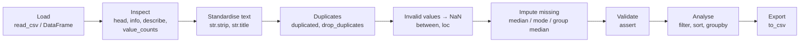
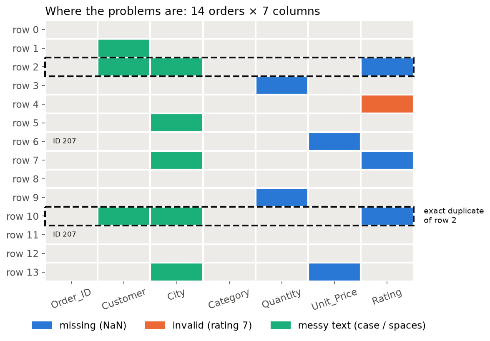
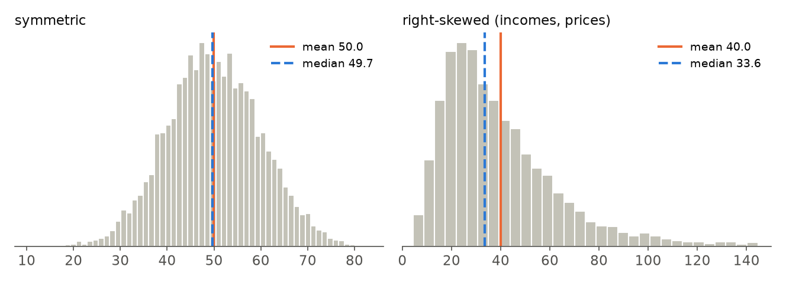
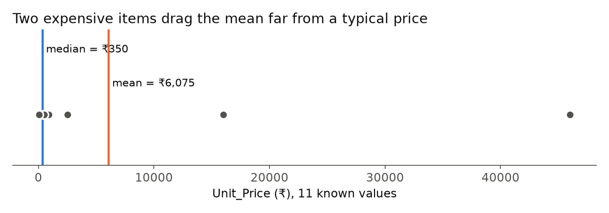
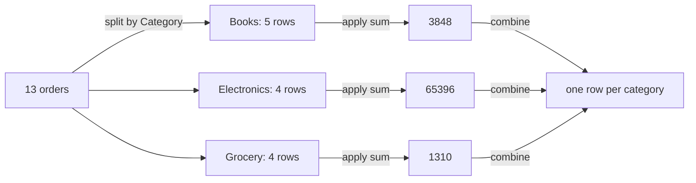

# 02 · Pandas DataFrames & Data Cleaning

> **Course:** Data Analytics Laboratory · Dept. of DS & AI · IIIT Dharwad
>
> **Lab manual:** Experiment 3, *Working with Pandas DataFrames* (the Pandas half; the NumPy half is Note 01). This note follows the manual's order, fixes its typos (see [§17 Manual errata](#17--manual-errata)) and adds the data-cleaning workflow that **Assignment 3** (*Data Cleaning and Analysis Using Pandas*) practises.
>
> **Notebook:** [`code/02_pandas_deep_dive.ipynb`](code/02_pandas_deep_dive.ipynb), Parts A–N. Every number in this note comes from it (pandas 3.0.3, NumPy 2.4). Figures: [`code/figures_02.py`](code/figures_02.py).
>
> **Running example:** a 14-row table of online-shop orders with every common defect in it (missing values, an impossible rating, a duplicated row, a re-used ID, messy city names). It is deliberately *not* the assignment's dataset, so you can practise the moves here and then do the assignment on your own.
>
> **Difficulty tags:** 🟢 core / in the manual · 🟡 needs practice · 🔴 beyond the manual (good to know, interview-level)

---

## 📌 Table of Contents

1. [Big Picture](#1-big-picture)
2. [Creating DataFrames & Reading Files](#2-creating-dataframes--reading-files-)
3. [Selecting Data: `[]`, `.loc`, `.iloc`](#3-selecting-data--loc-iloc-)
4. [Filtering Rows with Boolean Masks](#4-filtering-rows-with-boolean-masks-)
5. [Adding & Modifying Columns](#5-adding--modifying-columns-)
6. [Inspecting a Dataset](#6-inspecting-a-dataset-)
7. [Missing Values & How NaN Behaves](#7-missing-values--how-nan-behaves-)
8. [Text Standardisation](#8-text-standardisation-)
9. [Duplicates: Rows vs Keys](#9-duplicates-rows-vs-keys-)
10. [Invalid Values → NaN](#10-invalid-values--nan-)
11. [Imputation: Mean vs Median vs Mode](#11-imputation-mean-vs-median-vs-mode-)
12. [Validation with `assert`](#12-validation-with-assert-)
13. [Sorting & Derived Columns](#13-sorting--derived-columns-)
14. [Grouping, Aggregating & Plotting](#14-grouping-aggregating--plotting-)
15. [Exporting the Clean Data](#15-exporting-the-clean-data-)
16. [Pitfalls in pandas 2 / 3: Copy-on-Write](#16-pitfalls-in-pandas-2--3-copy-on-write-)
17. [Manual Errata](#17--manual-errata)
18. [Real-World Case Studies](#18-real-world-case-studies-)
19. [Common Confusions](#19--common-confusions)
20. [Quiz-Style Questions](#20--quiz-style-questions)
21. [Practice Problems](#21--practice-problems)
22. [Cheat Sheet](#22--cheat-sheet)
23. [Go Deeper](#23--go-deeper-curated-links)

---

## 1. Big Picture

> **Pandas = NumPy arrays + labels.** A NumPy array is a grid of numbers addressed by position (`a[2, 3]`). A pandas **DataFrame** is a table whose rows and columns have **names**, where each column can have its own type (numbers, text, dates, True/False).

Three objects are all you need:

| Object | What it is | Think of it as |
|---|---|---|
| `Series` | one column: values + an index | a labelled 1-D NumPy array |
| `DataFrame` | many Series sharing one index | a spreadsheet / SQL table |
| `Index` | the row (or column) labels | the "row numbers" column in Excel, except it can hold any labels |

```
            columns  →
          ┌──────────┬──────────┬──────────┐
 index    │ Customer │ City     │ Quantity │   ← each column is a Series
   0      │ Anil     │ Dharwad  │ 2.0      │     with ONE dtype
   1      │ Bhavya   │ Hubli    │ 1.0      │     (str, str, float64)
   2      │ Chetan   │ Dharwad  │ 3.0      │
   ↓      └──────────┴──────────┴──────────┘
```

**Why a whole lab on cleaning?** Real data arrives broken. Surveys skip questions, sensors drop readings, people type "hubli", "Hubli " and "HUBLI" for the same city, and exports duplicate rows. Every later step (plots, statistics, machine learning) silently trusts the data, so an error that survives cleaning becomes a wrong chart, a wrong p-value or a wrong model. Data scientists often say cleaning is most of the job; this lab is where you learn to do it **deliberately**: look first, fix with a reason, then check that the fix worked.

### The cleaning pipeline



**Why this order?** Each step protects the next one:

| Step | Must come before… | because… |
|---|---|---|
| Standardise text | duplicate check | `"Dharwad "` ≠ `"Dharwad"`, so messy text **hides** duplicates (§9) |
| Remove duplicates | imputation | a duplicated row is counted twice in the median/mean you impute with |
| Invalid → NaN | imputation | an impossible value (rating 7) would pull the statistic you fill with |
| Impute | validation | validation checks the final state |
| Validate | analysis | analysis assumes the rules hold |

Assignment 3 asks for the steps in a slightly different order (missing values in Part B, duplicates in Part C). That is fine for a short exercise, as long as you understand the dependency: if you impute first, the duplicate row's values take part in the median.

---

## 2. Creating DataFrames & Reading Files 🟢

### From Python objects

```python
import pandas as pd
import numpy as np

# dict of lists: each key is a COLUMN (the manual's example)
df = pd.DataFrame({"Name": ["Alice", "Bob", "Charlie"], "Age": [25, 30, 22]})

# list of dicts: each dict is a ROW; missing keys become NaN
pd.DataFrame([{"Name": "Dev", "Age": 28}, {"Name": "Ela"}])
#   Name   Age
# 0  Dev  28.0
# 1  Ela   NaN        ← Age became float64 because NaN is a float

# NumPy array + column names
pd.DataFrame(np.arange(6).reshape(3, 2), columns=["x", "y"])
```

`df["Age"]` (single brackets) returns a **Series**; `df[["Age"]]` (a *list* of names inside the brackets) returns a one-column **DataFrame**.

### From files

| Format | Function | Common options |
|---|---|---|
| CSV / TSV | `pd.read_csv(path)` | `sep=","`, `na_values=["NA", "-"]`, `usecols=[...]`, `parse_dates=[...]`, `index_col=0` |
| Excel | `pd.read_excel("f.xlsx", sheet_name="Sheet1")` | needs `openpyxl` installed |
| Stata / SAS | `pd.read_stata("f.dta")`, `pd.read_sas("f.sas7bdat")` | |
| HDF5 | `pd.read_hdf("f.h5", "df")` | needs `tables` |
| JSON | `pd.read_json(path)` | |
| SQL | `pd.read_sql(query, connection)` | |
| Built-in toy data | `sklearn.datasets.load_iris(as_frame=True).frame` | no internet needed |

> 💡 **`na_values` is the first cleaning tool.** If a file writes missing values as `"NA"`, `"-"` or `"?"`, tell `read_csv` and they arrive as proper NaN instead of strings that break your numeric columns.

> ⚠️ The manual's example URL `http://rcs.bu.edu/examples/python/data_analysis/Salaries.csv` now returns **HTTP 404** (notebook Part B). Use the iris data, or download any CSV and read it from disk.

### dtypes in pandas 3

| Data | dtype | Note |
|---|---|---|
| whole numbers, no gaps | `int64` | |
| numbers with any NaN | `float64` | an int column with one missing value becomes float (`[1, None, 3]` → `float64`) |
| text | `str` | **new in pandas 3**: older versions show `object` |
| True/False | `bool` | |
| dates | `datetime64[ns]` | use `parse_dates=` or `pd.to_datetime` |
| few repeated labels | `category` | saves memory, keeps an order |

---

## 3. Selecting Data: `[]`, `.loc`, `.iloc` 🟢

The manual uses the iris dataset. Loaded correctly (notebook Part B):

```python
from sklearn.datasets import load_iris          # "datasets", plural
iris = load_iris(as_frame=True).frame
iris.columns = ["sepal_length", "sepal_width", "petal_length", "petal_width", "target"]
iris["species"] = iris["target"].map({0: "setosa", 1: "versicolor", 2: "virginica"})
iris.shape        # (150, 6)
```

> 💡 Renaming `"petal width (cm)"` to `petal_width` lets you write `iris.petal_width`. Attribute access only works for names that are valid Python identifiers, which is exactly why the manual's `df.petal width` fails.

### The three selectors

| Selector | Selects by | Slice `a:b` includes `b`? | Example |
|---|---|---|---|
| `df["col"]`, `df[["c1","c2"]]` | column name(s) | n/a | `iris["petal_width"]` |
| `df[a:b]` | row **positions** | no | `iris[0:3]` |
| `df.loc[rows, cols]` | **labels** | **yes** | `iris.loc[0:2, "petal_length":"petal_width"]` |
| `df.iloc[rows, cols]` | **positions** | no | `iris.iloc[0:3, 2:4]` |

In notebook Part B, `iris.loc[:, "petal_length":"petal_width"]` and `iris.iloc[0:3, 2:4]` select the same 3×2 block, but notice the two different rules: label slices are **inclusive** at both ends, position slices **exclude** the stop (just like Python lists and NumPy).

### Worked example 3.1: predict before you run 🟢

Index labels are `0, 1, 2, …` for iris, so labels and positions coincide. Predict each result:

| Expression | Rows returned | Why |
|---|---|---|
| `iris["petal_width"][1:4]` | labels 1, 2, 3 (three values, all 0.2) | position slice, stop excluded |
| `iris["petal_width"][4]` | the single value 0.2 | `[4]` on a Series looks up the **label** 4 |
| `iris.loc[1:4, "species"]` | labels 1, 2, 3, **4** | `.loc` slices include the end |
| `iris.iloc[1:4, -1]` | positions 1, 2, 3 of the last column | `.iloc` excludes the end |

**Why it matters:** after you filter or sort, labels and positions stop matching. After `df.sort_values("Total")`, `df.loc[0]` is still the order with label 0 wherever it moved to, while `df.iloc[0]` is whatever is now on top. When in doubt, use `.loc` for names and `.iloc` for positions, never bare `[]` with numbers.

---

## 4. Filtering Rows with Boolean Masks 🟢

**Intuition.** `iris["petal_width"] > 1.5` produces a column of True/False, one per row (a *mask*). Putting a mask inside `df[...]` keeps the True rows.

```python
mask = iris["petal_width"] >= 1.5          # Series of True/False
iris[mask]                                  # rows where it is True

# two conditions: & (and), | (or), ~ (not) — each condition in parentheses
iris[(iris["petal_width"] >= 1.5) & (iris["petal_length"] < 5.0)]
```

From notebook Part B:

* The manual's filter `petal width > 3.0` returns **0 rows**: the largest petal width in iris is **2.5 cm**. A filter that silently returns nothing is a bug, not a result; always check `len(...)`.
* `petal_width >= 1.5 AND petal_length < 5.0` returns **19 rows**: 13 versicolor and 6 virginica.

| Want | Write | Not |
|---|---|---|
| both conditions | `(a > 1) & (b < 5)` | `a > 1 and b < 5` (raises `ValueError: The truth value of a Series is ambiguous`) |
| either | `(a > 1) \| (b < 5)` | `or` |
| negate | `~(a > 1)` | `not` |
| one of several values | `df["City"].isin(["Hubli", "Belagavi"])` | a chain of `\|` |
| a range | `df["Rating"].between(1, 5)` | (inclusive at both ends by default) |
| SQL-like string | `df.query("Category == 'Books' and Quantity >= 3")` | inside `query`, `and`/`or` **are** allowed |

> ⚠️ **Parentheses are not optional.** `&` binds more tightly than `>`, so `t["a"] > 1 & t["b"] >= 0` is parsed as `t["a"] > (1 & t["b"]) >= 0` and fails (notebook Part M).

---

## 5. Adding & Modifying Columns 🟢

```python
people["Salary"]   = [50000, 60000, 45000]          # from a list (length must match)
people["Salary_k"] = people["Salary"] / 1000         # vectorised: no loop
df["Total"]        = df["Quantity"] * df["Unit_Price"]
df = df.rename(columns={"Unit_Price": "Price"})      # rename
df = df.drop(columns=["Temp"])                       # remove
df.loc[df["City"] == "Hubli", "Zone"] = "North"      # set only some rows
```

Arithmetic between columns works **element by element, matched by index label**, exactly like NumPy vectorisation from Note 01. If a value is NaN on either side, the result is NaN.

---

## 6. Inspecting a Dataset 🟢

Never clean data you have not looked at. Here is the running example (notebook Part C):

```python
data = {
    "Order_ID":   [201, 202, 203, 204, 205, 206, 207, 208, 209, 210, 203, 207, 213, 214],
    "Customer":   ["Anil", "bhavya ", " Chetan", "Deepa", "Esha", "Farhan", "Gita", "Hari",
                   "Isha", "Jay", " Chetan", "Kavya", "Lokesh", "Mani"],
    "City":       ["Dharwad", "Hubli", "dharwad", "Belagavi", "Hubli", "Dharwad ", "Belagavi",
                   "hubli", "Dharwad", "Belagavi", "dharwad", "Hubli", "Dharwad", "HUBLI"],
    "Category":   ["Books", "Electronics", "Books", "Grocery", "Electronics", "Grocery", "Books",
                   "Electronics", "Grocery", "Books", "Books", "Grocery", "Electronics", "Books"],
    "Quantity":   [2, 1, 3, np.nan, 1, 5, 2, 1, 4, np.nan, 3, 6, 1, 2],
    "Unit_Price": [350, 15999, 250, 120, 899, 60, np.nan, 45999, 80, 499, 250, 75, 2499, np.nan],
    "Rating":     [5, 4, np.nan, 3, 7, 4, 5, np.nan, 2, 4, np.nan, 3, 5, 4],   # valid range 1–5
}
raw = pd.DataFrame(data)
df = raw.copy()                 # keep the raw data untouched for before/after comparisons
```



*Every problem in one picture: 7 missing cells (blue), one impossible rating (orange), 8 messy text cells (green), an exact duplicate row (rows 2 and 10) and an Order_ID used by two different orders (207).*

### The inspection checklist

| Question | Code | What it told us |
|---|---|---|
| What does it look like? | `df.head()`, `df.tail()`, `df.sample(5)` | first / last / random rows |
| How big? | `df.shape` | `(14, 7)` → 14 rows, 7 columns |
| What columns? | `df.columns.tolist()` | `['Order_ID', 'Customer', …, 'Rating']` |
| Types and gaps? | `df.info()` | Quantity and Unit_Price 12 non-null, Rating 11 non-null; 3 `str` columns |
| Numeric summary? | `df.describe()` | Unit_Price: mean 5590, median (50%) 300, max 45999; **Rating max 7** |
| Text summary? | `df.describe(exclude="number")` | City has **7 unique** values |
| Spelling variants? | `df["City"].value_counts()` | `Dharwad 3, Hubli 3, Belagavi 3, dharwad 2, Dharwad␣ 1, hubli 1, HUBLI 1` |

`describe()` is a fast anomaly detector. Read these rows:

* **max / min** against what is possible: a rating of 7 on a 1–5 scale is impossible.
* **mean vs 50%**: for Unit_Price the mean (5590) is ~19× the median (300). That gap means a long right tail (a few very expensive items).
* **count** below the number of rows means missing values.

### Numeric vs categorical columns

```python
num_cols = df.select_dtypes(include="number").columns.tolist()
# ['Order_ID', 'Quantity', 'Unit_Price', 'Rating']
cat_cols = df.select_dtypes(exclude="number").columns.tolist()
# ['Customer', 'City', 'Category']
```

> ⚠️ **dtype ≠ meaning.** `Order_ID` is stored as a number but it is an **identifier**: its mean (206.57 in `describe()`) means nothing. Roll numbers, PIN codes and phone numbers are the same. Likewise `Rating` is numeric but **ordinal** (an order without equal spacing). Decide each column's *role*, not just its dtype.

---

## 7. Missing Values & How NaN Behaves 🟡

### Counting

```python
missing = pd.DataFrame({
    "missing": df.isna().sum(),                    # True counts as 1
    "percent": (df.isna().mean() * 100).round(2),  # mean of True/False = fraction True
})
```

| Column | missing | percent |
|---|--:|--:|
| Quantity | 2 | 14.29 |
| Unit_Price | 2 | 14.29 |
| Rating | 3 | 21.43 |
| others | 0 | 0.00 |

Total: **7 missing cells out of 98** (14 × 7). Rows with at least one gap: `df[df.isna().any(axis=1)]` returns **7 rows** (labels 2, 3, 6, 7, 9, 10, 13).

> 💡 `isna().mean()` gives the fraction directly because `True` is 1 and `False` is 0: the mean of a 0/1 column is the share of 1s. Same trick for "what % of orders are rated ≥ 4": `(df["Rating"] >= 4).mean()`.

### How NaN behaves (notebook Part D)

| Fact | Demonstration | Consequence |
|---|---|---|
| NaN is not equal to itself | `np.nan == np.nan` → `False` | never test with `== np.nan`; use `isna()` |
| Aggregations skip NaN | `pd.Series([1, NaN, 3])`: `sum` 4.0, `mean` 2.0, `count` 2, `len` 3 | `count` ≠ `len` tells you there are gaps |
| …unless you ask | `.mean(skipna=False)` → `nan` | |
| Comparisons with NaN are False | `[1, NaN, 3] > 0` → `[True, False, True]` | a NaN row silently fails **every** filter |
| NaN forces floats | `pd.Series([1, None, 3]).dtype` → `float64` | Quantity shows `2.0`, not `2` |
| `duplicated()` treats NaN as equal | rows 2 and 10 both have NaN rating and still count as duplicates | |

### Option 1: drop

| Call | Result shape | Keeps |
|---|---|---|
| `df.dropna()` | `(7, 7)` | only complete rows; **half the data is gone** |
| `df.dropna(subset=["Unit_Price"])` | `(12, 7)` | rows where Unit_Price is known |
| `df.dropna(thresh=6)` | `(14, 7)` | rows with ≥ 6 non-null values (every row here is missing at most one) |
| `df.dropna(axis=1)` | | drops **columns** with any NaN |

Dropping is fine when few rows are affected **and** they are missing at random. Here `dropna()` would throw away 50 % of the orders to fix 7 % of the cells, so we **impute** (fill) instead (§11). The manual's `df.dropna(inplace=True)` is the bluntest possible tool.

### Why is it missing? (MCAR / MAR / MNAR) 🔴

| Type | Meaning | Example | Safe to drop / impute simply? |
|---|---|---|---|
| **MCAR** (completely at random) | missingness unrelated to anything | a form page lost in a printer jam | yes |
| **MAR** (at random, given other columns) | depends on columns you have | ratings missing more often for Electronics | impute **within groups** |
| **MNAR** (not at random) | depends on the missing value itself | unhappy customers skip the rating | no simple fix; flag it, report it |

A cheap habit: before filling, add a flag column (`df["Rating_was_missing"] = df["Rating"].isna()`). Then the information "this was missing" survives the imputation.

---

## 8. Text Standardisation 🟢

Text problems are invisible in `print(df)` (a trailing space looks like nothing) and visible in `value_counts()` and `unique()`:

```python
[repr(c) for c in raw["City"].unique()]
# ["'Dharwad'", "'Hubli'", "'dharwad'", "'Belagavi'", "'Dharwad '", "'hubli'", "'HUBLI'"]
```

`repr()` shows the quotes, so `'Dharwad '` with its trailing space becomes obvious. Fix all text columns in one loop (notebook Part E):

```python
for col in ["Customer", "City", "Category"]:
    df[col] = df[col].str.strip().str.title()

df["City"].value_counts()      # Dharwad 6, Hubli 5, Belagavi 3   (7 spellings → 3 cities)
```

| Method | Does | `"  new   delhi "` → |
|---|---|---|
| `.str.strip()` | remove leading/trailing whitespace | `"new   delhi"` |
| `.str.lower()` / `.upper()` / `.title()` | change case | `.title()` → `"  New   Delhi "` |
| `.str.split().str.join(" ")` | collapse inner runs of spaces | `"new delhi"` |
| `.str.replace("-", " ")` | substitute text | `"bengaluru-urban"` → `"bengaluru urban"` |
| `.str.contains("bai", case=False)` | mask: contains a substring | `"MUMBAI"` → `True` |
| `.str.len()`, `.str[:3]` | length, slicing | |

> 💡 Choose one canonical form and apply it to the whole column. `.title()` suits names and places; for codes such as `"CSE"` or `"ECE"`, `.upper()` is right (`.title()` would give `"Cse"`).

---

## 9. Duplicates: Rows vs Keys 🟡

Two different questions:

| Question | Code | Running example |
|---|---|---|
| Are any **whole rows** identical? | `df.duplicated()` | **1** duplicate: rows 2 and 10 (Order 203, Chetan, Dharwad, Books, 3 × ₹250) |
| Is any **ID** used more than once? | `df["Order_ID"].duplicated()` | **2** repeats: 203 (the duplicate row) and **207** |

### The `keep` parameter

| `keep=` | Marks as duplicate | Count here |
|---|---|---|
| `"first"` (default) | every occurrence **except the first** | 1 |
| `"last"` | every occurrence except the last | 1 |
| `False` | **all** occurrences | 2 (use this to *look at* both copies) |

### Worked example 9.1: investigate before deleting 🟡

```python
df[df["Order_ID"].duplicated(keep=False)].sort_values("Order_ID")
```

| Order_ID | Customer | City | Category | Quantity | Unit_Price | Rating |
|--:|---|---|---|--:|--:|--:|
| 203 | Chetan | Dharwad | Books | 3 | 250 | NaN |
| 203 | Chetan | Dharwad | Books | 3 | 250 | NaN |
| 207 | Gita | Belagavi | Books | 2 | NaN | 5 |
| 207 | Kavya | Hubli | Grocery | 6 | 75 | 3 |

* **Order 203:** every column is identical, so it is the same record entered twice (a double export or a double click). Drop the copy.
* **Order 207:** different customer, city and category. These are **two real orders that share an ID** (a data-entry or system error). Deleting one would destroy a genuine sale. Keep both and flag them for someone who can check the source:

```python
df = df.drop_duplicates().reset_index(drop=True)     # 14 → 13 rows
df["ID_conflict"] = df["Order_ID"].duplicated(keep=False)
```

> **Rule:** a duplicate **row** can be removed; a duplicate **key** must be **investigated**. Same ID could mean a true duplicate, a re-used ID, a typo in the ID, or a legitimately repeated entity (the same student in two courses). Only the context decides. Assignment 3's question 10 asks you to explain exactly this.

### Why text cleaning comes first

```python
t = pd.DataFrame({"name": ["Asha", "Asha "], "city": ["Pune", "pune"]})
t.duplicated().sum()          # 0  — looks clean
t = t.apply(lambda c: c.str.strip().str.title())
t.duplicated().sum()          # 1  — the duplicate was hiding behind a space and a lowercase p
```

`reset_index(drop=True)` renumbers the rows 0 … n−1 after a deletion; `drop=True` stops pandas from keeping the old index as a new column.

---

## 10. Invalid Values → NaN 🟡

A value outside its possible range is **not data**, it is an error. You usually do not know the true value, so the honest move is to mark it **missing**, then treat it like any other gap.

```python
invalid = ~df["Rating"].between(1, 5) & df["Rating"].notna()
df.loc[invalid, ["Order_ID", "Rating"]]     # Order 205, Rating 7.0
df.loc[invalid, "Rating"] = np.nan          # one .loc call: rows AND column together
```

Why `& df["Rating"].notna()`? `between` returns False for NaN, so `~between` alone would also flag every *missing* rating as "invalid".

**Effect on the statistics** (notebook Part G, after removing the duplicate row):

| | including the 7 | valid values only |
|---|--:|--:|
| mean | 4.1818 | 3.9 |
| median | 4.0 | 4.0 |

The mean moved; the median did not. This is the whole argument of the next section in miniature.

**Other range rules you will meet:** percentages 0–100, age 0–120, negative quantities or prices, dates in the future, attendance > 100 %. Write the rule from domain knowledge, not from the data.

| Strategy | Use when |
|---|---|
| set to NaN, then impute | the value is impossible and the true value is unknown (default) |
| clip to the boundary: `s.clip(0, 100)` | it is a known rounding/sensor overshoot (100.4 % attendance) |
| correct it | you can prove the true value (an obvious unit error: 1750 cm → 175.0) |
| drop the row | the whole record is untrustworthy |

---

## 11. Imputation: Mean vs Median vs Mode 🟡

**Imputation** = replacing a missing value with a sensible estimate so the row can still be used.

| Statistic | Definition | Robust to outliers? | Use for |
|---|---|---|---|
| **mean** | sum ÷ count | ❌ one huge value drags it | symmetric numeric data without outliers |
| **median** | middle value when sorted | ✅ | skewed numeric data, data with outliers, small samples |
| **mode** | most frequent value | ✅ | **categorical** data (city, grade, port), discrete counts |



*On symmetric data the mean and median coincide; on right-skewed data (prices, incomes, waiting times) the long tail pulls the mean to the right of the typical value.*

### Worked example 11.1: Unit_Price 🟡

After removing the duplicate row, Unit_Price has 11 known values (notebook Part H):

| | value |
|---|--:|
| mean | ₹6,075.45 |
| median | ₹350 |
| skewness | 2.778 (strongly right-skewed) |
| mean without the two expensive items (₹15,999, ₹45,999) | ₹536.89 |
| median without them | ₹250 |



Filling a missing book price with ₹6,075 would invent an absurdly expensive book. The median (₹350) is a typical price. Removing the two big items moved the mean by more than ₹5,500 but the median by only ₹100: **the median depends on the order of values, not their size**, so one extreme value can at most shift it by one position.

### Worked example 11.2: group-wise median 🔴

Prices depend on the category. Better than one global median is the median **within the same category**:

```python
df.groupby("Category")["Unit_Price"].median()
# Books 350.0   Electronics 9249.0   Grocery 77.5

cat_median = df.groupby("Category")["Unit_Price"].transform("median")
df["Unit_Price"] = df["Unit_Price"].fillna(cat_median)
```

`transform` returns a Series **the same length as `df`** (each row gets its group's median), so it lines up with the column for `fillna`. Both missing prices here are Books (Gita and Mani), so both get ₹350. In this dataset that happens to equal the global median, but a missing Grocery price would have been filled with ₹77.50 instead of ₹350.

### Filling the rest

```python
df["Quantity"] = df["Quantity"].fillna(df["Quantity"].median())   # median 2.0 (mean 2.5455, mode 1.0)
df["Rating"]   = df["Rating"].fillna(df["Rating"].median())       # 4.0, from VALID ratings only
```

Quantity is a whole-number count. The median (2.0) is a possible quantity; the mean (2.5455) is not. For a categorical column use the mode: `s.fillna(s.mode()[0])` (`mode()` returns a Series because there can be ties, hence `[0]`).

### Before vs after

```python
before = raw.isna().sum()
after  = df[before.index].isna().sum()
```

| Column | before | after |
|---|--:|--:|
| Quantity | 2 | 0 |
| Unit_Price | 2 | 0 |
| Rating | 3 | 0 |

Rating: the raw data had 3 NaN; dropping the duplicate removed one of them; turning the 7 into NaN added one, so **3** ratings were imputed.

> ⚠️ **Imputation shrinks variability.** Every filled value sits at the centre, so the standard deviation goes down and correlations weaken. With 7 % of cells imputed this is negligible; at 40 % it is not. Report how many values you imputed.

---

## 12. Validation with `assert` 🟢

Cleaning is not finished until you have **checked** it. `assert condition, "message"` does nothing if the condition is True and stops the notebook with an `AssertionError` if it is False, so a broken assumption cannot slip through silently.

```python
assert df["Rating"].between(1, 5).all(), "rating out of range"
assert df[["Quantity", "Unit_Price", "Rating"]].notna().all().all(), "missing values remain"
assert (df["Quantity"] > 0).all()
assert not df.duplicated().any()
```

All four pass in notebook Part I (ratings now range 2.0–5.0).

| Check | Expression |
|---|---|
| all in range | `s.between(lo, hi).all()` |
| no NaN in a column | `s.notna().all()` |
| no NaN anywhere | `df.notna().all().all()` (first `.all()` per column, second over columns) |
| unique key | `df["ID"].is_unique` |
| allowed categories only | `s.isin({"Books", "Electronics", "Grocery"}).all()` |
| row count as expected | `len(df) == 13` |

We **don't** assert `df["Order_ID"].is_unique` here: we know Order 207 is shared, and we chose to flag it. Validation encodes the decisions you made.

---

## 13. Sorting & Derived Columns 🟢

### Sorting

```python
df.sort_values("Total", ascending=False).head()             # biggest orders first
df.sort_values(["City", "Total"], ascending=[True, False])   # City A→Z, then Total high→low within each city
df.sort_index()                                              # back to label order
df.nlargest(3, "Total")                                      # shortcut for top-k
```

Top five orders by `Total = Quantity × Unit_Price` (notebook Part J): 208 Hari ₹45,999 · 202 Bhavya ₹15,999 · 213 Lokesh ₹2,499 · 210 Jay ₹998 · 205 Esha ₹899. `sort_values` returns a **new** DataFrame; assign it if you want to keep the order.

### Three ways to create a category column

```python
# 1) two outcomes: np.where(condition, if_true, if_false)
df["Happy"] = np.where(df["Rating"] >= 4, "Yes", "No")

# 2) several outcomes: np.select — conditions checked IN ORDER, first True wins
conditions = [df["Total"] >= 5000, df["Total"] >= 500]
choices    = ["High", "Medium"]
df["Value_Band"] = np.select(conditions, choices, default="Low")

# 3) numeric ranges: pd.cut with bin edges
df["Value_Band_cut"] = pd.cut(df["Total"], bins=[0, 500, 5000, np.inf],
                              labels=["Low", "Medium", "High"], right=False)
```

Both band columns agree on every row (notebook check prints `True`): 2 High, 7 Medium, 4 Low.

**Why order matters in `np.select`:** an order of ₹45,999 satisfies *both* conditions. Because `>= 5000` is listed first, it becomes High. Reverse the list and every High order would be labelled Medium.

### Worked example 13.1: bin edges in `pd.cut` 🟡

`right=` decides which side of each interval is closed:

| `right=` | Intervals | 500 → | 5000 → |
|---|---|---|---|
| `True` (default) | (0, 500], (500, 5000], (5000, ∞] | Low | Medium |
| `False` | [0, 500), [500, 5000), [5000, ∞) | Medium | High |

A rule written as "Medium for ≥ 500 and < 5000" means left-closed intervals, so use `right=False`. Test the edges explicitly (notebook Part J does exactly this); edge values are where binning bugs live.

| Tool | Best for |
|---|---|
| `np.where` | yes/no flags |
| `np.select` | several rules, possibly on **different** columns |
| `pd.cut` | ranges of **one** numeric column; returns an ordered `category` |
| `pd.qcut` | equal-**count** bins (quartiles, deciles) |
| `Series.map(dict)` | relabelling codes: `{0: "setosa", 1: "versicolor"}` |

---

## 14. Grouping, Aggregating & Plotting 🟡

### Split → apply → combine



The manual's `df.groupby('Age')['Salary'].mean()` is the one-statistic version. Named aggregation produces a full summary table in one call:

```python
summary = df.groupby("Category").agg(
    orders=("Order_ID", "count"),
    units=("Quantity", "sum"),
    revenue=("Total", "sum"),
    avg_rating=("Rating", "mean"),
).round(2).sort_values("revenue", ascending=False)
```

| Category | orders | units | revenue | avg_rating |
|---|--:|--:|--:|--:|
| Electronics | 4 | 4 | 65,396 | 4.25 |
| Books | 5 | 11 | 3,848 | 4.40 |
| Grocery | 4 | 17 | 1,310 | 3.00 |

**Reading it:** Grocery sells the most units but brings the least revenue and the lowest satisfaction; Electronics is 4 units and ~93 % of revenue. A summary table like this, plus one sentence of interpretation, is what an analysis section should deliver.

On iris (manual's grouping example): mean petal length is setosa 1.462, versicolor 4.260, virginica 5.552 cm.

### Two-way summaries

```python
pd.pivot_table(df, index="City", columns="Category", values="Total", aggfunc="sum", fill_value=0)
pd.crosstab(df["City"], df["Value_Band"])          # counts
```

| City | Books | Electronics | Grocery |
|---|--:|--:|--:|
| Belagavi | 1698 | 0 | 240 |
| Dharwad | 1450 | 2499 | 620 |
| Hubli | 700 | 62897 | 450 |

| Want | Use |
|---|---|
| one statistic per group | `df.groupby("g")["x"].mean()` |
| several statistics, your own names | `.agg(name=("col", "func"), …)` |
| a group statistic on **every row** (for filling or comparing) | `.transform("median")` |
| two grouping variables as a grid | `pivot_table` (any statistic), `crosstab` (counts) |
| keep groups passing a test | `.filter(lambda g: len(g) >= 3)` |

### Plotting straight from pandas

```python
ax = summary["revenue"].plot(kind="bar", rot=0, title="Revenue by category")
ax.set_ylabel("Revenue (₹)")
```

`df.plot(kind=...)` supports `"line"`, `"bar"`, `"barh"`, `"hist"`, `"box"`, `"scatter"` (needs `x=` and `y=`), `"pie"`. It is Matplotlib underneath, so everything from Experiment 5 applies. The manual's `df.plot(x='Name', y='Salary', kind='bar')` works as written.

---

## 15. Exporting the Clean Data 🟢

```python
clean.to_csv("orders_clean.csv", index=False)     # index=False: don't write 0..n-1 as an extra column
back = pd.read_csv("orders_clean.csv")
pd.testing.assert_frame_equal(back, clean, check_dtype=False)   # round-trip check
```

Notebook Part L reads the file back and confirms the 13 × 11 table survived. Things CSV does **not** keep: `category` dtypes and their order, timezones, the index name. Use `to_parquet` when you need the types preserved; `to_excel("f.xlsx", index=False)` for people who want Excel.

> 💡 Never overwrite the raw file. Keep `raw.csv` untouched and write `clean.csv` from code, so anyone can re-run your notebook and get the same clean data.

---

## 16. Pitfalls in pandas 2 / 3: Copy-on-Write 🔴

Older tutorials (and the manual's `inplace=True` examples) predate a big change. Since **pandas 3.0, Copy-on-Write is always on**: any object you get by indexing **behaves like a copy**. Writing to it never changes the original.

```python
t = pd.DataFrame({"a": [1, 2, 3], "b": [np.nan, 5.0, 6.0]})

t[t["a"] > 1]["b"] = 0              # ❌ chained assignment: t is unchanged
t["b"].fillna(0, inplace=True)      # ❌ inplace on a column: t is unchanged
```

Both lines raise `ChainedAssignmentError` warnings and leave `t` untouched (notebook Part M). The fixes:

```python
t.loc[t["a"] > 1, "b"] = 0          # ✅ select rows and column in ONE .loc call
t["b"] = t["b"].fillna(-1)          # ✅ compute, then assign back
```

| Version | `df[mask]["col"] = v` |
|---|---|
| pandas 1.x | sometimes worked, sometimes not, with `SettingWithCopyWarning` |
| pandas 2.x | same, plus Copy-on-Write available as an option |
| pandas 3.x | **never** works; `ChainedAssignmentError` warning; `SettingWithCopyWarning` no longer exists |

**About `inplace=True`:** it rarely saves memory, cannot be chained, and is the source of the bug above. Prefer `df = df.dropna()` / `df["c"] = df["c"].fillna(v)`. If you need a real independent subset to modify, say so: `sub = df[df["City"] == "Hubli"].copy()`.

Other pitfalls collected in this note:

| Pitfall | Symptom | Fix |
|---|---|---|
| `and` / `or` between masks | `ValueError: truth value of a Series is ambiguous` | `&`, `\|`, `~` |
| missing parentheses | `TypeError` or wrong rows | `(a > 1) & (b < 5)` |
| `== np.nan` | always False | `.isna()` |
| int column turns float | `2.0` instead of `2` | expected with NaN; `astype("Int64")` (capital I) is the nullable integer type |
| `.loc` vs `.iloc` after sorting | wrong row | names → `.loc`, positions → `.iloc` |
| `pd.cut` edge values | 500 lands in the wrong band | set `right=` deliberately, test edges |

---

## 17. 📝 Manual Errata

The Experiment 3 handout has typos that stop the code running. Corrected versions:

| Manual | Problem | Correct |
|---|---|---|
| `from sklearn.dataset import load_iris` | module is `datasets` | `from sklearn.datasets import load_iris` |
| `import pandas as pd from sklearn.dataset` on one line | two statements on one line | one import per line |
| `iris=load_iris()` then `df[' petal width']` | `load_iris()` returns a Bunch, not a DataFrame; column is `"petal width (cm)"` | `load_iris(as_frame=True).frame` and the real column name (or rename, §3) |
| `Print(...)` | Python is case-sensitive | `print(...)` |
| `df[' petal width''][4]` | unbalanced quotes | `df["petal_width"][4]` |
| `df.loc[:, petal width'':' petal length']` | quotes, and the slice runs backwards (petal width is *after* petal length) | `df.loc[:, "petal_length":"petal_width"]` |
| `df.petal width > 3.0` | attribute names cannot contain spaces; also no iris petal is wider than 2.5 cm, so it returns 0 rows | `df[df["petal_width"] > 1.5]` |
| `df[(df.petal.width >= 50) & (df.petal lenght < 200)]` | typos, and these thresholds fit a salary/height dataset, not iris (cm) | `df[(df["petal_width"] >= 1.5) & (df["petal_length"] < 5.0)]` → 19 rows |
| `np.arrange(3,5)` (NumPy part) | spelling | `np.arange(3, 5)` |
| `pd.read_csv("http://rcs.bu.edu/…/Salaries.csv")` | URL returns HTTP 404 | use iris / any local CSV |
| `df.dropna(inplace=True)` | works on a whole DataFrame, but the column form `df["c"].fillna(v, inplace=True)` silently does nothing in pandas 3 | `df = df.dropna()`, `df["c"] = df["c"].fillna(v)` |

---

## 18. Real-World Case Studies 🔴

### 18.1 Excel turned genes into dates

Spreadsheet software auto-converts text like `SEPT2` or `MARCH1` (human gene names) into dates (`2-Sep`, `1-Mar`). Ziemann, Eren & El-Osta (2016, *Genome Biology*) found gene-name errors of this kind in about **one in five** genomics papers with Excel gene lists in their supplementary files. The problem was serious enough that the HUGO Gene Nomenclature Committee **renamed** the affected genes in 2020 (`SEPT2` → `SEPTIN2`). **Lesson:** inspect dtypes after loading (`df.info()`), and read identifiers as text (`pd.read_csv(..., dtype={"gene": str})`).

### 18.2 The row limit that lost 15,841 COVID cases

In October 2020, Public Health England under-reported **15,841** positive COVID-19 cases in England because lab results were moved through the legacy `.xls` format, which holds at most **65,536 rows**; rows beyond the limit were silently cut off and contact tracing for those cases was delayed. **Lesson:** validate row counts at every hand-off (`assert len(df) == expected`), exactly the §12 habit.

### 18.3 Reinhart–Rogoff: an average over the wrong rows

The influential 2010 paper *Growth in a Time of Debt* reported that countries with public debt above 90 % of GDP grew much more slowly. In 2013 a graduate student, Thomas Herndon, re-ran the spreadsheet and found, among other issues, that an averaging formula **left out five countries' rows**; with the corrected data the reported drop in growth was much smaller. **Lesson:** a filter or range that silently drops rows changes conclusions. Print `len()` after every filter, and keep the analysis in code that others can re-run.

### 18.4 Duplicate keys in the real world

Duplicate IDs are rarely simple duplicates: two hospitals both numbering a patient "1001", one customer with two accounts, a student enrolled in two departments. Record-linkage (deduplication) is a whole research area because deleting by ID alone either merges different people or keeps the same person twice. §9's rule (rows may be dropped, keys must be investigated) is the lab-sized version of this.

---

## 19. ⚠️ Common Confusions

| Confusion | Clarification |
|---|---|
| `df["a"]` vs `df[["a"]]` | Series vs one-column DataFrame |
| `.loc[0:3]` vs `.iloc[0:3]` | 4 rows (labels 0–3, inclusive) vs 3 rows (positions 0–2) |
| `count()` vs `len()` vs `size` | non-null values vs rows vs rows × columns |
| `isna()` vs `isnull()` | identical; `notna()` = `notnull()` |
| `df.duplicated()` vs `df["ID"].duplicated()` | identical rows vs repeated keys |
| `keep="first"` | the first occurrence is **not** marked; the later ones are |
| `drop_duplicates()` "didn't work" | the copies differ by a space or case; standardise text first |
| median "ignores" outliers | it is **robust** to them: an outlier can shift it by at most one position in the sorted order |
| mode for numbers | fine for small discrete counts; for continuous values every number is unique and the mode is meaningless |
| `describe()` shows only some columns | by default numeric only; `include="all"` or `exclude="number"` for text |
| `str` vs `object` dtype | pandas 3 shows text as `str`; pandas 1–2 showed `object` |
| `fillna(..., inplace=True)` on a column "did nothing" | Copy-on-Write; assign back instead |
| `groupby(...).mean()` vs `.transform("mean")` | one row per group vs one value per original row |
| `pd.cut` vs `pd.qcut` | fixed edges you choose vs equal-count bins from quantiles |

---

## 20. ❓ Quiz-Style Questions

1. What does `df.isna().mean()` return, and why does it work?
   <details><summary>Answer</summary>The fraction of missing values per column. True/False are treated as 1/0, so the mean of a 0/1 column is the share of 1s. Multiply by 100 for a percentage.</details>

2. A column has values `[2, 3, 3, 4, 250]`. Which statistic would you impute with and why?
   <details><summary>Answer</summary>The median (3). 250 is an outlier that pulls the mean to 52.4, a value no typical row has.</details>

3. Why mark an impossible value as NaN *before* computing the imputation median?
   <details><summary>Answer</summary>Otherwise the impossible value takes part in the statistic used to fill the gaps. (The median is robust, so it may not move; the mean would.)</details>

4. `df.duplicated().sum()` is 0 but you suspect duplicates. What do you check?
   <details><summary>Answer</summary>Text inconsistencies (spaces, case) hiding identical records: standardise with <code>.str.strip().str.title()</code> and re-check. Also check duplicates on a subset of key columns: <code>df.duplicated(subset=["Name", "City"])</code>.</details>

5. Two rows share a student ID but have different names. Delete one?
   <details><summary>Answer</summary>No. A shared key with different data may be two real people with a mistyped ID. Flag and investigate; only identical rows are safe to drop.</details>

6. What does `df[(df.x > 1) and (df.y < 2)]` raise and how do you fix it?
   <details><summary>Answer</summary><code>ValueError: The truth value of a Series is ambiguous</code>. Python's <code>and</code> needs a single True/False; use the element-wise <code>&</code>.</details>

7. In pandas 3, does `df[df.a > 0]["b"] = 1` change `df`?
   <details><summary>Answer</summary>No. Chained assignment writes to a temporary copy (Copy-on-Write). Use <code>df.loc[df.a > 0, "b"] = 1</code>.</details>

8. With `pd.cut(x, [0, 50, 100])`, which bin does 50 go into?
   <details><summary>Answer</summary>(0, 50], the first one, because <code>right=True</code> by default (intervals closed on the right).</details>

9. Name a numeric column that should never be averaged.
   <details><summary>Answer</summary>An identifier: Order_ID, roll number, PIN code, phone number.</details>

10. Why `to_csv(..., index=False)`?
    <details><summary>Answer</summary>Otherwise the 0…n−1 row index is written as an unnamed first column, which reappears as <code>Unnamed: 0</code> when the file is read back.</details>

---

## 21. 🏋️ Practice Problems

Problems 1–8 are solved in notebook Part N with output; 9–14 are by hand.

**P1 🟢** Using the raw orders data, list the percentage of missing values per column, highest first.
<details><summary>Solution</summary>

`(raw.isna().mean() * 100).round(2).sort_values(ascending=False)` → Rating 21.43, Quantity 14.29, Unit_Price 14.29, all others 0.00.
</details>

**P2 🟢** For `[3, 4, 4, 5, 100]` compute the mean, median and mode. Which one represents a "typical" value?
<details><summary>Solution</summary>

Mean = 116 / 5 = **23.2**; median = **4** (middle of the sorted list); mode = **4**. The median and mode are typical; the mean is pulled up by 100.
</details>

**P3 🟢** On iris, find the mean of each measurement per species, and the species with the longest average sepal.
<details><summary>Solution</summary>

`iris.groupby("species")[[...4 columns...]].mean()`: sepal_length setosa 5.006, versicolor 5.936, virginica 6.588 → `idxmax()` gives **virginica**.
</details>

**P4 🟢** On iris, show rows with sepal length > 7.0, longest first. How many are there and which species?
<details><summary>Solution</summary>

`iris.loc[iris["sepal_length"] > 7.0, ["sepal_length", "species"]].sort_values("sepal_length", ascending=False)` → **12 rows**, all **virginica**, from 7.9 down to 7.1.
</details>

**P5 🟡** Bands: C for marks < 50, B for 50 ≤ marks < 75, A for ≥ 75. Apply `pd.cut` to `[35, 50, 60, 75, 90]`.
<details><summary>Solution</summary>

The rule is left-closed, so `right=False`: `pd.cut(marks, bins=[0, 50, 75, 100], labels=["C", "B", "A"], right=False)` → `['C', 'B', 'B', 'A', 'A']`. Careful: a mark of exactly 100 would fall outside `[75, 100)`; use `np.inf` (or 101) as the last edge if 100 is possible.
</details>

**P6 🟢** After cleaning, how many orders came from each city, and what share?
<details><summary>Solution</summary>

`vc = df["City"].value_counts()`; `vc / vc.sum() * 100` → Dharwad 5 (38.5 %), Hubli 5 (38.5 %), Belagavi 3 (23.1 %). (Before removing the duplicate row, Dharwad had 6.)
</details>

**P7 🟡** Does iris contain duplicated rows?
<details><summary>Solution</summary>

`iris.duplicated().sum()` → **1**. Rows 101 and 142 are both virginica with 5.8, 2.7, 5.1, 1.9. Here two different flowers simply measured the same at 0.1 cm resolution, so this is a *legitimate* repeat. Dropping it would be wrong: another example of "investigate before deleting".
</details>

**P8 🟢** Fill the gaps in the categorical series `["S", "C", NaN, "S", "Q", "S", NaN]`.
<details><summary>Solution</summary>

Mode = "S": `port.fillna(port.mode()[0])` → `['S', 'C', 'S', 'S', 'Q', 'S', 'S']`. Mean and median are undefined for categories.
</details>

**P9 🟡** A DataFrame has index labels `[10, 20, 30, 40]`. What do `df.loc[10:30]`, `df.iloc[0:2]` and `df.loc[0:2]` return?
<details><summary>Solution</summary>

`df.loc[10:30]` → the 3 rows labelled 10, 20, 30 (inclusive). `df.iloc[0:2]` → the first two rows (labels 10 and 20). `df.loc[0:2]` → an **empty** DataFrame: on a sorted index, a label slice selects the labels between 0 and 2, and there are none.
</details>

**P10 🟡** Column `A = [1, 1, 2, 2, 2]`. What are `duplicated()` with `keep="first"`, `"last"` and `False`?
<details><summary>Solution</summary>

`first` → `[F, T, F, T, T]` (3 True); `last` → `[T, F, T, T, F]` (3 True); `False` → all five True.
</details>

**P11 🟡** Write the code: set every Age above 120 to NaN, then fill missing Age with the median age **of the same Gender**.
<details><summary>Solution</summary>

```python
df.loc[df["Age"] > 120, "Age"] = np.nan
df["Age"] = df["Age"].fillna(df.groupby("Gender")["Age"].transform("median"))
```
The order matters: removing the bad values first keeps them out of the group medians.
</details>

**P12 🟡** What is wrong, and what is the fix?
```python
df[df["Marks"] < 40]["Result"] = "Fail"
```
<details><summary>Solution</summary>

Chained assignment: the first `[]` returns a temporary (behaves as a copy in pandas 3), so `df` never changes. Fix: `df.loc[df["Marks"] < 40, "Result"] = "Fail"`. Even better for pass/fail: `df["Result"] = np.where(df["Marks"] >= 40, "Pass", "Fail")`.
</details>

**P13 🔴** `np.select([m >= 70, m >= 85], ["Good", "Excellent"], default="Needs work")`. What does a mark of 90 get, and why?
<details><summary>Solution</summary>

**"Good"**. `np.select` takes the first True condition, and 90 ≥ 70 is checked first. Put the stricter condition first: `[m >= 85, m >= 70]`.
</details>

**P14 🔴** A column has 45 % missing values, and they are mostly from customers who never received their order. Should you fill them with the median?
<details><summary>Solution</summary>

No. This is MNAR (missing for a reason related to the outcome) and too large a share to impute without distorting the distribution. Keep the rows, add a `was_missing` flag (or a separate "Not delivered" category), and report it. The missingness itself is information.
</details>

---

## 22. 📋 Cheat Sheet

```python
# ---------- load & inspect ----------
df = pd.read_csv("f.csv", na_values=["NA", "-", "?"])
raw = df.copy()
df.head(); df.tail(); df.sample(5); df.shape; df.columns.tolist()
df.info(); df.describe(); df.describe(exclude="number")
df.select_dtypes("number").columns; df.select_dtypes(exclude="number").columns
df["c"].value_counts(); df["c"].unique(); [repr(x) for x in df["c"].unique()]

# ---------- select & filter ----------
df["c"]; df[["c1", "c2"]]; df.loc[rows, "a":"b"]; df.iloc[0:3, 2:4]
df[(df.a > 1) & (df.b < 5)]; df[df.c.isin(["x", "y"])]; df[df.c.between(1, 5)]
df.query("a > 1 and c == 'x'")

# ---------- missing ----------
df.isna().sum(); (df.isna().mean() * 100).round(2); df[df.isna().any(axis=1)]
df.dropna(); df.dropna(subset=["c"]); df.dropna(thresh=k)
df["c"] = df["c"].fillna(df["c"].median())                       # numeric, skewed
df["c"] = df["c"].fillna(df["c"].mode()[0])                      # categorical
df["c"] = df["c"].fillna(df.groupby("g")["c"].transform("median"))   # group-wise

# ---------- invalid / text / duplicates ----------
df.loc[~df["c"].between(lo, hi) & df["c"].notna(), "c"] = np.nan
df["t"] = df["t"].str.strip().str.title()
df.duplicated().sum(); df[df.duplicated(keep=False)]
df[df["id"].duplicated(keep=False)].sort_values("id")             # investigate keys
df = df.drop_duplicates().reset_index(drop=True)

# ---------- validate ----------
assert df["c"].between(lo, hi).all(); assert df.notna().all().all(); assert not df.duplicated().any()

# ---------- derive, sort, group ----------
df["flag"] = np.where(cond, "Yes", "No")
df["band"] = np.select([c1, c2], ["High", "Mid"], default="Low")       # first True wins
df["band"] = pd.cut(df["x"], bins=[0, 50, 75, np.inf], labels=["C", "B", "A"], right=False)
df.sort_values(["a", "b"], ascending=[True, False])
df.groupby("g").agg(n=("id", "count"), total=("x", "sum"), avg=("y", "mean"))
pd.pivot_table(df, index="r", columns="c", values="x", aggfunc="sum", fill_value=0)
pd.crosstab(df["r"], df["c"])
df["x"].plot(kind="hist")

# ---------- export ----------
df.to_csv("clean.csv", index=False)

# ---------- pandas 3 rules ----------
df.loc[mask, "c"] = v           # never df[mask]["c"] = v
df["c"] = df["c"].fillna(v)     # never df["c"].fillna(v, inplace=True)
sub = df[mask].copy()           # an explicit copy when you will modify a subset
```

**Imputation decision table**

| Column type | Shape | Fill with |
|---|---|---|
| numeric | symmetric, no outliers | mean (median is also fine) |
| numeric | skewed / outliers / small sample | **median** |
| numeric | depends on a group | group median via `transform` |
| categorical | any | **mode**, or a new `"Unknown"` category |
| any | > ~30–40 % missing, or missing for a reason | don't impute blindly: flag, consider dropping the column, report |

---

## 23. 🔗 Go Deeper (curated links)

* [pandas: 10 minutes to pandas](https://pandas.pydata.org/docs/user_guide/10min.html): the official whirlwind tour.
* [pandas user guide: Working with missing data](https://pandas.pydata.org/docs/user_guide/missing_data.html)
* [pandas user guide: Copy-on-Write](https://pandas.pydata.org/docs/user_guide/copy_on_write.html): why chained assignment stopped working.
* [pandas user guide: Group by: split-apply-combine](https://pandas.pydata.org/docs/user_guide/groupby.html)
* [pandas: Comparison with SQL](https://pandas.pydata.org/docs/getting_started/comparison/comparison_with_sql.html): if you know SQL, the fastest way in.
* Wes McKinney, [*Python for Data Analysis*, 3rd ed.](https://wesmckinney.com/book/) (free online; by the creator of pandas), chapters 5, 7 and 10.
* Hadley Wickham, ["Tidy Data"](https://www.jstatsoft.org/article/view/v059i10), *Journal of Statistical Software* 59 (2014): the principles behind a clean table.
* Ziemann, Eren & El-Osta, ["Gene name errors are widespread in the scientific literature"](https://genomebiology.biomedcentral.com/articles/10.1186/s13059-016-1044-7), *Genome Biology* (2016): case study 18.1.
