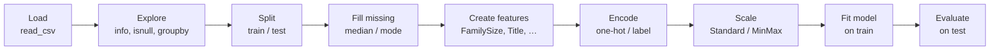
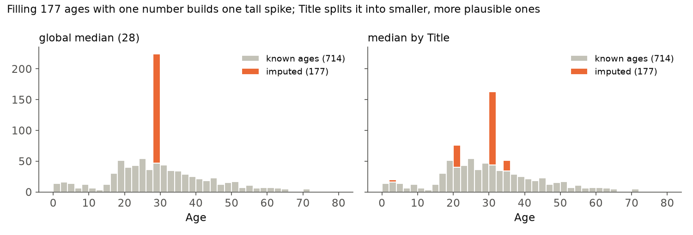
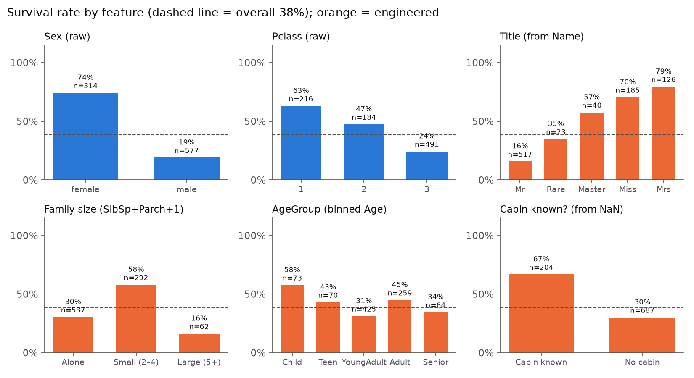
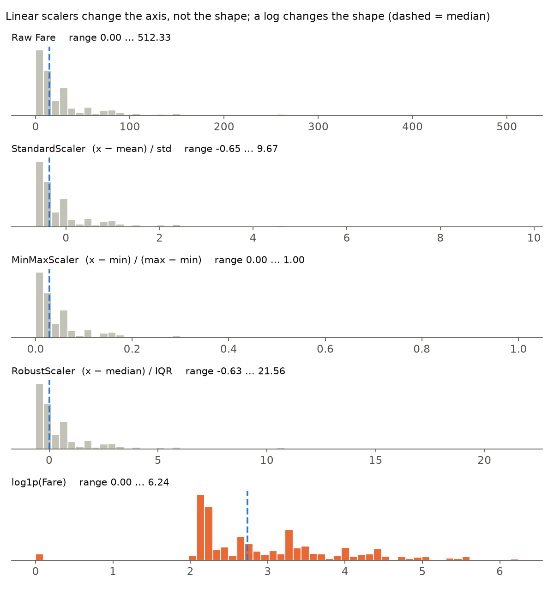

# 03 · Feature Engineering (Titanic)

> **Course:** Data Analytics Laboratory · Dept. of DS & AI · IIIT Dharwad
>
> **Lab manual:** Experiment 4, *Feature Engineering*. This note follows the manual's order (load → explore → missing values → new features → encoding → scaling → drop columns → split → model), fixes its errors (see [§12 Manual errata](#12--manual-errata)) and adds what the manual leaves out: *why* each step is done, data leakage, and pipelines. **Assignment 4** (*Titanic preprocessing + Logistic Regression*) practises the same steps with `LabelEncoder`, `MinMaxScaler` and `LogisticRegression`.
>
> **Notebook:** [`code/03_feature_engineering_deep_dive.ipynb`](code/03_feature_engineering_deep_dive.ipynb), Parts A–I. Every number in this note comes from it (pandas 3.0.3, scikit-learn 1.9.0). Figures: [`code/figures_03.py`](code/figures_03.py). Data: [`code/titanic.csv`](code/titanic.csv) (Kaggle `train.csv`, 891 rows).
>
> **Difficulty tags:** 🟢 core / in the manual · 🟡 needs practice · 🔴 beyond the manual (good to know, interview-level)

---

## 📌 Table of Contents

1. [Big Picture](#1-big-picture)
2. [The Titanic Dataset](#2-the-titanic-dataset-)
3. [Handling Missing Values](#3-handling-missing-values-)
4. [Creating New Features](#4-creating-new-features-)
5. [Encoding Categorical Features](#5-encoding-categorical-features-)
6. [Feature Scaling](#6-feature-scaling-)
7. [Dropping Unnecessary Columns](#7-dropping-unnecessary-columns-)
8. [Train/Test Split & Data Leakage](#8-traintest-split--data-leakage-)
9. [Pipelines & ColumnTransformer](#9-pipelines--columntransformer-)
10. [Building & Evaluating a Model](#10-building--evaluating-a-model-)
11. [Does Feature Engineering Help?](#11-does-feature-engineering-help-)
12. [Manual Errata](#12--manual-errata)
13. [Real-World Case Studies](#13-real-world-case-studies-)
14. [Common Confusions](#14--common-confusions)
15. [Quiz-Style Questions](#15--quiz-style-questions)
16. [Practice Problems](#16--practice-problems)
17. [Cheat Sheet](#17--cheat-sheet)
18. [Go Deeper](#18--go-deeper-curated-links)

---

## 1. Big Picture

> **A model only sees the columns you give it.** Feature engineering is turning raw columns into columns a model can use: numbers (not text), no gaps, on comparable scales, and expressing the patterns that actually matter.

A **feature** is one input column (`Age`, `Fare`); the **target** is the column to predict (`Survived`). The raw Titanic table has a `Name` column like `"Braund, Mr. Owen Harris"`. A model cannot do arithmetic on that string, but the word **Mr** inside it says "adult man", which is one of the strongest predictors of who died. Pulling that word out into a `Title` column is feature engineering.

The work falls into five kinds:

| Kind | Question it answers | Titanic example |
|---|---|---|
| **Cleaning** | Are there gaps? | 177 ages missing → fill with a median |
| **Creating** | Is there a more useful way to express this? | `FamilySize = SibSp + Parch + 1`, `Title` from `Name` |
| **Encoding** | Is it a number? | `Sex`: female/male → 0/1 or two 0/1 columns |
| **Scaling** | Are the numbers on comparable ranges? | `Fare` 0–512 vs `Parch` 0–6 → both 0–1 or mean 0 / std 1 |
| **Selecting** | Does this column help at all? | drop `PassengerId`, `Ticket` |

### The pipeline



**Note the position of *Split*.** The manual (and Assignment 4) split *last*, just before the model. In a real project you split **before** any step that learns a number from the data (a median, a mode, a min/max, a mean/std), and learn those numbers from the training rows only. Otherwise information from the test rows leaks into training (§8). On Titanic the difference is small, but the habit is what interviewers and reviewers check.

---

## 2. The Titanic Dataset 🟢

891 passengers (the Kaggle `train.csv`), 12 columns:

| Column | Meaning | Type | Missing |
|---|---|---|--:|
| `PassengerId` | row number | ID | 0 |
| `Survived` | **target**: 1 = survived, 0 = died | binary | 0 |
| `Pclass` | ticket class 1 / 2 / 3 (1 = first) | ordinal | 0 |
| `Name` | `"Surname, Title. Given names"` | text | 0 |
| `Sex` | male / female | nominal | 0 |
| `Age` | years (fractions for babies: 0.42) | numeric | **177** |
| `SibSp` | siblings + spouses aboard | count | 0 |
| `Parch` | parents + children aboard | count | 0 |
| `Ticket` | ticket code | text | 0 |
| `Fare` | ticket price (£) | numeric | 0 |
| `Cabin` | cabin number | text | **687** |
| `Embarked` | port: C = Cherbourg, Q = Queenstown, S = Southampton | nominal | **2** |

```python
import pandas as pd
df = pd.read_csv("titanic.csv")
df.head(); df.info(); df.isnull().sum()
df.groupby("Sex")["Survived"].mean()      # survival rate per group (mean of 0/1 = share of 1s)
```

**Who survived?** (notebook Part A; overall rate **38.4 %**)

| Group | Survival rate | n |
|---|--:|--:|
| female / male | 74.2 % / 18.9 % | 314 / 577 |
| 1st / 2nd / 3rd class | 63.0 % / 47.3 % / 24.2 % | 216 / 184 / 491 |
| 1st-class women | **96.8 %** | |
| 3rd-class men | **13.5 %** | |
| Embarked C / Q / S | 55.4 % / 39.0 % / 33.7 % | 168 / 77 / 644 |

"Women and children first" and class are already visible before any modelling. A good feature is one that **splits the passengers into groups with different survival rates**: that is exactly what a model will exploit.

`Fare` is very **right-skewed** (skewness 4.79: median £14.45, mean £32.20, max £512.33); `Age` is close to symmetric (skewness 0.39). This decides the choice of median vs mean (§3) and of scaler (§6).

---

## 3. Handling Missing Values 🟢

### The manual's approach

```python
df["Age"]      = df["Age"].fillna(df["Age"].median())          # 28.0
df["Embarked"] = df["Embarked"].fillna(df["Embarked"].mode()[0])  # 'S'
df = df.drop(columns=["Cabin"])                                 # 77 % missing
```

| Column | Missing | Strategy | Why |
|---|--:|---|---|
| `Age` | 177 (19.9 %) | median (28.0; the mean is 29.70) | numeric; median is robust to the few old passengers (Note 02 §11) |
| `Embarked` | 2 (0.2 %) | mode `'S'` (644 of 889) | categorical: a "median port" is meaningless |
| `Cabin` | 687 (77.1 %) | drop the column | filling 3 in 4 values would be invention |

> ⚠️ **pandas 3 pitfall.** The manual writes `train_df['Age'].fillna(..., inplace=True)`. In pandas 3 (Copy-on-Write) `train_df['Age']` is a new object, so the fill changes that copy, raises `ChainedAssignmentError`, and **all 177 ages stay missing** (notebook Part B). Always assign back: `df["Age"] = df["Age"].fillna(...)`.

### Better: impute from a related column 🟡

One global median puts 177 people at exactly 28. Notebook Part C counts **202** passengers aged exactly 28 after the global fill (25 genuine + 177 filled), and the standard deviation of Age drops from 14.53 to 13.02: the column now looks less varied than it is.

The **title** inside `Name` predicts age well. Fill each missing age with the median of passengers who have the same title:

```python
df["Title"] = df["Name"].str.extract(r",\s*([^\.]+)\.", expand=False).str.strip()
df["Age"] = df["Age"].fillna(df.groupby("Title")["Age"].transform("median"))
```

| Title | missing ages | median age of that title |
|---|--:|--:|
| Mr | 119 | 30.0 |
| Miss | 36 | 21.0 |
| Mrs | 17 | 35.0 |
| Master (boys) | 4 | **3.5** |
| Dr | 1 | 46.5 |



A missing "Master" now becomes a 3½-year-old boy instead of a 28-year-old. `transform("median")` returns one value **per row** (its group's median), so it lines up with the column for `fillna` (Note 02 §11.2).

### Missingness can itself be a feature 🔴

Whether a value is missing is sometimes informative. A **cabin number was recorded mostly for first-class passengers** (81.5 % of 1st class vs 2.4 % of 3rd), so "cabin known" is a proxy for wealth and deck:

```python
df["HasCabin"]   = df["Cabin"].notna().astype(int)   # survival 66.7 % vs 30.0 %
df["AgeMissing"] = df["Age"].isna().astype(int)      # survival 29.4 % vs 40.6 %
```

So "drop Cabin" (manual) throws away a useful signal; "turn Cabin into HasCabin, then drop Cabin" keeps it. scikit-learn can do this automatically: `SimpleImputer(add_indicator=True)`.

---

## 4. Creating New Features 🟢



*Blue: raw columns. Orange: features created in this section. A bar far from the dashed line means the feature separates survivors from non-survivors.*

### FamilySize and IsAlone

```python
df["FamilySize"] = df["SibSp"] + df["Parch"] + 1        # +1 for the passenger
df["IsAlone"]    = (df["FamilySize"] == 1).astype(int)  # True/False → 1/0
```

| FamilySize | 1 | 2 | 3 | 4 | 5 | 6 | 7 | 8 | 11 |
|---|--:|--:|--:|--:|--:|--:|--:|--:|--:|
| survival | 30 % | 55 % | 58 % | **72 %** | 20 % | 14 % | 33 % | 0 % | 0 % |
| n | 537 | 161 | 102 | 29 | 15 | 22 | 12 | 6 | 7 |

The relationship is **not straight**: travelling alone is bad, a small family (2–4) is good, a large family (5+) is very bad. A linear model given only `FamilySize` cannot express "rises then falls"; giving it bands does:

```python
df["FamilyBand"] = pd.cut(df["FamilySize"], bins=[0, 1, 4, 11], labels=["Alone", "Small", "Large"])
# survival: Alone 30.4 % (537) · Small 57.9 % (292) · Large 16.1 % (62)
```

`IsAlone` (30.4 % vs 50.6 %) captures only the first half of the story.

### Title from Name

The manual's one-liner, step by step on `"Braund, Mr. Owen Harris"`:

```python
name.split(",")      # ['Braund', ' Mr. Owen Harris']
    [1]              # ' Mr. Owen Harris'
    .split(".")      # [' Mr', ' Owen Harris']
    [0]              # ' Mr'
    .strip()         # 'Mr'
```

The vectorised equivalent is `df["Name"].str.extract(r",\s*([^\.]+)\.")`: "after the comma and any spaces, capture everything up to the first full stop". Both give the same 17 titles on all 891 rows (notebook Part D).

17 titles is too many for 891 rows: `Capt`, `Don`, `Jonkheer`, `Sir`, `Lady`, `the Countess` occur **once each**, so a model would memorise those individuals. Merge synonyms and group the rest:

```python
df["Title"] = df["Title"].replace({"Mlle": "Miss", "Ms": "Miss", "Mme": "Mrs"})   # French / modern forms
df["Title"] = df["Title"].where(df["Title"].isin(["Mr", "Mrs", "Miss", "Master"]), "Rare")
```

| Title | Mr | Rare | Master | Miss | Mrs |
|---|--:|--:|--:|--:|--:|
| survival | **15.7 %** | 34.8 % | 57.5 % | 70.3 % | **79.4 %** |
| n | 517 | 23 | 40 | 185 | 126 |

`Title` combines sex **and** age: "Master" (boys) survived at 57.5 % while adult men ("Mr") survived at 15.7 %. That is the "children first" rule, which `Sex` alone cannot see. This is why `Title` is usually the single most useful engineered Titanic feature.

### AgeGroup (binning)

```python
df["AgeGroup"] = pd.cut(df["Age"], bins=[0, 12, 18, 30, 50, 100],
                        labels=["Child", "Teen", "YoungAdult", "Adult", "Senior"])
```

Bins are right-closed: `(0, 12]` is Child, so a 12-year-old is a Child and an 18-year-old is a Teen. With title-based imputation: Child 57.5 % (73) · Teen 42.9 % (70) · YoungAdult 31.1 % (425) · Adult 44.8 % (259) · Senior 34.4 % (64).

**Binning trades detail for robustness.** It helps a linear model capture a non-linear effect (children survive more) and reduces the influence of noisy exact values, but it throws away the difference between 13 and 17. Tree models can find their own cut points, so binning helps them less.

⚠️ **Order matters.** If you bin *after* filling Age with the global median 28, all 177 imputed passengers fall into `YoungAdult`: it grows from 270 known to **447** (notebook Part I, P5). The bin then mixes "really 18–30" with "age unknown".

### More ideas 🔴

| Feature | Formula | Idea |
|---|---|---|
| `FarePerPerson` | `Fare / FamilySize` | `Fare` is per **ticket**, often bought for a whole family |
| `TicketGroup` | `df.groupby("Ticket")["Ticket"].transform("count")` | 344 passengers shared a ticket: friends and servants travelling together |
| `Deck` | `Cabin.str[0]` | first letter of the cabin = deck (A at the top … G) |
| `log1p(Fare)` | `np.log1p(Fare)` | removes skew (§6) |

---

## 5. Encoding Categorical Features 🟢

Models need numbers. How you turn categories into numbers depends on whether the categories have an **order**.

| Type | Has order? | Titanic | Encode with |
|---|---|---|---|
| **Nominal** | no | `Sex`, `Embarked`, `Title` | one-hot |
| **Ordinal** | yes | `Pclass` (1 < 2 < 3), `AgeGroup` | integer codes **in the right order** |
| **Binary** | (two values) | `Sex` | a single 0/1 column; label and one-hot are equivalent |

### Label encoding

```python
from sklearn.preprocessing import LabelEncoder
le = LabelEncoder()
df["Embarked"] = le.fit_transform(df["Embarked"])   # C → 0, Q → 1, S → 2
le.classes_                                          # array(['C', 'Q', 'S']): code i = classes_[i]
```

`LabelEncoder` sorts the classes **alphabetically**. That is harmless for a binary column, but it creates a **fake order** for a nominal one: a linear model now believes Southampton (2) is "twice" Queenstown (1). And for an ordinal column it can **scramble the real order**. The manual label-encodes `AgeGroup` and gets (notebook Part B):

| | Child | Teen | YoungAdult | Adult | Senior |
|---|--:|--:|--:|--:|--:|
| `LabelEncoder` code | **1** | **3** | **4** | **0** | **2** |
| the real order | 0 | 1 | 2 | 3 | 4 |

Adults are coded below children and seniors sit between them. To keep the real order, use the category codes of the ordered `pd.cut` result, or `OrdinalEncoder` with the order spelled out:

```python
df["AgeGroup_code"] = df["AgeGroup"].cat.codes          # Child 0 … Senior 4 (order of the labels)

from sklearn.preprocessing import OrdinalEncoder
oe = OrdinalEncoder(categories=[["Child", "Teen", "YoungAdult", "Adult", "Senior"]])
df[["AgeGroup_code"]] = oe.fit_transform(df[["AgeGroup"]])
```

`LabelEncoder` is officially meant for the **target** `y`, which is why it takes one column at a time; `OrdinalEncoder` is its feature (2-D) counterpart.

### One-hot encoding

One new 0/1 column per category; exactly one of them is 1 in each row:

```python
pd.get_dummies(df, columns=["Sex", "Embarked"], dtype=int)
```

| Embarked | → | Embarked_C | Embarked_Q | Embarked_S |
|---|---|--:|--:|--:|
| S | | 0 | 0 | 1 |
| C | | 1 | 0 | 0 |
| Q | | 0 | 1 | 0 |

No fake order, and every category gets its own weight. The cost is width: *k* categories become *k* columns, which matters for a column with hundreds of values (a pin code, a product ID).

**The dummy-variable trap 🟡.** The *k* columns always sum to 1 (notebook Part E), so any one of them can be computed from the others. For a linear model *with an intercept* that is perfect multicollinearity: the weights are not unique. `drop_first=True` keeps *k* − 1 columns; the dropped category becomes the **reference** that the others are compared against. Sex (2) + Embarked (3) + Pclass (3) give 8 columns, or 5 with `drop_first=True`. Tree models and regularised models (scikit-learn's `LogisticRegression` is L2-regularised by default) cope with all *k*.

### `get_dummies` vs `OneHotEncoder` 🔴

`pd.get_dummies` builds columns from **whatever values are present in the data you pass it**. Apply it to a new batch that only contains `S` and you get one column, `Embarked_S`, so the model's input has the wrong width. `OneHotEncoder` **remembers** the categories seen in `fit` and always outputs the same columns; with `handle_unknown="ignore"` an unseen category becomes all zeros instead of an error (notebook Part E). Use `get_dummies` for exploration, `OneHotEncoder` for anything that has to run on new data.

---

## 6. Feature Scaling 🟢

| Scaler | Formula | Result | Sensitive to outliers? |
|---|---|---|---|
| `StandardScaler` | $z = \dfrac{x - \mu}{\sigma}$ | mean 0, std 1; no fixed range | yes (mean and std) |
| `MinMaxScaler` | $x' = \dfrac{x - x_{\min}}{x_{\max} - x_{\min}}$ | exactly [0, 1] on the fitted data | **very** (one extreme sets the range) |
| `RobustScaler` | $x' = \dfrac{x - \text{median}}{Q_3 - Q_1}$ | median 0, IQR 1 | no |

The manual uses `StandardScaler` on `Age`, `Fare`, `FamilySize`; Assignment 4 uses `MinMaxScaler`.

### Worked example 6.1: one fare, three scalers 🟡

Fare statistics: mean 32.2042, std 49.6655, median 14.4542, Q1 7.9104, Q3 31.0, IQR 23.0896, min 0, max 512.3292. A fare of **£100** becomes:

| Scaler | Calculation | Value |
|---|---|--:|
| Standard | (100 − 32.20) / 49.67 | **1.365** |
| MinMax | (100 − 0) / (512.33 − 0) | **0.195** |
| Robust | (100 − 14.45) / 23.09 | **3.705** |

`StandardScaler` uses the **population** standard deviation (divide by *n*, `ddof=0`): 49.6655. pandas' `.std()` divides by *n* − 1 and gives 49.6934, so a hand calculation with `.std()` is slightly off.



What the figure shows: the three scalers only **relabel the axis**; the histogram keeps exactly the same shape and the long right tail survives. After MinMax, half of all fares are squeezed below 0.028 because one £512 ticket defines "1". To change the **shape** you need a non-linear transform: `np.log1p(Fare)` (log of 1 + x, safe for the 15 zero fares) cuts the skewness from 4.79 to 0.39.

### Which models need scaling?

| Needs it | Doesn't |
|---|---|
| distance-based: KNN, K-means, SVM | decision trees, random forests, gradient boosting |
| gradient-trained / regularised: logistic & linear regression with a penalty, neural networks | Naive Bayes |
| PCA (variance depends on units) | |

Trees split on one feature at a time ("Fare > 52?"), and a monotone rescaling does not change which rows fall on each side. Notebook Part F checks this: the random forest scores **0.7989** with and without scaling. Logistic regression converged in **8 iterations** on scaled data versus **104** unscaled; the accuracy differed slightly (0.7989 vs 0.8101) because the L2 penalty treats weights differently on different scales, not because one is "correct".

---

## 7. Dropping Unnecessary Columns 🟢

| Column | Why drop | Before dropping, consider… |
|---|---|---|
| `PassengerId` | an ID: unique per row, no meaning | nothing; an ID that **predicts** the target is a leak (§13.1) |
| `Name` | unique text | extracting `Title` first (§4) |
| `Ticket` | near-unique code | `TicketGroup` (shared tickets) |
| `Cabin` | 77 % missing | `HasCabin`, `Deck` |

**Create first, drop second.** The manual drops `Name` at the end, after `Title` has been extracted; dropping it first would make `Title` impossible.

---

## 8. Train/Test Split & Data Leakage 🟢

```python
from sklearn.model_selection import train_test_split
X = df.drop(columns=["Survived"])
y = df["Survived"]
X_train, X_test, y_train, y_test = train_test_split(X, y, test_size=0.2, random_state=42)
# 891 rows → 712 train, 179 test  (test size = ceil(0.2 × 891) = 179)
```

* The **test set** stands in for passengers the model has never seen. Its score estimates performance on new data; the training score does not (a model can memorise its training rows).
* `random_state` fixes the shuffle so results are reproducible.
* `stratify=y` keeps the survival rate the same in both parts. Without it this split gives 37.6 % survivors in train vs 41.3 % in test.

### Data leakage 🟡

**Leakage** is any information in the training process that would not be available at prediction time. It makes test scores look better than real-world performance.

| Leak | Example | Fix |
|---|---|---|
| **Preprocessing leak** | fitting the scaler / imputer on all 891 rows before splitting (the manual's order) | split first; `fit` on `X_train`, `transform` both |
| **Target leak** | a feature that is recorded *after* the outcome: e.g. `lifeboat` or `body` number (both exist in the full Titanic records) | ask "would I know this value at prediction time?" |
| **ID / ordering leak** | an ID or row order that correlates with the label | drop IDs; shuffle |
| **Duplicate leak** | the same person in train and test | deduplicate before splitting |

The correct pattern for any learned statistic:

```python
scaler = MinMaxScaler()
X_train[cols] = scaler.fit_transform(X_train[cols])   # learn min/max from TRAIN only
X_test[cols]  = scaler.transform(X_test[cols])        # re-use them; never fit on test
```

On Titanic the preprocessing leak is tiny (the Age median is 28.0 on all rows and on the training rows; the Fare mean moves from 32.20 to 32.59), which is why the manual's order still gives sensible numbers. On small datasets, with target encoding, or with feature selection done before the split, the same mistake can inflate scores badly. A side effect of doing it right: test values can fall **outside** [0, 1] after MinMax scaling if they exceed the training range. That is expected, not a bug.

---

## 9. Pipelines & ColumnTransformer 🔴

Doing §8 by hand is error-prone. scikit-learn's `ColumnTransformer` applies a recipe per group of columns, and `Pipeline` chains preprocessing with the model so that `fit` learns every statistic from training data only:

```python
from sklearn.compose import ColumnTransformer
from sklearn.pipeline import Pipeline
from sklearn.impute import SimpleImputer
from sklearn.preprocessing import StandardScaler, OneHotEncoder
from sklearn.linear_model import LogisticRegression

num_cols  = ["Age", "Fare", "FamilySize"]
cat_cols  = ["Sex", "Embarked", "Title"]
pass_cols = ["Pclass", "IsAlone", "HasCabin"]

pre = ColumnTransformer([
    ("num", Pipeline([("impute", SimpleImputer(strategy="median")),
                      ("scale",  StandardScaler())]), num_cols),
    ("cat", Pipeline([("impute", SimpleImputer(strategy="most_frequent")),
                      ("onehot", OneHotEncoder(handle_unknown="ignore"))]), cat_cols),
    ("keep", "passthrough", pass_cols),
])
pipe = Pipeline([("prep", pre), ("model", LogisticRegression(max_iter=1000))])

pipe.fit(X_train, y_train)        # imputers, scaler, encoder and model all fit on TRAIN
pipe.score(X_test, y_test)        # 0.8324: test rows only transformed, never fitted
```

Why it is worth learning: (1) no leakage by construction, (2) the whole thing works with `cross_val_score` (§11), which refits it on each fold, (3) one object to save and apply to new passengers, (4) `pipe.named_steps["prep"].get_feature_names_out()` tells you which output column is which.

Hand-made features (`FamilySize`, `Title`) that use **only the row itself** have no statistic to learn, so they can safely be computed before the split. Anything that looks across rows (a median, a group median, a ticket count) belongs inside the pipeline or after the split.

---

## 10. Building & Evaluating a Model 🟢

The manual ends with a random forest:

```python
from sklearn.ensemble import RandomForestClassifier
from sklearn.metrics import accuracy_score
model = RandomForestClassifier(n_estimators=100, random_state=42)
model.fit(X_train, y_train)
y_pred = model.predict(X_test)
print(f"Accuracy: {accuracy_score(y_test, y_pred):.2f}")
```

Running the manual's full pipeline (with only the pandas-3 fix) gives **19 columns** and accuracy **0.8045** (notebook Part B).

| Model | Idea | Needs scaling? |
|---|---|---|
| `LogisticRegression` | weighted sum of features → sigmoid → probability; linear decision boundary | yes (regularised, gradient-trained) |
| `RandomForestClassifier` | 100 decision trees on random subsets of rows and features; majority vote | no |

**Accuracy needs a baseline.** 61.6 % of passengers died, so a "model" that always predicts *died* scores 58.7 % on this test split. 0.80 is good only in comparison with that. Accuracy also hides *which* mistakes are made; Assignment 4 adds the confusion matrix, precision, recall and F1, which tell you, for example, how many survivors the model misses (more in Experiment 9, *Classification*).

---

## 11. Does Feature Engineering Help? 🟡

Notebook Part H compares two feature sets, both inside the leak-free pipeline of §9:

* **baseline:** `Pclass, Sex, Age, SibSp, Parch, Fare, Embarked` (what Assignment 4 uses)
* **engineered:** `Pclass, Sex, Age, Fare, Embarked` + `FamilySize, IsAlone, Title, HasCabin`

| Features | Model | Test accuracy (one 80:20 split) | 5-fold CV mean ± std |
|---|---|--:|--:|
| baseline | LogReg | 0.8101 | 0.7935 ± 0.0193 |
| baseline | RandomForest | 0.8045 | 0.8226 ± 0.0167 |
| engineered | LogReg | **0.8324** | **0.8294 ± 0.0094** |
| engineered | RandomForest | **0.8324** | 0.8170 ± 0.0168 |

What to read from it:

1. **Engineering helps the linear model most** (CV 0.794 → 0.829). Logistic regression cannot invent interactions like "male *and* adult"; `Title` hands it that directly. The random forest can already find such interactions by splitting on Sex then Age, so it gains little (and its CV score even dips, within one standard deviation).
2. **One split is noisy.** The single split ranks baseline-RF *below* baseline-LR, cross-validation ranks it *above*. With 179 test rows, one passenger = 0.56 percentage points. Use **cross-validation** (`cross_val_score` with `StratifiedKFold`) to compare models: every row is tested exactly once and you get a spread, not one number.
3. The random forest's importance ranking on the engineered set puts `Fare` (0.237), `Age` (0.209) and `Title_Mr` (0.107) at the top, ahead of `Sex` (≈ 0.08 for each of the two columns): the engineered `Title` carries information the raw columns did not.

---

## 12. 📝 Manual Errata

| Manual | Problem | Correct |
|---|---|---|
| `train_df['Age'].fillna(..., inplace=True)` (and the same for Embarked, Fare) | pandas 3: chained in-place call raises `ChainedAssignmentError` and **does nothing**; all 177 ages stay missing | `train_df["Age"] = train_df["Age"].fillna(...)` |
| `train_df['Fare'].fillna(...)` | `train.csv` has **no** missing Fare (only `test.csv` has one); harmless but suggests the code was written for the test file | keep it if you also process `test.csv`; otherwise remove |
| loads `test_df = pd.read_csv('test.csv')` | never used; Kaggle's `test.csv` has **no `Survived` column**, so it cannot evaluate anything. The evaluation is the 80:20 split of `train.csv` | load only `train.csv`, or apply the *same fitted* transformations to `test.csv` for a Kaggle submission |
| "Label Encoding: For ordinal features" applied to `Title` | `Title` is **nominal**; label codes give it a fake order | one-hot (`OneHotEncoder` / `get_dummies`) |
| `label_encoder.fit_transform(train_df['AgeGroup'])` | alphabetical codes **scramble** the age order (Adult 0, Child 1, Senior 2, Teen 3, YoungAdult 4) | `df["AgeGroup"].cat.codes` or `OrdinalEncoder(categories=[[...]])` |
| `get_dummies(..., columns=[..., 'AgeGroup'])` after label-encoding AgeGroup | redundant: the label encoding is immediately replaced, and the dummies are named `AgeGroup_0…4` with the scrambled meaning | one-hot the original labels (`AgeGroup_Child` …) or keep ordered codes, not both |
| one `label_encoder` object reused for Title and AgeGroup | the second `fit` overwrites the first: `inverse_transform` on Title is now impossible | one encoder per column |
| `StandardScaler` fitted on all rows, then split | **preprocessing leak** (§8) | split first; fit on train, transform both (or a `Pipeline`, §9) |
| AgeGroup computed after median-filling Age | all 177 unknown ages land in `YoungAdult` (270 → 447) | impute by title first, or add `AgeMissing` |
| "One-Hot Encodin", "Drop Unnecessary Columns**", stray ` ``` ` lines | typos / leftover Markdown fences; ` ``` ` is a syntax error if pasted into Python | delete them |

---

## 13. Real-World Case Studies 🔴

### 13.1 KDD Cup 2008: the patient ID that predicted cancer

In the KDD Cup 2008 breast-cancer detection challenge, the **patient ID** turned out to be strongly predictive of the label, an artefact of how the data had been assembled from different sources. Kaufman, Rosset, Perlich & Stitelman use it as a headline example in *Leakage in Data Mining: Formulation, Detection, and Avoidance* (ACM TKDD, 2012). A model using the ID would score well and be useless on new patients. **Lesson:** drop IDs (§7), and be suspicious of any feature that is "too good".

### 13.2 COVID-19 X-ray models that learned the hospital, not the disease

Roberts et al. (*Nature Machine Intelligence*, 2021) screened over 2,000 papers on machine learning for COVID-19 diagnosis from chest images, assessed 62 in detail and found **none** ready for clinical use; a recurring problem was that models picked up shortcuts such as which dataset/hospital an image came from, patient positioning or text markers on the image, rather than the lungs. DeGrave, Janizek & Lee (same journal, 2021) showed such shortcut learning directly. **Lesson:** a feature correlated with the label *in your dataset* is not necessarily a cause; check what the model relies on (feature importances, §11).

### 13.3 Recruiting model that penalised a word

Reuters reported in 2018 that Amazon abandoned an experimental CV-screening model after finding it downgraded résumés containing the word "women's" (as in "women's chess club captain"): it had learned from ten years of mostly male hires. **Lesson:** features carry the history of how the data was produced. On Titanic, `Sex` is *supposed* to predict survival because of the evacuation rule; in a hiring or lending model the same kind of feature is a fairness problem (course objective vii, ethics).

### 13.4 Titanic itself: the leak hiding in the full dataset

The complete Titanic passenger list (1,309 people, e.g. `titanic3` from Vanderbilt) includes `boat` (lifeboat number) and `body` (body identification number). Both are recorded *after* the outcome, and a model given `boat` is nearly perfect. The Kaggle files do not include them, which is why `train.csv` has 12 columns. **Lesson:** for every feature ask *when* its value becomes known (§8).

---

## 14. ⚠️ Common Confusions

| Confusion | Clarification |
|---|---|
| feature engineering vs feature selection | creating / transforming columns vs choosing which to keep |
| `LabelEncoder` vs `OrdinalEncoder` | same idea; `LabelEncoder` is for the 1-D target `y` (alphabetical), `OrdinalEncoder` for 2-D features and accepts an explicit order |
| label vs one-hot encoding | one integer column (implies order) vs one 0/1 column per category (no order) |
| `get_dummies` vs `OneHotEncoder` | ad hoc on a DataFrame vs remembers categories from `fit` (safe on new data) |
| normalisation vs standardisation | usually min-max to [0, 1] vs z-score to mean 0 / std 1; the words are used loosely, so check the formula |
| scaling makes data normal | no: linear scalers keep the shape; use `log1p` / Box-Cox to reduce skew |
| `fit_transform` on test data | wrong: `fit` on train, `transform` on test |
| `fit` vs `transform` vs `fit_transform` | learn the statistics vs apply them vs both in one call |
| scaling random forests | not needed; trees are invariant to monotone rescaling |
| accuracy 0.80 is "good" | compare with the majority-class baseline (0.587 on this test split) |
| `FamilySize` has a "+1" | the passenger themself; SibSp and Parch count only *other* relatives |
| `pd.cut` vs `pd.qcut` | fixed edges you choose vs equal-count bins from quantiles |

---

## 15. ❓ Quiz-Style Questions

1. Why is the median preferred over the mean for imputing `Fare`?
   <details><summary>Answer</summary>Fare is strongly right-skewed (skewness 4.79). The mean (32.20) is pulled up by a few very expensive tickets; the median (14.45) is a typical fare.</details>

2. `LabelEncoder` turns C/Q/S into 0/1/2. What does a linear model wrongly assume?
   <details><summary>Answer</summary>That the ports are ordered and evenly spaced (Q is "between" C and S, S − Q = Q − C), so a single weight multiplies the code. One-hot gives each port its own weight.</details>

3. When is label encoding perfectly fine?
   <details><summary>Answer</summary>For a binary column (two categories, one 0/1 column), for the target <code>y</code>, and for tree-based models, which can split codes into any groups with several splits.</details>

4. What is the dummy-variable trap and when does it matter?
   <details><summary>Answer</summary>The k one-hot columns always sum to 1, which equals the intercept column, so a linear model's weights are not unique. Drop one column (<code>drop_first=True</code>) for unregularised linear/logistic regression; trees and regularised models are fine with all k.</details>

5. Why must the scaler be fit only on the training set?
   <details><summary>Answer</summary>Its min/max (or mean/std) would otherwise contain information from the test rows, so the test set is no longer "unseen" and the score is optimistic.</details>

6. After MinMax scaling fitted on train, a test fare scales to 1.3. Bug?
   <details><summary>Answer</summary>No. The test fare is larger than any training fare. The scaler correctly uses the training range. (Use <code>clip=True</code> if the model needs [0, 1].)</details>

7. Why does `Title` help logistic regression more than random forest?
   <details><summary>Answer</summary>Title encodes an interaction of sex and age (Master = boy). A linear model cannot build interactions itself; a tree can by splitting on Sex then Age.</details>

8. `df["Age"].fillna(28, inplace=True)` leaves the NaNs in pandas 3. Why?
   <details><summary>Answer</summary>Copy-on-Write: <code>df["Age"]</code> is a new object; the in-place fill modifies it, not <code>df</code>. Assign back.</details>

9. What does `pd.cut(age, bins=[0, 12, 18])` do with age 12? With 0?
   <details><summary>Answer</summary>12 goes into (0, 12] (right-closed). 0 is outside every bin and becomes NaN; use <code>include_lowest=True</code> or a lower edge below 0.</details>

10. Name a feature that would be leakage when predicting Titanic survival.
    <details><summary>Answer</summary><code>boat</code> (lifeboat number) or <code>body</code> (body ID): both are known only after the outcome.</details>

---

## 16. 🏋️ Practice Problems

Problems 1–6 are solved in notebook Part I with output; 7–12 are by hand.

**P1 🟢** What is the survival rate of women and of men? Of 1st-class women and of 3rd-class men?
<details><summary>Solution</summary>

`df.groupby("Sex")["Survived"].mean()` → female **0.7420**, male **0.1889**. `df.query("Sex == 'female' and Pclass == 1")["Survived"].mean()` → **0.9681**; 3rd-class men **0.1354**.
</details>

**P2 🟢** Create `FamilySize`. What is its maximum, and how many passengers travelled alone?
<details><summary>Solution</summary>

`f = df["SibSp"] + df["Parch"] + 1` → max **11**; alone (`f == 1`) **537**, with family **354**.
</details>

**P3 🟢** Using the 714 known ages (min 0.42, max 80, mean 29.6991, population std 14.5163), scale Age = 40 with min-max and with z-score.
<details><summary>Solution</summary>

Min-max: (40 − 0.42) / (80 − 0.42) = 39.58 / 79.58 = **0.4974**. z-score: (40 − 29.6991) / 14.5163 = **0.7096**.
</details>

**P4 🟡** How many columns does `get_dummies` make from `Sex` (2 values), `Embarked` (3) and `Pclass` (3), with and without `drop_first`?
<details><summary>Solution</summary>

2 + 3 + 3 = **8**; with `drop_first=True`, 1 + 2 + 2 = **5**. (Pass `Pclass` in `columns=`; numeric columns are not dummied by default.)
</details>

**P5 🟡** Apply the manual's AgeGroup bins after filling Age with the global median. How many passengers are YoungAdult, and how many of them have a known age?
<details><summary>Solution</summary>

Child 69, Teen 70, **YoungAdult 447**, Adult 241, Senior 64. Only **270** YoungAdults have a known age; all 177 imputed (age 28) landed there.
</details>

**P6 🟡** List the rare titles and their survival.
<details><summary>Solution</summary>

Capt 0/1, Col 1/2, Don 0/1, Dr 3/7, Jonkheer 0/1, Lady 1/1, Major 1/2, Rev **0/6**, Sir 1/1, the Countess 1/1. Each is too small to learn from on its own, hence the `Rare` group (23 passengers, 34.8 %).
</details>

**P7 🟡** Should `Pclass` be one-hot encoded or left as 1/2/3?
<details><summary>Solution</summary>

It is ordinal and the survival rate falls steadily (63 % → 47 % → 24 %), so 1/2/3 is a reasonable single feature for a linear model. One-hot is also valid: it lets 2nd class differ from "halfway between", at the cost of one extra column. For trees it makes little difference. Either is defensible; the important thing is to give the reason.
</details>

**P8 🟢** StandardScale `[2, 4, 6, 8]` by hand (population std).
<details><summary>Solution</summary>

Mean 5. Deviations −3, −1, 1, 3; squares 9, 1, 1, 9; variance 20 / 4 = 5; std √5 = 2.2361. z = **−1.342, −0.447, 0.447, 1.342**.
</details>

**P9 🟡** What `Title` does the manual's lambda return for `"Rothes, the Countess. of (Lucy Noel Martha Dyer-Edwards)"`? And for a name with no comma?
<details><summary>Solution</summary>

`split(",")[1]` → `" the Countess. of (…)"`, `split(".")[0]` → `" the Countess"`, strip → **`"the Countess"`**. With no comma, `split(",")` has one element and `[1]` raises **IndexError**; the `str.extract` version returns NaN instead, which is safer.
</details>

**P10 🟡** A MinMax scaler fitted on training fares (min 0, max 263) transforms a test fare of 512.33. Result?
<details><summary>Solution</summary>

512.33 / 263 = **1.948**. Outside [0, 1] because the test value exceeds the training max. Correct behaviour, not a bug (quiz Q6).
</details>

**P11 🟡** Spot the leaks: (a) `StandardScaler().fit(X)` then split; (b) fill missing ages with the median of `X_test`; (c) choose the 5 "best" features by correlation with `y` on all rows, then cross-validate; (d) `FamilySize` computed before splitting.
<details><summary>Solution</summary>

(a) leak (statistics from test rows); (b) leak, and also wrong: test rows must use the *training* median; (c) leak: feature selection saw the test folds' labels, so put selection inside the pipeline; (d) **not** a leak: FamilySize uses only the passenger's own row.
</details>

**P12 🟢** A model on 179 test passengers has TP = 50, FP = 10, FN = 20, TN = 99. Compute accuracy, precision, recall and F1 for "survived".
<details><summary>Solution</summary>

Accuracy (50 + 99) / 179 = **0.8324**. Precision 50 / 60 = **0.8333**. Recall 50 / 70 = **0.7143**. F1 = 2 · 0.8333 · 0.7143 / (0.8333 + 0.7143) = **0.7692**.
</details>

---

## 17. 📋 Cheat Sheet

```python
import numpy as np, pandas as pd
from sklearn.preprocessing import LabelEncoder, OrdinalEncoder, OneHotEncoder, StandardScaler, MinMaxScaler, RobustScaler
from sklearn.model_selection import train_test_split, cross_val_score, StratifiedKFold
from sklearn.compose import ColumnTransformer
from sklearn.pipeline import Pipeline
from sklearn.impute import SimpleImputer

# ---------- explore ----------
df = pd.read_csv("titanic.csv"); df.info(); df.isnull().sum()
df.groupby("Sex")["Survived"].mean()                 # survival rate per group
pd.crosstab(df["Sex"], df["Pclass"], values=df["Survived"], aggfunc="mean")

# ---------- missing (assign back; never inplace on a column) ----------
df["Age"] = df["Age"].fillna(df["Age"].median())
df["Age"] = df["Age"].fillna(df.groupby("Title")["Age"].transform("median"))   # group-wise
df["Embarked"] = df["Embarked"].fillna(df["Embarked"].mode()[0])
df["HasCabin"] = df["Cabin"].notna().astype(int)     # missingness as a feature

# ---------- create ----------
df["FamilySize"] = df["SibSp"] + df["Parch"] + 1
df["IsAlone"] = (df["FamilySize"] == 1).astype(int)
df["Title"] = df["Name"].str.extract(r",\s*([^\.]+)\.", expand=False).str.strip()
df["Title"] = df["Title"].where(df["Title"].isin(["Mr", "Mrs", "Miss", "Master"]), "Rare")
df["AgeGroup"] = pd.cut(df["Age"], bins=[0, 12, 18, 30, 50, 100], labels=["Child", "Teen", "YoungAdult", "Adult", "Senior"])
df["LogFare"] = np.log1p(df["Fare"])

# ---------- encode ----------
df["Sex"] = LabelEncoder().fit_transform(df["Sex"])            # binary: female 0, male 1
df["AgeGroup"] = df["AgeGroup"].cat.codes                       # ordinal, keeps order
df = pd.get_dummies(df, columns=["Embarked", "Title"], drop_first=True, dtype=int)   # nominal

# ---------- drop, split ----------
df = df.drop(columns=["PassengerId", "Name", "Ticket", "Cabin"])
X, y = df.drop(columns=["Survived"]), df["Survived"]
X_train, X_test, y_train, y_test = train_test_split(X, y, test_size=0.2, random_state=42, stratify=y)

# ---------- scale: fit on train only ----------
sc = StandardScaler()                                 # or MinMaxScaler(), RobustScaler()
X_train[cols] = sc.fit_transform(X_train[cols]); X_test[cols] = sc.transform(X_test[cols])

# ---------- leak-proof pipeline + CV ----------
pre = ColumnTransformer([
    ("num", Pipeline([("imp", SimpleImputer(strategy="median")), ("sc", StandardScaler())]), num_cols),
    ("cat", Pipeline([("imp", SimpleImputer(strategy="most_frequent")), ("oh", OneHotEncoder(handle_unknown="ignore"))]), cat_cols),
], remainder="passthrough")
pipe = Pipeline([("prep", pre), ("model", model)])
cross_val_score(pipe, X, y, cv=StratifiedKFold(5, shuffle=True, random_state=42)).mean()
```

| Situation | Use |
|---|---|
| numeric, skewed / outliers | median impute; `RobustScaler` or `log1p` |
| numeric, roughly symmetric | mean or median impute; `StandardScaler` |
| need values in [0, 1] | `MinMaxScaler` |
| categorical, few values | mode impute; one-hot |
| categorical with an order | `OrdinalEncoder(categories=[...])` / `.cat.codes` |
| > ~30–40 % missing | don't impute blindly: a `Has…` flag, or drop |
| tree model | skip scaling; label/ordinal codes are fine |

---

## 18. 🔗 Go Deeper (curated links)

* [scikit-learn user guide: Preprocessing data](https://scikit-learn.org/stable/modules/preprocessing.html): every scaler and encoder, with the formulas.
* [scikit-learn: Column Transformer with Mixed Types](https://scikit-learn.org/stable/auto_examples/compose/plot_column_transformer_mixed_types.html): the §9 pipeline on the Titanic data.
* [scikit-learn: Common pitfalls and recommended practices](https://scikit-learn.org/stable/common_pitfalls.html): data leakage and inconsistent preprocessing.
* [scikit-learn: Compare the effect of different scalers on data with outliers](https://scikit-learn.org/stable/auto_examples/preprocessing/plot_all_scaling.html)
* [Kaggle: Titanic competition](https://www.kaggle.com/c/titanic/data): data dictionary for `train.csv`.
* Kaufman, Rosset, Perlich & Stitelman, ["Leakage in Data Mining: Formulation, Detection, and Avoidance"](https://dl.acm.org/doi/10.1145/2382577.2382579), *ACM TKDD* 6(4), 2012: case study 13.1.
* Roberts et al., ["Common pitfalls and recommendations for using machine learning to detect and prognosticate for COVID-19 using chest radiographs and CT scans"](https://www.nature.com/articles/s42256-021-00307-0), *Nature Machine Intelligence* 3, 2021: case study 13.2.
* Alice Zheng & Amanda Casari, *Feature Engineering for Machine Learning* (O'Reilly, 2018): a whole book on the topic.
