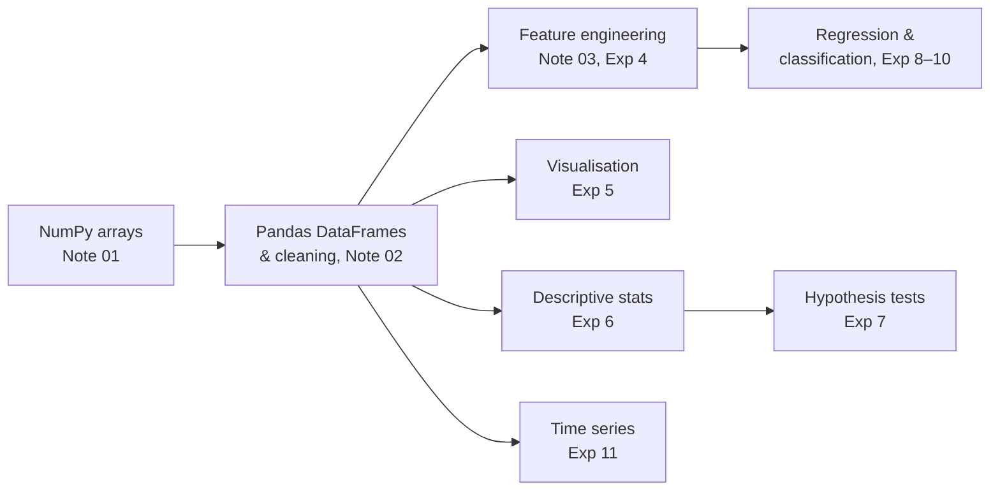

# Data Analytics Laboratory

> Department of Data Science & AI · IIIT Dharwad · Semester 1 · Lab course
>
> **Tools:** Python, NumPy, SciPy, Matplotlib, Pandas, Statsmodels, Seaborn, Plotly, Bokeh

## Notes

| # | Topic | Manual | Notebook |
|:-:|:--|:--|:--|
| 01 | [NumPy Foundations](01-NumPy-Foundations.md) | Experiment 3 (NumPy part) | [deep dive](code/01_numpy_deep_dive.ipynb) |
| 02 | [Pandas DataFrames & Data Cleaning](02-Pandas-DataFrames-and-Data-Cleaning.md) | Experiment 3 (Pandas part) | [deep dive](code/02_pandas_deep_dive.ipynb) |
| 03 | [Feature Engineering (Titanic)](03-Feature-Engineering.md) | Experiment 4 | [deep dive](code/03_feature_engineering_deep_dive.ipynb) |

Each note starts from the lab manual, explains every command in plain language, fixes the manual's typos (see the *Manual errata* box in each note), and ends with worked examples, practice problems with full solutions and a cheat sheet.

**Class examples notebook:** [Lab 1, NumPy](code/lab1_numpy_class.ipynb) runs every NumPy snippet from the manual with an explanation of each.

## Experiment plan (from the lab manual)

| # | Experiment | Status |
|:-:|:--|:--|
| 01 | Installation and core use of a multi-node Hadoop cluster | not yet covered |
| 02 | Installation and introductory use of a multi-node Spark cluster | not yet covered |
| 03 | Working with Pandas DataFrames (and NumPy arrays) | ✅ Notes 01–02 |
| 04 | Feature engineering (Titanic: new features, encoding, scaling, train/test split) | ✅ Note 03 |
| 05 | Plots with Matplotlib, Seaborn and Plotly | coming up |
| 06 | Frequency distributions, averages, variability, normal curves, correlation | coming up |
| 07 | Normality test, Z-test, T-test and ANOVA | coming up |
| 08 | Supervised learning: regression | coming up |
| 09 | Supervised learning: classification | coming up |
| 10 | Building and validating linear and regression models | coming up |
| 11 | Time-series trend analysis | coming up |

The manual has write-ups for experiments 1–8; 9–11 are listed only by title.

## How the topics connect

## References

McKinney, [*Python for Data Analysis*, 3rd ed.](https://wesmckinney.com/book/) (free online, by the creator of Pandas) · VanderPlas, [*Python Data Science Handbook*](https://jakevdp.github.io/PythonDataScienceHandbook/) (free online) · [NumPy user guide](https://numpy.org/doc/stable/user/) · [Pandas user guide](https://pandas.pydata.org/docs/user_guide/)
