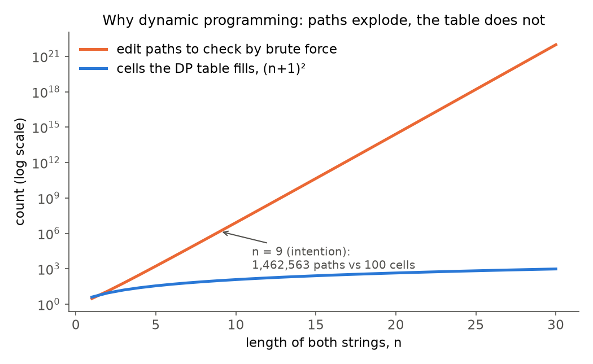
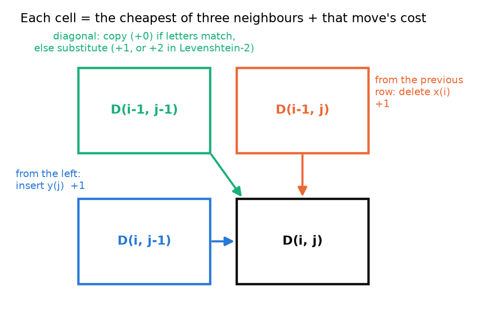
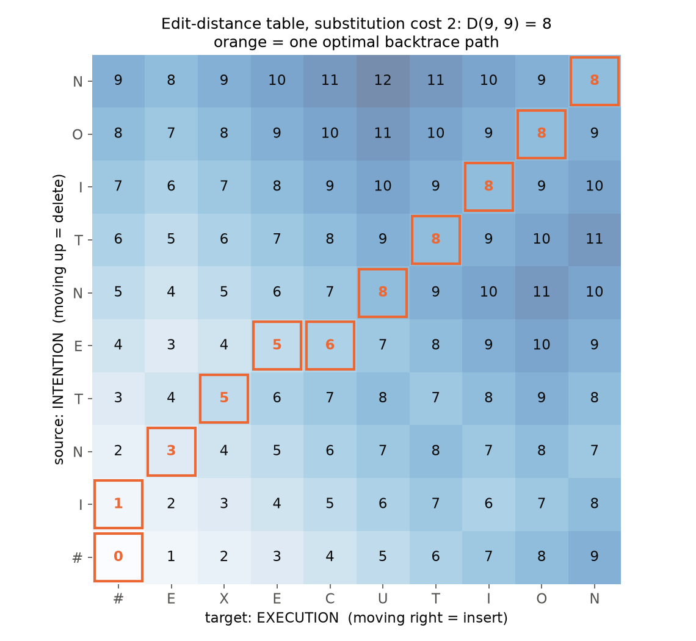

# 03 · Lexical Processing in NLP, Part 2: Minimum Edit Distance

> **Course:** Introduction to Speech & Natural Language Processing · Dr. Krishnendu Ghosh · IIIT Dharwad
>
> **Lecture:** Lecture 3, *Lexical Processing in NLP Part 2*
>
> **Sources:** `Lecture 3.pdf` (26 slides). No transcript for this lecture.
>
> **Notebook:** [`code/03_edit_distance_deep_dive.ipynb`](code/03_edit_distance_deep_dive.ipynb), Parts A–J. Every number in this note is printed by a cell there. Figures: [`code/figures_03.py`](code/figures_03.py).
>
> **Difficulty tags:** 🟢 core/syllabus · 🟡 needs practice · 🔴 beyond the slides
>
> **Builds on:** Note 02 §14 introduced Levenshtein distance as a preview. This note is the full lecture version: the table, the backtrace, the costs and the weighted variant.

---

## 📌 Table of Contents

1. [The Question: How Similar Are Two Strings?](#1-the-question-how-similar-are-two-strings-)
2. [Edit Distance in Plain Words](#2-edit-distance-in-plain-words-)
3. [Alignment: A Picture of the Edits](#3-alignment-a-picture-of-the-edits-)
4. [Why Not Try Every Edit Sequence?](#4-why-not-try-every-edit-sequence-)
5. [The Dynamic-Programming Table](#5-the-dynamic-programming-table-)
6. [Worked Example: leda → deal, Row by Row](#6-worked-example-leda--deal-row-by-row-)
7. [The Big Table: intention → execution](#7-the-big-table-intention--execution-)
8. [Backtrace: Getting the Alignment Back](#8-backtrace-getting-the-alignment-back-)
9. [Performance](#9-performance-)
10. [Weighted Edit Distance](#10-weighted-edit-distance-)
11. [Three Applications from the Slides](#11-three-applications-from-the-slides-)
12. [Worth Knowing About the Slides](#12--worth-knowing-about-the-slides)
13. [Common Confusions](#13--common-confusions)
14. [Quiz-Style Questions](#14--quiz-style-questions)
15. [Practice Problems](#15--practice-problems)
16. [Cheat Sheet](#16--cheat-sheet)
17. [Go Deeper](#17--go-deeper)

---

## 1. The Question: How Similar Are Two Strings? 🟢

The lecture opens with three situations that all ask the same question.

| Situation | The two strings | What we want |
|---|---|---|
| **Spell correction** | the typo *graffe* vs dictionary words *graf, graft, grail, giraffe* | the dictionary word that is "closest" |
| **Computational biology** | two DNA sequences, `AGGCTATCACCTGACC…` and `TAGCTATCACGACCGC…` | line them up so matching letters sit together |
| **Machine translation / speech recognition** | a reference sentence R and the system's output H | count how many words the system got wrong |

All three need **a number that says how far apart two strings are**, and ideally **a picture showing which parts match**. Minimum edit distance gives both.

---

## 2. Edit Distance in Plain Words 🟢

> **Minimum edit distance (MED)** between two strings = the **smallest number of edit operations** needed to turn one string into the other.

There are only three operations:

| Operation | What it does | Example |
|---|---|---|
| **Insertion** | add one character | *grafe* → *graffe* (insert *f*) |
| **Deletion** | remove one character | *graffe* → *grafe* (delete *f*) |
| **Substitution** | replace one character with another | *graft* → *grafe* (t → e) |

Everyday analogy: you are editing a word in a text box and each keystroke that changes a letter costs ₹1. Edit distance is the cheapest bill that gets you from the first word to the second.

**How much does each operation cost?** Two conventions appear on the slides:

| Convention | insert | delete | substitute | intention → execution |
|---|:-:|:-:|:-:|:-:|
| all operations cost 1 | 1 | 1 | 1 | **5** |
| **Levenshtein** (as the slides use the name) | 1 | 1 | **2** | **8** |

Why would a substitution cost 2? Because replacing a letter is the same as deleting it and inserting another, so it is counted as two steps. (Many textbooks and libraries call the all-1 version "Levenshtein distance"; see §12. On an exam, just state which costs you use.)

**Copying a matching letter is free.** If both strings have the same letter at a position in the alignment, cost 0.

---

## 3. Alignment: A Picture of the Edits 🟢

An **alignment** writes the two strings one above the other, using `*` for a gap, so that every column is one of:

- the same letter on top and bottom (copy, cost 0)
- different letters (substitution, `s`)
- a letter on top over `*` (deletion, `d`)
- `*` on top over a letter (insertion, `i`)

The slide's alignment of *intention* and *execution*:

```
I N T E * N T I O N
| | | | | | | | | |
* E X E C U T I O N
d s s   i s
```

Count the edits: 1 deletion, 3 substitutions, 1 insertion = **5 operations**.

- Cost if everything costs 1: 1 + 3 + 1 = **5**
- Cost if substitution costs 2: 1 + 3×2 + 1 = **8**

Both numbers match the slide. The slide also shows the first step as a search tree: from *intention* you could delete (→ *ntention*), insert (→ *eintention*), or substitute (→ *entention*), and each of those branches again.

---

## 4. Why Not Try Every Edit Sequence? 🟡

Think of it as a **search problem** (slide 6):

- **Start state:** the word we are transforming (*intention*)
- **Operators:** insert, delete, substitute
- **Goal state:** the word we want (*execution*)
- **Path cost:** the number of edits, which we want to minimise

The trouble is the number of possible paths. If both words have length *n*, the number of different edit paths is a *Delannoy number*, and it explodes:

| n | different edit paths | cells in the DP table |
|--:|--:|--:|
| 4 | 321 | 25 |
| 9 (*intention*) | 1,462,563 | 100 |
| 15 | 44,642,381,823 | 256 |
| 30 | about 9.6 × 10²¹ | 961 |

(Notebook Part D.)



The slide's key observation is that **many different paths reach the same intermediate state**. For example, "first 3 letters of *intention* turned into first 2 letters of *execution*" can be reached in many ways, but we only care about the **cheapest** way to get there. Keep one number per state and throw the rest away. That is exactly what dynamic programming does.

---

## 5. The Dynamic-Programming Table 🟢

### 5.1 What one cell means

Let X be the source string with length *n* and Y the target with length *m*.

> **D(i, j)** = the edit distance between the **first i letters of X** and the **first j letters of Y**.

So D(3, 2) for *intention* → *execution* = distance between *int* and *ex*. The answer to the whole problem is the bottom-right (or top-right, depending on how you draw it) cell **D(n, m)**.

### 5.2 The three rules

**Initialisation** (the edges of the table):

- **D(i, 0) = i**: turning i letters into nothing takes i deletions.
- **D(0, j) = j**: turning nothing into j letters takes j insertions.

**Recurrence** (every other cell). To fill D(i, j), look at three neighbours you've already filled and take the cheapest:

$$
D(i,j) = \min
\begin{cases}
D(i-1,\,j) + 1 & \text{delete } X_i\\
D(i,\,j-1) + 1 & \text{insert } Y_j\\
D(i-1,\,j-1) + \begin{cases} 0 & X_i = Y_j \\ \text{sub cost } (1 \text{ or } 2) & X_i \ne Y_j \end{cases} & \text{copy or substitute}
\end{cases}
$$

**Termination:** D(n, m) is the distance.



### 5.3 Why each neighbour means what it means

Imagine you have already solved the smaller problems and are deciding the **last column** of the alignment for *X[1..i]* and *Y[1..j]*. That last column can only be one of three things:

1. **X_i over a gap** (X_i was deleted). Before that, you must have aligned X[1..i−1] with Y[1..j] → **D(i−1, j) + 1**.
2. **A gap over Y_j** (Y_j was inserted). Before that, X[1..i] with Y[1..j−1] → **D(i, j−1) + 1**.
3. **X_i over Y_j** (copied if equal, substituted otherwise). Before that, X[1..i−1] with Y[1..j−1] → **D(i−1, j−1) + 0 or sub cost**.

There is no fourth possibility, so the minimum of the three is the true best. This is the whole correctness argument.

### 5.4 The order you fill it in

Bottom-up: small prefixes first, so the three neighbours are always ready. In practice: row 0, then row 1 left to right, then row 2, and so on.

> 💡 **Reading tip.** A cell only ever looks **left**, **one row back** and **diagonally back**. If you can remember "three neighbours, take the min, +1 for gaps, +0/+sub for the diagonal", you can rebuild the whole algorithm in an exam.

---

## 6. Worked Example: leda → deal, Row by Row 🟢

This is the slide's step-by-step example (all costs 1). Source X = *leda* (rows), target Y = *deal* (columns).

**Step 0: fill the edges.** Row 0 is 0 1 2 3 4, column 0 is 0 1 2 3 4.

|   | # | d | e | a | l |
|:-:|:-:|:-:|:-:|:-:|:-:|
| **#** | 0 | 1 | 2 | 3 | 4 |
| **l** | 1 | | | | |
| **e** | 2 | | | | |
| **d** | 3 | | | | |
| **a** | 4 | | | | |

**Row 1 (letter *l*).** Take D(1,1) as an example: compare *l* with *d*.

- up (delete *l*): D(0,1) + 1 = 2
- left (insert *d*): D(1,0) + 1 = 2
- diagonal: *l* ≠ *d*, so D(0,0) + 1 = 1 ← minimum

So D(1,1) = 1. Continuing along the row: D(1,2) = 2, D(1,3) = 3. At D(1,4) we compare *l* with *l*, a **match**, so the diagonal costs D(0,3) + 0 = 3. Row 1 = **1 1 2 3 3**.

**Row 2 (letter *e*).** At D(2,2), *e* = *e* matches, so the diagonal gives D(1,1) + 0 = 1. Row 2 = **2 2 1 2 3**.

**Row 3 (letter *d*).** Row 3 = **3 2 2 2 3** (D(3,1): *d* = *d* matches, diagonal D(2,0) + 0 = 2).

**Row 4 (letter *a*).** Row 4 = **4 3 3 2 3** (D(4,3): *a* = *a* matches, diagonal D(3,2) + 0 = 2).

Final table (notebook Part A):

|   | # | d | e | a | l |
|:-:|:-:|:-:|:-:|:-:|:-:|
| **#** | 0 | 1 | 2 | 3 | 4 |
| **l** | 1 | 1 | 2 | 3 | 3 |
| **e** | 2 | 2 | **1** | 2 | 3 |
| **d** | 3 | 2 | 2 | 2 | 3 |
| **a** | 4 | 3 | 3 | **2** | **3** |

**MED(leda, deal) = 3.** One optimal alignment (the kind of thing the backtrace in §8 gives you):

```
l e d a *
d e * a l
s   d   i
```

substitute l → d, keep *e*, delete *d*, keep *a*, insert *l*: 1 + 1 + 1 = 3. With substitution cost 2 the answer is 4.

> ✅ **Sanity checks you can always do.** (1) The answer is at least |n − m| (here 0) because you need that many insertions or deletions just to fix the length. (2) It is at most max(n, m) with sub = 1 (substitute everything, then insert/delete the extra), here 4. 3 lies between 0 and 4 ✔.

---

## 7. The Big Table: intention → execution 🟡

The slides show the full 10 × 10 table with substitution cost 2, drawn with row 0 (`#`) at the **bottom**. The notebook (Part B) prints exactly the same numbers:



How to read the picture:

- Bottom-left `0` is D(0,0): empty to empty.
- Bottom row 0 1 2 … 9: build *EXECUTION* from nothing by insertions.
- Left column 0 1 2 … 9: delete all of *INTENTION*.
- **Top-right 8** is the answer: D(9, 9) = 8.
- The orange boxes are one optimal path. Moving **diagonally** = copy or substitute, **up** = delete a source letter, **right** = insert a target letter.

Look at the top-right corner: the last three letters *ION* match, so the value stays 8 → 8 → 8 along the diagonal. Matching endings cost nothing.

---

## 8. Backtrace: Getting the Alignment Back 🟢

The number 8 tells us *how far apart* the strings are, but spell checkers, biologists and WER scripts also need *which letters line up*. The slide's recipe:

1. Every time you fill a cell, **remember which neighbour gave the minimum** (a pointer).
2. When the table is full, start at D(n, m) and **follow the pointers back** to D(0, 0).
3. Each step of the path is one column of the alignment.

| Pointer (how you arrived at the cell) | Operation |
|---|---|
| **DIAG** (from D(i−1, j−1)) | copy if letters match, else substitute |
| from the **previous row**, D(i−1, j) | delete X_i |
| from the **left**, D(i, j−1) | insert Y_j |

> ⚠️ The slide's table says LEFT = Delete and DOWN = Insert. With the slide's own layout (source letters up the side, target letters along the bottom), it's the other way round: coming from the **left** means **insert** and coming from the row below (**DOWN**) means **delete**. See §12.

Following the pointers on the intention/execution table (notebook Part C) gives:

```
i n t e * n t i o n
| | | | | | | | | |
* e x e c u t i o n
d s s   i s
cost = 1 + 2 + 2 + 0 + 1 + 2 + 0 + 0 + 0 + 0 = 8
```

the same alignment as the slide.

**There can be more than one best alignment.** When two neighbours tie for the minimum, either pointer is fine. The notebook counts optimal paths: *intention → execution* has **7** optimal paths with sub = 1 and **134** with sub = 2 (with sub = 2, a substitution costs exactly the same as delete + insert, so many more ties appear). *leda → deal* has 2 with sub = 1.

---

## 9. Performance 🟢

| Task | Cost | Why |
|---|---|---|
| Time | **O(nm)** | each of the (n+1)(m+1) cells does a constant amount of work (three comparisons) |
| Space | **O(nm)** | we store the whole table (and the pointers) |
| Backtrace | **O(n + m)** | each step moves at least one row or one column closer to D(0, 0) |

Notebook Part I times random strings: doubling the length takes about **4×** as long (200 letters: 5 ms, 400: 23 ms, 800: 104 ms), exactly what O(nm) predicts.

🔴 **Beyond the slides:** if you only want the *distance* and not the alignment, you only need the previous row to compute the current one, so memory drops to O(m) ("two-row" version, notebook Part I). Getting the alignment in linear memory is possible with Hirschberg's algorithm.

---

## 10. Weighted Edit Distance 🟡

### 10.1 Why add weights?

Not all mistakes are equally likely:

- **Spell correction:** people often hit a **neighbouring key** (*e* and *r* sit next to each other) or confuse similar sounds. A typo *thw* is much more likely to be *the* (w is right next to e) than *thy*.
- **Biology:** some insertions, deletions and mutations happen far more often in nature than others.

The slide shows a keyboard and a **confusion matrix for spelling errors**, `sub[X, Y]`, which counts how often letter X was typed when Y was meant (from Kernighan, Church & Gale, 1990). Frequent confusions should be **cheap**, rare ones **expensive**.

### 10.2 The weighted recurrence

Replace every "+1" with a cost that depends on the letters:

**Initialisation**

- D(0, 0) = 0
- D(i, 0) = D(i−1, 0) + del[x(i)] for 1 ≤ i ≤ N
- D(0, j) = D(0, j−1) + ins[y(j)] for 1 ≤ j ≤ M

**Recurrence**

$$
D(i,j) = \min
\begin{cases}
D(i-1,\,j) + \text{del}[x_i]\\
D(i,\,j-1) + \text{ins}[y_j]\\
D(i-1,\,j-1) + \text{sub}[x_i, y_j]
\end{cases}
$$

with sub[a, a] = 0. **Termination:** D(N, M) is the distance.

It is the **same table, same filling order, same backtrace**; only the costs change.

### 10.3 Worked example: keyboard-aware costs (notebook Part H)

Rule: substituting two keys that touch on a QWERTY keyboard costs **0.5**, any other substitution costs 1, insert and delete cost 1.

| Typo | Candidate | Plain distance | Keyboard-weighted |
|---|---|:-:|:-:|
| thw | **the** | 1 | **0.5** (w and e are neighbours) |
| thw | thy | 1 | 1 |
| thw | two | 2 | 2 |
| hwllo | **hello** | 1 | **0.5** |
| hwllo | **hallo** | 1 | **0.5** (w also touches a) |
| hwllo | hullo | 1 | 1 |

With plain costs, *the* and *thy* tie; the weights break the tie the way a human would. The *hello/hallo* tie shows that weights alone are not enough. Real spell checkers also use **how common each word is** (a language model). That is the noisy-channel model you'll meet later.

---

## 11. Three Applications from the Slides 🟡

### 11.1 Spell correction: the *graffe* question

Notebook Part E:

| Candidate | sub = 1 | sub = 2 |
|---|:-:|:-:|
| graf | 2 | 2 |
| graft | 2 | 3 |
| grail | 3 | 5 |
| **giraffe** | **1** | **1** |

*giraffe* wins with a single insertion (`g * r a f f e` / `g i r a f f e`).

### 11.2 Word-level distance for MT and speech recognition

Run the **same algorithm with words instead of letters**:

```
R: Spokesman confirms senior government adviser was shot
H: Spokesman said the senior adviser was shot dead
              S     I        D                     I
```

That's 4 edits (1 substitution, 2 insertions, 1 deletion) against 7 reference words. This gives the standard speech-recognition metric:

$$
\text{WER} = \frac{S + D + I}{\text{words in the reference}} = \frac{4}{7} = 57.1\%
$$

The notebook finds 3 different optimal alignments, all with 4 edits. Its backtrace picks "3 substitutions + 1 insertion"; the slide's alignment (S, I, D, I) is another one of the three. WER can exceed 100% if the system inserts lots of extra words.

### 11.3 Biology: aligning DNA

The slide's two sequences (31 and 32 letters) have unit-cost edit distance **13**, and the slide's gapped alignment also scores 13, so it is optimal (notebook Part G). Biologists usually flip the idea around: instead of minimising a cost they **maximise a similarity score** (reward matches, penalise gaps). That is the Needleman–Wunsch algorithm (global alignment) and Smith–Waterman (local alignment), both built on the same table.

---

## 12. ⚠️ Worth Knowing About the Slides

| Slide | What it says | What's right |
|---|---|---|
| *Defining MED* | "For each i = 1…M, for each j = 1…N … D(N,M) is distance", after defining X with length n and Y with length m | The letters are mixed up. With X of length n and Y of length m: i = 1…n, j = 1…m, answer D(n, m). |
| *Adding Backtrace* | LEFT = Delete, DOWN = Insert | Swapped for the slide's own table layout. Coming from the **left** (same source letter, one more target letter) = **insert**; coming from **below** (one more source letter) = **delete**. DIAG = substitute/copy is right. |
| *Weighted MED* | D(i,0) for "1 < i ≤ N" | Should be **1 ≤ i ≤ N** (and 1 ≤ j ≤ M); i = 1 also uses this rule. |
| *Minimum Edit Distance* | calls the sub-cost-2 version "Levenshtein" | Common in Jurafsky & Martin's slides. Most libraries (`python-Levenshtein`, `nltk.edit_distance`) and Wikipedia use **cost 1** for substitution under that name. Always state your costs. |
| *Dynamic Programming for MED* | compute D(i,j) for "0 < i < n" | Should include the end points: 0 ≤ i ≤ n, 0 ≤ j ≤ m. |

---

## 13. ⚠️ Common Confusions

| Confusion | Clear-up |
|---|---|
| "Edit distance is the number of letters that differ" | No. That's the **Hamming** distance, which only works for equal-length strings and allows only substitutions. *abc* vs *bc*: Hamming undefined, edit distance 1. |
| "D(i, j) is about letter i and letter j" | It's about the **prefixes**: the first i letters and the first j letters. |
| "The diagonal always costs something" | A diagonal move is **free** if the two letters match. |
| "Insert and delete are different problems" | Distance is symmetric when insert and delete cost the same: MED(x, y) = MED(y, x) (e.g. *intention ↔ execution* = 8 both ways). With different costs it isn't. |
| "The best alignment is unique" | Often many alignments tie (7 for intention/execution with sub = 1). |
| "We need the full table for the distance" | Only for the alignment. Two rows suffice for the number alone. |

---

## 14. 📝 Quiz-Style Questions

<details>
<summary><b>Q1.</b> Name the three edit operations.</summary>

Insertion, deletion, substitution.

</details>

<details>
<summary><b>Q2.</b> What does D(i, j) mean?</summary>

The minimum edit distance between the first i characters of X and the first j characters of Y.

</details>

<details>
<summary><b>Q3.</b> What are D(i, 0) and D(0, j), and why?</summary>

D(i, 0) = i (delete all i letters), D(0, j) = j (insert all j letters).

</details>

<details>
<summary><b>Q4.</b> MED of intention → execution with unit costs, and with substitution cost 2?</summary>

5 and 8.

</details>

<details>
<summary><b>Q5.</b> Time, space and backtrace complexity?</summary>

O(nm), O(nm), O(n + m).

</details>

<details>
<summary><b>Q6.</b> Why do we need a backtrace?</summary>

The distance alone does not say which characters line up; the backtrace recovers the alignment (needed for spell-correction explanations, DNA alignment and WER counting).

</details>

<details>
<summary><b>Q7.</b> Give two reasons to use weighted edit distance.</summary>

Spell correction (some letters, such as neighbouring keys, are mistyped more often) and biology (some insertions/deletions/mutations are more likely).

</details>

<details>
<summary><b>Q8.</b> Why is brute-force search over edit sequences a bad idea, and what fixes it?</summary>

The number of edit sequences grows exponentially (1.46 million paths for two 9-letter words), and many paths reach the same intermediate state. Dynamic programming keeps only the cheapest way to reach each state, needing just (n+1)(m+1) cells.

</details>

---

## 15. 📝 Practice Problems

20 problems, 🟢 easy · 🟡 medium · 🔴 hard. All numbers are checked in notebook Part J.

<details>
<summary><b>P1 🟢</b> MED(cat, cut)? MED(cat, cats)? MED(cat, act)? (unit costs)</summary>

1 (substitute a → u), 1 (insert s), 2 (e.g. substitute c → a and a → c, or delete c and insert c after a).

</details>

<details>
<summary><b>P2 🟢</b> What is MED("abc", "") and MED("", "abc")?</summary>

3 and 3 (three deletions; three insertions). These are just the edge cells D(3, 0) and D(0, 3).

</details>

<details>
<summary><b>P3 🟢</b> Without building a table, give lower and upper bounds for MED(sunday, saturday) with unit costs.</summary>

Lower bound |6 − 8| = 2 (at least two insertions). Upper bound 8 (max length). The true value is **3** (see P5).

</details>

<details>
<summary><b>P4 🟡</b> Build the full unit-cost table for drive → brief.</summary>

|   | # | b | r | i | e | f |
|:-:|:-:|:-:|:-:|:-:|:-:|:-:|
| **#** | 0 | 1 | 2 | 3 | 4 | 5 |
| **d** | 1 | 1 | 2 | 3 | 4 | 5 |
| **r** | 2 | 2 | 1 | 2 | 3 | 4 |
| **i** | 3 | 3 | 2 | 1 | 2 | 3 |
| **v** | 4 | 4 | 3 | 2 | 2 | 3 |
| **e** | 5 | 5 | 4 | 3 | 2 | 3 |

**MED = 3**: substitute d → b, keep *ri*, then *ve* → *ef* by one deletion (v) and one insertion (f) at the end, or two substitutions (v → e, e → f). Either way, 3. With sub = 2 the answer is 4.

</details>

<details>
<summary><b>P5 🟡</b> MED(sunday, saturday), unit costs. Give an edit script.</summary>

**3.** s-*-*-u-n-d-a-y vs s-a-t-u-r-d-a-y: insert *a*, insert *t*, substitute n → r. With sub = 2 it is 4 (the n → r substitution becomes delete + insert).

</details>

<details>
<summary><b>P6 🟡</b> MED(kitten, sitting) with sub = 1 and with sub = 2.</summary>

3 (k → s, e → i, insert g) and 5 (2 + 2 + 1).

</details>

<details>
<summary><b>P7 🟡</b> MED(drive, divers) and an alignment.</summary>

**3**:
```
d r i v e * *
d * i v e r s
  d       i i
```
(delete r, insert r, insert s). With sub = 2 it is still 3, because no substitutions are used.

</details>

<details>
<summary><b>P8 🟡</b> Fill the unit-cost table for rain → shine and read off the answer.</summary>

|   | # | s | h | i | n | e |
|:-:|:-:|:-:|:-:|:-:|:-:|:-:|
| **#** | 0 | 1 | 2 | 3 | 4 | 5 |
| **r** | 1 | 1 | 2 | 3 | 4 | 5 |
| **a** | 2 | 2 | 2 | 3 | 4 | 5 |
| **i** | 3 | 3 | 3 | 2 | 3 | 4 |
| **n** | 4 | 4 | 4 | 3 | 2 | 3 |

**MED = 3**: r → s, a → h, keep *in*, insert *e*. With sub = 2: 5.

</details>

<details>
<summary><b>P9 🟢</b> Which dictionary word is closest to the typo "graffe": graf, graft, grail or giraffe? Give each distance (unit costs).</summary>

graf 2, graft 2, grail 3, **giraffe 1**.

</details>

<details>
<summary><b>P10 🟡</b> A speech recogniser outputs "the cat sat on mat" for the reference "the cat sat on the mat". Compute the WER.</summary>

One deletion (*the*), 6 reference words: WER = 1/6 = **16.7%**.

</details>

<details>
<summary><b>P11 🟡</b> Reference "I like tea", hypothesis "I really do like the tea". WER?</summary>

Three insertions (*really, do, the*), 0 substitutions, 0 deletions, 3 reference words: WER = 3/3 = **100%**. This shows WER can reach (or exceed) 100%.

</details>

<details>
<summary><b>P12 🟢</b> Why is MED(x, y) = MED(y, x) when insertion and deletion both cost 1?</summary>

Reverse any edit script: every insertion becomes a deletion of the same letter and vice versa, and every substitution a → b becomes b → a. Costs are unchanged, so the cheapest script one way gives an equally cheap script the other way.

</details>

<details>
<summary><b>P13 🟡</b> Show that with substitution cost 2 and insert/delete cost 1, you never *need* substitutions.</summary>

A substitution (cost 2) can always be replaced by delete + insert (1 + 1 = 2) with the same total. So substitutions only create ties. This is also why so many alignments tie for intention → execution with sub = 2 (134 of them).

</details>

<details>
<summary><b>P14 🟡</b> With sub = 2, what simple formula gives MED in terms of the longest common subsequence (LCS)?</summary>

MED = n + m − 2·|LCS|. Every letter not in the LCS must be deleted (from X) or inserted (from Y). For intention/execution, the LCS is *etion* (5 letters): 9 + 9 − 10 = 8 ✔.

</details>

<details>
<summary><b>P15 🟢</b> In the DP table, which three cells must be filled before D(4, 7)?</summary>

D(3, 7), D(4, 6) and D(3, 6).

</details>

<details>
<summary><b>P16 🟡</b> How many cells does the table for two 1000-letter strings have, and how many steps does the backtrace take at most?</summary>

1001 × 1001 = 1,002,001 cells. The backtrace takes at most n + m = 2000 steps.

</details>

<details>
<summary><b>P17 🟡</b> Weighted MED: substituting neighbouring keys costs 0.5, other substitutions 1, insert/delete 1. Distances from "thw" to "the", "thy" and "two"?</summary>

0.5, 1, 2. The weights make *the* the clear winner where plain costs tie *the* and *thy*.

</details>

<details>
<summary><b>P18 🟡</b> MED(algorithm, altruistic) with sub = 1 and sub = 2.</summary>

6 and 9 (notebook Part J). Common letters a-l … i … t… keep the cost well below the length 10.

</details>

<details>
<summary><b>P19 🔴</b> Explain in one paragraph why the recurrence is correct (why the min over three cells gives the optimum).</summary>

Take any optimal alignment of X[1..i] and Y[1..j] and look at its last column. It is either X_i over a gap, a gap over Y_j, or X_i over Y_j. Removing that column leaves an alignment of the corresponding smaller prefixes, which must itself be optimal (otherwise we could swap in a cheaper one and beat the "optimal" alignment). So the optimal cost equals one of D(i−1, j) + del, D(i, j−1) + ins, D(i−1, j−1) + sub/0, and taking the minimum picks the right case. This is the *optimal substructure* property that makes dynamic programming work.

</details>

<details>
<summary><b>P20 🔴</b> Levenshtein gives MED(form, from) = 2. Which extra operation would make it 1, and why do spell checkers want it?</summary>

**Transposition** of two adjacent letters (*or* → *ro*), giving **Damerau–Levenshtein** distance. Swapped letters are one of the most common typing errors, so counting them as one mistake ranks the intended word correctly. (Note 02 §14.2 covers this.)

</details>

---

## 16. 🧾 Cheat Sheet

- **MED** = minimum number (or cost) of insertions, deletions and substitutions turning X into Y.
- **Costs:** unit (1, 1, 1), or the slides' "Levenshtein" (ins 1, del 1, sub 2). Matching letters cost 0.
- **D(i, j)** = distance between X[1..i] and Y[1..j]. Answer: **D(n, m)**.
- **Init:** D(i, 0) = i, D(0, j) = j.
- **Recurrence:** D(i,j) = min( D(i−1,j)+1 [delete], D(i,j−1)+1 [insert], D(i−1,j−1)+(0 if same else sub) ).
- **Backtrace:** store a pointer per cell, follow from D(n, m) to D(0, 0). Diagonal = copy/sub, from previous row = delete, from left = insert.
- **Complexity:** time O(nm), space O(nm), backtrace O(n+m); distance only: O(m) space.
- **Weighted:** replace +1 with del[x], ins[y], sub[x, y] (e.g. from a spelling confusion matrix or keyboard layout).
- **Key numbers:** leda→deal 3 · intention→execution 5 (sub 1) / 8 (sub 2) · graffe→giraffe 1 · slide WER example 4/7 = 57.1%.
- **Applications:** spell correction, DNA alignment, WER for ASR/MT.

---

## 17. 📚 Go Deeper

| What | Why | Link |
|---|---|---|
| Textbook section | Edit distance with the same intention/execution example | [Jurafsky & Martin SLP3, Ch. 2 (minimum edit distance section)](https://web.stanford.edu/~jurafsky/slp3/2.pdf) |
| Spelling & noisy channel | How edit distance + word frequencies make a real spell checker | [J&M SLP3, Appendix B: Spelling Correction and the Noisy Channel](https://web.stanford.edu/~jurafsky/slp3/B.pdf) |
| Half-page spell checker | Edit-distance candidates ranked by frequency | [Norvig, How to Write a Spelling Corrector](https://norvig.com/spell-correct.html) |
| The confusion matrix on the slide | Where the spelling-error counts come from | Kernighan, Church & Gale (1990), *A Spelling Correction Program Based on a Noisy Channel Model*, [ACL Anthology C90-2036](https://aclanthology.org/C90-2036/) |
| Biology version | Needleman–Wunsch global alignment | [Wikipedia: Needleman–Wunsch algorithm](https://en.wikipedia.org/wiki/Needleman%E2%80%93Wunsch_algorithm) |
| WER in practice | Library used in speech-recognition evaluation | [`jiwer` on PyPI](https://pypi.org/project/jiwer/) |
