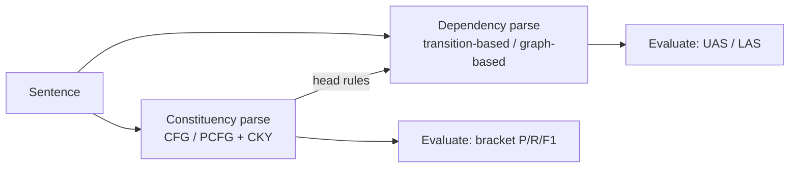
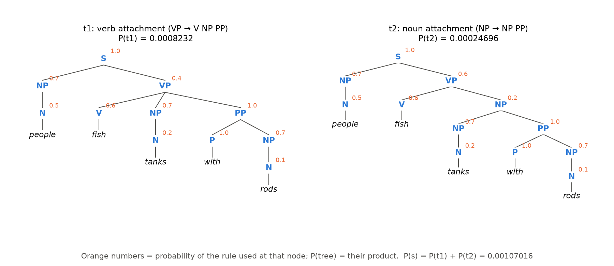
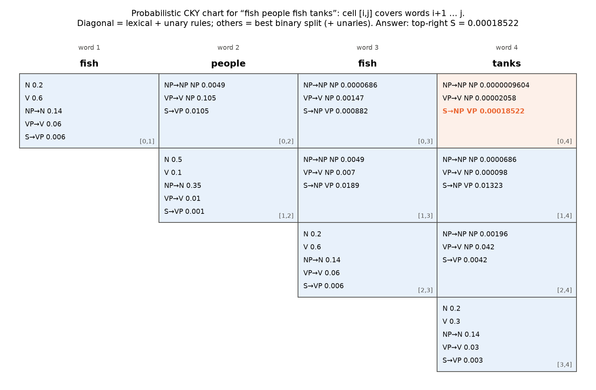
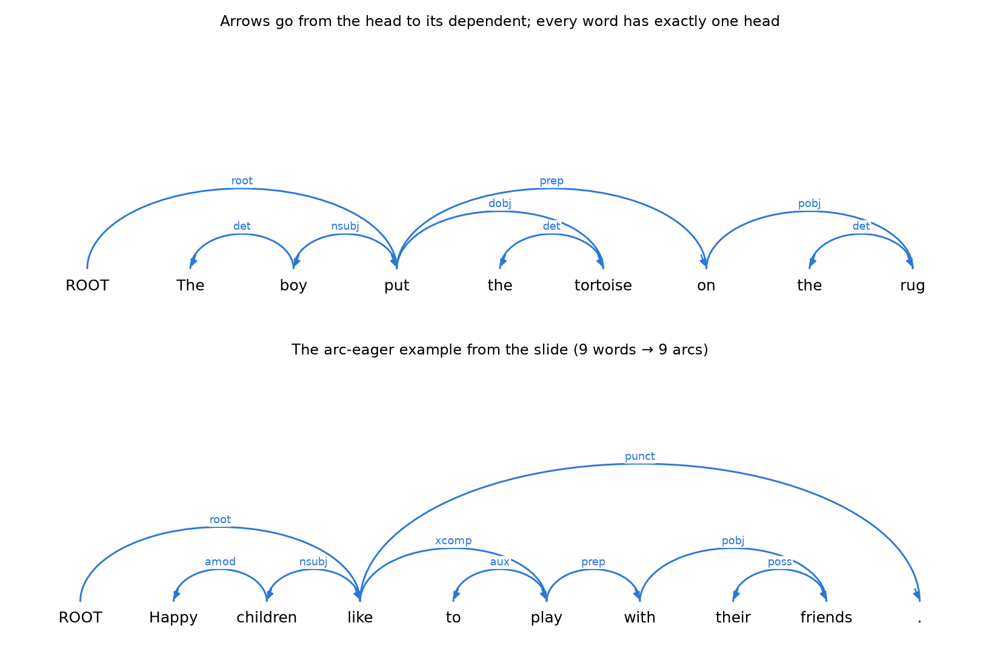
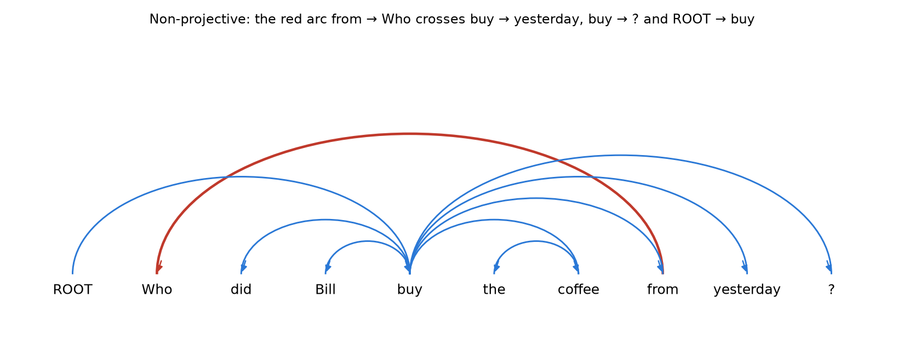

# 04 · Syntactic Processing in NLP: Constituency & Dependency Parsing

> **Course:** Introduction to Speech & Natural Language Processing · Dr. Krishnendu Ghosh · IIIT Dharwad
>
> **Lecture:** Lecture 4, *Syntactic Processing in NLP*
>
> **Sources:** `Lecture 4.pdf` (48 slides). No transcript for this lecture.
>
> **Notebook:** [`code/04_parsing_deep_dive.ipynb`](code/04_parsing_deep_dive.ipynb), Parts A–K. Every number in this note is printed by a cell there, including the full CKY chart and the arc-eager trace from the slides. Figures: [`code/figures_04.py`](code/figures_04.py).
>
> **Difficulty tags:** 🟢 core/syllabus · 🟡 needs practice · 🔴 beyond the slides
>
> **Builds on:** Note 01 §9 (syntax layer, a first CKY with a plain CFG). This lecture adds **probabilities** to the grammar, **binarization**, **evaluation**, and the whole **dependency** side.

---

## 📌 Table of Contents

1. [Big Picture: Two Ways to Draw a Sentence's Structure](#1-big-picture-two-ways-to-draw-a-sentences-structure-)
2. [Constituents: Which Words Belong Together?](#2-constituents-which-words-belong-together-)
3. [Phrase-Structure Grammar = Context-Free Grammar](#3-phrase-structure-grammar--context-free-grammar-)
4. [Probabilistic CFG (PCFG)](#4-probabilistic-cfg-pcfg-)
5. [Worked Example: Two Trees for *people fish tanks with rods*](#5-worked-example-two-trees-for-people-fish-tanks-with-rods-)
6. [Grammar Transforms: Chomsky Normal Form and Binarization](#6-grammar-transforms-chomsky-normal-form-and-binarization-)
7. [The CKY Algorithm, Step by Step](#7-the-cky-algorithm-step-by-step-)
8. [Evaluating Constituency Parsers](#8-evaluating-constituency-parsers-)
9. [Dependency Structure](#9-dependency-structure-)
10. [Phrase Structure ↔ Dependencies: Heads](#10-phrase-structure--dependencies-heads-)
11. [Four Ways to Build a Dependency Parser](#11-four-ways-to-build-a-dependency-parser-)
12. [What Tells a Parser Where Arcs Go?](#12-what-tells-a-parser-where-arcs-go-)
13. [Transition-Based Parsing (MaltParser)](#13-transition-based-parsing-maltparser-)
14. [Evaluating Dependency Parsers: UAS and LAS](#14-evaluating-dependency-parsers-uas-and-las-)
15. [Projectivity](#15-projectivity-)
16. [Worth Knowing About the Slides](#16--worth-knowing-about-the-slides)
17. [Common Confusions](#17--common-confusions)
18. [Quiz-Style Questions](#18--quiz-style-questions)
19. [Practice Problems](#19--practice-problems)
20. [Cheat Sheet](#20--cheat-sheet)
21. [Go Deeper](#21--go-deeper)

---

## 1. Big Picture: Two Ways to Draw a Sentence's Structure 🟢

**Syntax** is about how words combine into sentences. A **parser** takes a sentence and outputs its structure as a tree. The lecture covers the two standard kinds of tree:

| | **Constituency (phrase structure)** | **Dependency** |
|---|---|---|
| Basic idea | words group into **nested phrases** (NP, VP, PP …) | each word **depends on** one other word (its head) |
| Nodes | words **plus** phrase labels | **only the words** |
| Edges | "this phrase is made of these parts" | "this word modifies / is an argument of that word" |
| Picture for *The boy put the tortoise on the rug* | `(S (NP The boy) (VP put (NP the tortoise) (PP on (NP the rug))))` | *put* → *boy*, *put* → *tortoise*, *put* → *on*, *on* → *rug*, … |
| Classic algorithm in this lecture | **PCFG + CKY** | **transition-based parsing (MaltParser)** |
| Evaluation | labeled precision / recall / F1 of brackets | UAS / LAS (fraction of correct heads) |

Both trees describe the same sentence. Constituency is good for "what are the phrases?", dependency for "who did what to whom?". Most modern NLP tools (spaCy, Stanza) output **dependencies** because they are simpler and work well across languages with free word order.



---

## 2. Constituents: Which Words Belong Together? 🟢

A **constituent** is a group of words that behaves like **one unit**. Phrase structure arranges words into nested constituents. How do we know a group is a unit? The slide gives tests (linguists argue about some edge cases, but these work most of the time):

**1. Distribution (it can move around as a block).**

- John talked **[to the children]** **[about drugs]**.
- John talked **[about drugs]** **[to the children]**. ✔ the two blocks swap
- \*John talked **drugs to the children about**. ✘ breaking a block apart gives nonsense (`*` = ungrammatical)

**2. Substitution / pro-forms (it can be replaced by one word or a different phrase of the same type).**

- I sat **[on the box]** / **[right on top of the box]** / **[there]**.

All three fill the same slot, so *on the box* is one unit (a PP).

**3. Others** listed on the slide: **coordination** (*[the boy] and [the girl]*), regular internal structure, no intrusion, it can stand alone as a **fragment** (answer to a question: *"Where did you sit?" "On the box."*), and it has a single meaning.

---

## 3. Phrase-Structure Grammar = Context-Free Grammar 🟢

### 3.1 The slide's grammar

```
S  → NP VP          N → people     V → people
VP → V NP           N → fish       V → fish
VP → V NP PP        N → tanks      V → tanks
NP → NP NP          N → rods       P → with
NP → NP PP
NP → N
NP → e              (e = empty: an NP with no words)
PP → P NP
```

Read `S → NP VP` as "a sentence can be made of a noun phrase followed by a verb phrase". The right column is the **lexicon**: which words can be which part of speech. Notice *people*, *fish* and *tanks* can all be nouns **or** verbs, which is where the ambiguity comes from.

**Deriving *people fish tanks*** (notebook Part A finds exactly 1 parse):

```
S → NP VP → N VP → people VP → people V NP → people fish NP → people fish N → people fish tanks
```

Tree: `(S (NP (N people)) (VP (V fish) (NP (N tanks))))`, meaning "people catch tanks with a fishing rod".

**Why is `NP → e` there?** *people fish with rods* has no object between *fish* and *with*. The only VP rule with a PP is `VP → V NP PP`, which demands an NP in the middle. Without the empty NP, this grammar gives the sentence **0 parses** (notebook Part A). With `NP → e`, the empty NP fills the gap.

### 3.2 The formal definition

A CFG is a 4-tuple **G = (T, N, S, R)**:

| Symbol | Name | In the slide's grammar |
|---|---|---|
| **T** | terminal symbols (the actual words) | people, fish, tanks, rods, with |
| **N** | non-terminal symbols (categories) | S, NP, VP, PP, N, V, P |
| **S** | start symbol, S ∈ N | S |
| **R** | rules X → γ with X ∈ N, γ ∈ (N ∪ T)* | the 15 rules above |

"Context-free" means the left side is a **single** non-terminal: an NP can be expanded the same way wherever it appears, regardless of its neighbours (its context).

A grammar G **generates a language L**: the set of all word strings that can be derived from S.

**The NLP version** splits things more finely: G = (T, **C**, N, S, **L**, R), where

- **C** = preterminals (POS tags such as N, V, P),
- **L** = the lexicon, rules X → x with X a preterminal and x a word,
- **R** = the grammar proper, rules X → γ over non-terminals and preterminals.

Two conventions: statistical parsers usually add an extra top node **ROOT** (or TOP) above S, and we write **e** for an empty sequence.

---

## 4. Probabilistic CFG (PCFG) 🟢

### 4.1 The idea

A plain CFG can tell you **which** trees are possible, but a real sentence often has many. A PCFG attaches a probability to every rule, so we can say **which tree is most likely**.

**G = (T, N, S, R, P)**, where P gives each rule a probability between 0 and 1, and **for each left-hand side the probabilities add up to 1**:

$$
\forall X \in N:\quad \sum_{X \to \gamma \,\in\, R} P(X \to \gamma) = 1
$$

Read P(VP → V NP) = 0.6 as: *"when we expand a VP, 60% of the time it becomes V NP."*

### 4.2 The slide's PCFG

```
S  → NP VP     1.0        N → people  0.5        V → people  0.1
VP → V NP      0.6        N → fish    0.2        V → fish    0.6
VP → V NP PP   0.4        N → tanks   0.2        V → tanks   0.3
NP → NP NP     0.1        N → rods    0.1        P → with    1.0
NP → NP PP     0.2
NP → N         0.7
PP → P NP      1.0
```

Check: VP rules 0.6 + 0.4 = 1 ✔; NP rules 0.1 + 0.2 + 0.7 = 1 ✔; N words 0.5 + 0.2 + 0.2 + 0.1 = 1 ✔; V words 0.1 + 0.6 + 0.3 = 1 ✔ (notebook Part B prints all sums = 1.0).

### 4.3 Probability of a tree and of a sentence

> **P(t)**: the probability of a **tree** = the **product** of the probabilities of all the rules used to build it.
>
> **P(s)**: the probability of a **sentence** = the **sum** of P(t) over all trees whose words (yield) are s.

$$
P(s) = \sum_{t:\ \text{yield}(t) = s} P(t)
$$

So a PCFG is also a **language model**: it assigns a probability to every sentence.

---

## 5. Worked Example: Two Trees for *people fish tanks with rods* 🟡

This sentence has exactly 2 parses under the slide's grammar (notebook Part B). The question is **where does *with rods* attach?**



**t1: verb attachment.** *with rods* belongs to the verb: the people use rods to fish tanks.

| Rule | Prob |
|---|--:|
| S → NP VP | 1.0 |
| NP → N | 0.7 |
| N → people | 0.5 |
| VP → V NP PP | 0.4 |
| V → fish | 0.6 |
| NP → N | 0.7 |
| N → tanks | 0.2 |
| PP → P NP | 1.0 |
| P → with | 1.0 |
| NP → N | 0.7 |
| N → rods | 0.1 |
| **P(t1)** | **0.0008232** |

**t2: noun attachment.** *with rods* belongs to *tanks*: they fish the tanks that have rods.

| Rule | Prob |
|---|--:|
| S → NP VP | 1.0 |
| NP → N, N → people | 0.7 × 0.5 |
| **VP → V NP** | **0.6** |
| V → fish | 0.6 |
| **NP → NP PP** | **0.2** |
| NP → N, N → tanks | 0.7 × 0.2 |
| PP → P NP, P → with | 1.0 × 1.0 |
| NP → N, N → rods | 0.7 × 0.1 |
| **P(t2)** | **0.00024696** |

**Sentence probability:** P(s) = 0.0008232 + 0.00024696 = **0.00107016**.

**Which tree wins?** t1, by a factor of 0.0008232 / 0.00024696 ≈ **3.33**. There's a shortcut: all the rules the two trees share cancel, so the ratio is just

$$
\frac{P(\text{VP} \to \text{V NP PP})}{P(\text{VP} \to \text{V NP}) \times P(\text{NP} \to \text{NP PP})} = \frac{0.4}{0.6 \times 0.2} = 3.33
$$

> 💡 This is the famous **PP-attachment ambiguity**. Notice the PCFG decides it purely from rule frequencies; it doesn't know anything about *rods* or *tanks*. That weakness is why later parsers became **lexicalised** (rules that look at head words) and then neural.

---

## 6. Grammar Transforms: Chomsky Normal Form and Binarization 🟡

### 6.1 Chomsky Normal Form (CNF)

A grammar is in CNF if **every** rule is one of:

- **X → Y Z** (exactly two non-terminals), or
- **X → w** (exactly one word).

Converting any CFG to CNF:

1. **Remove empties** (X → e) and **unaries** (X → Y), recursively.
2. **Split n-ary rules** (more than 2 children) by introducing new non-terminals.

This does **not change the weak generative capacity**: the new grammar accepts exactly the same set of sentences, though the trees look different. With some bookkeeping in the new symbol names, you can **detransform** back to the original trees.

### 6.2 In practice: just binarize

Full CNF is a pain:

- Reconstructing n-ary rules afterwards is **easy** (just remove the `@` nodes).
- Reconstructing unaries and empties is **trickier**.

The key fact: **binarization is what you really need** for O(n³) CKY parsing. Removing unaries is optional (it just makes the algorithm a bit cleaner and faster), so the slide's CKY grammar keeps unaries and handles them inside each cell.

**Binarizing `VP → V NP PP`:**

```
VP    → V @VP_V
@VP_V → NP PP
```

`@VP_V` means "the rest of a VP after a V has been seen". Before vs after:

```
Before:  (VP (V fish) (NP tanks) (PP with rods))           3 children
After:   (VP (V fish) (@VP_V (NP tanks) (PP with rods)))   2 children each
```

NLTK does the same thing with its own naming (`VP|<NP-PP>`), and undoing it gives back the original tree exactly (notebook Part C).

---

## 7. The CKY Algorithm, Step by Step 🟡

### 7.1 The idea

CKY (Cocke–Kasami–Younger) finds the **most probable tree** using dynamic programming, much like edit distance (Note 03). Instead of a table indexed by two string prefixes, it fills a **triangular chart** indexed by **spans** of the sentence.

Number the gaps between words: for *fish people fish tanks*, the gaps are 0 fish 1 people 2 fish 3 tanks 4.

> **score[i][j][A]** = the probability of the best A-subtree covering exactly the words between gap i and gap j.

The answer is **score[0][n][S]**.

### 7.2 The grammar used in the CKY slides

The CKY slides use a slightly different, **binarized** PCFG with unaries:

```
S  → NP VP     0.9     @VP_V → NP PP  1.0     N → people 0.5    V → people 0.1
S  → VP        0.1     NP → NP NP     0.1     N → fish   0.2    V → fish   0.6
VP → V NP      0.5     NP → NP PP     0.2     N → tanks  0.2    V → tanks  0.3
VP → V         0.1     NP → N         0.7     N → rods   0.1    P → with   1.0
VP → V @VP_V   0.3     PP → P NP      1.0
VP → V PP      0.1
```

### 7.3 The three steps

**Step 1: lexical (diagonal cells).** For each word, put in every POS tag that can produce it.

> cell [0,1] *fish*: N = 0.2, V = 0.6

**Step 2: unaries (inside the same cell).** Repeatedly apply A → B rules while they improve something:

> NP → N: 0.7 × 0.2 = 0.14 · VP → V: 0.1 × 0.6 = 0.06 · then S → VP: 0.1 × 0.06 = 0.006

The repeat ("while added") is needed because one unary can enable another (V → VP → S).

**Step 3: binary (longer spans, shortest first).** For a cell [begin, end], try **every split point** and **every binary rule** A → B C:

```
prob = score[begin][split][B] × score[split][end][C] × P(A → B C)
keep it if it beats the current score[begin][end][A]   (also store a back-pointer)
```

Then apply unaries again in that cell.

### 7.4 Filling the chart for *fish people fish tanks*

**Span 1 (the diagonal), after lexical + unaries:**

| Cell | Word | Entries |
|---|---|---|
| [0,1] | fish | N 0.2, V 0.6, NP 0.14, VP 0.06, S 0.006 |
| [1,2] | people | N 0.5, V 0.1, NP 0.35, VP 0.01, S 0.001 |
| [2,3] | fish | N 0.2, V 0.6, NP 0.14, VP 0.06, S 0.006 |
| [3,4] | tanks | N 0.2, V 0.3, NP 0.14, VP 0.03, S 0.003 |

**Span 2, worked in full for cell [0,2] = *fish people*** (only split point 1):

- NP → NP NP: 0.14 × 0.35 × 0.1 = **0.0049**
- VP → V NP: 0.6 × 0.35 × 0.5 = **0.105** ("to fish people")
- S → NP VP: 0.14 × 0.01 × 0.9 = 0.00126
- then the unary S → VP: 0.1 × 0.105 = **0.0105**, which beats 0.00126, so S is replaced.

That's exactly what the slides show: S → NP VP 0.00126 is first written in and then overwritten by S → VP 0.0105.

**Cell [1,3] = *people fish***: S → NP VP = 0.35 × 0.06 × 0.9 = **0.0189** (people + fish as a verb: "people fish").

**The finished chart** (notebook Part D, matches the slides number for number):



**Answer:** score[0][4][S] = **0.00018522**. Following the back-pointers (`buildTree`) gives

```
(S (NP (NP (N fish)) (NP (N people))) (VP (V fish) (NP (N tanks))))
```

i.e. *"[fish people] fish [tanks]"*: people who are fish-people catch tanks. The S comes from split 2: NP[0,2] × VP[2,4] × 0.9 = 0.0049 × 0.042 × 0.9 = 0.00018522 ✔.

### 7.5 Cost

The binary step loops over all (begin, split, end) triples, and there are (n³ − n)/6 of them (n = 4: 10 triples, n = 40: 10,660; notebook Part K). Each triple tries every binary rule, so

$$
\text{time} = O(n^3 \cdot |G|)
$$

This is why **binarization is crucial**: with a 3-child rule you'd need two split points, giving O(n⁴).

### 7.6 🔴 Max vs sum: the inside algorithm

Replace "keep the max" with "add them up" and the same chart computes **P(sentence)** over all trees instead of the best tree's probability. For *fish people fish tanks* the total is 0.0002054, so the best tree carries **90.2%** of the probability (notebook Part E).

---

## 8. Evaluating Constituency Parsers 🟡

Compare the parser's tree (candidate) with a human-made tree (gold standard) from a **treebank** such as the Penn Treebank.

**Method (PARSEVAL):** turn each tree into a set of **labeled brackets** (label, start, end), leaving out the POS tags and ROOT. Then

$$
\text{LP} = \frac{\#\text{correct brackets}}{\#\text{brackets in candidate}} \qquad
\text{LR} = \frac{\#\text{correct brackets}}{\#\text{brackets in gold}} \qquad
F_1 = \frac{2 \cdot \text{LP} \cdot \text{LR}}{\text{LP} + \text{LR}}
$$

### Slide example: *Sales executives were examining the figures with great care yesterday .*

The gold tree attaches *yesterday* as its own NP at the sentence level. The parser wrongly glues it into the NP *great care yesterday*.

| Gold brackets (8) | Candidate brackets (7) |
|---|---|
| **S (0:11)** | **S (0:11)** ✔ |
| **NP (0:2)** *Sales executives* | **NP (0:2)** ✔ |
| VP (2:9) | VP (2:10) ✘ |
| VP (3:9) | VP (3:10) ✘ |
| **NP (4:6)** *the figures* | **NP (4:6)** ✔ |
| PP (6:9) | PP (6:10) ✘ |
| NP (7:9) | NP (7:10) ✘ |
| NP (9:10) *yesterday* | — |

- LP = 3/7 = **42.9%**
- LR = 3/8 = **37.5%**
- F1 = **40.0%**
- Tagging accuracy = 11/11 = **100%** (every POS tag is right)

**Lesson:** a single wrong attachment (*yesterday*) breaks **every bracket that contains it**, so the score drops sharply even though every word got the right tag. (Notebook Part F computes all of this from the two trees.)

---

## 9. Dependency Structure 🟢

### 9.1 The idea

> A **dependency structure** shows which words **depend on** (modify or are arguments of) which other words.

Each link is a **binary, asymmetric** relation, drawn as an arrow from the **head** to the **dependent**:

- *boy* is the subject of *put* → arrow *put* → *boy*
- *the* modifies *tortoise* → arrow *tortoise* → *the*

Rules of a dependency tree:

1. Every word has **exactly one head** (one incoming arrow).
2. One word (usually the main verb) has the fake word **ROOT** as its head.
3. No cycles.

So a sentence with n words always has **exactly n arcs**.



### 9.2 Typed dependencies

The arrows are usually **labeled** with the grammatical relation:

| Label | Meaning | Example (head → dependent) |
|---|---|---|
| **nsubj** | nominal subject | like → children |
| **nsubjpass** | subject of a passive verb | submitted → Bills |
| **dobj** | direct object | put → tortoise |
| **iobj** | indirect object | book → me (*book me a flight*) |
| **det** | determiner | tortoise → the |
| **amod** | adjective modifier | children → Happy |
| **aux / auxpass** | auxiliary verb | play → to, submitted → were |
| **prep / pobj** | preposition / its object | play → with, with → friends |
| **poss** | possessive | friends → their |
| **nn / compound** | noun compound | lecture → video |
| **xcomp** | open clausal complement | like → play |
| **cc / conj** | coordination | ports → and, ports → immigration |
| **appos** | apposition | Brownback → Republican |
| **punct** | punctuation | like → . |

The slide's big example, *Bills on ports and immigration were submitted by Senator Brownback, Republican of Kansas*, uses many of these: *submitted* is the root, with *Bills* (nsubjpass), *were* (auxpass) and *by* (prep) hanging off it.

---

## 10. Phrase Structure ↔ Dependencies: Heads 🟡

- A **dependency grammar has a notion of a head**; officially, a CFG doesn't.
- But all modern statistical constituency parsers (Charniak, Collins, Stanford) add one using hand-written **head rules**:
  - the head of an NP is a noun (or number, adjective …),
  - the head of a VP is a verb (or modal …),
  - the head of a PP is the preposition, the head of S is its VP.

**From a constituency tree to dependencies:** in every phrase, find the head child. The head word of that child is the head word of the whole phrase, and the head word of **every other child** becomes its dependent.

Worked example (notebook Part G) on `(S (NP The boy) (VP put (NP the tortoise) (PP on (NP the rug))))`:

| Phrase | Head child | Head word | New arcs |
|---|---|---|---|
| NP *The boy* | N | boy | boy → The |
| NP *the tortoise* | N | tortoise | tortoise → the |
| NP *the rug* | N | rug | rug → the |
| PP *on the rug* | P | on | on → rug |
| VP *put … rug* | V | put | put → tortoise, put → on |
| S | VP | put | put → boy |

Root = *put*: 7 arcs + 1 root arc for 8 words ✔.

**Going the other way:** the set of words below a head (its "closure") gives the constituents. But dependents of a word sit at the **same, flat level**, so there's no separate VP node: in a dependency tree the subject and the object are both just children of the verb.

---

## 11. Four Ways to Build a Dependency Parser 🟢

| # | Method | How it works | Example |
|:-:|---|---|---|
| 1 | **Dynamic programming** | CKY-like chart over spans; naive lexicalized version is O(n⁵), Eisner's trick (heads at the span ends, not in the middle) brings it to O(n³) | Eisner (1996) |
| 2 | **Graph algorithms** | score every possible arc with an ML classifier, then pick the **maximum spanning tree** | MSTParser, McDonald et al. (2005) |
| 3 | **Constraint satisfaction** | start with all possible arcs and delete those that break hard constraints | Karlsson (1990) |
| 4 | **Deterministic ("transition-based") parsing** | read the sentence left to right and make greedy attachment decisions using a classifier | **MaltParser**, Nivre et al. (2008) |

The lecture goes into detail on #4.

---

## 12. What Tells a Parser Where Arcs Go? 🟢

Four sources of information (slide example: *ROOT Discussion of the outstanding issues was completed .*):

1. **Bilexical affinities**: some word pairs naturally go together. *issues → the* is plausible; *the → was* is not.
2. **Dependency distance**: most arcs connect **nearby** words.
3. **Intervening material**: arcs rarely jump **over a verb or punctuation**.
4. **Valency of heads**: how many dependents, and on which side, a head usually takes (a determiner takes none; a transitive verb takes a subject on the left and an object on the right).

These are exactly the kinds of **features** the classifier in MaltParser looks at.

---

## 13. Transition-Based Parsing (MaltParser) 🟡

### 13.1 The machine

Think of a person reading a sentence word by word, holding some words in short-term memory and deciding "this attaches to that". The parser has:

| Part | Written as | Starts as | Analogy |
|---|---|---|---|
| **Stack** σ (top on the **right**) | [ROOT, …, w_i] | [ROOT] | words you're still working on |
| **Buffer** β (front on the **left**) | [w_j, …] | the whole sentence | words not read yet |
| **Arcs** A | {r(head, dep)} | ∅ (empty) | the dependencies found so far |
| **Actions** | Shift, Left-Arc, Right-Arc (and Reduce) | | the moves you can make |

At every step a **classifier** (an "oracle" during training) looks at the stack and buffer and picks the next action. It stops when the **buffer is empty**.

### 13.2 The basic parser (arc-standard)

From the slide, with s = top of stack, b = front of buffer:

| Action | Before → after | Plain meaning |
|---|---|---|
| **Shift** | σ, b\|β → σ\|b, β | move the next word onto the stack |
| **Left-Arc_r** | σ\|s, b\|β → σ, b\|β, add r(b, s) | **b is the head of s**: draw an arrow b → s and pop s (it's finished) |
| **Right-Arc_r** | σ\|s, b\|β → σ, s\|β, add r(s, b) | **s is the head of b**: draw s → b, b is finished, and s goes back to the front of the buffer to collect more dependents |

Unlike the "reduce" of a CFG shift-reduce parser, a dependency action always combines **one word from the stack with one word from the buffer**.

**Example: *Book me the morning flight*** (notebook Part H.2):

| # | Action | Stack | Buffer | New arc |
|--:|---|---|---|---|
| 1 | Shift | [ROOT, Book] | [me, the, morning, flight] | |
| 2 | Right-Arc | [ROOT] | [Book, the, morning, flight] | iobj(Book, me) |
| 3 | Shift | [ROOT, Book] | [the, morning, flight] | |
| 4 | Shift | [ROOT, Book, the] | [morning, flight] | |
| 5 | Shift | [ROOT, Book, the, morning] | [flight] | |
| 6 | Left-Arc | [ROOT, Book, the] | [flight] | compound(flight, morning) |
| 7 | Left-Arc | [ROOT, Book] | [flight] | det(flight, the) |
| 8 | Right-Arc | [ROOT] | [Book] | dobj(Book, flight) |
| 9 | Right-Arc | [] | [ROOT] | root(ROOT, Book) |

Notice step 2: *me* is attached to *Book* immediately, because *me* has no dependents of its own. But at step 8, *flight* can only be attached after its own dependents (*the*, *morning*) are done, since once Right-Arc removes a word, nothing more can attach to it.

### 13.3 The arc-eager parser (the common variant)

Arc-eager lets a head take its **right** dependent **immediately**, before that dependent's own dependents are found. It needs a fourth action, **Reduce**, to pop finished words later.

| Action | Before → after | Precondition | Plain meaning |
|---|---|---|---|
| **Left-Arc_r** | σ\|s, b\|β → σ, b\|β, add r(b, s) | s has **no head yet** and s ≠ ROOT | b is s's head; pop s |
| **Right-Arc_r** | σ\|s, b\|β → σ\|s\|b, β, add r(s, b) | | s is b's head; **push b** (it may still get dependents) |
| **Reduce** | σ\|s, β → σ, β | s **already has a head** | s is completely done; pop it |
| **Shift** | σ, b\|β → σ\|b, β | | read the next word |

### 13.4 The slide's full trace: *Happy children like to play with their friends .*

Gold tree: amod(children, Happy), nsubj(like, children), root(ROOT, like), aux(play, to), xcomp(like, play), prep(play, with), poss(friends, their), pobj(with, friends), punct(like, .). Notebook Part H.1 reproduces the slide step by step:

| # | Action | Stack | Buffer | New arc | Why |
|--:|---|---|---|---|---|
| 0 | (start) | [ROOT] | [Happy, children, …] | | |
| 1 | Shift | [ROOT, Happy] | [children, like, …] | | ROOT and Happy aren't linked |
| 2 | LA-amod | [ROOT] | [children, like, …] | amod(children, Happy) | children is Happy's head |
| 3 | Shift | [ROOT, children] | [like, to, …] | | |
| 4 | LA-nsubj | [ROOT] | [like, to, …] | nsubj(like, children) | like is children's head |
| 5 | RA-root | [ROOT, like] | [to, play, …] | root(ROOT, like) | ROOT is like's head; keep like on stack |
| 6 | Shift | [ROOT, like, to] | [play, with, …] | | |
| 7 | LA-aux | [ROOT, like] | [play, with, …] | aux(play, to) | |
| 8 | RA-xcomp | [ROOT, like, play] | [with, their, …] | xcomp(like, play) | play attached **eagerly** |
| 9 | RA-prep | [ROOT, like, play, with] | [their, friends, .] | prep(play, with) | |
| 10 | Shift | [ROOT, like, play, with, their] | [friends, .] | | |
| 11 | LA-poss | [ROOT, like, play, with] | [friends, .] | poss(friends, their) | |
| 12 | RA-pobj | [ROOT, like, play, with, friends] | [.] | pobj(with, friends) | |
| 13 | Reduce | [ROOT, like, play, with] | [.] | | friends is done |
| 14 | Reduce | [ROOT, like, play] | [.] | | with is done |
| 15 | Reduce | [ROOT, like] | [.] | | play is done; "." belongs to like |
| 16 | RA-punct | [ROOT, like, .] | [] | punct(like, .) | buffer empty → **stop** |

16 actions, 9 arcs for 9 words ✔. Every word is pushed once (by Shift or Right-Arc) and popped at most once (by Left-Arc or Reduce), so the number of actions is at most **2n: linear time**.

### 13.5 How MaltParser chooses the action

- Each action is predicted by a **discriminative classifier** (often an SVM; a MaxEnt / logistic-regression classifier also works).
- Number of choices: **4** untyped (Shift, Left-Arc, Right-Arc, Reduce), or **2|R| + 2** with labels (a Left-Arc and a Right-Arc for each of the |R| relation types, plus Shift and Reduce).
- **Features:** top-of-stack word and its POS, first-in-buffer word and its POS, and so on.
- **No search** in the basic form: one greedy decision per step (a beam search can be added).
- Accuracy is slightly **below** the best lexicalized PCFG parsers, but close to state of the art, and **very fast** (linear time).

> 🔗 Modern neural dependency parsers (Chen & Manning 2014, spaCy, Stanza) are the same transition machine with a neural network replacing the SVM.

---

## 14. Evaluating Dependency Parsers: UAS and LAS 🟢

$$
\text{Accuracy} = \frac{\#\text{correct dependencies}}{\#\text{dependencies}}
$$

- **UAS** (Unlabeled Attachment Score): the word has the **right head**.
- **LAS** (Labeled Attachment Score): the word has the **right head and the right label**.

**Slide example: *She saw the video lecture*** (notebook Part I):

| Word | Gold (head, label) | Parsed (head, label) | Head right? | Head + label right? |
|---|---|---|:-:|:-:|
| She | 2 saw, nsubj | 2 saw, nsubj | ✔ | ✔ |
| saw | 0 ROOT, root | 0 ROOT, root | ✔ | ✔ |
| the | 5 lecture, det | **4 video**, det | ✘ | ✘ |
| video | 5 lecture, nn | 5 lecture, **nsubj** | ✔ | ✘ |
| lecture | 2 saw, dobj | 2 saw, **ccomp** | ✔ | ✘ |

**UAS = 4/5 = 80%**, **LAS = 2/5 = 40%**. LAS ≤ UAS always, because a correct label only counts if the head is also correct.

**Representative English UAS numbers (slide):**

| Parser | Type | UAS % |
|---|---|--:|
| Sagae & Lavie (2006) | ensemble of dependency parsers | 92.7 |
| Charniak (2000) | generative constituency | 92.2 |
| Collins (1999) | generative constituency | 91.7 |
| McDonald & Pereira (2005) | MST graph-based dependency | 91.5 |
| Yamada & Matsumoto (2003) | transition-based dependency | 90.4 |

Across 13 languages in the CoNLL-X 2006 shared task, MaltParser's LAS ranged from **65% to 92%**, depending heavily on the language and treebank.

---

## 15. Projectivity 🟡

### 15.1 Definition

> A dependency tree is **projective** if, when you write the words in order and draw all arcs **above** them, **no two arcs cross**.

Dependencies extracted from a CFG tree using head rules are **always projective**. But dependency theory does allow **non-projective** trees, because some sentences have **displaced constituents** whose meaning you can't capture otherwise.

### 15.2 The slide's example: *Who did Bill buy the coffee from yesterday?*

*Who* is the object of the preposition *from* (Bill bought the coffee **from whom**?), but it has moved to the front of the question. Its arc *from → Who* has to jump over *buy*, and it crosses buy → yesterday, buy → ? and ROOT → buy (notebook Part J):



An equivalent test: for every arc h → d, **every word between h and d must be a descendant of h**. Here *buy* lies between *Who* and *from* but is not a descendant of *from*, so the tree is non-projective.

By contrast, *Happy children like to play with their friends .* and *Discussion of the outstanding issues was completed .* are both projective.

### 15.3 Handling non-projectivity

The arc-eager parser above **can only build projective trees**. Options:

1. **Give up** on non-projective arcs (accept the errors; they are rare in English).
2. Use a formalism that **only allows projective** trees (a CFG can't represent these structures anyway).
3. **Post-process**: run a projective parser, then a second step identifies and fixes the non-projective links.
4. **Add extra transitions** (e.g. a *Swap* action) that can build most non-projective structures.
5. Switch to a parser with **no projectivity constraint**, such as the graph-based **MSTParser**.

---

## 16. ⚠️ Worth Knowing About the Slides

| Slide | What it says | What's right |
|---|---|---|
| CKY chart, cell [3,4] | `V → tanks 0.1` | The grammar says **V → tanks 0.3**, and the same cell's VP → V 0.03 = 0.1 × 0.3 only works with 0.3. It's a typo in the cell (notebook Part D checks both). |
| A Phrase Structure Grammar | lists `NP → e` without comment | It's needed: without it, *people fish with rods* has **no** parse (the only PP rule for VP needs an object NP). |
| Context-Free Grammar (6-tuple) | lexicon items X → x with "X ∈ P" | Should be **X ∈ C** (the preterminal set); there is no set P in that tuple. |
| CKY pseudocode | `score[begin]end][A]` | Missing bracket: `score[begin][end][A]`. |
| Two different PCFGs | the PCFG slide has S → NP VP 1.0, VP → V NP 0.6; the CKY slides have S → NP VP 0.9, VP → V NP 0.5 … | Not an error: the CKY slides use a **second, binarized grammar with unaries**. Don't mix the two when computing. |
| Evaluating constituency | "PP-(6-9)", "NP-(7,9)" | Mixed notation; all brackets mean (label, start, end), e.g. PP (6:9). |
| Arc-eager example | label "punc" | The standard (Stanford/UD) label is **punct**. |

---

## 17. ⚠️ Common Confusions

| Confusion | Clear-up |
|---|---|
| "P(sentence) = probability of the best tree" | No. P(s) is the **sum** over all trees; the best tree is the **max**. CKY with max gives the parse; the inside algorithm (sum) gives P(s). |
| "Arrows point from dependent to head" | Convention on these slides (and in UD): from **head** to **dependent**. The *label* is written r(head, dependent). |
| "CNF changes what sentences the grammar accepts" | No, same language (weak generative capacity); only the tree shapes change. |
| "Left-Arc means the arrow points left" | It means the **head is on the right** (buffer) and the dependent on the left (stack): r(b, s). |
| "Arc-eager's Right-Arc finishes the dependent" | In **arc-standard** it does; in **arc-eager** the dependent is pushed and can still collect dependents. That's what *eager* means. |
| "UAS and LAS can be in either order" | LAS ≤ UAS always. |
| "Constituency and dependency parsing need different grammars" | Head rules convert constituency trees to (projective) dependency trees. |
| "Projective = the sentence is grammatical" | Projectivity is about crossing arcs; perfectly grammatical questions can be non-projective. |

---

## 18. 📝 Quiz-Style Questions

<details>
<summary><b>Q1.</b> Name the two views of linguistic structure.</summary>

Phrase structure (constituency) and dependency structure.

</details>

<details>
<summary><b>Q2.</b> Give two tests that show a group of words is a constituent.</summary>

Distribution (it can move as a block: *to the children* / *about drugs* can swap) and substitution by a pro-form (*on the box* → *there*). Also coordination and standing alone as a fragment.

</details>

<details>
<summary><b>Q3.</b> Write the 4-tuple for a CFG and say what each part is.</summary>

G = (T, N, S, R): terminals (words), non-terminals (categories), start symbol S ∈ N, rules X → γ with X ∈ N and γ ∈ (N ∪ T)*.

</details>

<details>
<summary><b>Q4.</b> What extra component does a PCFG have, and what constraint must it satisfy?</summary>

A probability function P: R → [0, 1], with the probabilities of all rules sharing a left-hand side summing to 1.

</details>

<details>
<summary><b>Q5.</b> How are P(t) and P(s) computed?</summary>

P(t) = product of the probabilities of the rules used in t. P(s) = sum of P(t) over all trees t whose yield is s.

</details>

<details>
<summary><b>Q6.</b> What two forms do rules have in Chomsky Normal Form? Why is binarization important?</summary>

X → Y Z and X → w. Binarization lets CKY run in cubic time, O(n³|G|).

</details>

<details>
<summary><b>Q7.</b> In the slide's example, what are LP, LR and F1?</summary>

3/7 = 42.9%, 3/8 = 37.5%, F1 = 40.0% (tagging accuracy 100%).

</details>

<details>
<summary><b>Q8.</b> What do the stack, buffer and arc set start as in MaltParser?</summary>

Stack = [ROOT], buffer = the whole sentence, arcs = ∅.

</details>

<details>
<summary><b>Q9.</b> Define UAS and LAS. Compute them for the slide's *She saw the video lecture* example.</summary>

UAS = fraction of words with the correct head; LAS = correct head and label. 4/5 = 80% and 2/5 = 40%.

</details>

<details>
<summary><b>Q10.</b> What is a projective dependency tree? Give an example of a non-projective sentence.</summary>

No crossing arcs when all arcs are drawn above the words. *Who did Bill buy the coffee from yesterday?* (the arc from → Who crosses others).

</details>

<details>
<summary><b>Q11.</b> Name the four families of dependency-parsing methods.</summary>

Dynamic programming (Eisner), graph algorithms (MSTParser), constraint satisfaction (Karlsson), deterministic / transition-based parsing (MaltParser).

</details>

<details>
<summary><b>Q12.</b> List the four sources of information for dependency parsing.</summary>

Bilexical affinities, dependency distance, intervening material (verbs, punctuation), valency of heads.

</details>

---

## 19. 📝 Practice Problems

20 problems, 🟢 easy · 🟡 medium · 🔴 hard. Numbers are checked in the notebook.

<details>
<summary><b>P1 🟢</b> Using the slide's PCFG (§4.2), compute P(t) for the only parse of <i>people fish tanks</i>.</summary>

Tree: (S (NP (N people)) (VP (V fish) (NP (N tanks)))).

P = 1.0 × 0.7 × 0.5 × 0.6 × 0.6 × 0.7 × 0.2 = **0.01764**. It's the only tree, so P(s) = 0.01764 too.

</details>

<details>
<summary><b>P2 🟢</b> Is this a valid PCFG fragment? NP → Det N 0.5, NP → N 0.3, NP → NP PP 0.3.</summary>

No. The NP rules sum to 1.1, not 1.

</details>

<details>
<summary><b>P3 🟡</b> For <i>people fish tanks with rods</i>, explain why only three rule probabilities decide which tree wins, and find the value of P(NP → NP PP) that would make the two trees equally likely (all other rules unchanged).</summary>

All the other rules (S → NP VP, the three NP → N, the words, PP → P NP) appear in **both** trees, so they cancel in the ratio:

P(t1) / P(t2) = P(VP → V NP PP) / ( P(VP → V NP) × P(NP → NP PP) ) = 0.4 / (0.6 × 0.2) = 3.33.

For a tie: 0.4 / (0.6 · x) = 1 → x = 0.4 / 0.6 ≈ **0.667**. With the slide's 0.2, the verb attachment is 3.33 times more likely.

</details>

<details>
<summary><b>P4 🟢</b> Binarize VP → V NP PP PP using the @ notation.</summary>

```
VP        → V @VP_V
@VP_V     → NP @VP_V_NP
@VP_V_NP  → PP PP
```

Each new symbol records what has been seen so far, which makes the detransform easy.

</details>

<details>
<summary><b>P5 🟢</b> How many cells does the CKY chart have for an n-word sentence? For n = 4?</summary>

n(n+1)/2 cells (one per span). For n = 4: 10, the triangle in the slides.

</details>

<details>
<summary><b>P6 🟡</b> Using the CKY grammar (§7.2), compute cell [1,3] (<i>people fish</i>) entry S → NP VP.</summary>

NP[1,2] = 0.35 (NP → N on *people*: 0.7 × 0.5), VP[2,3] = 0.06 (VP → V on *fish*: 0.1 × 0.6).

S = 0.35 × 0.06 × 0.9 = **0.0189** ✔ (matches the slide).

</details>

<details>
<summary><b>P7 🟡</b> In cell [0,2] (<i>fish people</i>), why does the slide replace S → NP VP 0.00126 with S → VP 0.0105?</summary>

After the binary step, S = 0.14 × 0.01 × 0.9 = 0.00126 and VP → V NP = 0.6 × 0.35 × 0.5 = 0.105. The unary step then tries S → VP: 0.1 × 0.105 = 0.0105 > 0.00126, so the cell keeps the better (imperative "fish people!") reading.

</details>

<details>
<summary><b>P8 🟡</b> Verify the final answer 0.00018522 for <i>fish people fish tanks</i> from the chart.</summary>

Best S over [0,4] uses split 2: NP[0,2] = 0.0049, VP[2,4] = 0.042, S → NP VP = 0.9.

0.0049 × 0.042 × 0.9 = **0.00018522** ✔. (Other splits are lower: split 1 gives NP[0,1] × VP[1,4] × 0.9 = 0.14 × 0.000098 × 0.9 ≈ 0.0000123; split 3 gives NP[0,3] × VP[3,4] × 0.9 = 0.0000686 × 0.03 × 0.9 ≈ 0.00000185.)

</details>

<details>
<summary><b>P9 🟢</b> How many (begin, split, end) triples does CKY loop over for a 10-word sentence?</summary>

(n³ − n)/6 = (1000 − 10)/6 = **165**.

</details>

<details>
<summary><b>P10 🟡</b> Gold: (S (NP the dog) (VP barked (PP at (NP the cat)))). Candidate: (S (NP the dog) (VP barked) (PP at (NP the cat))). Compute LP, LR, F1.</summary>

Words: the0 dog1 barked2 at3 the4 cat5 (end 6).

Gold: S(0,6), NP(0,2), VP(2,6), PP(3,6), NP(4,6) = 5. Candidate: S(0,6), NP(0,2), VP(2,3), PP(3,6), NP(4,6) = 5. Correct: 4 (all but VP).

LP = 4/5 = 80%, LR = 4/5 = 80%, F1 = 80%.

</details>

<details>
<summary><b>P11 🟢</b> Why are preterminals (POS tags) left out of bracket scoring?</summary>

They're scored separately as tagging accuracy; including them would inflate the bracket score with the easy part of the job.

</details>

<details>
<summary><b>P12 🟢</b> How many arcs does a dependency tree for a 12-word sentence have?</summary>

12: every word has exactly one head (one of them is ROOT).

</details>

<details>
<summary><b>P13 🟡</b> Use head rules (NP → noun, VP → verb, PP → preposition, S → VP) to get dependencies for (S (NP Ram) (VP ate (NP the mango) (PP with (NP a spoon)))).</summary>

root(ROOT, ate), ate → Ram, ate → mango, mango → the, ate → with, with → spoon, spoon → a. That's 7 arcs for 7 words ✔.

</details>

<details>
<summary><b>P14 🟡</b> Run the arc-eager oracle on <i>I ate fish</i> (gold: nsubj(ate, I), root(ROOT, ate), dobj(ate, fish)).</summary>

| Action | Stack | Buffer | Arc |
|---|---|---|---|
| Shift | [ROOT, I] | [ate, fish] | |
| LA-nsubj | [ROOT] | [ate, fish] | nsubj(ate, I) |
| RA-root | [ROOT, ate] | [fish] | root(ROOT, ate) |
| RA-dobj | [ROOT, ate, fish] | [] | dobj(ate, fish) |

4 transitions, buffer empty → done.

</details>

<details>
<summary><b>P15 🟡</b> Run the arc-eager oracle on the slide's <i>She saw the video lecture</i> using the <b>gold</b> tree.</summary>

Shift → LA-nsubj (saw → She) → RA-root (ROOT → saw) → Shift (the) → Shift (video) → LA-nn (lecture → video) → LA-det (lecture → the) → RA-dobj (saw → lecture). 8 transitions, 5 arcs (notebook check).

</details>

<details>
<summary><b>P16 🟡</b> Why must Left-Arc have the precondition "s has no head yet" in arc-eager, but arc-standard doesn't need it?</summary>

In arc-eager, Right-Arc pushes the dependent onto the stack, so a word on the stack may **already have a head**. Left-Arc would give it a second head, breaking the "one head per word" rule. In arc-standard, a word on the stack never has a head yet (Right-Arc removes the dependent at once).

</details>

<details>
<summary><b>P17 🟢</b> A typed arc-eager parser uses 40 dependency labels. How many classes does its action classifier have?</summary>

2|R| + 2 = 2 × 40 + 2 = **82** (a Left-Arc and a Right-Arc per label, plus Shift and Reduce).

</details>

<details>
<summary><b>P18 🟡</b> Gold heads/labels: I→ate (nsubj), ate→ROOT (root), fish→ate (dobj). Parsed: I→ate (nsubj), ate→ROOT (root), fish→ate (nsubj). UAS and LAS?</summary>

All heads right: UAS = 3/3 = 100%. *fish* has the wrong label: LAS = 2/3 = 66.7%.

</details>

<details>
<summary><b>P19 🔴</b> Is this tree projective? <i>A hearing is scheduled on the issue today .</i> Heads: A→hearing, hearing→scheduled, is→scheduled, scheduled→ROOT, on→hearing, the→issue, issue→on, today→scheduled.</summary>

**No.** The arc hearing → on spans *is scheduled*, and *scheduled* is not a descendant of *hearing*. It crosses ROOT → scheduled and scheduled → today (notebook-style check). The PP *on the issue* has been displaced away from its noun *hearing*, which is the classic English non-projective example.

</details>

<details>
<summary><b>P20 🔴</b> Show that arc-eager parsing takes at most 2n transitions for n words.</summary>

Each word enters the stack exactly once (by Shift or Right-Arc, both of which consume a buffer word), giving n transitions. Each word leaves the stack at most once (by Left-Arc or Reduce), giving at most n more. Total ≤ 2n, so parsing is **linear time** (the slide's 9-word example took 16 ≤ 18).

</details>

---

## 20. 🧾 Cheat Sheet

- **Two views:** constituency (nested phrases, CFG) vs dependency (head → dependent arrows, one head per word).
- **Constituent tests:** movement/distribution, substitution by a pro-form, coordination, fragment.
- **CFG** = (T, N, S, R); NLP version adds preterminals C and lexicon L; ROOT on top; e = empty.
- **PCFG** = (T, N, S, R, P), rules with the same LHS sum to 1. **P(t) = ∏ rule probs**, **P(s) = Σ_t P(t)**.
- **Slide numbers:** P(t1) = 0.0008232 (verb attach), P(t2) = 0.00024696 (noun attach), P(s) = 0.00107016.
- **CNF:** X → Y Z or X → w; same language. **Binarize** n-ary rules with @-symbols: needed for O(n³) CKY.
- **CKY:** score[i][j][A] = best A over words i..j−1; lexical → unaries → binary (all splits, all rules) → unaries. Time O(n³|G|). Answer score[0][n][S]; *fish people fish tanks* = 0.00018522.
- **PARSEVAL:** LP = correct/candidate, LR = correct/gold, F1; slide: 42.9%, 37.5%, 40.0%.
- **Head rules:** NP → noun, VP → verb, PP → preposition, S → VP; convert trees to projective dependencies.
- **Dependency parsing methods:** DP (Eisner O(n³)), graph (MST), constraints, transition-based (MaltParser).
- **Arc-eager:** Left-Arc (s has no head, s ≠ ROOT), Right-Arc (push b), Reduce (s has a head), Shift; stop when buffer empty; ≤ 2n steps.
- **Classifier:** 4 untyped / 2|R| + 2 typed actions; features from stack top and buffer front; greedy, linear time.
- **UAS** = right head; **LAS** = right head + label; slide: 80% / 40%.
- **Projective** = no crossing arcs; *Who did Bill buy the coffee from yesterday?* is not. Fixes: give up, post-process, extra transitions (Swap), or MSTParser.

---

## 21. 📚 Go Deeper

| What | Why | Link |
|---|---|---|
| Textbook: constituency | CFGs, treebanks, CKY, PARSEVAL | [Jurafsky & Martin SLP3, Ch. 18 *Context-Free Grammars and Constituency Parsing*](https://web.stanford.edu/~jurafsky/slp3/18.pdf) |
| Textbook: dependency | Dependency relations, transition-based and graph-based parsing, UAS/LAS | [J&M SLP3, Ch. 19 *Dependency Parsing*](https://web.stanford.edu/~jurafsky/slp3/19.pdf) |
| Textbook: PCFGs | Probabilistic CKY, lexicalized parsing | [J&M SLP3, Appendix C *Statistical Constituency Parsing*](https://web.stanford.edu/~jurafsky/slp3/C.pdf) |
| Lecture videos | Stanford CS224N lecture on dependency parsing (same slides lineage) | [CS224N YouTube playlist](https://www.youtube.com/playlist?list=PLoROMvodv4rOaMFbaqxPDoLWjDaRAdP9D) |
| The MaltParser paper | Nivre et al. 2007, *MaltParser: A language-independent system for data-driven dependency parsing* | [Natural Language Engineering 13(2)](https://doi.org/10.1017/S1351324906004505) |
| Neural transition parser | Chen & Manning 2014: the SVM replaced by a neural net | [ACL Anthology D14-1082](https://aclanthology.org/D14-1082/) |
| Universal Dependencies | The label set used by modern parsers in 100+ languages (incl. Hindi, Tamil, Telugu, Marathi) | [universaldependencies.org](https://universaldependencies.org/) |
| Try it | Parse any sentence and see both kinds of tree | [Stanza demo](http://stanza.run/) · [spaCy displaCy](https://explosion.ai/demos/displacy) |
