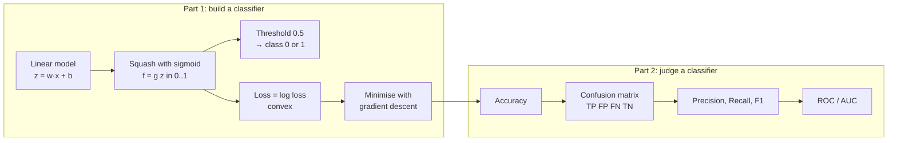
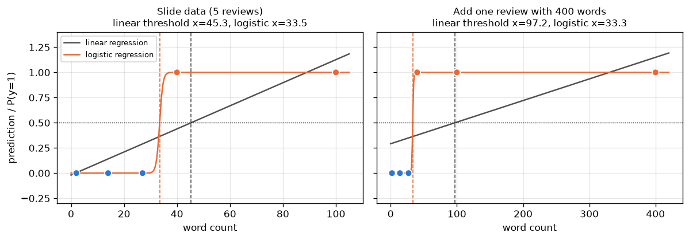
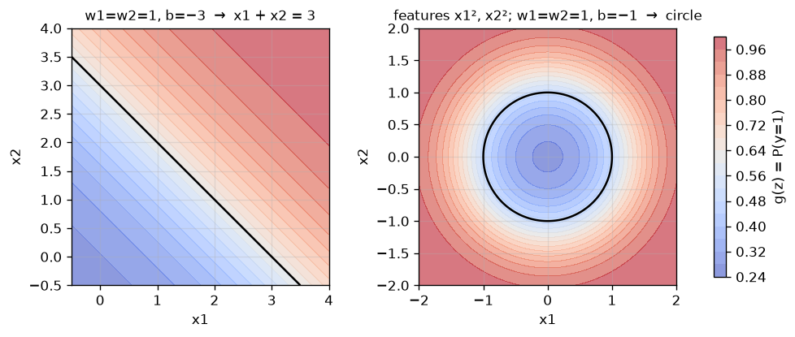
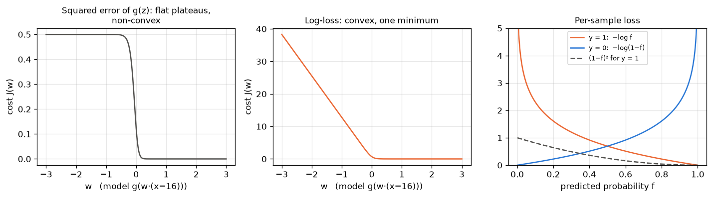
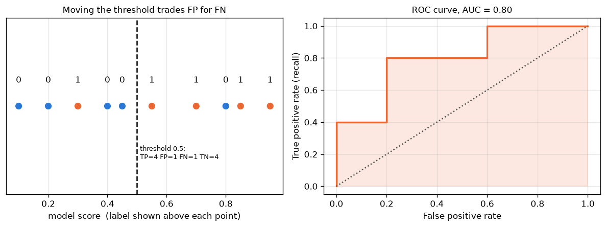
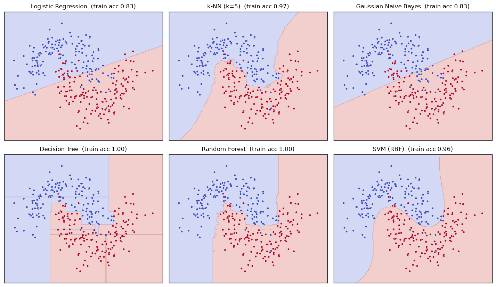

# 04 · Supervised Learning: Classification (Logistic Regression, Log Loss, Metrics)

> **Course:** Machine Learning Paradigms (DS602) · Dr. Sunil Saumya · IIIT Dharwad
>
> **Deck:** `03_MLP_Supervised_Learning_Classification.pdf` (dated 15 Oct 2026, 41 slides)
>
> **Status:** Based on the slides (no class transcript yet). Sections 1–16 follow the deck in order; sections 17–20 cover what the deck lists or demos but does not explain (AUC, multi-class, the model-comparison demo, class imbalance) and are marked 🔴 where they go beyond the syllabus. Note 02 already contains the proofs behind logistic regression (log-odds, maximum likelihood, gradient, convexity) and a metrics deep dive; this note links to it instead of repeating it.
>
> **Notebook:** [`code/04_classification_deep_dive.ipynb`](code/04_classification_deep_dive.ipynb), Parts A–L. It checks every number on the slides, fits logistic regression by gradient descent from scratch, computes all metrics, and runs the six-classifier comparison. Every number in this note comes from it (scikit-learn 1.9.0).
>
> **Figures:** generated by [`code/figures_04.py`](code/figures_04.py)
>
> **Difficulty tags:** 🟢 core / on the slides · 🟡 needs practice / exam-standard · 🔴 beyond the slides

---

## 📌 Table of Contents

1. [Big Picture](#1-big-picture)
2. [What Is Classification?](#2-what-is-classification-)
3. [Why Not Linear Regression?](#3-why-not-linear-regression-)
4. [The Sigmoid Function](#4-the-sigmoid-function-)
5. [The Logistic Regression Model](#5-the-logistic-regression-model-)
6. [Decision Boundaries](#6-decision-boundaries-)
7. [Why Not MSE as the Cost?](#7-why-not-mse-as-the-cost-)
8. [Log Loss (Binary Cross-Entropy)](#8-log-loss-binary-cross-entropy-)
9. [Training with Gradient Descent](#9-training-with-gradient-descent-)
10. [Accuracy](#10-accuracy-)
11. [How Much Accuracy Is Good?](#11-how-much-accuracy-is-good-)
12. [The Confusion Matrix, Type I and Type II Errors](#12-the-confusion-matrix-type-i-and-type-ii-errors-)
13. [The Accuracy Paradox](#13-the-accuracy-paradox-)
14. [Precision and Recall](#14-precision-and-recall-)
15. [F1 and F-beta](#15-f1-and-f-beta-)
16. [All Slide Metrics in One Table](#16-all-slide-metrics-in-one-table-)
17. [Thresholds, ROC and AUC](#17-thresholds-roc-and-auc-)
18. [More Than Two Classes](#18-more-than-two-classes-)
19. [The Model-Comparison Demo: Six Classifiers](#19-the-model-comparison-demo-six-classifiers-)
20. [Class Imbalance in Practice](#20-class-imbalance-in-practice-)
21. [Slide Corrections](#21--slide-corrections)
22. [Real-World Case Studies](#22-real-world-case-studies-)
23. [Common Confusions](#23--common-confusions)
24. [Exam / Interview Questions](#24--exam--interview-questions)
25. [Practice Problems](#25--practice-problems)
26. [Cheat Sheet](#26--cheat-sheet)
27. [Go Deeper: Curated Links](#27--go-deeper-curated-links)

---

## 1. Big Picture

Regression (Note 03) answered **"how much?"**. Classification answers **"which one?"**: positive or negative review, spam or not, malignant or benign, which of 10 digits.

The lecture has two halves, and both follow the recipe from Note 03 (*model → loss → minimise*):



> 💡 **The single most important idea of the second half:** a classifier makes **two kinds of mistakes** (false alarms and misses), and they almost never cost the same. Accuracy adds them together; precision and recall keep them apart.

---

## 2. What Is Classification? 🟢

**The slide example (slide 4).** Given product reviews with votes and rating, predict the sentiment:

| Review Text | Votes | Rating | Sentiment |
|---|--:|--:|:-:|
| Worst product ever, broke in a day. | 7 | 1.0 | 0 |
| Absolutely love it! Works perfectly as expected. | 8 | 5.0 | 1 |
| Decent quality, but overpriced. | 4 | 3.0 | 0 |
| Amazing value for money, very satisfied. | 7 | 5.0 | 1 |
| Late delivery and poor support. | 5 | 2.0 | 0 |

Features: Review Text, Votes, Rating. Label: Sentiment (0/1). **The output is categorical, so this is classification.** (The same table with *Votes* as the target was the regression example of Note 03.)

**Definitions (slide 5).**

- A **class** is a category that a sample can belong to; samples of the same class share characteristics (all positive reviews tend to use words like *love*, *amazing*).
- The **classification task**: from labelled examples, learn what distinguishes the classes, then assign a class to new, unlabelled feature vectors. It is **supervised** because the labels are given during training.

The slide lists three ways to group classifiers without explaining them:

| Distinction | Meaning | Examples |
|---|---|---|
| **Binary vs multi-class** (vs multi-label) | 2 classes; K > 2 classes, exactly one per sample; several labels may be on at once | spam/not · digit 0–9 · movie genres (action *and* comedy) |
| **Discriminative vs generative** | models $`P(y \mid x)`$ or the boundary directly; models how each class *generates* data, $`P(x \mid y)P(y)`$, then uses Bayes' rule | logistic regression, SVM, trees · Naive Bayes, LDA, Gaussian mixture |
| **Parametric vs non-parametric** | a fixed number of parameters regardless of data size; model complexity grows with the data | logistic regression (d + 1 weights), Naive Bayes · k-NN (stores all training points), decision trees, kernel SVM |

Section 19 shows all of these side by side on the same data.

---

## 3. Why Not Linear Regression? 🟢

**Slides 6–11.** Word count → product quality (0/1):

| X (word count) | Y | ŷ (linear) | class at 0.5 |
|--:|:-:|--:|:-:|
| 27 | 0 | 0.29003 | 0 ✅ |
| 2 | 0 | 0.00364 | 0 ✅ |
| 100 | 1 | 1.12629 | 1 ✅ |
| 40 | 1 | 0.43895 | **0 ❌** |
| 14 | 0 | 0.14110 | 0 ✅ |
| 20 | ?? | 0.20984 | 0 |

OLS line: $`\hat{y} = 0.01146\,x - 0.01928`$ (notebook Part A; the slide's ŷ column is computed from these rounded coefficients, so its last digits differ slightly). With the rule *"ŷ ≥ 0.5 → 1"* the threshold falls at $`x = (0.5 + 0.01928)/0.01146 = 45.33`$ words.

Three problems:

1. **Outputs are not probabilities.** ŷ = 1.126 for x = 100 and would go negative for very short reviews (slide 11's "caution"). A probability must stay in [0, 1].
2. **It already misclassifies x = 40**, a real positive, even on 5 training points.
3. **It is dragged by easy points.** Add a single 400-word positive review (an *easy*, correctly-labelled example) and the line flattens: the threshold moves from **45.3 to 97.2 words**, and now x = 40 and every review shorter than 97 words is called negative. Logistic regression's boundary barely moves (33.5 → 33.3).



*Why the line moves:* least squares penalises the squared **distance** of 1.149 from the target 1 for the 400-word review, so it tilts the line to reduce it, even though that point is already on the correct side. A classifier should not be punished for being "too right". Logistic regression with log loss is not: a confidently-correct point has almost zero loss and almost zero gradient.

---

## 4. The Sigmoid Function 🟢

```math
g(z) = \frac{1}{1 + e^{-z}}, \qquad 0 < g(z) < 1
```

**Slide 12, three cases:**

| z | $`e^{-z}`$ | g(z) |
|---|---|---|
| large positive (→ ∞) | → 0 | → 1 |
| 0 | 1 | 1/2 = **0.5** |
| large negative (→ −∞) | → ∞ | → 0 |

**Values to know** (notebook Part B):

| z | −4 | −2 | −1 | 0 | 1 | 2 | 4 |
|---|--:|--:|--:|--:|--:|--:|--:|
| g(z) | 0.0180 | 0.1192 | 0.2689 | 0.5 | 0.7311 | 0.8808 | 0.9820 |

**Properties** (proofs in Note 02 §15.2):

- **Symmetry:** $`g(-z) = 1 - g(z)`$, so the table's left half mirrors the right.
- **Derivative:** $`g'(z) = g(z)\,(1 - g(z))`$, largest at z = 0 where it is 0.25. This makes the gradient in §9 short.
- **Inverse = logit:** if $`p = g(z)`$ then $`z = \log\frac{p}{1-p}`$ (the **log-odds**). For p = 0.8, z = log 4 = 1.3863. So the sigmoid is the *logistic* function and the **logit is its inverse**; they are not two names for the same thing (slide 12 says "sigmoid (or logit)", see §21).

---

## 5. The Logistic Regression Model 🟢

**Slide 13.** Two steps:

```math
\text{Step 1: } z = \vec{w}\cdot\vec{x} + b \qquad\qquad \text{Step 2: } f_{\vec{w},b}(\vec{x}) = g(z) = \frac{1}{1 + e^{-(\vec{w}\cdot\vec{x} + b)}}
```

**Interpretation:** $`f_{\vec{w},b}(\vec{x}) = P(y = 1 \mid \vec{x})`$, the model's estimated probability that the label is 1. Then $`P(y = 0 \mid \vec{x}) = 1 - f`$.

**Slide 14 example.** On the 13-point word-count data (0s at word counts 1–6, 1s at 26–32), with the slide's weights $`w = 1.9292,\ b = -30.8841`$:

| word count | z = 1.9292x − 30.8841 | P(y = 1) |
|--:|--:|--:|
| 6 | −19.31 | 0.0000 |
| 15 | −1.95 | 0.1250 |
| 16 | −0.02 | 0.4958 |
| **17** | **1.91** | **0.8713** |
| 20 | 7.70 | 0.9995 |

So at word count 17 the model says about **87 %** chance of high quality and 13 % of low quality. The slide reads "0.9 / 90 %" off the curve; the exact value is 0.871 (§21).

**Reading the weights.** Since $`\log\frac{p}{1-p} = z`$, increasing $`x_j`$ by 1 adds $`w_j`$ to the log-odds, i.e. **multiplies the odds by $`e^{w_j}`$**. With w = 1.9292, one extra word multiplies the odds of "high quality" by $`e^{1.9292} \approx 6.9`$.

### 🔴 Where do the slide's weights come from?

These 13 points are **perfectly separable** (largest 0 at x = 6, smallest 1 at x = 26). For separable data the log loss can always be lowered by making the weights bigger (the S-curve gets steeper), so **there is no finite best fit** (Note 02 §15.8). What you get depends on regularisation and on when the optimiser stops (notebook Part C):

| scikit-learn `C` (less regularisation →) | w | b | boundary −b/w | P(17) |
|--:|--:|--:|--:|--:|
| 0.1 | 0.3150 | −5.0160 | 15.92 | 0.584 |
| 1 (default) | 0.4761 | −7.5937 | 15.95 | 0.623 |
| 100 | 0.8366 | −13.3436 | 15.95 | 0.707 |
| 10⁶ | 1.0236 | −16.4238 | 16.05 | 0.727 |
| slide | 1.9292 | −30.8841 | 16.01 | 0.871 |

All of them classify the training data perfectly and put the boundary at about **16 words** (the midpoint of the gap, 6 and 26). What is *not* well defined is the steepness, and therefore probabilities like P(17). Lesson: on separable data, trust the boundary more than the probabilities.

---

## 6. Decision Boundaries 🟢

**Slides 15–16.** With threshold 0.5:

```math
\hat{y} = 1 \iff g(z) \ge 0.5 \iff z \ge 0 \iff \vec{w}\cdot\vec{x} + b \ge 0
```

because g is increasing and g(0) = 0.5. The **decision boundary** is the set where the model is exactly undecided:

```math
\vec{w}\cdot\vec{x} + b = 0
```

It does not involve the sigmoid at all: **logistic regression is a linear classifier.** The sigmoid only turns the distance from the boundary into a probability.

| Data | Boundary | Shape |
|---|---|---|
| 1-D (slide 17): $`-30.8841 + 1.9292x_1 = 0`$ | $`x_1 = 30.8841/1.9292 = 16.0088`$ | a point (threshold) |
| 2-D (slide 18): $`w_1 = w_2 = 1,\ b = -3`$ | $`x_1 + x_2 = 3`$ | a line |
| d-D | $`\vec{w}\cdot\vec{x} + b = 0`$ | a hyperplane; $`\vec{w}`$ is perpendicular to it |

**Checking points against $`x_1 + x_2 = 3`$:** (1, 1) → z = −1, g = 0.269, class 0; (2, 2) → z = 1, g = 0.731, class 1; (2, 1) → z = 0, g = 0.5, exactly on the boundary (class 1 by the "≥" rule).

### Non-linear boundaries from new features

**Slide 19** uses squared features: $`z = w_1x_1^2 + w_2x_2^2 + b`$ with $`w_1 = w_2 = 1,\ b = -1`$, so the boundary is the **circle** $`x_1^2 + x_2^2 = 1`$: points inside (e.g. (0.5, 0.5), z = −0.5) are class 0, points outside are class 1.



The model is still linear **in the features** $`(x_1^2, x_2^2)`$; it is the feature map that bends the boundary. This is exactly polynomial regression's trick from Note 03 §13. Notebook Part D shows it on 400 random points labelled by $`x_1^2 + x_2^2 \ge 1.5`$: plain logistic regression on $`(x_1, x_2)`$ gets **69.25 %** training accuracy (no better than predicting the majority class, 69.2 %), while logistic regression on $`(x_1^2, x_2^2)`$ gets **99.75 %** and recovers a radius² of 1.505.

(The slide's title says "3D data", but the data have two features, $`x_1`$ and $`x_2`$; what is new is the squared features, see §21.)

---

## 7. Why Not MSE as the Cost? 🟢

**Slide 20.** For linear regression, $`J = \frac{1}{2m}\sum (f(x^{(i)}) - y^{(i)})^2`$ is a convex bowl (Note 03 §8). Plug the sigmoid model into the same formula and the bowl is gone:



*Left:* with $`f = g(w\,(x - 16))`$ on the word-count data, the squared-error cost is flat at 0.5 for negative w, falls steeply around 0, and is flat again. It curves **down** on one side and **up** on the other: not convex. Gradient descent started in a plateau barely moves. *Middle:* the log loss on the same model is convex (notebook Part E confirms no second difference is negative).

**Why the plateaus? Vanishing gradient.** For one sample with y = 1, the gradient with respect to z is:

| z | f = g(z) | d(squared error)/dz $`= (f - 1)f(1-f)`$ | d(log loss)/dz $`= f - 1`$ |
|--:|--:|--:|--:|
| −6 (very wrong) | 0.0025 | −0.0025 | **−0.9975** |
| −3 | 0.0474 | −0.0430 | −0.9526 |
| 0 | 0.5 | −0.1250 | −0.5 |
| 3 (right) | 0.9526 | −0.0021 | −0.0474 |

With squared error, a **confidently wrong** prediction (z = −6) gets almost no gradient, so the model hardly learns from its worst mistakes. The extra factor $`f(1-f)`$ is the sigmoid's derivative, which is tiny at both ends. Log loss cancels it.

---

## 8. Log Loss (Binary Cross-Entropy) 🟢

**Slides 21–25.** Per-sample loss:

```math
L\big(f(\vec{x}^{(i)}), y^{(i)}\big) =
\begin{cases}
-\log f(\vec{x}^{(i)}) & \text{if } y^{(i)} = 1 \\[2pt]
-\log\big(1 - f(\vec{x}^{(i)})\big) & \text{if } y^{(i)} = 0
\end{cases}
```

**Simplified (one line, slide 25):**

```math
L = -\,y^{(i)}\log f(\vec{x}^{(i)}) - \big(1 - y^{(i)}\big)\log\big(1 - f(\vec{x}^{(i)})\big)
```

Since y is 0 or 1, one of the two terms is always zero, so this is the two-case formula written once. The **cost** is the average over the m training samples:

```math
J(\vec{w}, b) = \frac{1}{m}\sum_{i=1}^{m} L\big(f(\vec{x}^{(i)}), y^{(i)}\big)
```

**Behaviour (slides 22–24)** (log = natural log; notebook Part E):

| predicted f | loss if y = 1: $`-\log f`$ | loss if y = 0: $`-\log(1-f)`$ |
|--:|--:|--:|
| 0.99 | 0.0101 | 4.6052 |
| 0.9 | 0.1054 | 2.3026 |
| 0.7 | 0.3567 | 1.2040 |
| 0.5 | 0.6931 | 0.6931 |
| 0.3 | 1.2040 | 0.3567 |
| 0.1 | 2.3026 | 0.1054 |
| 0.01 | 4.6052 | 0.0101 |

- Correct and confident → loss near 0.
- Wrong and confident → loss grows without bound ($`-\log f \to \infty`$ as $`f \to 0`$). Compare squared error, which can never exceed 1.
- A model that always says 0.5 pays $`\log 2 = 0.6931`$ per sample: a useful "no-skill" reference value for the cost.

**Where it comes from** (Note 02 §15.4): it is the negative log-likelihood of the labels under the model $`P(y=1 \mid x) = f`$. Minimising log loss = maximum likelihood. It is also the **cross-entropy** between the true label distribution and the predicted one, hence the second name.

**Worked example 8.1 🟢.** Labels y = (1, 0, 0), predictions f = (0.9, 0.2, 0.6):
$`-\log 0.9 = 0.1054`$, $`-\log 0.8 = 0.2231`$, $`-\log 0.4 = 0.9163`$; average **J = 0.4149**. The third sample (wrong side of 0.5) contributes 74 % of the cost.

---

## 9. Training with Gradient Descent 🟡

The slides stop at the loss; training uses gradient descent exactly as in Note 03 §9. The derivative works out to the **same form as linear regression** (derivation in Note 02 §15.5):

```math
\frac{\partial J}{\partial w_j} = \frac{1}{m}\sum_{i=1}^{m}\big(f(\vec{x}^{(i)}) - y^{(i)}\big)\,x_j^{(i)}, \qquad
\frac{\partial J}{\partial b} = \frac{1}{m}\sum_{i=1}^{m}\big(f(\vec{x}^{(i)}) - y^{(i)}\big)
```

```math
w_j \leftarrow w_j - \alpha\,\frac{\partial J}{\partial w_j}, \qquad b \leftarrow b - \alpha\,\frac{\partial J}{\partial b}
```

The formulas look identical to linear regression's, but **f is different**: here $`f = g(\vec{w}\cdot\vec{x} + b)`$, there $`f = \vec{w}\cdot\vec{x} + b`$. Unlike linear regression there is **no closed-form solution** (no "normal equation"), so an iterative method is required.

```python
def fit_logreg_gd(X, y, alpha=0.1, iters=1000):
    w = np.zeros(X.shape[1]); b = 0.0
    for _ in range(iters):
        f = 1 / (1 + np.exp(-(X @ w + b)))     # predictions
        w -= alpha * X.T @ (f - y) / len(y)     # gradient step on w
        b -= alpha * np.mean(f - y)             # gradient step on b
    return w, b
```

### Worked example 9.1: first iteration by hand 🟡

Slide data (word counts 27, 2, 100, 40, 14 → y = 0, 0, 1, 1, 0), feature scaled to x/100 = (0.27, 0.02, 1.00, 0.40, 0.14), start w = b = 0, α = 1.

1. z = 0 for every sample → f = g(0) = 0.5 for all.
2. Residuals f − y = (0.5, 0.5, −0.5, −0.5, 0.5).
3. ∂J/∂w = (0.27·0.5 + 0.02·0.5 + 1.00·(−0.5) + 0.40·(−0.5) + 0.14·0.5) / 5 = (0.135 + 0.01 − 0.5 − 0.2 + 0.07) / 5 = −0.485 / 5 = **−0.097**.
4. ∂J/∂b = (0.5 + 0.5 − 0.5 − 0.5 + 0.5) / 5 = **0.1**.
5. Update: w = 0 − 1·(−0.097) = **0.097**, b = 0 − 1·0.1 = **−0.1**.

w became positive (more words → more likely 1), and b became negative because 3 of 5 labels are 0. After 5,000 steps the log loss falls 0.6931 → 0.5687 (10 steps) → 0.2991 (100) → 0.1272 (1,000) → 0.0452 (5,000), and the boundary sits at **33.46 words**. The loss keeps falling and w keeps growing because this data is separable too (§5).

---

## 10. Accuracy 🟢

**Slides 26–28.** Which classifier is better?

| Word Count | Actual | Pred. LR | Pred. DT |
|--:|:-:|:-:|:-:|
| 27 | 0 | 0 ✅ | 0 ✅ |
| 2 | 0 | 0 ✅ | 0 ✅ |
| 100 | 1 | 0 ❌ | 1 ✅ |
| 40 | 1 | 1 ✅ | 0 ❌ |
| 14 | 0 | 1 ❌ | 0 ✅ |

```math
\text{Accuracy} = \frac{\text{number of correct predictions}}{\text{total number of predictions}}
```

Accuracy(LR) = 3/5 = **0.6**, Accuracy(DT) = 4/5 = **0.8**. The slide's answer is the decision tree.

**But look at *which* mistakes.** Both models catch only 1 of the 2 positives. The difference is that LR also raises one false alarm (x = 14). If false alarms are cheap, the two models are equally good at the thing that matters (finding positives). Accuracy cannot tell you that; §12 can.

---

## 11. How Much Accuracy Is Good? 🟢

**Slides 29–31** give three scenarios:

| Scenario | 99 % / 80 % accurate. Deploy? | Why |
|---|---|---|
| Cancer from chest image | 99 %: **no** | a missed cancer can cost a life |
| Self-driving car: left or right | 99 %: **no** | 1 wrong turn in 100 decisions is catastrophic at many decisions per minute |
| Will a customer order food this weekend? | 80 %: **yes** | a wrong guess costs a wasted coupon or notification |

The principle: **the acceptable error rate depends on the cost of an error, not on a universal number.**

Two refinements the slides leave implicit:

1. **"99 % accurate → 1 patient in 100 dies" is not quite right.** The 1 % errors are a mix of false alarms (healthy people told to get a biopsy) and misses (cancers sent home). If cancer is rare, a model can be 99 % accurate and miss *every* cancer (§13). The question to ask is not "what is the accuracy?" but "what fraction of cancers does it catch (recall), and how many false alarms per catch (precision)?".
2. **Compare with a baseline.** 80 % accuracy on the food-order question is impressive if 50 % of customers order and worthless if 85 % do, since "always yes" would score 85 %.

---

## 12. The Confusion Matrix, Type I and Type II Errors 🟢

**Slide 32:** "a model is 90 % accurate" also means "10 % wrong", but wrong *how*? Actual 0 predicted 1, or actual 1 predicted 0? **Slide 33:** the confusion matrix counts each kind separately.

| Actual ↓ / Predicted → | Positive (1) | Negative (0) |
|---|---|---|
| **Positive (1)** | **TP** true positive | **FN** false negative = **Type II error** (a *miss*) |
| **Negative (0)** | **FP** false positive = **Type I error** (a *false alarm*) | **TN** true negative |

Rows = actual, columns = predicted. Reading the names: the second word (*positive / negative*) is **what the model said**; the first word (*true / false*) is **whether it was right**. A false negative: the model said negative, and it was wrong.

**Slide 34, for the LR column of §10:** TP = 1 (x = 40), TN = 2 (x = 27, 2), FP = 1 (x = 14), FN = 1 (x = 100).

| | Pred 1 | Pred 0 |
|---|--:|--:|
| Actual 1 | 1 | 1 |
| Actual 0 | 1 | 2 |

```math
\text{Accuracy} = \frac{TP + TN}{TP + TN + FP + FN} = \frac{1 + 2}{5} = 0.60
```

For the DT column: TP = 1, TN = 3, FP = 0, FN = 1 → 4/5 = 0.80.

**Type I vs Type II (slide 35)** comes from hypothesis testing, with $`H_0`$ = "negative / nothing there": a **Type I** error rejects a true $`H_0`$ (false alarm, FP); a **Type II** error fails to reject a false one (miss, FN). Memory hook: *Type I = "crying wolf"; Type II = "missing the wolf".*

⚠️ **scikit-learn's layout is the other way round.** `confusion_matrix(y_true, y_pred)` sorts the labels, so row/column 0 come first:

```python
confusion_matrix([0, 0, 1, 1, 0], [0, 0, 0, 1, 1])
# [[2 1]      [[TN FP]
#  [1 1]]      [FN TP]]
tn, fp, fn, tp = confusion_matrix(y_true, y_pred).ravel()   # the safe way to unpack
```

Always check which convention a slide, paper or library uses before reading off TP.

---

## 13. The Accuracy Paradox 🟢

**Slide 36.** Airport screening: 10,000 passengers, **1** terrorist. A "model" that says *not terrorist* to everyone:

| Actual ↓ / Pred → | Terrorist (1) | Not (0) | Total |
|---|--:|--:|--:|
| Terrorist (1) | 0 (TP) | 1 (FN) | 1 |
| Not (0) | 0 (FP) | 9,999 (TN) | 9,999 |

Accuracy = (0 + 9,999) / 10,000 = **99.99 %**, and it is useless: it missed the only case that mattered.

**Accuracy is dominated by the majority class.** When one class is 99.99 % of the data, the trivial "always majority" rule is 99.99 % accurate. On imbalanced problems (fraud, disease, defects, intrusions) always report the **majority-class baseline** next to accuracy, and use metrics that look at the minority class separately.

---

## 14. Precision and Recall 🟢

**Slide 37.**

```math
\text{Precision} = \frac{TP}{TP + FP} \qquad\qquad \text{Recall} = \frac{TP}{TP + FN}
```

| Metric | Question it answers | Denominator | Hurt by |
|---|---|---|---|
| **Precision** | Of everything the model *flagged*, how much was really positive? | predicted positives (column) | false alarms (FP) |
| **Recall** (sensitivity, true positive rate) | Of all *real* positives, how many did the model find? | actual positives (row) | misses (FN) |

Both share the numerator TP; they differ only in what they divide by.

**The do-nothing model (slide 37):** TP = 0, FP = 0, FN = 1. Recall = 0/1 = **0**: it found no terrorist. Precision = 0/0 is **undefined**, since the model never flagged anyone. (scikit-learn returns 0 with a warning; set `zero_division=0` or `1` explicitly.) Unlike accuracy, recall immediately exposes the model as useless.

### Recall first: the airport (slide 38)

Flag generously so that no terrorist gets through:

| Actual ↓ / Pred → | Terrorist | Not | Total |
|---|--:|--:|--:|
| Terrorist | 1 (TP) | 0 (FN) | 1 |
| Not | 100 (FP) | 9,899 (TN) | 9,999 |

Recall = 1/1 = **1.0**; Precision = 1/101 ≈ **0.0099**; Accuracy = 9,900/10,000 = **99.0 %**.

Accuracy went *down* (99.99 → 99.0 %) while the model became *useful*. 100 innocent passengers get a second check (cheap); the terrorist is caught (priceless). This is how real screening works: a high-recall first stage, followed by a more precise second stage (manual search) for the flagged few.

### Precision first: the spam filter (slide 39)

A real email lost in the spam folder (FP) is worse than a spam email reaching the inbox (FN):

| Actual ↓ / Pred → | Spam | Not spam | Total |
|---|--:|--:|--:|
| Spam | 30 (TP) | 70 (FN) | 100 |
| Not spam | 1 (FP) | 9,899 (TN) | 9,900 |

Precision = 30/31 ≈ **0.968**; Recall = 30/100 = **0.30**; Accuracy = 9,929/10,000 = **99.29 %**.

### The trade-off

Precision and recall usually pull against each other: flag more (lower the threshold) and recall rises while precision falls; flag less and the opposite happens (§17). Which one to favour is a **business decision about costs**, not a statistical one:

| Favour recall (misses are expensive) | Favour precision (false alarms are expensive) |
|---|---|
| cancer screening, airport security, fraud alerts that a human reviews, safety defects | spam filtering, recommending a video, auto-blocking a bank card, convicting someone |

---

## 15. F1 and F-beta 🟢

**Slide 40.** A single number that balances precision P and recall R, the **harmonic mean**:

```math
F_1 = 2\cdot\frac{P \cdot R}{P + R} = \frac{2\,TP}{2\,TP + FP + FN}
```

**Spam model:** $`F_1 = 2 \cdot \frac{0.967 \times 0.30}{0.967 + 0.30} \approx 0.458`$. Exactly: $`\frac{2 \cdot 30}{2 \cdot 30 + 1 + 70} = \frac{60}{131} = 0.4580`$ (the slide's 0.457 is a rounding slip, §21). Despite 97 % precision, F1 is low because recall is poor.

**Why harmonic and not the ordinary average?** The harmonic mean is pulled toward the smaller value. The airport model has P = 0.0099, R = 1: ordinary average 0.505 (looks fine), F1 = **0.0196** (correctly terrible). F1 is high only when **both** are high. (More in Note 02 §16.2.)

**F-beta 🔴** weights recall β times as much as precision:

```math
F_\beta = (1 + \beta^2)\,\frac{P \cdot R}{\beta^2 P + R}
```

| | F0.5 (precision-leaning) | F1 | F2 (recall-leaning) |
|---|--:|--:|--:|
| spam (P 0.968, R 0.30) | **0.670** | 0.458 | 0.348 |
| airport (P 0.0099, R 1.0) | 0.012 | 0.020 | **0.048** |

Pick β to match the costs: F0.5 for the spam filter, F2 for screening.

**One limitation:** F1 ignores TN completely. When true negatives matter too, look at specificity (§16), balanced accuracy, or the Matthews correlation coefficient.

---

## 16. All Slide Metrics in One Table 🟡

Notebook Part G, from the four counts:

| Case | Acc | Precision | Recall | F1 | Specificity $`\frac{TN}{TN+FP}`$ | Balanced acc $`\frac{R + \text{Spec}}{2}`$ |
|---|--:|--:|--:|--:|--:|--:|
| LR (§10) | 0.60 | 0.50 | 0.50 | 0.500 | 0.667 | 0.583 |
| DT (§10) | 0.80 | 1.00 | 0.50 | 0.667 | 1.000 | 0.750 |
| Terrorist, all "not" (slide 36) | 0.9999 | undefined | 0.0 | 0.0 | 1.000 | **0.500** |
| Terrorist, recall-max (slide 38) | 0.9900 | 0.0099 | 1.0 | 0.0196 | 0.990 | **0.995** |
| Spam (slide 39) | 0.9929 | 0.9677 | 0.30 | 0.4580 | 0.9999 | 0.650 |

Note how **balanced accuracy** (the average of recall on each class) ranks the two terrorist models correctly (0.5 vs 0.995), while plain accuracy ranks them the wrong way round.

The full family of rates, all from the confusion matrix:

| Name | Formula | Also called |
|---|---|---|
| Recall | TP / (TP + FN) | sensitivity, TPR, hit rate |
| Specificity | TN / (TN + FP) | TNR, selectivity |
| Precision | TP / (TP + FP) | positive predictive value (PPV) |
| False positive rate | FP / (FP + TN) = 1 − specificity | fall-out, Type I error rate |
| False negative rate | FN / (FN + TP) = 1 − recall | miss rate, Type II error rate |

---

## 17. Thresholds, ROC and AUC 🟡→🔴

Slide 26 lists **AUC** but the deck does not cover it. Here is the idea.

Logistic regression outputs a **score** (a probability). The class depends on the **threshold** t: ŷ = 1 if f ≥ t. 0.5 is a default, not a law. Ten test samples with scores and true labels (notebook Part H):

| score | 0.95 | 0.85 | 0.80 | 0.70 | 0.55 | 0.45 | 0.40 | 0.30 | 0.20 | 0.10 |
|---|--:|--:|--:|--:|--:|--:|--:|--:|--:|--:|
| label | 1 | 1 | 0 | 1 | 1 | 0 | 0 | 1 | 0 | 0 |

| threshold | TP | FP | FN | TN | Recall (TPR) | FPR | Precision |
|--:|--:|--:|--:|--:|--:|--:|--:|
| 0.90 | 1 | 0 | 4 | 5 | 0.20 | 0.00 | 1.00 |
| 0.75 | 2 | 1 | 3 | 4 | 0.40 | 0.20 | 0.67 |
| 0.50 | 4 | 1 | 1 | 4 | 0.80 | 0.20 | 0.80 |
| 0.35 | 4 | 3 | 1 | 2 | 0.80 | 0.60 | 0.57 |
| 0.15 | 5 | 4 | 0 | 1 | 1.00 | 0.80 | 0.56 |

Lowering the threshold raises recall and the false-positive rate together: the precision/recall trade-off of §14 in numbers.



**ROC curve:** plot TPR (recall) against FPR for **every** threshold. The diagonal is random guessing; the top-left corner (TPR 1, FPR 0) is perfect.

**AUC** (area under the ROC curve) summarises it in one number, **independent of the threshold**: here **0.80**. It has a clean meaning: **the probability that a randomly chosen positive gets a higher score than a randomly chosen negative.** Check by counting: 5 positives × 5 negatives = 25 pairs, of which the positive scores higher in **20** → 20/25 = 0.80. AUC = 0.5 is random, 1.0 is perfect ranking.

**Choosing the threshold** is the last step, done on validation data: maximise F1, or pick the lowest threshold that reaches the precision you need, or minimise expected cost $`c_{FP}\cdot FP + c_{FN}\cdot FN`$. For heavily imbalanced data, the **precision–recall curve** is more informative than ROC (Note 02 §17).

---

## 18. More Than Two Classes 🔴

Logistic regression is binary. Three ways to extend it to K classes:

| Strategy | How | Number of binary models | K = 3 | K = 10 |
|---|---|---|--:|--:|
| **One-vs-rest (OvR)** | one model per class: "this class vs all others"; pick the class with the highest score | K | 3 | 10 |
| **One-vs-one (OvO)** | one model per pair of classes; majority vote | K(K − 1)/2 | 3 | 45 |
| **Softmax (multinomial)** | one score $`z_k`$ per class, $`P(y = k) = \frac{e^{z_k}}{\sum_j e^{z_j}}`$, trained jointly with categorical cross-entropy | 1 model with K weight vectors | | |

scikit-learn's `LogisticRegression` uses softmax by default for K > 2. On iris (notebook Part I, 70/30 stratified split): softmax **0.9111**, OvR 0.8444, OvO 0.9111 test accuracy. The softmax probabilities for one flower: (0.0000, 0.1014, 0.8985), summing to 1.

**The confusion matrix becomes K × K.** Iris, softmax:

| Actual ↓ / Pred → | setosa | versicolor | virginica |
|---|--:|--:|--:|
| setosa | 15 | 0 | 0 |
| versicolor | 0 | 14 | 1 |
| virginica | 0 | 3 | 12 |

Setosa is perfectly separated; all 4 errors are versicolor ↔ virginica, the two species that overlap.

**Averaging per-class metrics.** Precision, recall and F1 are computed per class (each class in turn is "positive") and then averaged:

| Average | How | Use when |
|---|---|---|
| **macro** | plain mean over classes | every class matters equally, including rare ones |
| **weighted** | mean weighted by class size (support) | you want overall performance, imbalance-aware |
| **micro** | pool all TP/FP/FN first; for single-label problems equals accuracy | |

On an imbalanced 3-class toy (80/15/5 samples; the rare class is almost never found), micro F1 = **0.890** and weighted F1 = 0.875 look fine, but macro recall is **0.614** and macro F1 **0.669**, revealing that one class is barely detected (notebook Part I).

---

## 19. The Model-Comparison Demo: Six Classifiers 🟡→🔴

Slide 40 ends with a "Classification Model Comparison" demo. Here are the usual six, side by side.

| Classifier | Idea in one line | Boundary | Type | Scale features? |
|---|---|---|---|---|
| **Logistic regression** | linear score → sigmoid / softmax | linear (hyperplane) | discriminative, parametric | yes |
| **k-nearest neighbours** | majority vote of the k closest training points | flexible, follows the data | discriminative, non-parametric, "lazy" (no training) | **yes, essential** |
| **Gaussian Naive Bayes** | per class, assume each feature is Gaussian and features are independent; Bayes' rule | quadratic in general | **generative**, parametric | no |
| **Decision tree** | ask yes/no questions on one feature at a time | axis-parallel rectangles | discriminative, non-parametric | no |
| **Random forest** | many trees on bootstrap samples and random feature subsets; vote | smoother rectangles | ensemble | no |
| **SVM (RBF kernel)** | maximum-margin boundary in a kernel feature space | smooth, curved | discriminative | yes |



*The same 300 noisy "two moons" points. Logistic regression and Naive Bayes can only draw a near-straight boundary here; k-NN, SVM and the tree-based models bend around the moons. The decision tree reaches 100 % training accuracy with jagged boxes around single points: **over-fitting**, visible as a picture.*

**On real data** (notebook Part J): the Wisconsin breast-cancer dataset (569 tumours, 30 features, 62.7 % benign), 5-fold stratified cross-validation, scaling inside a pipeline where needed:

| Model | Accuracy (mean ± std) | Macro F1 | ROC AUC |
|---|--:|--:|--:|
| SVM (RBF) | **0.9772** ± 0.0163 | 0.9754 | 0.9945 |
| Logistic regression | 0.9737 ± 0.0166 | 0.9714 | **0.9953** |
| k-NN (k = 5) | 0.9631 ± 0.0179 | 0.9599 | 0.9849 |
| Random forest | 0.9543 ± 0.0102 | 0.9509 | 0.9896 |
| Gaussian Naive Bayes | 0.9385 ± 0.0235 | 0.9331 | 0.9887 |
| Decision tree | 0.9104 ± 0.0279 | 0.9028 | 0.9000 |

What to take from it:

1. **Simple models are strong baselines.** Logistic regression is within one standard deviation of the best model and has the best AUC. Always fit it first.
2. **The metric that matters here is malignant recall.** On a held-out split (53 malignant tumours), logistic regression and SVM each miss **1**, k-NN misses 3, the tree and the forest miss 4, Naive Bayes misses **7**, despite all having accuracies between 0.92 and 0.99.
3. **Scaling matters for distance-based models, not trees:** k-NN 0.9350 unscaled → 0.9631 scaled; the decision tree scores 0.9104 either way.
4. **Generative vs discriminative 🔴.** Averaged over 30 random small training sets: with 10 training samples Naive Bayes is slightly ahead (0.909 vs 0.904); with 300, logistic regression wins clearly (0.974 vs 0.935). Generative models make stronger assumptions, so they learn faster from little data but hit a lower ceiling when the assumptions are wrong (here, the 30 features are strongly correlated, violating Naive Bayes' independence). This is the classic result of Ng & Jordan (2001).
5. **Train accuracy says nothing about test accuracy:** the tree's 100 % training accuracy on the moons is its weakness, not its strength.

---

## 20. Class Imbalance in Practice 🔴

Notebook Part K: 20,000 synthetic samples, **2.2 %** positive (like fraud). Always-0 gets 97.78 % accuracy.

| Approach | Accuracy | Precision | Recall | F1 | Balanced acc |
|---|--:|--:|--:|--:|--:|
| Logistic regression, threshold 0.5 | 0.9775 | 0.000 | **0.000** | 0.000 | 0.500 |
| same model, threshold 0.2 | 0.9812 | 0.661 | 0.308 | 0.421 | 0.652 |
| `class_weight="balanced"` | 0.7002 | 0.052 | **0.729** | 0.097 | 0.714 |

The default model **never predicts the rare class**: its accuracy is just the baseline. Two standard fixes:

- **Move the threshold** (no retraining): lower t until recall/precision is acceptable. Here t = 0.2 trades nothing in accuracy for 31 % recall.
- **Re-weight the classes:** `class_weight="balanced"` makes each rare-class mistake cost about 44 times more (97.8 / 2.2) in the log loss. Recall jumps to 73 %, at the price of many false alarms (precision 5 %).

Which is "right" depends on the costs (§14). Other tools: resampling (undersample the majority, oversample or SMOTE the minority, **on the training set only**), collecting more positive examples, and judging with PR-AUC, recall at a fixed precision, or balanced accuracy instead of accuracy. The ROC AUC of this model is 0.744 whatever the threshold.

---

## 21. 📝 Slide Corrections

| Slide | Says | Correction |
|---|---|---|
| 7 | ŷ values 0.29014, 1.12672, 0.43912 … | computed from the rounded coefficients 0.01146, −0.01928. Exact OLS (0.011456, −0.019276) gives 0.29003, 1.12629, 0.43895. Same classes; only the last digits change. |
| 12 | "the sigmoid (or logit) function" | the sigmoid is the **logistic** function; the **logit** $`\log\frac{p}{1-p}`$ is its **inverse** (§4). |
| 14 | "if wordCount = 17, then product quality = 0.9 (90 %)" | with the slide's own weights (slide 17), $`g(1.9292 \cdot 17 - 30.8841) = g(1.912) = `$ **0.871**, i.e. 87 % / 13 %. |
| 14–17 | the fitted model has w = 1.9292, b = −30.8841 | the 13 points are perfectly separable, so the log loss has **no finite minimiser**; the weights depend on regularisation and stopping (scikit-learn's default gives w = 0.476, b = −7.594). Only the boundary (≈ 16) is stable (§5). |
| 19 | title "Decision Boundary: 3D data" | the data are 2-D ($`x_1, x_2`$); the new idea is **squared features** $`x_1^2, x_2^2`$ giving a circular boundary. |
| 33–35 | confusion matrix with the positive class in the first row/column | correct, but scikit-learn uses the opposite order (`[[TN, FP], [FN, TP]]`); check the convention (§12). |
| 34 | "False Negatives (FN): 1" listed twice | duplicated line. |
| 29–30 | "99 % accurate → 1 patient in 100 will die / 1 accident in 100" | the 1 % error mixes false alarms and misses; the number of deaths depends on how many errors are **misses** (recall) and on how common the disease is (§11, §13). The conclusion (don't deploy on accuracy alone) stands. |
| 37 | "Precision: Undefined (0/0)" | correct; note that scikit-learn reports 0 with a warning unless `zero_division` is set. |
| 40 | F1 ≈ 0.457 | $`60/131 = `$ **0.4580** (0.4579 even from the rounded 0.967 and 0.30). |
| 26 | lists AUC | not covered in the deck; see §17. |

---

## 22. Real-World Case Studies 🟢

### 22.1 Spam filtering: precision first, at enormous scale

Email providers classify billions of messages a day. Google reported in 2015 that less than 0.1 % of the email in an average Gmail inbox was spam, and that wanted mail landing in the spam folder was even rarer, under 0.05 %. The two numbers measure different errors: the first is spam that got through (misses), the second is genuine mail wrongly filtered (false positives), the error users notice and hate (slide 39's argument). Real filters also do not use one hard threshold: borderline messages get a warning banner, a third option between "inbox" and "spam".

### 22.2 Credit-card fraud: 0.17 % positives

The widely used European credit-card dataset (Worldline / Université Libre de Bruxelles, on Kaggle) has **492 frauds among 284,807 transactions (0.172 %)**. "Never fraud" is 99.83 % accurate. The dataset's own description recommends judging models by the area under the precision–recall curve, because accuracy and even ROC AUC look excellent for weak models. In production, a fraud score is thresholded twice: very high scores block the card (precision matters, a false block angers a customer), medium scores trigger an SMS confirmation (recall matters, cheap to check).

### 22.3 COMPAS: same accuracy, different errors for different groups

COMPAS is a risk score used in some US courts to predict re-offending. ProPublica's 2016 analysis of about 7,000 defendants in Broward County, Florida found similar overall accuracy for Black and white defendants, but very different **error types**: among defendants who did *not* re-offend, 44.9 % of Black defendants had been labelled higher risk versus 23.5 % of white defendants (false positives); the misses went the other way. The vendor answered that the score was equally *precise* (calibrated) for both groups. Later work (Kleinberg et al., Chouldechova, both 2016–17) proved that when base rates differ between groups, a classifier generally **cannot** equalise both precision and false-positive rates at once. **Lesson:** compute the confusion matrix **per group**, and decide explicitly which error rate must be equal.

### 22.4 Medical screening and the base rate

A test with 90 % recall and 95 % specificity sounds excellent. Screen 10,000 people where 1 % have the disease: TP = 90, FN = 10, FP = 495, TN = 9,405 (practice problem P4). Precision is only 90/585 = **15.4 %**: about 5 out of 6 positive results are false alarms. This is why screening is followed by a more specific confirmatory test, and why precision must be reported together with the prevalence it was measured at (Note 02 §16.3).

---

## 23. ⚠️ Common Confusions

| Confusion | Clarification |
|---|---|
| "logistic **regression** is regression" | it is a **classifier**; it regresses the log-odds linearly |
| sigmoid vs logit | sigmoid: z → p; logit: p → z (inverse functions) |
| decision boundary of logistic regression is an S-curve | the S-curve is the **probability**; the boundary $`\vec{w}\cdot\vec{x}+b = 0`$ is linear (in the features) |
| FP vs FN | the second word is the **prediction**; FP = predicted positive, wrongly |
| Type I vs Type II | I = false positive (false alarm), II = false negative (miss) |
| precision vs recall | same numerator TP; precision ÷ **predicted** positives, recall ÷ **actual** positives |
| recall vs specificity | recall on the positive class vs recall on the negative class |
| high accuracy = good model | compare with the majority-class baseline; on imbalanced data use recall/precision/F1/balanced accuracy |
| F1 uses TN | it doesn't; F1 ignores true negatives |
| ROC AUC vs accuracy | AUC is threshold-free and measures ranking; accuracy depends on one threshold |
| threshold must be 0.5 | 0.5 is a default; choose it from the costs on validation data |
| sklearn `confusion_matrix` = slide layout | sklearn: rows/cols in sorted label order, `[[TN, FP], [FN, TP]]` for 0/1 |
| log loss vs accuracy | log loss scores the **probabilities** (confident and wrong is punished hard); accuracy only the final labels |
| macro vs micro average | macro: mean over classes (rare classes count equally); micro: pooled counts (= accuracy for single-label) |
| more training accuracy = better | the tree's 100 % training accuracy is over-fitting; judge on held-out data |

---

## 24. 📝 Exam / Interview Questions

<details>
<summary><b>Q1.</b> Give three reasons why linear regression is a poor classifier.</summary>

(1) Outputs are not in [0, 1], so they cannot be read as probabilities. (2) Squared error penalises correctly-classified points that are far from the boundary, so extreme but easy points drag the line and move the threshold (45.3 → 97.2 words in §3). (3) The fitted line, and hence the threshold, depends on how far points lie from it, which has nothing to do with which side they are on.

</details>

<details>
<summary><b>Q2.</b> Show that the decision boundary of logistic regression with threshold 0.5 is w·x + b = 0.</summary>

g is strictly increasing and g(0) = 0.5. So g(z) ≥ 0.5 ⇔ z ≥ 0 ⇔ w·x + b ≥ 0. The boundary is where equality holds.

</details>

<details>
<summary><b>Q3.</b> Write the binary cross-entropy loss and explain each term.</summary>

$`L = -y\log f - (1-y)\log(1-f)`$. If y = 1 only $`-\log f`$ remains: zero when f = 1, infinite as f → 0. If y = 0 only $`-\log(1-f)`$ remains: zero when f = 0, infinite as f → 1. Confident mistakes are punished heavily.

</details>

<details>
<summary><b>Q4.</b> Why is MSE not used with the sigmoid?</summary>

The composition (g(z) − y)² is non-convex in the weights (plateaus and a steep drop, §7), so gradient descent can stall; its gradient contains g'(z) = g(1 − g), which vanishes when the model is confidently wrong. Log loss is convex and its gradient is simply f − y.

</details>

<details>
<summary><b>Q5.</b> State the gradient of the log-loss cost and compare it with linear regression.</summary>

$`\partial J/\partial w_j = \frac{1}{m}\sum (f^{(i)} - y^{(i)})x_j^{(i)}`$, $`\partial J/\partial b = \frac{1}{m}\sum (f^{(i)} - y^{(i)})`$. Same form as linear regression with MSE (1/2m), but f is the sigmoid of the linear score instead of the score itself.

</details>

<details>
<summary><b>Q6.</b> A model is 99.99 % accurate at detecting a rare event. Is it good?</summary>

Unknown until compared with the baseline. If the event is 0.01 % of cases, "always no" is also 99.99 % accurate (slide 36). Check recall on the rare class, precision, and the confusion matrix.

</details>

<details>
<summary><b>Q7.</b> When would you prefer precision over recall? Give an example of each.</summary>

Precision when false positives are costly: spam filter (losing a real email), auto-blocking a card, recommending content. Recall when false negatives are costly: cancer screening, airport security, safety defects.

</details>

<details>
<summary><b>Q8.</b> Why does F1 use the harmonic mean?</summary>

The harmonic mean is dominated by the smaller value, so a model cannot score well by being excellent at one and terrible at the other. P = 0.0099, R = 1: arithmetic mean 0.505, F1 = 0.0196.

</details>

<details>
<summary><b>Q9.</b> What does AUC = 0.8 mean?</summary>

A randomly chosen positive gets a higher score than a randomly chosen negative 80 % of the time. It measures ranking quality across all thresholds; 0.5 is random, 1.0 perfect.

</details>

<details>
<summary><b>Q10.</b> What happens to logistic regression on perfectly separable data?</summary>

The likelihood keeps increasing as ‖w‖ grows, so unregularised gradient descent never converges: the weights grow without bound and probabilities go to exactly 0/1. Regularisation (scikit-learn's C) or early stopping gives finite weights. The boundary location is stable; the probabilities are not.

</details>

<details>
<summary><b>Q11.</b> How can logistic regression learn a circular boundary?</summary>

Add non-linear features (x₁², x₂², x₁x₂). The model is linear in these features, so the boundary $`w_1x_1^2 + w_2x_2^2 + b = 0`$ is a circle/ellipse in the original space (slide 19).

</details>

<details>
<summary><b>Q12.</b> Discriminative vs generative classifier: definition and one example each.</summary>

Discriminative models learn $`P(y \mid x)`$ or the boundary directly (logistic regression, SVM). Generative models learn $`P(x \mid y)`$ and $`P(y)`$, then classify by Bayes' rule (Naive Bayes, LDA); they can also generate samples. Generative models often win with very little data; discriminative ones usually win with more (§19).

</details>

<details>
<summary><b>Q13.</b> Parametric vs non-parametric: is k-NN parametric?</summary>

No. k-NN stores the whole training set and its "model" grows with the data; it has a hyperparameter k but no fixed set of learned parameters. Logistic regression is parametric: d + 1 numbers, whatever the dataset size.

</details>

<details>
<summary><b>Q14.</b> How many binary classifiers do OvR and OvO need for 10 classes?</summary>

OvR: 10. OvO: 10·9/2 = 45.

</details>

<details>
<summary><b>Q15.</b> In scikit-learn, how do you get TP from `confusion_matrix` for 0/1 labels?</summary>

`tn, fp, fn, tp = confusion_matrix(y_true, y_pred).ravel()`. The matrix is `[[TN, FP], [FN, TP]]`, the reverse of the slide layout.

</details>

---

## 25. 📝 Practice Problems

25 problems: 🟢 basic · 🟡 exam-standard · 🔴 derivation / beyond syllabus. Every number was checked in the notebook (Part L) or in Python.

<details>
<summary><b>P1 🟢.</b> Compute g(2), g(−0.5), and the z that gives probability 0.9.</summary>

g(2) = 1/(1 + e⁻²) = 1/1.1353 = **0.8808**. g(−0.5) = 1/(1 + e^0.5) = 1/2.6487 = **0.3775**. z = log(0.9/0.1) = log 9 = **2.1972**.

</details>

<details>
<summary><b>P2 🟢.</b> A model has w₁ = 2, w₂ = −1, b = −4. Classify (3, 1), (1, 1), (2, 0) and give the boundary.</summary>

(3, 1): z = 6 − 1 − 4 = 1, g = 0.7311 → **1**. (1, 1): z = 2 − 1 − 4 = −3, g = 0.0474 → **0**. (2, 0): z = 0, g = 0.5 → **1** (on the boundary, "≥" rule). Boundary: 2x₁ − x₂ − 4 = 0, i.e. **x₂ = 2x₁ − 4**.

</details>

<details>
<summary><b>P3 🟢.</b> TP = 40, FP = 10, FN = 20, TN = 130. Compute accuracy, precision, recall, F1, specificity.</summary>

Total 200. Accuracy = 170/200 = **0.85**. Precision = 40/50 = **0.80**. Recall = 40/60 = **0.6667**. F1 = 80/(80 + 30) = **0.7273**. Specificity = 130/140 = **0.9286**.

</details>

<details>
<summary><b>P4 🟡.</b> A disease affects 1 % of 10,000 people. A test has recall 0.90 and specificity 0.95. Build the confusion matrix and find precision, accuracy and F1.</summary>

Positives 100: TP = 90, FN = 10. Negatives 9,900: TN = 0.95·9,900 = 9,405, FP = 495. Precision = 90/585 = **0.1538**. Accuracy = 9,495/10,000 = **0.9495**. F1 = 180/(180 + 505) = **0.2628**. Most positive results are false alarms (§22.4).

</details>

<details>
<summary><b>P5 🟢.</b> Labels y = (1, 0, 0), predictions f = (0.9, 0.2, 0.6). Compute the log-loss cost.</summary>

Terms: −ln 0.9 = 0.1054; −ln(1 − 0.2) = 0.2231; −ln(1 − 0.6) = 0.9163. Mean = 1.2448/3 = **0.4149**.

</details>

<details>
<summary><b>P6 🟢.</b> What is the log loss of a model that always predicts 0.5? Of one that predicts 0.99 for a sample whose label is 0?</summary>

ln 2 = **0.6931** per sample, whatever the labels. −ln(1 − 0.99) = −ln 0.01 = **4.6052**.

</details>

<details>
<summary><b>P7 🟡.</b> One gradient-descent step: x = (1, 2, 3), y = (0, 0, 1), start w = 0, b = 0, α = 0.5. Find w and b after one step.</summary>

All f = 0.5; residuals f − y = (0.5, 0.5, −0.5). ∂J/∂w = (0.5 + 1.0 − 1.5)/3 = **0**; ∂J/∂b = 0.5/3 = 0.1667. After the step: **w = 0**, **b = −0.0833**. (The first step only fixes the bias toward the majority class 0; w moves from the second step on.)

</details>

<details>
<summary><b>P8 🟡.</b> Scores (0.9, 0.7, 0.6, 0.4, 0.3) with labels (1, 0, 1, 0, 0). Compute AUC by counting pairs.</summary>

Positives: 0.9, 0.6. Negatives: 0.7, 0.4, 0.3. Pairs (pos > neg): 0.9 beats all 3; 0.6 beats 0.4 and 0.3 but not 0.7 → 5 of 6. **AUC = 5/6 = 0.8333**.

</details>

<details>
<summary><b>P9 🟡.</b> For the P8 scores, give TP, FP, FN, TN, precision and recall at thresholds 0.65 and 0.35.</summary>

t = 0.65: predicted 1 = {0.9, 0.7} → TP 1, FP 1, FN 1, TN 2; precision 0.5, recall 0.5. t = 0.35: predicted 1 = {0.9, 0.7, 0.6, 0.4} → TP 2, FP 2, FN 0, TN 1; precision 0.5, recall **1.0**.

</details>

<details>
<summary><b>P10 🟢 (MCQ).</b> Which metric is undefined for a model that never predicts the positive class? (a) recall (b) precision (c) accuracy (d) specificity</summary>

**(b).** Precision = TP/(TP + FP) = 0/0.

</details>

<details>
<summary><b>P11 🟢.</b> Precision 0.6, recall 0.9. Compute F1, F0.5 and F2.</summary>

F1 = 2·0.54/1.5 = **0.72**. F0.5 = 1.25·0.54/(0.25·0.6 + 0.9) = 0.675/1.05 = **0.6429**. F2 = 5·0.54/(4·0.6 + 0.9) = 2.7/3.3 = **0.8182**. F2 is highest because recall is the stronger of the two.

</details>

<details>
<summary><b>P12 🟡.</b> A logistic-regression weight for "number of exclamation marks" is 0.4. Interpret it.</summary>

Each extra exclamation mark adds 0.4 to the log-odds of the positive class, i.e. multiplies the odds by e^0.4 = **1.49** (49 % higher odds), holding the other features fixed.

</details>

<details>
<summary><b>P13 🟢.</b> Name each cell: a fraud detector flags a genuine transaction; it lets a fraud through.</summary>

Flagging a genuine transaction = **false positive (Type I)**. Letting a fraud through = **false negative (Type II)**.

</details>

<details>
<summary><b>P14 🟡.</b> 1,000 emails, 50 spam. Model A flags 40 emails, 35 of them spam. Model B flags 100, 48 of them spam. Compare precision, recall and F1.</summary>

A: precision 35/40 = **0.875**, recall 35/50 = **0.70**, F1 = 70/(70 + 5 + 15) = **0.7778**. B: precision 48/100 = **0.48**, recall 48/50 = **0.96**, F1 = 96/(96 + 52 + 2) = **0.64**. For a spam filter (precision first), A is better.

</details>

<details>
<summary><b>P15 🟡.</b> Prove g'(z) = g(z)(1 − g(z)).</summary>

g = (1 + e^{−z})^{−1}. g' = e^{−z}/(1 + e^{−z})² = [1/(1 + e^{−z})]·[e^{−z}/(1 + e^{−z})] = g·(1 − g), since 1 − g = e^{−z}/(1 + e^{−z}).

</details>

<details>
<summary><b>P16 🔴.</b> Derive ∂L/∂z = f − y for the log loss of one sample.</summary>

L = −y ln f − (1 − y) ln(1 − f), f = g(z). ∂L/∂f = −y/f + (1 − y)/(1 − f). ∂f/∂z = f(1 − f). Product: −y(1 − f) + (1 − y)f = f − y. Then ∂L/∂wⱼ = (f − y)xⱼ by the chain rule.

</details>

<details>
<summary><b>P17 🟡.</b> Show that g(−z) = 1 − g(z), and use it to write P(y = 0 | x).</summary>

1 − g(z) = e^{−z}/(1 + e^{−z}); multiply top and bottom by e^z: 1/(e^z + 1) = g(−z). So P(y = 0 | x) = 1 − g(w·x + b) = g(−(w·x + b)).

</details>

<details>
<summary><b>P18 🟢.</b> A boundary is x₁ + x₂ = 3 with w = (1, 1). Which side is class 1, and what is the probability at (3, 3)?</summary>

Class 1 where x₁ + x₂ − 3 ≥ 0 (above-right, the direction of w). At (3, 3): z = 3, g(3) = **0.9526**.

</details>

<details>
<summary><b>P19 🟡.</b> With w₁ = w₂ = 1 on features x₁², x₂², what b makes the boundary a circle of radius 2? Classify (1, 1) and (2, 1).</summary>

x₁² + x₂² = 4 → **b = −4**. (1, 1): z = 2 − 4 = −2 → class 0 (inside). (2, 1): z = 5 − 4 = 1 → class 1 (outside).

</details>

<details>
<summary><b>P20 🟡.</b> A 3-class confusion matrix (rows actual A, B, C; columns predicted A, B, C) is [[8, 2, 0], [1, 6, 3], [0, 1, 9]]. Compute accuracy and per-class recall and precision.</summary>

Accuracy = (8 + 6 + 9)/30 = **0.7667**. Recall: A 8/10 = 0.80, B 6/10 = 0.60, C 9/10 = 0.90. Precision (column sums 9, 9, 12): A 8/9 = 0.889, B 6/9 = 0.667, C 9/12 = 0.75. Macro recall = 0.7667 (equals accuracy here because the classes are balanced).

</details>

<details>
<summary><b>P21 🟡.</b> Why can the slide's model (w = 1.9292, b = −30.8841) and scikit-learn's default (w = 0.476, b = −7.594) both be "correct"?</summary>

The data are separable, so the cost has no finite minimum; both classify all points correctly with the boundary near 16 (16.01 and 15.95). They differ in steepness, i.e. in how confident the probabilities are: P(17) = 0.871 vs 0.623.

</details>

<details>
<summary><b>P22 🟢 (MCQ).</b> Which classifier does NOT need feature scaling? (a) k-NN (b) logistic regression with L2 (c) SVM with RBF kernel (d) random forest</summary>

**(d).** Trees split on one feature at a time by thresholds; monotone rescaling doesn't change the splits.

</details>

<details>
<summary><b>P23 🟡.</b> 10,000 transactions, 20 frauds. A model flags 50, catching 15 frauds. Compute accuracy, recall, precision, and the always-"not fraud" accuracy.</summary>

TP = 15, FP = 35, FN = 5, TN = 9,945. Accuracy = 9,960/10,000 = **0.996**. Recall = 15/20 = **0.75**. Precision = 15/50 = **0.30**. Always-not-fraud accuracy = 9,980/10,000 = **0.998**, *higher* than the useful model's.

</details>

<details>
<summary><b>P24 🔴.</b> Costs: a missed fraud costs ₹5,000, a false alarm ₹50. Using the P23 numbers, which is cheaper: the model or "never flag"?</summary>

Model: 5·5,000 + 35·50 = 25,000 + 1,750 = **₹26,750**. Never flag: 20·5,000 = **₹1,00,000**. The model saves ₹73,250 despite lower accuracy. Cost-based evaluation is what the deployment decision should use.

</details>

<details>
<summary><b>P25 🔴.</b> With costs c_FP and c_FN and a calibrated probability p = P(y = 1 | x), what threshold minimises expected cost?</summary>

Predict 1 when the expected cost of saying 1, (1 − p)·c_FP, is less than that of saying 0, p·c_FN: p > c_FP/(c_FP + c_FN). With the P24 costs: t = 50/5,050 ≈ **0.0099**. Flag anything with more than about a 1 % fraud probability. With equal costs, t = 0.5.

</details>

---

## 26. 🧾 Cheat Sheet

```math
g(z) = \frac{1}{1+e^{-z}},\quad f = g(\vec{w}\cdot\vec{x}+b) = P(y=1\mid\vec{x}),\quad \text{boundary: } \vec{w}\cdot\vec{x}+b = 0
```

```math
J = -\frac{1}{m}\sum_i\Big[y^{(i)}\log f^{(i)} + (1-y^{(i)})\log(1-f^{(i)})\Big],\qquad \frac{\partial J}{\partial w_j} = \frac{1}{m}\sum_i (f^{(i)}-y^{(i)})x_j^{(i)}
```

| Metric | Formula | Watch out |
|---|---|---|
| Accuracy | (TP + TN) / all | misleading on imbalanced data |
| Precision | TP / (TP + FP) | undefined if nothing predicted positive |
| Recall | TP / (TP + FN) | = sensitivity = TPR |
| Specificity | TN / (TN + FP) | recall of the negative class |
| F1 | 2PR / (P + R) = 2TP / (2TP + FP + FN) | ignores TN |
| AUC | P(score of random positive > random negative) | threshold-free |

```python
from sklearn.linear_model import LogisticRegression
from sklearn.preprocessing import StandardScaler
from sklearn.pipeline import make_pipeline
from sklearn.metrics import (accuracy_score, confusion_matrix, precision_score, recall_score,
                             f1_score, classification_report, roc_auc_score, log_loss)

model = make_pipeline(StandardScaler(), LogisticRegression())   # C = 1/regularisation
model.fit(X_train, y_train)
y_pred = model.predict(X_test)                    # threshold 0.5
p = model.predict_proba(X_test)[:, 1]             # probabilities
y_pred_t = (p >= 0.3).astype(int)                 # custom threshold

tn, fp, fn, tp = confusion_matrix(y_test, y_pred).ravel()   # sklearn: [[TN, FP], [FN, TP]]
print(classification_report(y_test, y_pred))
roc_auc_score(y_test, p); log_loss(y_test, p)
LogisticRegression(class_weight="balanced")       # imbalanced data
f1_score(y, y_hat, average="macro")               # multi-class
```

| Situation | Do |
|---|---|
| first model on any classification task | logistic regression (scaled) as the baseline |
| imbalanced classes | report the majority baseline; use recall/precision/F1/PR-AUC; move the threshold or `class_weight` |
| misses are expensive | maximise recall (F2), lower the threshold |
| false alarms are expensive | maximise precision (F0.5), raise the threshold |
| comparing models | stratified k-fold CV, same metric, same folds |
| non-linear boundary needed | add polynomial features, or use k-NN / SVM-RBF / trees |

---

## 27. 📚 Go Deeper: Curated Links

* Andrew Ng, *Machine Learning Specialization*, Course 1 Week 3 (Coursera): the slides' notation $`f_{\vec{w},b}`$ and the same sequence (sigmoid → boundary → log loss → GD).
* [scikit-learn: Logistic regression](https://scikit-learn.org/stable/modules/linear_model.html#logistic-regression) and [Metrics and scoring: classification metrics](https://scikit-learn.org/stable/modules/model_evaluation.html#classification-metrics)
* [scikit-learn: Classifier comparison](https://scikit-learn.org/stable/auto_examples/classification/plot_classifier_comparison.html): the gallery example behind §19's figure.
* [Google Machine Learning Crash Course: Classification](https://developers.google.com/machine-learning/crash-course/classification): thresholds, confusion matrix, ROC/AUC with interactive widgets.
* Géron, *Hands-On Machine Learning*, ch. 3 (Classification, MNIST: precision/recall trade-off, ROC) and ch. 4 (logistic and softmax regression).
* Bishop, *PRML*, §4.2–4.3 (generative vs discriminative, logistic regression); Duda & Hart, *Pattern Classification*, ch. 2 (Bayes decision theory, costs).
* Ng & Jordan, ["On Discriminative vs. Generative Classifiers: A comparison of logistic regression and naive Bayes"](https://papers.nips.cc/paper/2001/hash/7b7a53e239400a13bd6be6c91c4f6c4e-Abstract.html), NeurIPS 2001: §19 point 4.
* Saito & Rehmsmeier, ["The Precision-Recall Plot Is More Informative than the ROC Plot When Evaluating Binary Classifiers on Imbalanced Datasets"](https://journals.plos.org/plosone/article?id=10.1371/journal.pone.0118432), *PLOS ONE* (2015).
* Angwin et al., ["Machine Bias"](https://www.propublica.org/article/machine-bias-risk-assessments-in-criminal-sentencing), ProPublica (2016), and Kleinberg, Mullainathan & Raghavan, ["Inherent Trade-Offs in the Fair Determination of Risk Scores"](https://arxiv.org/abs/1609.05807) (2016): case study 22.3.
